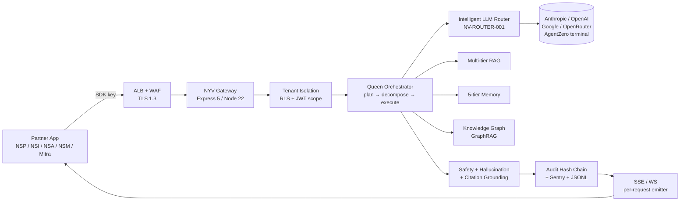
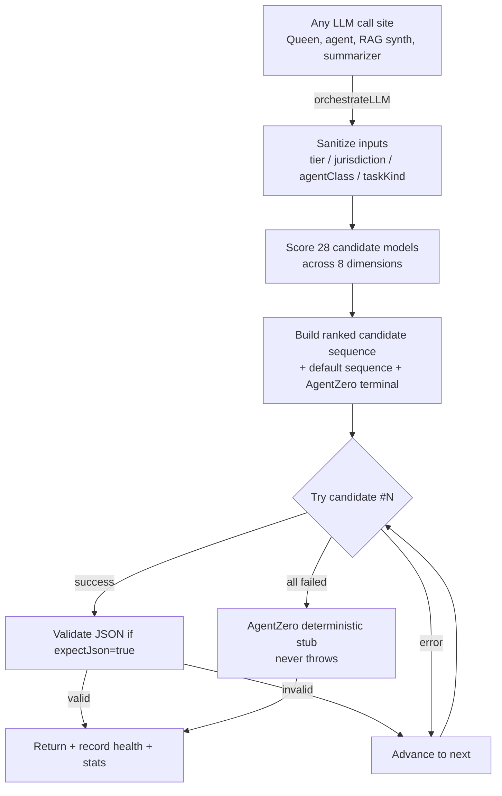
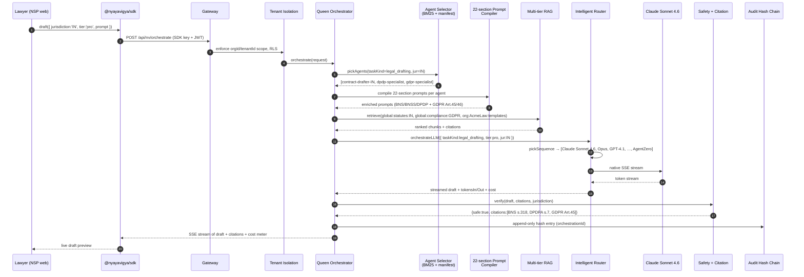
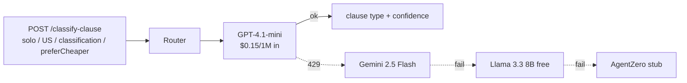
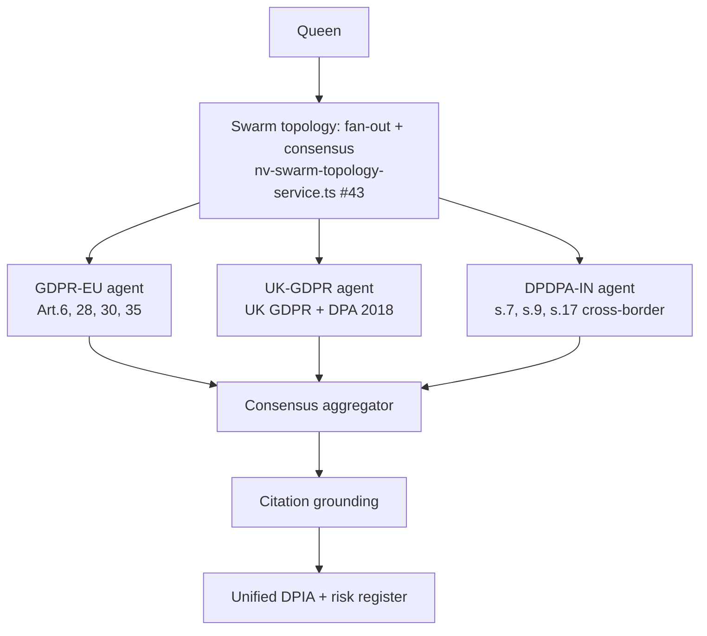
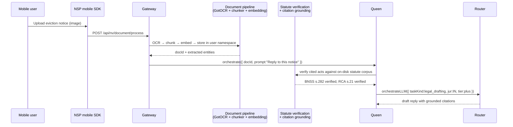
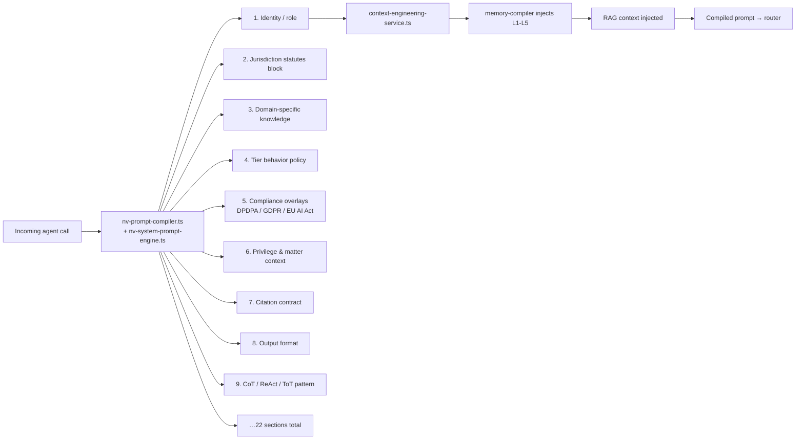
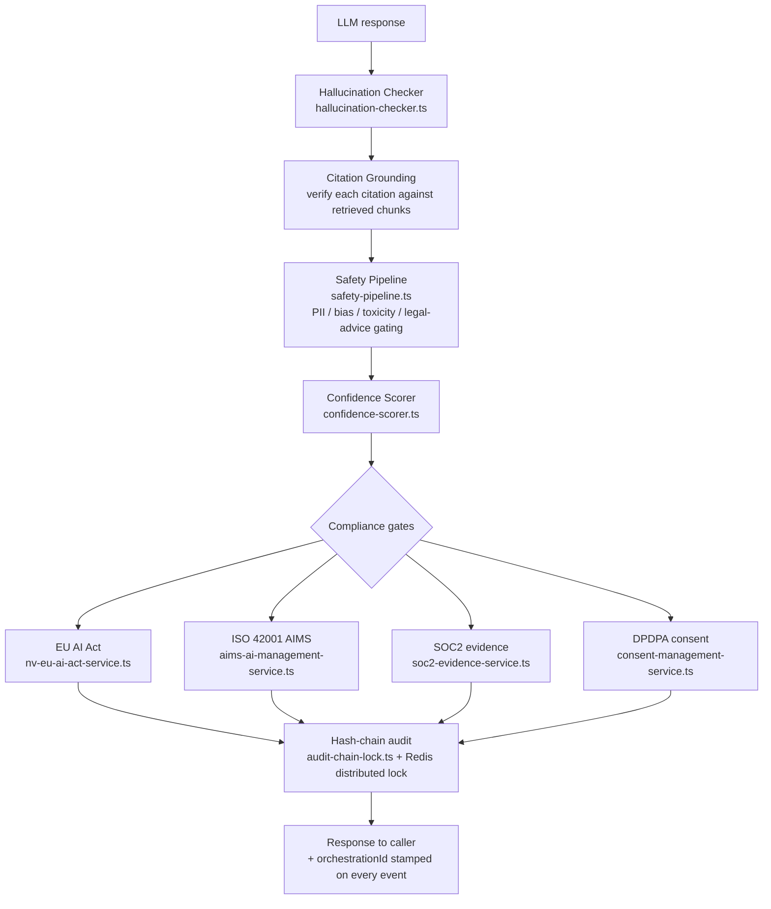

# Nyayavigya Platform — Architecture & User-Flow Reference (v3.1.2)

> ⚠️ **Status: WORK-IN-PROGRESS (live audit 2026-04-27).** The orchestration + router wiring described here is **live in code** (gateway healthy, NV-ROUTER-001 emitting `llm-orchestrator: success` for Anthropic Claude Sonnet 4.6 in dev-edge logs as of 2026-04-27 07:32 UTC). What is **not** live yet is the data plane that the user-flow scenarios depend on: `knowledge_chunks` / `rag_namespaces` / `nv_legal_templates` / `nv_organizations` / `nv_audit_logs` are **all empty** in dev-edge RDS, and `public.nv_pii_vault` does not exist. End-to-end scenarios (§4.1 contract drafting, §4.2 UK litigation, etc.) cannot complete with grounded citations against an empty RAG store. Reality snapshot: [`NYV-LIVE-AUDIT-GAP-REPORT-2026-04-27.md`](../NYV-LIVE-AUDIT-GAP-REPORT-2026-04-27.md).

**Audience.** Engineering leads, partner-platform integrators, SME reviewers,
auditors. This document describes how the platform processes a legal request
end-to-end — every intelligent module, every guardrail, every fallback — and
shows the same flow from the partner-SDK perspective so an integrator can
predict what happens to a user query before it ever fires.

**Why this exists.** The platform now has a single LLM orchestration entry
point (NV-ROUTER-001) plus 80+ supporting services. This doc is the map.

---

## 1. The 30-second mental model

> Every request from any of the 5 partner apps (Nyayamitra, NSP, NSI, NSA,
> NSM) lands at the gateway, gets enriched with tenant + jurisdiction +
> compliance context, is decomposed into agent steps by the **Queen
> orchestrator**, each step pulls retrieved evidence from the **multi-tier
> RAG** + **5-tier memory** + **knowledge graph**, the chosen agents run a
> **22-section Parlant prompt** through the **unified intelligent LLM
> router** (Claude-first for legal/drafting at pro+ tiers, AgentZero terminal
> never-fail), the answer is checked by **safety + hallucination + citation
> grounding**, audit-chained, optionally **streamed** back token-by-token,
> and metered for billing.



---

## 2. The seven layers of the platform

| # | Layer | Modules / files | Purpose |
|---|---|---|---|
| 1 | **Edge** | AWS ALB + WAF (count→block), Route53 wildcard, ACM TLS 1.3 | Partner traffic ingress, DDoS, geo-blocking. |
| 2 | **Gateway** | `src/index.ts`, `src/middleware/*`, `nv-tenant-isolation`, `nv-rate-limit-tier`, `nv-guardrails-enforcement` | Auth (SDK key + JWT), org/tenant scoping, tier-based concurrency, request shaping. |
| 3 | **Orchestration** | `src/orchestration/queen-orchestrator.ts`, `nv-queen-orchestrator.ts`, `dag-orchestration-service.ts`, `hierarchical-task-allocator.ts`, `nv-swarm-topology-service.ts` (107 topologies) | Plan a query → pick a topology → decompose into agent calls → execute in serial/parallel/DAG. |
| 4 | **Agents & prompts** | `src/data/jurisdiction-registries/*.json` (1,043 ROMA L5 agents across 7 jurisdictions), `nv-system-prompt-engine.ts` (22-section prompts), `agent-persona-service.ts`, `agent-registry-service.ts`, `bm25-agent-selector.ts`, `agent-orchestration.ts` | Pick the right specialist for the matter, compile its 22-section Parlant prompt at runtime. |
| 5 | **LLM execution** | `src/services/intelligent-router/*` (NV-ROUTER-001) — `intelligent-router.ts`, `llm-orchestrator.ts`, `model-catalog.ts` (28 models / 5 providers), `default-sequences.ts`, `health-tracker.ts`, `router-stats.ts`, `router-types.ts` | THE single LLM entry point. Picks best model per call, cascades on failure, terminates in AgentZero. True provider-side streaming. |
| 6 | **Knowledge** | `src/services/rag/*` (Adaptive RAG, Corrective RAG, GraphRAG, LightRAG, enhanced pipeline, Qdrant adapter, legal reranker, legal embedding), `src/services/memory/*` (5-tier, graph memory, project memory, tiered storage), `vector-database.ts`, `knowledge-base-system.ts`, `knowledge-module-service.ts` | Retrieval + memory + reranking + citation grounding. |
| 7 | **Safety, compliance, audit** | `safety-pipeline.ts`, `hallucination-checker.ts`, `nyayavigya-citation-grounding-service.ts`, `nv-eu-ai-act-service.ts`, `nv-federated-privacy-service.ts`, `nv-pqc-service.ts`, `audit-chain-lock.ts`, `hash-chain-verifier.ts`, `consent-management-service.ts`, `field-encryption-service.ts`, `soc2-evidence-service.ts`, `aims-ai-management-service.ts`, `eu-ai-act-compliance-service.ts` | ISO 42001 AIMS, ISO 27001-aligned controls, SOC2 evidence, DPDPA, GDPR (EU/UK), EU AI Act conformity. |

---

## 3. The unified intelligent router (NV-ROUTER-001)

This is the **only** path through which any LLM call leaves the platform.
Even when a caller pins a model or provider, that pin is forwarded as
`preferredModels` so the router still applies health-aware cascading and
the AgentZero terminal fallback. The architect-flagged legacy bypass in
`real-llm-service.ts` was closed in this revision.



### 3.1 Scoring dimensions

```text
total = ctxFitScore         // does the model's context window fit prompt+output?
      + costFitScore        // is the call within maxCostUsd? cheaper = better
      + capabilityScore     // vision/json/streaming/reasoning required?
      + jurisdictionFitScore// per-model 0-100 fit per jurisdiction
      + tierFitScore        // free/solo prefer cheap+free, pro+ prefer paid
      + legalAffinityScore  // Claude bias for legal/drafting/CoT at pro+
      + preferredListBoost  // caller-supplied hints (incl. forwarded pins)
      + speedScore          // weighted by preferCheaper
      + healthBoost         // sick model (≥50% failures) → -100 (circuit breaker)
```

### 3.2 Default sequences (used when inputs are incomplete)

| Tier × Class | Primary → … → Terminal |
|---|---|
| Pro / Enterprise / Superadmin × legal | Claude Sonnet 4.6 → Claude Opus 4.6 → GPT-4.1 → Gemini 2.5 Pro → Llama 3.3 70B (free) → AgentZero |
| Pro × CoT/reasoning | Claude Sonnet 4.6 → o3 → o4-mini → DeepSeek-R1 → AgentZero |
| Solo × classification (preferCheaper) | GPT-4.1-mini → Gemini 2.5 Flash → Llama 3.3 8B (free) → AgentZero |
| Free × any | Llama 3.3 70B (free) → Nemotron Nano (free) → Gemma 4 (free) → AgentZero |

### 3.3 Health tracker — what makes a model "sick"

Per-model cumulative success/failure counters in `health-tracker.ts`,
combined with a 5-minute staleness window and a 60-second recovery probe:

| Condition | Health score | Effect on router score |
|---|---|---|
| Never called or no data | 1.0 | +8 |
| Cumulative failure rate ≥ 50% AND last failure < 60s ago | 0.05 | **−100 (circuit-breaker)** |
| Cumulative failure rate ≥ 50% AND last failure ≥ 60s ago | 0.4 | −1.6 |
| Last success > 5 min ago AND last failure > 60s ago | 0.7 | +3.2 |
| Otherwise | max(0.5, 1 − failureRate) | proportional |

The model in the −100 bucket still stays in the candidate sequence as a
late-position fallback, so the next request that runs it acts as the
recovery probe. A successful probe returns the score to the proportional
range and the model can win the primary slot again on the request after.

### 3.4 Provider-side streaming (this revision)

`streamLLM` now opens a real SSE connection to Anthropic, OpenAI, Google,
or OpenRouter, parses the deltas natively, and yields tokens as they
arrive. If a model fails before emitting any token, the stream advances
to the next candidate transparently. If it fails mid-stream, the client
receives a `[STREAM_INTERRUPTED:<modelId>]` marker so the UI can offer a
retry — splicing a fresh model mid-answer would garble the response.

---

## 4. End-to-end legal scenarios

Each scenario shows the partner request, the orchestration steps, and the
intelligent modules invoked.

### 4.1 Scenario A — Indian contract drafting (`pro` tier)

> **Partner SDK:** NSP web. **Tenant:** "AcmeLaw IN". **User prompt:**
> "Draft a SaaS MSA for an Indian SaaS company licensing to a US enterprise
> with DPDP + GDPR data-protection schedules."



### 4.2 Scenario B — UK litigation strategy (`enterprise`, CoT, requireReasoning)

```mermaid
sequenceDiagram
    autonumber
    participant U as Senior Partner (NSI)
    participant Q as Queen
    participant ROUT as Router
    participant R1 as Claude Sonnet 4.6 (1st)
    participant R2 as o3 (fallback if R1 5xx)
    participant CRAG as Corrective RAG
    participant WEB as Web Search Tool

    U->>Q: "Strategy for IP infringement claim in EWHC, claimant non-domiciled"
    Q->>CRAG: retrieve(UK precedents, OSCOLA citations)
    CRAG->>CRAG: grade chunks; low quality → trigger web search
    CRAG->>WEB: search(BAILII, recent EWHC IP)
    WEB-->>CRAG: 3 fresh judgments (2025-2026)
    CRAG-->>Q: graded + reranked context
    Q->>ROUT: orchestrateLLM({ tier:enterprise, jur:UK, taskKind:chain_of_thought, requireReasoning:true })
    ROUT->>R1: native SSE
    R1-->>ROUT: 5xx after 2s, no tokens emitted
    ROUT->>R2: cascade to o3
    R2-->>ROUT: token stream (CoT visible)
    ROUT-->>Q: strategy memo + citations
```

### 4.3 Scenario C — US classification + extraction (`solo`, preferCheaper)

Cheap-first path — never reaches Claude unless the cheaper models fail.



### 4.4 Scenario D — EU GDPR DPIA (multi-jurisdiction, `pro`)

Cross-border data flows: EU controller, India processor, UK joint controller.
Three jurisdiction agents run in parallel under a fan-out swarm topology.



### 4.5 Scenario E — Document parse + statute lookup + drafting (NSP mobile)



---

## 5. Multi-tier memory + RAG topology

```mermaid
flowchart LR
  subgraph Memory["5-tier Memory (nv-5tier-memory-service.ts)"]
    L1[L1 Working<br/>in-process Map<br/>≤30s TTL]
    L2[L2 Session<br/>Redis<br/>≤1h TTL]
    L3[L3 Project<br/>RDS Postgres<br/>per-matter]
    L4[L4 Org<br/>RDS + RLS<br/>tenant-scoped]
    L5[L5 Knowledge Graph<br/>graph-memory-service.ts<br/>cross-matter relationships]
  end
  subgraph RAG["RAG variants (src/services/rag/)"]
    Adp[Adaptive RAG]
    Crg[Corrective RAG<br/>+ web fallback]
    Lgt[LightRAG]
    Grr[GraphRAG Legal]
    Enh[Enhanced pipeline<br/>vector+BM25 hybrid]
  end
  Memory --> RAG
  RAG --> Reranker[Legal Reranker<br/>nv-legal-reranker-service.ts]
  Reranker --> Cite[Citation Grounding<br/>nyayavigya-citation-grounding-service.ts]
  Cite --> Out[Pre-LLM context block<br/>injected into 22-section prompt]
```



**Namespaces (per-user/per-org isolation):**

- `global:statutes:{IN|UK|US|EU|GCC|SG}` — read-only, platform-shared
- `global:compliance:{GDPR|DPDPA|CCPA|HIPAA|EU-AI-Act|…}`
- `org:{orgId}:shared` — org-shared templates, playbooks
- `user:{orgId}:{userId}:docs` — personal lawyer documents
- `user:{orgId}:{userId}:matters:{matterId}` — matter-scoped chunks

---

## 6. Agent system: 1,043 agents × 22-section prompts × 107 topologies

| Asset | Where | Count |
|---|---|---|
| ROMA L5 agents | `src/data/jurisdiction-registries/*.json` | 1,043 across 7 jurisdictions |
| Jurisdictions | IN, UK, US, EU, GCC, SG, Default | 7 |
| Constitution + 29-section legal corpus | India: BNS/BNSS/BSA/CPC/DPDPA/IT Act + 29 amendment volumes; mirrored modules per jurisdiction | 6 jurisdictions deep |
| 22-section Parlant prompts | `nv-system-prompt-engine.ts` (`SUPPORTED_LANGUAGES_14`, `JURISDICTION_STATUTES`, role/tier/security/quantum/etc. sections) | 22 sections per agent |
| Swarm topologies | `nv-swarm-topology-service.ts` | 107 (Linear 10, Fan-out 8, Hierarchical 12, Round-Robin 6, Competitive 8, Consensus 10, Iterative 8, Specialized 12, Hybrid 15, Quantum-Ready 8, ROMA L5 10) |
| Languages | English + 13 Indian + Arabic + EU set | 14+ |

---

## 7. Prompt + context engineering layer



**Reasoning patterns supported:** Chain-of-Thought (CoT), Tree-of-Thoughts
(ToT), ReAct, Reflexion, Parlant directives, Plan-and-Solve, Self-Consistency,
Verbalized Sampling (`verbalized-sampling-service.ts`), Smart-Thinking-Engine
(`nv-smart-thinking-engine.ts`).

---

## 8. Safety, compliance & audit pipeline



**Compliance posture (current state):**

| Framework | Status | Owning module |
|---|---|---|
| ISO/IEC 42001 (AIMS) | Implemented; evidence packs generated | `aims-ai-management-service.ts` |
| ISO/IEC 27001-aligned controls | Implemented (encryption at rest, RLS, TLS 1.3, audit trail, access controls) | `field-encryption-service.ts`, `audit-chain-lock.ts`, `rbac-service.ts` |
| SOC 2 Type II | Evidence collection wired; ongoing observation period | `soc2-evidence-service.ts` |
| DPDPA 2023 (India) | Consent + DPBI breach notification + data fiduciary mode | `consent-management-service.ts` |
| GDPR (EU) + UK GDPR / DPA 2018 | Lawful basis, DSR endpoints, DPIA template | DPDPA forms (P0 fix tracked as #48) + `consent-management-service.ts` |
| EU AI Act 2024 | Article 6 high-risk system classification, conformity logger | `nv-eu-ai-act-service.ts`, `eu-ai-act-compliance-service.ts` |
| Federated privacy + PQC | ML-KEM + ML-DSA scaffolding for post-quantum | `nv-federated-privacy-service.ts`, `nv-pqc-service.ts` |
| Tenant isolation | Native Postgres RLS + middleware enforcement (RLS not yet enforcing in prod — task #42) | `nv-tenant-isolation`, RLS migration 0004 |

---

## 9. Knowledge tools & web intelligence

| Tool | File | What it does |
|---|---|---|
| Legal web search | `nyayavigya-legal-web-search-service.ts`, `enterprise-platform/real-web-search-service.ts` | Real web search across BAILII, IndianKanoon, EUR-Lex, SCOTUSblog, etc. |
| Web scraping | `web-scraping.ts` | On-demand scrape with PDF/HTML extraction. |
| Statute verification | `nyayavigya-statute-verification-service.ts` | Verify cited acts against on-disk statute corpus. |
| Citation grounding | `nyayavigya-citation-grounding-service.ts` | Verify each citation maps to a real source chunk. |
| OCR (legal) | `nyayavigya-enhanced-ocr-service.ts`, `nv-got-ocr-adapter-service.ts` | Court-grade OCR including handwritten, multi-column, tables. |
| Document templates | `nyayavigya-document-templates-service.ts` | Per-jurisdiction template library. |
| Domain research | `enterprise-platform/domain-research-api-service.ts` | Multi-source domain investigation. |
| Investment / financial | `enterprise-platform/investment-research-service.ts`, `enterprise-platform/real-financial-data-service.ts` | M&A / corporate finance support. |
| Regulatory monitor | `regulatory-monitor/regulatory-monitor-service.ts`, `intelligence/nv-regulatory-intelligence-service.ts` | Daily new-statute / amendment polling. |
| Amendment impact | `intelligence/nv-amendment-impact-service.ts` | Computes blast radius of a new amendment across the matter book. |
| Conflict detector | `intelligence/nv-conflict-detector-service.ts` | Detects internal contradictions across documents in a matter. |
| Litigation risk v2 | `intelligence/nv-litigation-risk-v2-service.ts` | Predictive risk score per pleading / contract clause. |
| Precedent similarity | `intelligence/nv-precedent-similarity-service.ts` | Vector + entity-graph similarity to precedent set. |

---

## 10. Built but not (yet) wired into the gateway request path

These exist as fully-functional services but are not on the default
`/api/nv/orchestrate` path. They are the highest-leverage backlog.

| Module | File | Status | Wire-in target |
|---|---|---|---|
| Adaptive RAG | `services/rag/adaptive-rag-service.ts` | Built; only called by internal SDK helper | Default RAG layer in Queen for all `legal_research` + `precedent` tasks. |
| Corrective RAG | `services/rag/corrective-rag-service.ts` | Built; not on gateway path | Auto-trigger when retrieval grade < 0.6, with web fallback. |
| GRPO optimization | `services/grpo-optimization-service.ts` | Built; called from one SDK route | Wire to admin Legal Chat for SME RLHF feedback loop. |
| DAG orchestration | `services/dag-orchestration-service.ts` | Built; imported but no execution endpoint | Replace ad-hoc `Promise.all` decomposition with declarative DAGs. |
| Verbalized sampling | `services/verbalized-sampling-service.ts` | Built; no callers | Wrap router for high-stakes drafting → produces self-consistency sample. |
| Safety pipeline (full) | `services/safety-pipeline.ts` | Built; partially superseded by middleware | Plug into post-orchestrator response phase as the canonical safety verdict. |
| 5-tier memory | `services/memory/nv-5tier-memory-service.ts` | Built; primary memory uses older service | Replace `nv-memory-service.ts` reads/writes. |
| Graph memory | `services/memory/graph-memory-service.ts` | Built; not on Queen path | Inject into Queen between RAG and prompt compilation for cross-matter linking. |
| Agent testing framework | `services/testing/nv-agent-testing-framework.ts` | Admin-only route exists | Schedule nightly oracle runs in CI; surface in dashboard. |
| LLM-as-judge | `services/testing/nv-llm-judge-service.ts` | Built | Wire into the Legal Chat dashboard for SME quality grading. |
| Skills system | `services/skills/skills-system-service.ts` | Built | Make skills addressable by agents (tool-use loop) inside Queen. |
| Federated privacy + PQC | `services/security/nv-federated-privacy-service.ts`, `nv-pqc-service.ts` | Built | Optional per-tenant feature flag for `enterprise+` clients. |

---

## 11. Routes mounted in `src/index.ts` (today)

| Path prefix | Router | Notes |
|---|---|---|
| `/api/nv/health` | health | Always-on, used by ALB. |
| `/api/nv/auth`, `/api/nv/api-keys` | auth + key issuance | JWT + SDK key. |
| `/api/nv/gateway` | `sdkGatewayRoutes` | Primary partner SDK entry. |
| `/api/nv/orchestrate` | `nvOrchestrationRouter` | Queen entry. |
| `/api/nv/stream` | `nvAguiStreamRouter` | SSE for live answers. |
| `/api/nv/observability/router-stats[/recent\|/catalog\|/explain]` | `nvRouterStatsRouter` | NV-ROUTER-001 visibility. |
| `/api/nv/intelligence` | `nvIntelligenceRouter` | Conflict/Amendment/Risk/Precedent. |
| `/api/nv/agents` | `agentRouter` | List + describe + invoke. |
| `/api/nv/jurisdiction` | `jurisdictionRouter` | Per-jurisdiction agent registries. |
| `/api/nv/rag` | `nvRagRouter` | Direct RAG queries (admin/SME). |
| `/api/nv/testing` | `nvTestingRouter` | Oracle harness, agent UAT. |
| `/api/nv/compliance` | `nvComplianceRouter` | DSR / consent / DPIA / SOC2 evidence. |
| `/api/nv/clawdbot`, `/openbot`, `/automateai`, `/twindesk` | per-product routers | Specialized verticals. |

---

## 12. Future-proofing notes

- **Streaming.** Now genuinely SSE, including cascading on pre-token failures.
  Mid-stream failures emit a clean interruption marker.
- **Health-aware routing.** Sick models (≥50% recent failure) cannot win
  primary even with maximum legal-affinity boost. Verified by unit test #13.
- **Reproducible builds.** `.dockerignore` added so EC2 `docker compose
  build` no longer ships stale source.
- **Single LLM entry point.** `real-llm-service.ts` always routes through
  `orchestrateLLM`, even for pinned-provider calls. AgentZero terminal
  fallback applies universally.
- **Observability.** `/api/nv/observability/router-stats[/recent|/catalog|
  /explain]` exposes ranked sequences, recent decisions, and per-model
  health. Stats include cost, fallback level, and latency.
