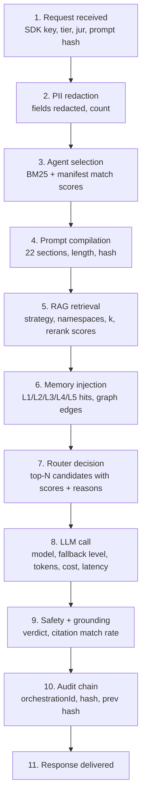
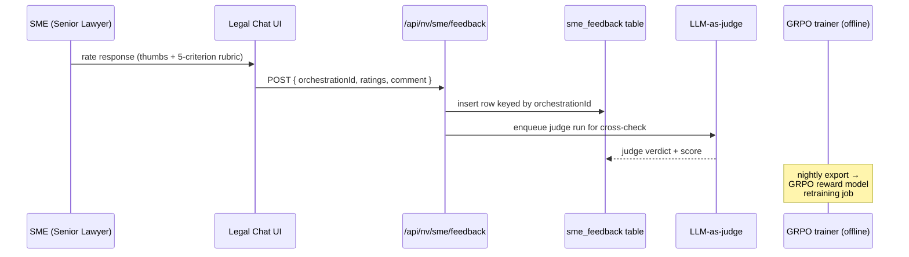

# Nyayavigya Console — "Legal Chat" Tool & Workflow Visualizer Plan

**Audience.** Console (admin dashboard) engineers, SME reviewers, the
person who will pick up this work next.
**Goal.** A single dashboard tool that lets an admin / SME exercise every
agent + RAG + memory + LLM router feature on real legal inputs, watch the
orchestration steps live, rate the answer, and have those ratings flow into
GRPO training data — so we can beat Claude Legal Chat on internal
benchmarks before exposing the same surface to enterprise customers.

This document is the implementation plan only. The platform-side wiring
(Adaptive/Corrective RAG, 5-tier memory, safety pipeline, LLM-judge) is
covered in [`NYV-NEXT-PROJECT-PLAN-2026-Q3-Q4.md`](./NYV-NEXT-PROJECT-PLAN-2026-Q3-Q4.md)
Track A. This tool consumes those endpoints once they exist.

---

## 1. Why we need this

- The platform has 1,042 agents × 6 jurisdictions × 28 models × 107 swarm
  topologies × 5 RAG variants × 5 memory tiers. Today no single screen
  exercises that surface end-to-end.
- SMEs (senior lawyers) currently have no way to give us per-response
  feedback that actually flows into our GRPO + retrieval training. That
  is the largest blocker on legal quality vs Claude.
- Enterprise prospects want a "show me the pipeline" tool before they
  commit. Today we hand them a doc; this gives them a live demo.

---

## 2. The two surfaces

### 2.1 Legal Chat (left pane)

Conversational tool with rich left-rail controls:

- **Document uploads.** Drag-drop one or many files (PDF, DOCX, image,
  email .eml). Stored under the SME user namespace; chunked and embedded
  via the document pipeline; visible as chips above the input.
- **Jurisdiction picker.** Multi-select: IN, UK, US, EU, GCC, SG, GLOBAL.
  Cross-border requests fan out to multiple jurisdiction agents.
- **Tier override.** free / solo / plus / pro / enterprise / superadmin.
  Drives router scoring + tier-fit.
- **Agent selector.** Search-as-you-type over the 1,042 agents in the
  jurisdiction registries. Multi-select; if empty, the agent selector
  picks for you.
- **Model preferences.** Pin a model (forwarded as `preferredModels` to
  the router) or pin a provider; advanced toggles for `preferCheaper`,
  `requireReasoning`, `requireJson`, `requireVision`.
- **Swarm topology picker.** Optional. Defaults to the topology the
  Queen would pick on its own.
- **Mode.** Chat / Drafting / Document Q&A / Statute Lookup / Compliance
  Review / Litigation Strategy.
- **Stream toggle.** SSE on/off. Defaults on.

The chat UI itself is standard but renders inline citations as clickable
chips that pop the source chunk in a side drawer.

### 2.2 Workflow Visualizer (right pane)

Live, real-time view of every step the platform takes for the current
request. Powered by the per-request event stream that the per-request
emitter from **Task #64 (merged)** unblocked, surfaced through the
roadmap-task-D timeline endpoint
(`/api/nv/orchestrate/timeline/:orchestrationId`). Phase 1 of this
dashboard is therefore unblocked on the streaming-emitter axis — the
remaining dependency is the timeline endpoint itself, which is part of
Track D in the next-project-plan.

Each step is a card with:

- Status (`pending` / `running` / `ok` / `failed` / `skipped`).
- Duration ms.
- Expandable JSON payload (the actual emitter event).
- For RAG: list of retrieved chunks with relevance scores.
- For Router: the ranked sequence with per-model score breakdown
  (`ctx`, `cost`, `cap`, `jur`, `tier`, `legal`, `prefList`, `speed`,
  `health`).
- For LLM: streaming token count + tokens-per-second meter.
- For Safety: verdict + which rule fired.
- For Audit: hash + prev hash with chain-link icon.

A "Replay" button on the visualizer re-runs the same orchestration with
identical inputs so SMEs can compare alternate model picks.

---

## 3. SME feedback loop (Phase 2)

**Rubric (5 criteria, each 1–5):**

| # | Criterion | What "5" looks like |
|---|---|---|
| 1 | Legal accuracy | All cited statutes / precedents are real and apply correctly. |
| 2 | Jurisdictional fit | Uses the right court hierarchy, currency, citation format. |
| 3 | Drafting quality | Reads like a senior associate's draft; correct register, structure, clauses. |
| 4 | Citation grounding | Every citation maps to a real source we showed the model. |
| 5 | Reasoning depth | CoT visible where appropriate; no hand-waving. |

A free-text comment box per rating. Optional "preferred response" if SME
runs the same prompt with a different model — both responses get stored
as a preference pair (the format GRPO needs).

---

## 4. Component / file plan

| Path | Purpose |
|---|---|
| `client/src/pages/admin/LegalChatPage.tsx` | Top-level page, two-pane layout. |
| `client/src/features/legal-chat/ChatPane.tsx` | Left pane: messages + composer. |
| `client/src/features/legal-chat/Sidebar.tsx` | Jurisdiction / tier / agent / model selectors + uploads. |
| `client/src/features/legal-chat/WorkflowPane.tsx` | Right pane: timeline visualizer. |
| `client/src/features/legal-chat/StepCard.tsx` | Single timeline card. |
| `client/src/features/legal-chat/RubricModal.tsx` | SME rating modal. |
| `client/src/hooks/useOrchestrationStream.ts` | SSE wrapper. |
| `client/src/hooks/useTimelineStream.ts` | Connects to `/api/nv/orchestrate/timeline/:id`. |
| `client/src/api/legal-chat.ts` | Typed API client. |
| `src/routes/nv-legal-chat-routes.ts` | New router: `/api/nv/legal-chat/*` for upload + send + rate + replay. |
| `src/routes/nv-sme-feedback-routes.ts` | New: `/api/nv/sme/feedback`. |
| `src/db/schema/sme_feedback.ts` | New table (Drizzle). |
| `src/services/legal-chat-service.ts` | Glue between dashboard and orchestrator/Queen. |

---

## 5. Phased delivery

### Phase 1 — "It works" (1 task agent, ~1 merge)

- Sidebar selectors (jurisdiction / tier / agent / model / mode).
- Document upload → pipeline → user namespace.
- Send message → orchestrate → SSE response with inline citations.
- Right-pane shows the steps as they happen using the per-request
  emitter (no replay yet, no rating yet).

**Acceptance.** An SME can: upload 3 docs, type "Draft me a reply to
this notice under BNSS s.282 with DPDPA carve-outs", select tier=pro,
agent=contract-drafter-IN, model=auto, watch the workflow visualizer,
and receive a streamed answer with clickable citations.

### Phase 2 — "It learns" (1 task agent, ~1 merge)

- Rubric modal after each response.
- `sme_feedback` table + endpoint.
- LLM-as-judge cross-check on every rated response (writes alongside
  the SME rating, not replacing it).
- Replay button re-runs the same prompt with a different model and
  stores both as a preference pair.
- Daily export to S3 of the GRPO-ready preference dataset.

**Acceptance.** SME ratings persist; an export job produces a JSONL
file that the offline GRPO retrainer accepts.

### Phase 3 — "It graduates" (smaller follow-up)

- Read-only customer-facing version of the workflow visualizer in
  enterprise tier (pipeline transparency as a sales feature).
- Public-facing rate-limited demo with PII guardrails.

---

## 6. Permissions & isolation

- Tool only visible behind RBAC role `console:legal_chat` (SME +
  superadmin).
- Uploaded documents land in the SME's own
  `user:{orgId}:{userId}:matters:legal-chat` namespace; tenant isolation
  middleware enforces RLS.
- Audit chain entries tag every Legal Chat call with
  `source: "console:legal-chat"` so the data set is filterable.
- SME feedback rows are not exposed back into customer-facing analytics.

---

## 7. Open questions for the user

- **Should the SME rating UI also let the SME edit the response in place
  before saving the preferred version?** That would give us the cleanest
  preference-pair signal; defaults to no until confirmed.
- **For Phase 3, what is the cap on the public-facing demo?** Suggest
  free tier limits (≤10 calls / IP / day, ≤200 tokens output).
- **Do we want an "expert ensemble" mode** where the same query runs
  through 3 different jurisdiction agents in parallel and the workflow
  visualizer shows all three chains side-by-side? (Easy if A4 DAG
  orchestration lands first.)
