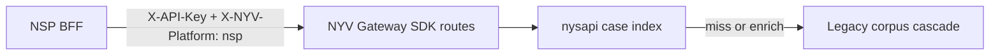
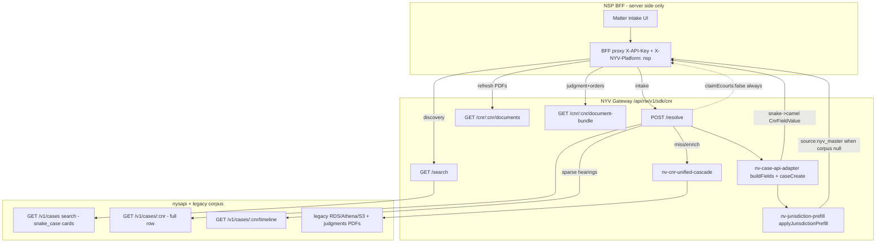
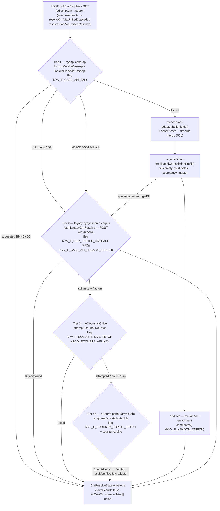

# NSP Case Search & Matter Discovery — Integration Handoff

**Audience:** NSP backend (BFF), mobile/web engineers, product & QA  
**Product:** Matter discovery and autofill for Indian courts (Supreme Court diary, High Court CNR, District Court CNR / filing reference)  
**API base (production):** `https://api.nyayasiddhi.online`  
**Client SDK:** `@nyayavigya/client-sdk` **5.2.0** (`CnrApi.search`, `CnrApi.resolve`, `CnrApi.documentBundle`) — **56** resolve keys (gap closure `NV-CASE-CORPUS-FIELD-GAP-CLOSURE-001`: `linkedMatters`, `incidentDate`, `caseTypeDisplay`, `courtCode`, `complexCode`, optional `nspParseGuide`)  
**Live integration stamp:** deploy `2026-09-27T1942Z-aws-ssm-14f68697` sha `14f686974` (Session-79 gap closure on nysdev + Session-80 docparse flag ship; supersedes `2026-09-25T0758Z-aws-ssm-5417fb15`). **Latest status brief: §17; parse contract: §21; gap closure: §22.** **56-field NSP showcase checklist + NyayaSearch SSOT: [`NSP-56-FIELD-CORPUS-SHOWCASE-2026-10.md`](./NSP-56-FIELD-CORPUS-SHOWCASE-2026-10.md).**

> **Scope of this document:** Case **search**, **resolve**, and **documents** for matter intake. This is the **NSP handoff SSoT** — see **§11 field catalog** (value vs field, every resolve key), **§12** search-raw vs resolve-normalized, **§13** structured sub-objects, **§16** master-data–derivable enrichment. For **orchestrate / AI taskType routing**, see `[NSP-NYV-AI-TASK-SURFACE-2026-09.md](./NSP-NYV-AI-TASK-SURFACE-2026-09.md)`. For drafting, filing book, and intelligence SDK routes, see `[NSP-LEGAL-INTELLIGENCE-SDK-SURFACE-2026-08.md](./NSP-LEGAL-INTELLIGENCE-SDK-SURFACE-2026-08.md)`. For a shorter endpoint cheat sheet, see `[NSP-CNR-DIARY-ONE-PAGER-2026-09.md](./NSP-CNR-DIARY-ONE-PAGER-2026-09.md)`. Master-data proposal: `[NYV-CASE-CORPUS-FIELD-GAP-PLAN-2026-09.md](./NYV-CASE-CORPUS-FIELD-GAP-PLAN-2026-09.md)` **Appendix F**. **Docparse LLM backup** on gateway is flag-gated — `NYV_F_DOCPARSE_LLM_FALLBACK` **default OFF** (absent on nysdev canonical env as of deploy `14f686974`); deterministic `@nyv/docparse` path unchanged when OFF.

---


## 1. Purpose & scope

NSP helps lawyers **find a matter** in indexed court records and **prefill** a new matter from corpus metadata and judgment PDFs.


| In scope                                                                 | Out of scope (this integration)                                                                                             |
| ------------------------------------------------------------------------ | --------------------------------------------------------------------------------------------------------------------------- |
| Party/diary/CNR/filing-ref **search** via NYV SDK                        | Calling **nysapi**, RDS, S3, or Athena from the browser or NSP client                                                       |
| **Resolve** by unified `identifier` (SC diary, HC/DC CNR, DC filing ref) | Live **eCourts** docket (`claimEcourts` is always **false**)                                                                |
| Presigned **judgment/order PDFs** (900s TTL)                             | Judgment **full-text research** (`GET /api/nv/knowledge/caselaw/search` — separate product surface)                         |
| Honest **field manifest** for partial corpus                             | **Sort**, `case_status` **filter**, and true **decision/filing date ranges** on search until NYS publishes them on case-api |


**Hard rule:** All corpus access goes through **NYV SDK routes** with `X-API-Key` on the **NSP BFF only**. Never expose the SDK key to end-user devices.

---


## 2. Architecture (simple)




1. **Primary:** Indexed case-api (**nysapi**) for search and first-pass resolve.
2. **Fallback:** When the index misses or needs enrichment, NYV runs an internal **legacy cascade** (judgment corpus, timelines, presigned docs). NSP does not configure or call this tier directly.
3. **Not live registry:** Data is **judgment corpus + indexed metadata**, not the live court portal. Every successful envelope includes `claimEcourts: false`.

NSP should label matters as **“Indexed court records”** or **“Judgment corpus”**, not “Live eCourts” or “Official docket sync.”

---


## 3. Authentication & partner headers


| Header                           | Required                                                                                                                                                                                                                                                                                                                                                                                                                                                                                                                                                                                                                                                                                                                                                                                                                                                                                                                                                                                                                                                                                                                                                                                                                                                                                                                                                                                                                                                                       | Purpose                                 |
| -------------------------------- | ------------------------------------------------------------------------------------------------------------------------------------------------------------------------------------------------------------------------------------------------------------------------------------------------------------------------------------------------------------------------------------------------------------------------------------------------------------------------------------------------------------------------------------------------------------------------------------------------------------------------------------------------------------------------------------------------------------------------------------------------------------------------------------------------------------------------------------------------------------------------------------------------------------------------------------------------------------------------------------------------------------------------------------------------------------------------------------------------------------------------------------------------------------------------------------------------------------------------------------------------------------------------------------------------------------------------------------------------------------------------------------------------------------------------------------------------------------------------------ | --------------------------------------- |
| `X-API-Key`                      | Yes (BFF)                                                                                                                                                                                                                                                                                                                                                                                                                                                                                                                                                                                                                                                                                                                                                                                                                                                                                                                                                                                                                                                                                                                                                                                                                                                                                                                                                                                                                                                                      | NSP platform SDK key — server-side only |
| `Content-Type: application/json` | POST resolve                                                                                                                                                                                                                                                                                                                                                                                                                                                                                                                                                                                                                                                                                                                                                                                                                                                                                                                                                                                                                                                                                                                                                                                                                                                                                                                                                                                                                                                                   | JSON body                               |
| `X-NYV-Platform: nsp`            | **Recommended**---4. API flowsBase path prefix: `/api/nv/v1/sdk/cnr`4.1 Search — `GET /search`**Purpose:** Matter **discovery** (pick a row, then resolve). `court_type` **is required** (400 if omitted).**Supported query parameters** (NYV forwards to case-api; unknown params are dropped):**Legacy date params (compatibility only):** `decision_date_from`, `decision_date_to`, `filing_date_from`, `filing_date_to` — NYV **does not** forward these as date ranges. When a 4-digit year can be inferred, NYV may set `year` instead. Do not build UX that depends on day-level search filters until NYS ships them.**Example request (BFF):**GET /api/nv/v1/sdk/cnr/search?court_type=DC&cnr=TSWL000000742024&page_size=1 X-API-Key: <server-side> X-NYV-Platform: nsp**Example response shape (illustrative — no secrets):**{ "success": true, "claimEcourts": false, "source": "nys-case-api", "data": { "cases": [ { "cnr": "TSWL000000742024", "court_type": "DC", "case_title": "…", "party_petitioner": "…", "party_respondent": "…", "filing_number": "…", "year": "2024" } ], "returned": 1, "page": 1, "page_size": 1, "total": 1, "meta": { "source": "nys-case-api", "latencyMs": 120 } } }**UX flow:** Search → user selects row → `POST /resolve` with `identifier` = row `cnr` (and `options.courtType` if HC/DC ambiguous).**SDK:**const hits = await nyv.cnr.search({ court_type: 'DC', cnr: 'TSWL000000742024', page_size: '1', }); |                                         |


---


### 4.2 Resolve — `POST /resolve`

**Purpose:** **Primary intake** — autofill matter fields, optional PDFs, optional `caseCreate` block for NSP matter schema.

**Body (preferred — unified identifier):**

```json
{
  "identifier": "RJHC010324382023",
  "options": {
    "profile": "caseCreate",
    "includeDocuments": true,
    "includeTimeline": false,
    "courtType": "hc"
  }
}
```

**SC diary (compact or slash):**

```json
{
  "identifier": "173292025",
  "options": {
    "courtType": "sc",
    "includeDocuments": false
  }
}
```

**DC filing reference (search-then-resolve inside NYV — no extra search call from UI):**

```json
{
  "filingNumber": "25600000794",
  "filingYear": "2025",
  "options": {
    "profile": "caseCreate",
    "courtType": "dc"
  }
}
```

Legacy `{ "cnr": "…" }`, `{ "diaryNumber": "…" }` remain accepted.


| Court  | Send                                 | Notes                                                             |
| ------ | ------------------------------------ | ----------------------------------------------------------------- |
| **SC** | Diary `NNNNN/YYYY` or compact digits | `fields.cnr` often empty until judgment links a CNR               |
| **HC** | 16-char CNR (`…HC…`)                 | Re-resolve with `courtType: "hc"` after duplicate picker          |
| **DC** | 16-char CNR or filing ref            | Some CNRs may return `not_found` until corpus backfill catches up |


**Resolve options:**


| Option                  | Values                   | Effect                                                                           |
| ----------------------- | ------------------------ | -------------------------------------------------------------------------------- |
| `profile`               | `default` | `caseCreate` | Adds structured `data.caseCreate` + `fieldManifest`                              |
| `includeDocuments`      | bool (default **true**)  | Inline presigned PDFs in `data.documents[]`; `false` ≈ faster intake             |
| `includeTimeline`       | bool                     | Extra hearings + order PDFs from timeline when corpus is sparse                  |
| `courtType`             | `sc` | `hc` | `dc`       | Required after **suggested** duplicate picker                                    |
| `includeExtractPreview` | bool                     | Snippet from judgment PDF when available (`profile: caseCreate` defaults useful) |


**Example success fragment (**`profile: caseCreate`**):**

```json
{
  "success": true,
  "claimEcourts": false,
  "data": {
    "status": "found",
    "cnr": "RJHC010324382023",
    "fields": {
      "caseTitle": { "value": "…", "confidence": 0.9 },
      "courtName": { "value": "…", "confidence": 0.95 },
      "petitioners": { "value": ["…"], "confidence": 0.85 }
    },
    "documents": [
      {
        "kind": "judgment",
        "url": "https://…",
        "expiresIn": 900
      }
    ],
    "caseCreate": {
      "header": {
        "caseTitle": "…",
        "cnr": "RJHC010324382023",
        "caseStatus": "…"
      },
      "clients": [],
      "opposingParties": [],
      "witnesses": [],
      "fieldManifest": {
        "complete": ["caseTitle", "courtName"],
        "partial": ["nextHearingDate"],
        "missing": [],
        "manualRecommended": ["witnesses"],
        "manualRequired": ["nextHearingDate"]
      }
    },
    "meta": {
      "inferredCourtType": "hc",
      "identifierKind": "cnr",
      "fieldAvailability": { "nextHearingDate": "tier3_required", "witnesses": "manual_required" },
      "betaReadiness": { "edjJobPath": "…" }
    }
  }
}
```

**Status values (HTTP 200 unless validation error):**


| `data.status` | NSP action                                                         |
| ------------- | ------------------------------------------------------------------ |
| `found`       | Map to matter; show corpus disclaimer                              |
| `not_found`   | Manual matter + optional retry later                               |
| `suggested`   | Show `data.candidates[]`; re-resolve with chosen CNR + `courtType` |
| `invalid`     | Fix identifier format                                              |


**Errors (map to partner-safe copy — do not show raw codes in UI):**


| HTTP        | Typical cause                | User-facing direction                    |
| ----------- | ---------------------------- | ---------------------------------------- |
| **422**     | SC case number without diary | Ask for **diary number**                 |
| **400**     | HC/DC diary, bad CNR         | Validation message                       |
| **503/504** | Upstream busy                | Retry with backoff (2s / 4s / 8s, max 3) |


---


### 4.3 Documents

**Paths:**


| When                                  | Route                                                                               |
| ------------------------------------- | ----------------------------------------------------------------------------------- |
| Resolve with `includeDocuments: true` | PDFs in `data.documents[]`                                                          |
| Resolve skipped docs                  | `GET …/cnr/{cnr}/documents`                                                         |
| Judgment + orders bundle              | `GET …/cnr/{cnr}/document-bundle?includeTimelineOrders=true` (optional `courtType`) |


**TTL:** Presigned URLs expire in **900 seconds**. Refresh via document-bundle (NYV regenerates presigned URLs) or re-resolve before opening PDFs in the client.

**Example document object:**

```json
{
  "id": "…",
  "kind": "judgment",
  "title": "…",
  "url": "https://…",
  "expiresIn": 900,
  "pdfUrlKind": "presigned",
  "sourceArchive": "…"
}
```

Do **not** fetch S3 URLs directly or embed bucket credentials in NSP.

**NSP BFF caching guidance (presigned docs):**


| Check                                      | When                                   | Action                                                                                                                                                                                                                                                                      |
| ------------------------------------------ | -------------------------------------- | --------------------------------------------------------------------------------------------------------------------------------------------------------------------------------------------------------------------------------------------------------------------------- |
| `Expires` **/ clock** on `documents[].url` | Before opening a cached PDF in the app | If the URL is within **60s** of expiry (or open fails with **403**), call `GET …/document-bundle` or re-**resolve** with `includeDocuments: true` — do **not** extend TTL client-side. **Do not use** `HEAD` on presigned URLs — some policies sign **GET only** (see §14). |
| **Resolve JSON TTL**                       | BFF cache of full resolve envelope     | **≤ 5 minutes** for identity fields; **do not cache** presigned URLs beyond `expiresIn` (900s server-side)                                                                                                                                                                  |
| **Search vs resolve**                      | After search pick                      | Search rows are **card-shaped** (identity + filing refs); **always resolve** the chosen CNR/diary for autofill — search does not return `fields.hearings`, HC docket blobs, or timeline order PDFs                                                                          |


### 4.4 Search vs resolve field divergence (RCA NV-NSP-CNR-DATA-GAP-001)

**Search** (`GET /search`) returns lightweight `data.cases[]` rows from nysapi (party names, CNR, filing refs, court tier). **Resolve** (`POST /resolve`) maps the full `GET /v1/cases/{cnr}` row through `nv-case-api-adapter.ts` into `data.fields.`* (`CnrFieldValue` wrappers) plus optional `caseCreate`, `documents[]`, and timeline enrichment.


| Concern                      | Search                    | Resolve                                                                                                                                      |
| ---------------------------- | ------------------------- | -------------------------------------------------------------------------------------------------------------------------------------------- |
| HC bench / category / orders | Often absent on card      | `fields.benchComposition`, `hcCategoryDetails`, `finalOrders`, `interimOrders`, `iaFilings`, `registryObjections`, etc. when nysapi hydrates |
| Hearings                     | Not returned              | `fields.hearings[]` — dates prefer `hearing_date` **/** `business_date` over adjournment `next_date`; timeline API uses `event_date`         |
| Judgment PDF                 | Usually not on search row | `documents[]` with `expiresIn: 900`                                                                                                          |


**Example (HC CNR** `APHC010000832023`**):** nysapi may return rich docket JSON on **resolve** while **search** only surfaces title/parties/CNR. NSP must not treat a sparse search card as “missing data” until resolve completes with `profile: "caseCreate"` when building a matter.

---


## 5. NSP UX rules (BFF + product)


### 5.1 What NYV sanitizes when `X-NYV-Platform: nsp`

- Removes top-level and nested `sourcesTried`
- Strips internal `meta` keys: `tier`, `extra`, eCourts attempt fields, portal job ids


### 5.2 What NSP must still hide from **end users**

Even if present in JSON for engineering builds, **do not render** in consumer UI:


| Never show                                                            | Use instead                                      |
| --------------------------------------------------------------------- | ------------------------------------------------ |
| `sourcesTried`, cascade tier tags                                     | “Indexed records” / support logs only            |
| Per-field `source` / `confidence` / internal `note` referencing tiers | Plain field values; grey-out via `fieldManifest` |
| Raw `error.code` (`CNR_*`, `CASE_API_*`, `QUEUE_UNAVAILABLE`)         | Mapped friendly strings (see §5.3)               |
| LLM, agent, or tool names                                             | N/A on CNR routes                                |
| Upstream product names in errors                                      | Generic “court records service”                  |


BFF may log full NYV responses server-side for support; mobile/web get **projected DTOs**.

### 5.3 End-user copy guidelines

Use short, non-technical Hindi/English product copy. Canonical BFF strings (mirror NYV `partnerSafeMessage`):


| Situation                           | Suggested user message                                                                                        |
| ----------------------------------- | ------------------------------------------------------------------------------------------------------------- |
| Lookup timeout / 5xx                | “Case lookup is temporarily unavailable. Please try again in a few minutes.”                                  |
| Search disabled / misconfigured env | “Case search is not available on this environment. Contact your administrator.”                               |
| Cascade `not_found`                 | “We could not find this case in our indexed records. Check the identifier or try a different search.”         |
| Filing ref miss                     | “No matching case found for this filing reference.”                                                           |
| Document load failure               | “Documents for this case could not be loaded right now. Try again or open documents from the matter summary.” |
| Live registry (if ever exposed)     | “Live court registry lookup is not enabled. Use search or enter details manually.”                            |


**Required disclaimer** on autofill screens:  
*“Details come from indexed judgments and public records, not live court portals. Confirm dates and status with official sources.”*  
Badge: **Indexed records** · `claimEcourts: false`.

---


## 6. Field honesty (`fieldManifest`, beta readiness, manual slots)

Drive UI enable/grey-out from NYV honesty maps — not from assumptions that all courts publish the same fields.


| Mechanism                      | Path                                                 | Use                                                                                                    |
| ------------------------------ | ---------------------------------------------------- | ------------------------------------------------------------------------------------------------------ |
| **Field manifest**             | `data.caseCreate.fieldManifest`                      | Sections: `complete`, `partial`, `missing`, `manualRecommended`, `corpusUnavailable`, `manualRequired` |
| **Availability map**           | `data.meta.fieldAvailability`                        | Per-field tiers (e.g. next hearing → manual or future live tier)                                       |
| **Beta readiness**             | `data.meta.betaReadiness`                            | Product flags (e.g. EDJ path for witness extraction — future)                                          |
| **PII**                        | `data.fields.partyDetails[]`, `caseCreate.clients[]` | Show when corpus has them; often sparse — keep manual PII slots                                        |
| **Witnesses**                  | `caseCreate.witnesses[]`                             | Usually empty — **manual entry** slot                                                                  |
| **Next hearing / live status** | `fields.nextHearingDate`, `caseStatus`               | Corpus-inferred only; treat as **manualRequired** unless live tier is explicitly product-approved      |


Full field path table: `[NYV-CASE-CORPUS-FIELD-GAP-PLAN-2026-09.md](./NYV-CASE-CORPUS-FIELD-GAP-PLAN-2026-09.md)` **Appendix C**.

---


## 7. Verification checklist (QA)

Run against **production API** from a secure runner (BFF CI or NYV probe scripts — not from browser with keys).


| #   | Check            | Sample input                                                                                    | Pass criteria                                                                       |
| --- | ---------------- | ----------------------------------------------------------------------------------------------- | ----------------------------------------------------------------------------------- |
| 1   | DC CNR search    | `GET …/search?court_type=DC&cnr=TSWL000000742024&page_size=1` + `X-NYV-Platform: nsp`           | **200**, first case CNR matches `TSWL000000742024`, no `sourcesTried` in body       |
| 2   | HC CNR resolve   | `POST …/resolve` `{ "identifier": "RJHC010324382023", "options": { "profile": "caseCreate" } }` | **200**, `status: found`, `claimEcourts: false`, `caseCreate.fieldManifest` present |
| 3   | DC CNR resolve   | `TSWL000000742024`                                                                              | **200** `found` or honest `not_found` with partner-safe subtitle                    |
| 4   | SC diary resolve | `17329/2025` or `173292025`                                                                     | **200** `found`; CNR may be empty — show diary + case number                        |
| 5   | Documents TTL    | Resolve or bundle with docs                                                                     | Each doc `expiresIn: 900`; refresh before open if stale                             |
| 6   | Partner sanitize | Repeat #1–2 with `X-NYV-Platform: nsp`                                                          | No `sourcesTried`; no cascade `meta.extra`                                          |
| 7   | Smoke bundle     | NYV `demo:probe:ec2` (ops)                                                                      | Gateway CNR health **PASS** (internal ops)                                          |


**Regression anchor:** TSWL CNR search probe documented in Session-75 deploy (`2026-09-23T1718Z-aws-ssm-5417fb15`).

### 7.1 Troubleshooting — intake always shows “not found”

**Platform status (2026-09-24):** NYV resolve is **healthy** for reference CNRs/diaries (`TSWL…`, `RJHC…`, `DLCT…`, SC diary `17329/2025`) — **HTTP 200**, `data.status: found`. If every intake fails, the issue is usually **NSP client logic** or **this identifier is not in the indexed corpus**, not a total API outage.


| Cause                       | What happens                                                              | NSP fix                                                             |
| --------------------------- | ------------------------------------------------------------------------- | ------------------------------------------------------------------- |
| **Corpus gap**              | **200**, `success: true`, `data.status: not_found`, partner-safe subtitle | Offer **manual matter**; optional `GET …/search` then resolve a hit |
| **Wrong endpoint**          | Party keywords in `POST …/resolve` → `not_found`                          | Use `GET …/cnr/search`, then resolve chosen CNR/diary               |
| **SC pending matter**       | Case number / SLP without diary                                           | Send `diaryNumber` or diary-shaped `identifier`                     |
| **Wrong** `courtType`       | Timeouts or miss on B9/edge CNRs                                          | Omit `courtType` unless user picked HC vs DC                        |
| **UI treats miss as error** | Small **200** JSON shown as “failure”                                     | Branch on `data.status`, not HTTP/`success` alone                   |


**BFF must call:** `https://api.nyayasiddhi.online/api/nv/v1/sdk/cnr/resolve` with `X-API-Key` + `X-NYV-Platform: nsp`. Do not call nysapi from the client.

When debugging a specific failure, capture: exact **CNR/diary**, request body, **UTC time**, and confirm the BFF uses **api** (not **pro**) for SDK routes. Evidence: [CNR intake not found RCA](a9dfbf24-e3a5-454c-b5fb-04268d2c9263) (2026-09-24).

**NSP QA samples (2026-09-24 live probes):** These **SCIN** CNRs are valid 16-char identifiers but **not in indexed corpus** — expect `not_found`, not a platform bug. Use **diary** or **party search** instead.


| CNR                | NYV resolve         | nysapi  | Search `court_type=sc` |
| ------------------ | ------------------- | ------- | ---------------------- |
| `SCIN010001372024` | **200** `not_found` | **404** | **0** hits             |
| `SCIN010716542025` | **200** `not_found` | **404** | **0** hits             |
| `SCIN010154682026` | **200** `not_found` | **404** | **0** hits             |


Control: SC diary `17329/2025` → `found`. Detail: [Probe SC CNR test identifiers](3c3dd199-1da7-4f44-98a6-50ef7ac83aea); deploy + nysapi audit: [GO deploy SCIN + nysapi audit](b3803de4-7d59-44db-bc7d-c10755f0e80a).

### 7.2 nysapi — where SC/HC data lives (2026-09-24)


| Store                                      | Approx. scale              | Powers                                               |
| ------------------------------------------ | -------------------------- | ---------------------------------------------------- |
| **Judgments** (SC/HC/DC PDF corpus)        | SC ~43k, HC ~20M, DC ~9.5M | Research PDFs; **not** the same as matter CNR lookup |
| `cases_search_staging` **+ DuckDB lookup** | ~57M search rows           | `GET /v1/cases`, partner search                      |
| `cnr_case_details`                         | ~797k rows                 | Matter metadata enrich                               |


**nysapi health:** `https://nysapi.nyayasiddhi.online/health` — RDS enabled; published table version moves with ingest (not live eCourts). **SCIN** eCourts CNRs appear only after those IDs are ingested into staging/RDS — large SC/HC **judgment** backfill does not automatically index every pending **matter CNR**.

---


## 8. Out of scope (do not promise in NSP beta)


| Item                                                      | Why                                                     |
| --------------------------------------------------------- | ------------------------------------------------------- |
| **Live docket** / running cause list                      | Not `claimEcourts`; Tier-3 live fetch is off by default |
| Search `sort` and `case_status` filters                   | Not on case-api yet — NYS backlog                       |
| True `decision_date_*` **/** `filing_date_`* range search | NYV only maps to `year` when possible                   |
| Browser → nysapi                                          | Security + contract violation                           |
| Witness / next-hearing **automation**                     | Manual slots until corpus or EDJ pipeline ships         |


Roadmap phases: gap plan **Appendix E** · pending closure `[NSP-PARTNER-PENDING-CLOSURE-PLAN-2026-09.md](./NSP-PARTNER-PENDING-CLOSURE-PLAN-2026-09.md)`.

---


## 9. Cross-links


| Document                                                                                   | Use                                                                 |
| ------------------------------------------------------------------------------------------ | ------------------------------------------------------------------- |
| `[NSP-CNR-DIARY-ONE-PAGER-2026-09.md](./NSP-CNR-DIARY-ONE-PAGER-2026-09.md)`               | Quick endpoint + identifier cheat sheet                             |
| `[NSP-CNR-DIARY-MATTER-CREATION-2026-09.md](./NSP-CNR-DIARY-MATTER-CREATION-2026-09.md)`   | Full matter-creation playbook (Appendices C–L)                      |
| `[NYV-CASE-CORPUS-FIELD-GAP-PLAN-2026-09.md](./NYV-CASE-CORPUS-FIELD-GAP-PLAN-2026-09.md)` | **Appendix C** (field export) · **Appendix E** (integration phases) |
| `[NSP-PARTNER-LIVE-PENDING-FLOWS-2026-09.md](./NSP-PARTNER-LIVE-PENDING-FLOWS-2026-09.md)` | LIVE vs PENDING product language                                    |
| `[NSP-BETA-LAUNCH-READINESS-2026-09.md](./NSP-BETA-LAUNCH-READINESS-2026-09.md)`           | Beta matrix with drafting + matter intake                           |


SDK types: `packages/client-sdk/src/api/CnrApi.ts`.

---


## 10. NSP implementation checklist (P0)


### BFF

- [ ] Store `NYV_SDK_KEY_*` server-side only; proxy all CNR routes through NSP API layer  
- [ ] Send `X-NYV-Platform: nsp` on every CNR search/resolve/documents/bundle call  
- [ ] Implement search with required `court_type`; map `courtType` → `court_type` if using camelCase internally  
- [ ] Project responses to UI DTOs — strip `field.source`, raw errors, and diagnostics  
- [ ] Map NYV/`partnerSafeMessage` semantics to stable NSP error codes for clients  
- [ ] Refresh presigned PDFs before **900s** expiry (bundle or re-fetch documents)  
- [ ] Retry 503/504 with bounded backoff (max 3)  


### UI / product

- [ ] Matter intake: **Search** → picker → **Resolve** with `profile: caseCreate`  
- [ ] Direct paths: SC diary, HC/DC CNR paste, DC filing ref form  
- [ ] Handle `suggested` + `candidates[]` with court picker → re-resolve with `courtType`  
- [ ] Render `fieldManifest` + grey-out from `meta.fieldAvailability`  
- [ ] Manual slots: witnesses, next hearing, full PII when corpus partial  
- [ ] Persistent **Indexed records / not live eCourts** disclaimer  
- [ ] SC: prompt for **diary** on `CNR_CASE_NUMBER_ONLY` (422) — do not show code string  


### QA

- [ ] Execute §7 checklist in staging and production smoke  
- [ ] Confirm no SDK key in mobile/web bundles or network tabs  
- [ ] Confirm consumer UI never displays `sourcesTried` or internal error codes  

---


## 11. Value vs field — the resolve field catalog (SSoT)

> **Read this first.** NSP integrators repeatedly conflate a **field** (the schema key NYV emits) with a **value** (the datum inside it). Every resolve field is a `CnrFieldValue` **wrapper**, never a bare scalar:
>
> ```json
> "caseTitle": { "value": "CRLP/62/2023 of KASULA … Vs THE STATE OF ANDHRA PRADESH", "source": "nys_case_api_rds", "confidence": 0.95, "note": null }
> ```
>
> - **field** = `data.fields.caseTitle` (stable API key, camelCase) — always present in the envelope when `status: found`, even when empty.
> - **value** = `data.fields.caseTitle.value` — the datum; `null`/`[]`/`""` when the corpus does not publish it. **A present field with an empty value is not an error** — read `confidence` + `note` + `meta.fieldAvailability` to know why.
> - `data.cnr` (top-level string) and `data.fields.cnr.value` are **both** emitted; the top-level is the canonical string, the wrapped one carries source/confidence.
>
> **Golden reference CNR:** `APHC010000832023` (HC of Andhra Pradesh, CRLP/62/2023, mobile-depth-hydrated) — every example value below is the **real** value from that row (handover §4A.1). Redaction: none required — this is public judgment metadata.


### 11.1 Legend

- **Source layer:** `nysapi row` = mapped 1:1 from the `GET /v1/cases/{cnr}` row · `NYV inference` = derived in gateway (no upstream field) · `master lookup` = **proposed** NYV master table (see §16 / gap-plan Appendix F) · `manual` = partner/EDJ capture only.
- **Availability tier:**
  - `universal` — populated across effectively all rows of that court tier.
  - `HC mobile-depth ~0.4%` — only within the 71,615 / 17.98M HC judgment rows the eCourts mobile API indexed (handover §7.2); **null everywhere else** even though the field exists.
  - `SC registry` — SC diary/registry rows only.
  - `DC ~34%` / `DC ~99%` — measured DC population (handover §7.1).
  - `sparse` — present only when a specific source published it.
  - `manual/tier3` — never in judgment corpus; requires manual entry or Tier-3 live eCourts (GO-gated).


### 11.2 Identity & keys


| API field key                                  | Human label            | Type    | Example value (`APHC010000832023`)                                      | Source layer                       | Upstream nysapi key                   | Availability                      | NSP UI mapping                                 |
| ---------------------------------------------- | ---------------------- | ------- | ----------------------------------------------------------------------- | ---------------------------------- | ------------------------------------- | --------------------------------- | ---------------------------------------------- |
| `cnr`                                          | CNR number             | string  | `APHC010000832023`                                                      | nysapi row                         | `cnr`                                 | universal (HC/DC); SC often empty | Matter → CNR (read-only)                       |
| `diaryNumber`                                  | SC diary number        | string  | *(n/a — HC)* `17329/2025` on SC                                         | nysapi row                         | `diary_no`                            | SC registry                       | Matter → SC diary                              |
| `cnrSynthetic` (top-level `data.cnrSynthetic`) | Synthetic CNR flag     | boolean | `false`                                                                 | nysapi row                         | `cnr_is_synthetic`                    | SC judgment layer                 | Badge only — do not show as CNR                |
| `caseNo`                                       | Case number            | string  | `62`                                                                    | nysapi row                         | `case_number` / `case_number_display` | universal                         | Matter → Case no.                              |
| `caseType`                                     | Case type (short code) | string  | `CRLP`                                                                  | nysapi row                         | `case_type`                           | HC ~98.9% / DC ~99%               | Matter → Case type (**decode via master §16**) |
| `caseTitle`                                    | Case title             | string  | `CRLP/62/2023 of KASULA PEDDA GURAVAIAH Vs THE STATE OF ANDHRA PRADESH` | nysapi row (fallback `pet vs res`) | `case_title`                          | HC/SC good; **DC ~0%**            | Matter → Title                                 |
| `citation`                                     | Reported citation      | string  | `null`                                                                  | nysapi row                         | `citation` / `neutral_citation`       | SC registry                       | Research metadata                              |
| `filingNumber`                                 | Filing number          | string  | `16`                                                                    | nysapi row                         | `filing_number`                       | DC + HC mobile-depth              | Matter → Filing no.                            |
| `filingNumberYear`                             | Filing year            | string  | `2023`                                                                  | nysapi row                         | `filing_number_year`                  | DC + HC mobile-depth              | Matter → Filing year                           |
| `registrationNumber`                           | Registration number    | string  | `62`                                                                    | nysapi row                         | `registration_number`                 | HC mobile-depth ~0.4%             | Matter → Reg. no. (distinct from filing)       |
| `registrationYear`                             | Registration year      | string  | `2023`                                                                  | nysapi row                         | `registration_number_year`            | HC mobile-depth ~0.4%             | Matter → Reg. year                             |


### 11.3 Court & venue


| API field key  | Human label                   | Type            | Example value                       | Source layer                                                 | Upstream nysapi key                    | Availability                                           | NSP UI mapping                                                                                         |
| -------------- | ----------------------------- | --------------- | ----------------------------------- | ------------------------------------------------------------ | -------------------------------------- | ------------------------------------------------------ | ------------------------------------------------------------------------------------------------------ |
| `courtType`    | Court tier                    | enum `sc|hc|dc` | `hc`                                | nysapi row (**also NYV-inferable from CNR**)                 | `court_level`                          | universal                                              | Matter → Court type dropdown                                                                           |
| `courtName`    | Court name                    | string          | `High Court of Andhra Pradesh`      | nysapi row (fallback join of state/district)                 | `court`                                | HC/SC good; DC from `court`                            | Matter → Court                                                                                         |
| `bench`        | Bench / CNR-prefix code       | string          | `aphc`                              | nysapi row                                                   | `bench`                                | HC                                                     | Internal routing — **not** "Division Bench" (see `benchComposition`); resolve label via **master §16** |
| `complexName`  | Court complex / establishment | string          | `Principal Bench at Andhra Pradesh` | nysapi row (`complex_name` → fallback `court_establishment`) | `complex_name` / `court_establishment` | DC has complex; HC mobile-depth only for establishment | Matter → Court complex (**prefill via master §16** when null)                                          |
| `stateName`    | State                         | string          | `ANDHRAPRADESH`                     | nysapi row                                                   | `state_name`                           | HC **mobile-depth only** (0% primary); DC ~99%         | Matter → State (**prefill via master §16** when null)                                                  |
| `districtName` | District                      | string          | `PRAKASAM`                          | nysapi row                                                   | `district_name`                        | HC mobile-depth only; DC ~99%                          | Matter → District (**prefill via master §16** when null)                                               |
| `jurisdiction` | Jurisdiction country          | string          | `IND`                               | nysapi row                                                   | `jurisdiction`                         | universal                                              | Hidden / constant                                                                                      |


### 11.4 Parties & advocates


| API field key  | Human label                 | Type              | Example value                                                                                                        | Source layer                         | Upstream nysapi key                           | Availability                             | NSP UI mapping                              |
| -------------- | --------------------------- | ----------------- | -------------------------------------------------------------------------------------------------------------------- | ------------------------------------ | --------------------------------------------- | ---------------------------------------- | ------------------------------------------- |
| `petitioner`   | Lead petitioner             | string            | `KASULA PEDDA GURAVAIAH`                                                                                             | nysapi row (first of array)          | `petitioner`                                  | universal                                | Matter → Client (petitioner)                |
| `petitioners`  | All petitioners             | string[]          | `["KASULA PEDDA GURAVAIAH"]`                                                                                         | nysapi row                           | `petitioners[]` / split of `petitioner`       | universal                                | Matter → Petitioner list                    |
| `respondent`   | Lead respondent             | string            | `THE STATE OF ANDHRA PRADESH`                                                                                        | nysapi row                           | `respondent`                                  | universal                                | Matter → Opposing party                     |
| `respondents`  | All respondents             | string[]          | `["THE STATE OF ANDHRA PRADESH"]`                                                                                    | nysapi row                           | `respondents[]`                               | universal                                | Matter → Respondent list                    |
| `advocates`    | Advocates + side            | `{name, side}[]`  | `[]` (advocate null in row)                                                                                          | nysapi row                           | `petitioner_advocate` / `respondent_advocate` | DC ~99%; HC sparse                       | Matter → Advocates                          |
| `judges`       | Judges                      | string[]          | `["SUNITHA GANDHAM"]`                                                                                                | nysapi row                           | `judges` / `current_judge` / `coram`          | HC/SC good                               | Matter → Bench (display)                    |
| `partyDetails` | Structured party rows + PII | `CnrPartyEntry[]` | `[{ name:"KASULA…", partyType:"Individual", address:null, phone:null, email:null, fatherName:null, advocate:null }]` | nysapi row (names) + PII passthrough | party columns + `parties[]` in `extra`        | names universal; **PII 0% (RDS mirror)** | Matter → Party cards; keep manual PII slots |


### 11.5 Dates & status


| API field key      | Human label        | Type   | Example value                            | Source layer                                            | Upstream nysapi key                                        | Availability                                      | NSP UI mapping                                        |
| ------------------ | ------------------ | ------ | ---------------------------------------- | ------------------------------------------------------- | ---------------------------------------------------------- | ------------------------------------------------- | ----------------------------------------------------- |
| `filingDate`       | Filing date        | date   | `2023-01-02`                             | nysapi row (fallback `registration_date`)               | `filing_date`                                              | HC **mobile-depth only**; DC good                 | Matter → Filed on                                     |
| `registrationDate` | Registration date  | date   | `2023-01-03`                             | nysapi row                                              | `registration_date`                                        | sparse                                            | Matter → Registered on                                |
| `firstHearingDate` | First hearing date | date   | `null`                                   | nysapi row                                              | `first_hearing_date`                                       | HC mobile-depth ~18.8% (else genuinely null)      | Matter → First listing                                |
| `decisionDate`     | Decision date      | date   | `2026-08-18`                             | nysapi row                                              | `decision_date`                                            | disposed cases                                    | Matter → Decided on                                   |
| `disposalNature`   | Disposal nature    | string | `WITHDRAWN`                              | nysapi row                                              | `disposal_nature`                                          | disposed cases (DC may be numeric code — see §16) | Matter → Disposal                                     |
| `caseStatus`       | Case status        | string | `WITHDRAWN`                              | nysapi row (fallback `DISPOSED` from disposal/decision) | `case_status`                                              | HC/SC text; **DC = numeric code, undecoded**      | Matter → Status (corpus, not live)                    |
| `currentPurpose`   | Current purpose    | string | `ADMISSION`                              | nysapi row                                              | `current_purpose`                                          | HC mobile-depth ~85%                              | Matter → Purpose                                      |
| `nextHearingDate`  | Next hearing date  | date   | corpus value when published, else `null` | nysapi row → **tier3 honesty**                          | `next_hearing_date` *(primary)* → `next_date` *(fallback)* | corpus when present, else **manual/tier3**        | Prefer corpus value; keep manual/tier3 slot when null |


> **✅ Mapping gap** `NV-CNR-NEXTDATE-KEY-001` **— FIXED (2026-09-24, Session-77):** the adapter now resolves `nextHearingDate` from `dateOnly(row.next_hearing_date ?? row.next_date)`, so a corpus-published next-listing date (e.g. `next_hearing_date: "2026-08-19"`) is surfaced instead of resolving null. When **both** keys are absent the field stays `null` and is stamped `tier3_required` (honest — not live eCourts). `fields.hearings[]` remains available as a secondary source.


### 11.6 Criminal, acts, hearings


| API field key   | Human label     | Type                 | Example value                                                                                             | Source layer                         | Upstream nysapi key                           | Availability                                        | NSP UI mapping                    |
| --------------- | --------------- | -------------------- | --------------------------------------------------------------------------------------------------------- | ------------------------------------ | --------------------------------------------- | --------------------------------------------------- | --------------------------------- |
| `firNo`         | FIR number      | string               | `null`                                                                                                    | nysapi row                           | `fir_no`                                      | HC mobile-depth only; DC ~34%                       | Matter → FIR no.                  |
| `firYear`       | FIR year        | string               | `null`                                                                                                    | nysapi row                           | `fir_year`                                    | as `firNo`                                          | Matter → FIR year                 |
| `policeStation` | Police station  | string               | `null` (fallback `FIR <no>`)                                                                              | nysapi row                           | `police_station`                              | HC mobile-depth; DC ~34%                            | Matter → Police station           |
| `actsSections`  | Acts & sections | `{act, section}[]`   | `[{ "act":"03-CRIMINAL PROCEDURE CODE", "section":"482" }]`                                               | nysapi row (+ legacy merge)          | `acts` / `acts_json` / `extra.acts`           | HC mobile-depth 100%; DC via merge; else count-only | Matter → Acts/sections            |
| `hearings`      | Hearing history | `CnrTimelineEntry[]` | 13 entries, e.g. `{ date:"2023-01-04", purpose:"FOR ADMISSION", judge:"R RAGHUNANDAN RAO", status:null }` | nysapi row + `/timeline` merge       | `hearings[]` (`hearing_date`/`business_date`) | HC mobile-depth + all-court timeline                | Matter → Proceedings/timeline     |
| `summary`       | Case summary    | string               | `null`                                                                                                    | nysapi row (fallback extract/manual) | `summary`                                     | SC judgments; HC/DC rare                            | Matter → Summary (grey when null) |


### 11.7 HC docket richness (mobile-depth ~0.4%) — SDK 5.1.9 fields


| API field key         | Human label                            | Type                    | Example value                                                                                                                        | Source layer | Upstream nysapi key     | Availability           | NSP UI mapping              |
| --------------------- | -------------------------------------- | ----------------------- | ------------------------------------------------------------------------------------------------------------------------------------ | ------------ | ----------------------- | ---------------------- | --------------------------- |
| `benchComposition`    | Bench composition                      | string                  | `Single Bench`                                                                                                                       | nysapi row   | `bench_composition`     | HC mobile-depth        | Matter → Bench type         |
| `judicialSection`     | Judicial section                       | string                  | `CRIMINAL Section`                                                                                                                   | nysapi row   | `judicial_section`      | HC mobile-depth        | Matter → Section            |
| `coram`               | Coram (judge panel)                    | string / string[]       | `["THE HONOURABLE SMT JUSTICE SUNITHA GANDHAM"]`                                                                                     | nysapi row   | `coram`                 | HC ~0.31%              | Matter → Coram              |
| `hcCategoryDetails`   | HC category                            | json object             | `{ "category":"CRLP ( 41 )", "sub_category":"CRIMINAL PETITION ( 1 )", "sub_sub_category":"U/s.482 Cr.p.c Quash the F.I.R ( 63 )" }` | nysapi row   | `hc_category_details`   | HC mobile-depth ~88.7% | Matter → Category (display) |
| `lowerCourtReference` | Lower court reference                  | json object             | `null` (direct HC filing)                                                                                                            | nysapi row   | `lower_court_reference` | HC mobile-depth ~22%   | Matter → Origin court       |
| `finalOrders`         | Final orders                           | `HcOrderRecord[]`       | `[{ order_id:"12", order_date:"2026-08-19", order_details:"Final Order", filename:"/orders/2023/…_12.pdf", … }]`                     | nysapi row   | `final_orders`          | HC mobile-depth ~99.5% | Matter → Orders (see §13)   |
| `interimOrders`       | Interim orders                         | `HcOrderRecord[]`       | `[{ order_id:"1", order_date:"2023-01-04", order_details:"Court Proceedings", … }]`                                                  | nysapi row   | `interim_orders`        | HC mobile-depth ~89.5% | Matter → Interim orders     |
| `iaFilings`           | Interlocutory application filings (HC) | `HcIaFiling[]`          | `[{ case_type_no_year:"IA/1/2023", rowtoprint:"Classification :Stay Petition", status:"Disposed", … }]`                              | nysapi row   | `ia_filings`            | HC mobile-depth ~88.4% | Matter → IAs                |
| `registryObjections`  | Registry objections (HC)               | `HcRegistryObjection[]` | `[{ serial_no:"1", scrutiny_date:"2023-01-03", objection:"-", … }]`                                                                  | nysapi row   | `registry_objections`   | HC mobile-depth ~86.5% | Matter → Objections         |


### 11.8 SC registry richness — SDK 5.1.9 fields


| API field key               | Human label                    | Type                         | Example value                                                 | Source layer | Upstream nysapi key          | Availability | NSP UI mapping        |
| --------------------------- | ------------------------------ | ---------------------------- | ------------------------------------------------------------- | ------------ | ---------------------------- | ------------ | --------------------- |
| `caseCategory`              | SC official category           | json object                  | `null` (HC row) — SC: `{ code, main_category, sub_category }` | nysapi row   | `case_category`              | SC registry  | Matter → SC category  |
| `interlocutoryApplications` | SC IA table                    | `InterlocutoryApplication[]` | `[]` (HC)                                                     | nysapi row   | `interlocutory_applications` | SC registry  | Matter → SC IAs       |
| `registryDefects`           | SC registry defects            | `RegistryDefect[]`           | `[]` (HC)                                                     | nysapi row   | `registry_defects`           | SC registry  | Matter → Defects      |
| `earlierCourtDetails`       | Earlier/lower court chain (SC) | `EarlierCourtDetail[]`       | `[]` (HC)                                                     | nysapi row   | `earlier_court_details`      | SC registry  | Matter → Case history |


**Field-count summary:** 11.2 identity ×11 · 11.3 court/venue ×7 · 11.4 parties ×7 · 11.5 dates/status ×8 · 11.6 criminal/acts/hearings ×6 · 11.7 HC richness ×9 · 11.8 SC richness ×4 — **52 resolve fields** (all `CnrFieldValue`-wrapped), plus 1 top-level `cnrSynthetic` flag and the diary-path `lookupType`/`diaryNumber` extras.

---


## 12. Search passthrough (raw nysapi) vs resolve normalized

Two different shapes. **Search is discovery; resolve is intake.** Never build autofill off a search card.

### 12.1 Search — raw nysapi row cards (`data.cases[]`)

`GET /search` forwards to nysapi `GET /v1/cases` and returns lightweight **raw snake_case** rows (handover §6.1 `Case` model — the full ~66-field object, but only the columns nysapi hydrates on a search page are populated; hearings/orders/HC blobs are **absent on the card**). NSP must treat these as **discovery cards**, not schema.


| Concern                      | Search `data.cases[]` (raw nysapi)                            | Resolve `data.fields.*` (normalized)                       |
| ---------------------------- | ------------------------------------------------------------- | ---------------------------------------------------------- |
| Key casing                   | **snake_case** (`case_title`, `court_level`, `filing_number`) | **camelCase** (`caseTitle`, `courtType`, `filingNumber`)   |
| Shape                        | bare scalars                                                  | `CnrFieldValue` `{ value, source, confidence, note? }`     |
| Hearings / orders / HC blobs | **not returned**                                              | `hearings[]`, `finalOrders`, `hcCategoryDetails`, …        |
| Documents                    | not on card                                                   | `documents[]` (presigned, 900s)                            |
| Honesty maps                 | none                                                          | `fieldManifest`, `meta.fieldAvailability`, `betaReadiness` |
| Purpose                      | pick a row                                                    | build a matter                                             |


**Raw nysapi search-row keys (subset partner may read on the card — all snake_case, handover §6.1):** `cnr`, `diary_no`, `cnr_is_synthetic`, `court_level`, `jurisdiction`, `case_title`, `case_number`, `case_type`, `case_type_full`, `case_category`, `court`, `court_code`, `bench`, `state_name`, `district_name`, `complex_name`, `court_establishment`, `bench_composition`, `judicial_section`, `petitioner`, `respondent`, `petitioner_advocate`, `respondent_advocate`, `petitioners[]`, `respondents[]`, `filing_date`, `registration_date`, `first_hearing_date`, `next_hearing_date`, `decision_date`, `case_status`, `disposal_nature`, `current_judge`, `current_purpose`, `coram[]`, `fir_no`, `fir_year`, `police_station`, `police_district`, `filing_number`, `filing_number_year`, `registration_number`, `registration_number_year`, `citation`, `neutral_citation`, `case_number_display`, `days_since_filing`, `counts{}`, `field_availability{}`, `provenance{}`, `extra{}` — plus child arrays (`hearings[]`, `acts[]`, `final_orders[]`, `interim_orders[]`, `ia_filings[]`, `registry_objections[]`, `interlocutory_applications[]`, `registry_defects[]`, `earlier_court_details[]`, `document{}`) that are **only reliably present on resolve**, not on a search card.

> NYV `X-NYV-Platform: nsp` strips internal `sourcesTried` / cascade `meta` from both surfaces; the raw nysapi **domain** keys above are otherwise passed through unchanged on search.


### 12.2 Mapping rule (BFF)

When a partner uses camelCase internally: map `courtType → court_type` before calling `/search`; on the way back, resolve is the normalizer — do **not** hand-roll snake→camel from search cards, just re-`/resolve` the chosen `cnr`/`diary_no`.

---


## 13. Structured sub-objects (shapes)

All are `data.fields.<key>.value` (resolve) unless noted. Shapes mirror the SDK types in `packages/client-sdk/src/api/CnrApi.ts` and the nysapi child models (handover §6.2).


| Sub-object                         | JSON path                                           | Shape                                                                                                                                                                                                                   |
| ---------------------------------- | --------------------------------------------------- | ----------------------------------------------------------------------------------------------------------------------------------------------------------------------------------------------------------------------- |
| **hearings**                       | `fields.hearings.value[]`                           | `{ date, purpose, judge, status, docUrl?, source, confidence }` — dates prefer `hearing_date`/`business_date` over adjournment `next_date` (`NV-CNR-HEARING-DATE-001`)                                                  |
| **hcCategoryDetails**              | `fields.hcCategoryDetails.value`                    | `{ category, sub_category, sub_sub_category }` (raw human-readable strings; no decode needed)                                                                                                                           |
| **finalOrders / interimOrders**    | `fields.finalOrders.value[]`                        | `HcOrderRecord`: `{ order_id, order_date, order_details, filename, case_no, c_code, app_flag, state_code, dist_code, court_code }` — `filename` is a **raw relative path** (not presigned; **§21.1** invariant 2 · §14) |
| **iaFilings**                      | `fields.iaFilings.value[]`                          | `HcIaFiling`: `{ case_type_no_year, rowtoprint, party_name, disposal_date, next_date, status }`                                                                                                                         |
| **registryObjections**             | `fields.registryObjections.value[]`                 | `HcRegistryObjection`: `{ serial_no, scrutiny_date, objection, compliance_by_date, receipt_date }`                                                                                                                      |
| **actsSections**                   | `fields.actsSections.value[]`                       | `{ act, section }`                                                                                                                                                                                                      |
| **partyDetails**                   | `fields.partyDetails.value[]`                       | `CnrPartyEntry`: `{ partyType, name, fatherName, address, phone, email, advocate, source, confidence }`                                                                                                                 |
| **caseCategory** (SC)              | `fields.caseCategory.value`                         | `{ code, main_category, sub_category }` (official 48-cat/175-subcode scheme)                                                                                                                                            |
| **interlocutoryApplications** (SC) | `fields.interlocutoryApplications.value[]`          | `{ serial_no, ia_no, particular, remark, filed_by, filing_date, status, entered_on }`                                                                                                                                   |
| **registryDefects** (SC)           | `fields.registryDefects.value[]`                    | `{ serial_no, description, remarks, notification_date, removed_on_date }`                                                                                                                                               |
| **earlierCourtDetails** (SC)       | `fields.earlierCourtDetails.value[]`                | `{ serial_no, court, agency_state, case_no, order_date, cnr_or_designation, judges, … }` (many fields may be source placeholder `"-"`)                                                                                  |
| **caseCreate block**               | `data.caseCreate` (only with `profile: caseCreate`) | `{ header{ caseTitle, cnr, filingDate, nextHearingDate, caseStatus, policeStation }, timeline[], summary, clients[], opposingParties[], witnesses[], fieldManifest }`                                                   |
| **fieldManifest**                  | `data.caseCreate.fieldManifest`                     | `{ complete[], partial[], missing[], manualRecommended[], corpusUnavailable[], manualRequired[] }`                                                                                                                      |


---


## 14. Documents — types, TTL, refresh

- **Types (**`kind`**):** `judgment` (row `document`), `order` (timeline order PDFs when `includeTimeline: true` or via `/document-bundle`).
- **Presign TTL:** **900 seconds** on every `documents[].url` (inline + timeline). `expiresIn: 900`.
- **Method:** open with `GET` on the presigned URL. **Do not use** `HEAD` — some S3 presign policies sign only `GET`, so a `HEAD` may 403 while `GET` succeeds. To check staleness, rely on the `Expires` query param / your BFF cache clock, not a `HEAD` probe. *(Supersedes the* `HEAD` *suggestion in §4.3's cache table — prefer clock-based refresh.)*
- **Refresh pattern:** before opening a cached PDF, if now ≥ `issuedAt + 900s − 60s`, call `GET …/cnr/{cnr}/document-bundle` (NYV re-presigns) or re-`resolve` with `includeDocuments: true`. Never extend TTL client-side; never fetch S3 directly.
- **HC order** `filename` **caveat:** do **not** open `finalOrders[].filename` / `interimOrders[].filename` as URLs (raw paths → 403). Presign contract (`nv_hc_order_s3_map`, `presign_active: BLOCKED`, `absentWhen` / no nested `presignedUrl`): **§21.1** invariant 2. Row `document` + timeline `doc_url` → `data.documents[]` above (900 s).

---


## 15. `not_found` vs partial — product handling

Three outcomes carry `HTTP 200`; branch on `data.status`, never on HTTP alone.


| Situation           | Envelope                                                                                                                              | What it means                                                                                        | NSP product action                                                                                                                        |
| ------------------- | ------------------------------------------------------------------------------------------------------------------------------------- | ---------------------------------------------------------------------------------------------------- | ----------------------------------------------------------------------------------------------------------------------------------------- |
| **Found, complete** | `status: found`, `fieldManifest.complete` rich, few `partial`                                                                         | Corpus has strong metadata (e.g. HC mobile-depth row)                                                | Autofill; disclaimer badge                                                                                                                |
| **Found, partial**  | `status: found`, populated identity but `fieldManifest.partial`/`missing`/`corpusUnavailable` non-empty; some `fields.*.value = null` | Row exists but source didn't publish some fields (e.g. HC non-mobile-depth: no dates/state/district) | Autofill what's present; **grey-out** empty fields via `meta.fieldAvailability`; open manual slots — **do not label the matter "failed"** |
| **Not found**       | `status: not_found`, `fields: null`                                                                                                   | Identifier not in indexed corpus (e.g. pending SCIN CNR)                                             | Offer manual matter + optional `/search` then resolve a hit; retry later                                                                  |
| **Suggested**       | `status: suggested`, `candidates[]`                                                                                                   | Ambiguous (B9 HC+DC duplicate)                                                                       | Show picker → re-resolve with `courtType`                                                                                                 |
| **Invalid**         | `status: invalid` (or 400/422)                                                                                                        | Bad identifier shape / SC case-no without diary                                                      | Fix format / prompt for diary                                                                                                             |


**Partial ≠ not_found.** The most common NSP false-negative is treating a **partial found** row (empty `nextHearingDate`, empty PII, empty `stateName` on a non-mobile-depth HC row) as a failure. Drive the UI from `fieldManifest` + `fieldAvailability`, not from "is every field non-null".

---


## 16. Enrichment not yet in the API — derivable via NYV master data

These fields are **often null from the corpus but deterministically derivable** from the CNR/case-type codes NYV already receives. They are **not** live-registry data (so `claimEcourts` stays `false`) — they are static reference joins. NYV fills them from **jurisdiction master tables** (full proposal: `NYV-CASE-CORPUS-FIELD-GAP-PLAN-2026-09.md` **Appendix F**).

> **✅ P0 IMPLEMENTED (2026-09-24, Session-77 /** `NV-CASE-MASTER-DATA-001`**):** the master tables (`nv_cnr_prefix_rules`, `nv_court_jurisdictions`, `nv_case_type_codes`, `nv_district_master`) and the resolve-path prefill (`src/services/nv-jurisdiction-prefill.ts`, wired after `buildFields()`) are live. `courtType` **/** `courtName` **/** `stateName` **/** `districtName` **/** `complexName` are prefilled **only when the corpus leaves them empty**, tagged `source:"nyv_master"` (confidence ≈0.8). `caseTypeDisplay` is a **first-class resolve field (SDK 5.2.0)** — prefilled from `nv_case_type_codes` when `(caseType, courtType, state)` matches; otherwise honest null + note. **P1 remaining:** SME curation of `nv_case_type_codes` beyond the seed **14** rows (coverage, not wiring).


| Currently-null field                                           | Derivable from                      | Proposed master table + key                                               | Example (`APHC010000832023`)            |
| -------------------------------------------------------------- | ----------------------------------- | ------------------------------------------------------------------------- | --------------------------------------- |
| `courtType` (when `court_level` absent)                        | CNR positions 3–4 (`HC`/`CT`/…)     | `nv_cnr_prefix_rules` (prefix → courtType)                                | `AP**HC**…` → `hc`                      |
| `courtName` / bench label (when `bench` is a code like `aphc`) | bench code + court_code             | `nv_court_jurisdictions` (bench/court_code → name)                        | `aphc` → `High Court of Andhra Pradesh` |
| `stateName` (HC rows w/o mobile-depth)                         | CNR positions 1–2 (`AP`)            | `nv_cnr_prefix_rules` (prefix → state)                                    | `AP…` → `Andhra Pradesh`                |
| `districtName` / `complexName` (DC)                            | CNR establishment code + state      | `nv_district_master` / court-complex master                               | `TSWL…` → Warangal complex              |
| `caseType` display expansion                                   | `case_type` short code + court tier | `nv_case_type_codes` (code → display, per tier/state)                     | `CRLP` → `Criminal Petition`            |
| `caseStatus` / `disposalNature` (DC numeric code)              | DC eCourts status integer           | `nv_case_status_codes` *(needs NJDG master — NYS backlog, §8.3 handover)* | `572` → *(undecoded today)*             |


**What master data cannot add (honest boundary):** `nextHearingDate` / live docket (Tier-3 only), party PII (manual/EDJ), witnesses (manual), HC order `filename` → presigned URL (NYS bucket mapping), DC numeric status decode (needs NJDG code table).

---


## 17. Full flow status (2026-09-25) — PM + NSP-engineer brief

> **One-paragraph summary for PM:** The `nysapi` → NYV → NSP case-search path is **LIVE and healthy** on SDK **5.1.9** / Session-77 (`2026-09-24T1638Z-aws-ssm-5417fb15`). NYV now **delivers the full 52-field resolve envelope** (identity, parties, dates, HC/SC docket richness, hearings, documents, honesty maps) **plus** deterministic **jurisdiction prefill** for the ~99.6 % of HC rows the corpus leaves geographically blank. The recurring "NSP only shows ~20 % of the details" complaint is now, on the platform side, a **binding gap on the client**, not a data gap — the two prior root causes (adapter drop-on-map + reading the wrong JSON path) are **fixed / documented**. Remaining true gaps are honest-boundary items (live next-hearing, party PII, HC order presign, DC numeric status decode) and a **long-tail master-data curation** effort.


### 17.1 End-to-end flow (search → resolve → documents → bundle)




| Surface       | Route                                     | Casing / shape                                                                                          | When to use                            | Key output                                                     |
| ------------- | ----------------------------------------- | ------------------------------------------------------------------------------------------------------- | -------------------------------------- | -------------------------------------------------------------- |
| **Search**    | `GET /search` (`court_type` **required**) | **raw snake_case** `data.cases[]` cards (subset of ~66-col nysapi row; **no** hearings/orders/HC blobs) | Discovery only — pick a row            | `cnr`, `case_title`, `party_`*, `filing_number`, `court_level` |
| **Resolve**   | `POST /resolve` (`profile: caseCreate`)   | **camelCase** `data.fields.`* = `CnrFieldValue {value,source,confidence,note?}`                         | **Primary intake / autofill**          | 52 fields + `caseCreate` + `documents[]` + `fieldManifest`     |
| **Documents** | `GET …/cnr/{cnr}/documents`               | `data.documents[]` presigned (**900 s**)                                                                | Resolve skipped docs / refresh         | `url`, `kind`, `expiresIn`                                     |
| **Bundle**    | `GET …/cnr/{cnr}/document-bundle`         | `data.judgment` + `data.orders[]` + `documents[]`                                                       | Judgment + timeline orders, re-presign | fresh presigned URLs                                           |


Full field-by-field detail: **§11** (value-vs-field catalog, 52 keys × example values on `APHC010000832023`), **§12** (search-raw vs resolve-normalized), **§13** (structured sub-object shapes), **§14** (documents/TTL). SDK types: `packages/client-sdk/src/api/CnrApi.ts` (**5.1.9**). Deployed behavior: Session-77 `2026-09-24T1638Z-aws-ssm-5417fb15` (migration + adapter + prefill all live; probe `APHC010000832023` **200**, `nextHearingDate=2026-08-19`, `hcCategoryDetails` + `finalOrders` present).

### 17.2 Why NSP might show ~20 % of details — platform delivers vs NSP must bind

Two prior RCAs explain the "only a fraction of fields show up" pattern. Both platform-side causes are now closed; the rest are **client-binding** obligations.


| #   | Root cause                                                                                                                                                                                                                                                                                       | Evidence                                                                           | Status                                                                                | Who must act now                                                                                         |
| --- | ------------------------------------------------------------------------------------------------------------------------------------------------------------------------------------------------------------------------------------------------------------------------------------------------ | ---------------------------------------------------------------------------------- | ------------------------------------------------------------------------------------- | -------------------------------------------------------------------------------------------------------- |
| 1   | **Adapter drop-on-map** — HC/SC rich columns (`benchComposition`, `hcCategoryDetails`, `finalOrders`, `interimOrders`, `iaFilings`, `registryObjections`, SC `caseCategory`/IA/defects) were silently dropped in `buildFields()`, so partners received ~20 % of the row nysapi actually returned | [drop-on-map RCA](430b1d4d-24db-4cd8-bbf7-1db91c41e839) → `NV-CNR-RICH-FIELDS-001` | **FIXED** (SDK 5.1.9, adapter 60→64 tests) — platform now emits all 52 fields         | NSP: render the new fields (§11.7/§11.8)                                                                 |
| 2   | **Reading the wrong path** — reading a bare top-level scalar instead of `data.fields.<key>.value`, and treating a **search card** (snake_case, sparse) as if it were the resolve schema; also treating **partial found** as failure                                                              | [resolve-vs-search / read-path RCA](50e9fd07-234f-4a75-acd0-d0837d8887f1)          | **DOCUMENTED** (§11 value-vs-field, §12 casing, §15 partial-vs-not_found)             | NSP: read `data.fields.*.value`; never autofill from a search card                                       |
| 3   | **Ignoring** `fieldManifest` **/** `fieldAvailability` — greying-out and manual slots not driven from honesty maps → empty-but-valid fields look "missing"                                                                                                                                       | §6, §15                                                                            | Platform emits maps                                                                   | NSP: drive enable/grey-out from `caseCreate.fieldManifest` + `meta.fieldAvailability`, not `is-non-null` |
| 4   | **UI mapping gaps** — 52 resolve keys not all mapped to matter form fields                                                                                                                                                                                                                       | §11 NSP-UI-mapping column                                                          | Platform documents mapping                                                            | NSP: complete the field→form map                                                                         |
| 5   | **Sparse corpus (~99.6 % HC "thin" rows)** — only ~0.4 % of HC judgment rows carry eCourts mobile-depth (dates/state/district/docket); the rest publish identity+parties only                                                                                                                    | §11.1 availability tiers; gap plan §1.2                                            | **MITIGATED** by §17.3 prefill for geography; docket richness still mobile-depth-only | NYV: widen master; NSP: manual slots + prefill badges                                                    |
| 6   | **Partner sanitize** — `X-NYV-Platform: nsp` strips `sourcesTried` + cascade `meta` (correct), which a client may misread as "missing data"                                                                                                                                                      | §5.1                                                                               | Working as designed                                                                   | NSP: don't treat stripped diagnostics as data loss                                                       |
| 7   | **Documents are a separate concern** — PDFs live in `documents[]`/bundle with 900 s TTL, not inside `fields.`*                                                                                                                                                                                   | §14                                                                                | Platform delivers presigned                                                           | NSP: fetch/refresh via bundle; **GET** not HEAD                                                          |


**Split summary — Platform delivers:** all 52 `CnrFieldValue` fields, `caseCreate` + `fieldManifest`, `documents[]` (900 s), honesty maps, `claimEcourts:false`, jurisdiction prefill (§17.3), partner-safe sanitize. **NSP must bind:** read `data.fields.*.value`; resolve-then-map (never off search cards); render HC/SC rich fields; drive UI from `fieldManifest`/`fieldAvailability`; keep manual slots for honest-boundary fields; refresh presigned PDFs before TTL.

### 17.3 Intelligent prefill status — `nv-jurisdiction-prefill` (NV-CASE-MASTER-DATA-001)

Live since Session-77 (`src/services/nv-jurisdiction-prefill.ts`, wired **after** `buildFields()`; feature flag `NYV_F_CNR_MASTER_PREFILL`). Four master tables seeded by `migrations/2026-09-24-nv-jurisdiction-master.sql`:


| Table                    | Seed rows (deployed)                | Keyed by                   | Fills                                                            |
| ------------------------ | ----------------------------------- | -------------------------- | ---------------------------------------------------------------- |
| `nv_cnr_prefix_rules`    | **30** (SC + 25 HC + 4 DC prefixes) | CNR chars 1–6 / 1–4        | `courtType`, `stateName`, `courtName` (via establishment)        |
| `nv_court_jurisdictions` | **26** (SC + 25 HC)                 | `bench` code (`aphc`)      | `courtName`, `stateName`, `courtType`                            |
| `nv_case_type_codes`     | **14** (SME-curated seed)           | `(code, courtType, state)` | `caseTypeDisplay` (first-class field; prefill when code matches) |
| `nv_district_master`     | **4** (TS/WL, TS/HY, AP/PK, AP/GN)  | `(state, district code)`   | `districtName`, `complexName`                                    |


**Fills today (only when corpus leaves the field empty; tagged** `source:"nyv_master"`**, confidence 0.8, reference-join note; never overwrites corpus, never sets** `claimEcourts`**):** `courtType`, `courtName`, `stateName`, `districtName`, `complexName`.

**Still null after prefill (honest boundary):** `nextHearingDate`/live docket (Tier-3), party PII (`partyDetails[]` address/phone/email/fatherName — 0 % RDS mirror), `witnesses[]` (manual), HC order nested `presignedUrl` only when `nv_hc_order_s3_map` has a mirror (**§21.1** — otherwise use `data.documents[]` for judgment PDFs), DC numeric `caseStatus`/`disposalNature` decode (needs NJDG code master), `caseTypeDisplay` when code not in seed master (null + note, not fabricated).

**Corpus fields the prefill targets** (null on non-mobile-depth rows, deterministically fillable from the CNR prefix): `state_name`, `district_name`, `court_establishment`/`complex_name`, `court` name from `bench` code, `court_level`→`courtType`. The large win is the **~99.6 % of HC rows without mobile-depth**, where `stateName`/`districtName`/`courtName` are null in the corpus but recoverable from `AP…`/`APHC`/`aphc` prefix logic. Note current seed is representative (25 HC + 4 DC districts); **DC district/complex coverage is the main expansion need** (§17.4).

### 17.4 Master-data vision — eCourts-style cascades + schema crosswalk

Target UX (matches the eCourts / NJDG portal cascade lawyers already know): **court type → state → district → court complex/establishment → court → case type/code**. The four `nv_`* tables above are the P0 skeleton; the vision expands them into a full all-India crosswalk that the NYV resolve output maps onto:


| eCourts cascade level         | Master table (current → proposed expansion)                                      | Resolve output it enriches           |
| ----------------------------- | -------------------------------------------------------------------------------- | ------------------------------------ |
| Court type (SC/HC/DC)         | `nv_cnr_prefix_rules.court_type`                                                 | `fields.courtType`                   |
| State                         | `nv_cnr_prefix_rules.state_code` → `STATE_CODE_TO_NAME`                          | `fields.stateName`                   |
| High Court / bench            | `nv_court_jurisdictions` (26 → all benches + circuit benches)                    | `fields.courtName`, `fields.bench`   |
| District                      | `nv_district_master` (4 → **~700 districts**)                                    | `fields.districtName`                |
| Court complex / establishment | `nv_district_master.default_complex` (4 → **~3,567 complexes**)                  | `fields.complexName`                 |
| Court / court no.             | *(new)* `nv_court_establishments` (`state,district,complex,court_no,court_name`) | `fields.courtName` granularity       |
| Case type / code              | `nv_case_type_codes` (14 → SME top ~200/tier)                                    | `caseTypeDisplay`                    |
| DC numeric status             | *(deferred)* `nv_case_status_codes` (NJDG code table)                            | decode `caseStatus`/`disposalNature` |


Full DDL + prefill algorithm: gap plan **Appendix F**; the district/complex expansion aligns with the **Session-77 migration** pattern (idempotent seed, `NV-SCHEMA-DRIFT-001` parity). All rows stay **static reference joins** — they never claim live eCourts.

### 17.5 Web research — feasibility of an all-India court-complex master (2026-09-25)

Honest scope assessment from public/near-public sources:


| Source                                                                                    | What it gives                                                                                                                                                                                       | Openness                                                                                    | Fit for our master                                                                                                       |
| ----------------------------------------------------------------------------------------- | --------------------------------------------------------------------------------------------------------------------------------------------------------------------------------------------------- | ------------------------------------------------------------------------------------------- | ------------------------------------------------------------------------------------------------------------------------ |
| `vanga/indian-district-court-judgments` (GitHub)                                          | Pre-generated `courts.csv` **— all 3,567 court complexes**: `state_code, state_name, district_code, district_name, complex_code, complex_name, court_numbers, flag`; ~700+ districts, 36 states/UTs | **Open** (same vanga Open Data the platform already uses for DC judgments — CC-attribution) | **P0 seed — directly loadable** into `nv_district_master` + a new `nv_court_establishments`. Best single starting point. |
| **NJDG** (`njdg.ecourts.gov.in`) — National Master / Data Monitoring reports              | Official court complexes, establishments, national-master codes; exportable **PDF/Excel/CSV**                                                                                                       | **Official but UI-gated** (report download, not a clean bulk API; `app_token` per session)  | Authoritative cross-check + establishment codes; needs manual/scripted export, periodic refresh.                         |
| **eCourts services portal** (`services.ecourts.gov.in`) `fillDistrict`/`fillcomplex` AJAX | Live state→district→complex cascade (the actual dropdown source)                                                                                                                                    | **Undocumented/session-token**, ToS-sensitive                                               | Freshness/reconcile only — not a stable contract; scraper-shaped.                                                        |
| `openjustice-in/ecourts` ****`courts.csv`                                                 | **High Court benches** (`state_code, court_code, state_name, name`)                                                                                                                                 | **Open**                                                                                    | Cross-check `nv_court_jurisdictions` (HC benches).                                                                       |
| **eCourtsIndia.com** partner REST/MCP (`webapi.ecourtsindia.com`)                         | Free court-structure walk (states/districts/complexes/courts) + paid case data (28.4 Cr+)                                                                                                           | **Commercial third-party** (bearer token; free tier for structure walk)                     | Optional live-cascade backfill; recurring cost + vendor dependency — not for the static seed.                            |
| **data.gov.in**                                                                           | No clean matching court-complex CSV found                                                                                                                                                           | Open portal                                                                                 | Not a reliable single source today.                                                                                      |


**Verdict:** A "best court-complex master for all India" is **feasible for a P0 static seed today** — load `vanga courts.csv` (3,567 complexes / ~700 districts) into `nv_district_master` + `nv_court_establishments`, cross-checked against `openjustice` HC benches and NJDG National Master. **What is public:** the full complex/establishment hierarchy (vanga + NJDG exports). **What is fragmented:** case-type code → display-name mapping (court-specific, no canonical open table → **SME curation**), DC numeric status codes (needs NJDG code master), and **freshness** (new establishments appear over time). **Maintenance cost:** low for a one-time seed; ongoing needs a **quarterly reconcile job** (diff `case_lookup_full` distinct `bench/court_code/state/district` + NJDG National Master) plus **SME curation** for case-type/status decode. Recommend: **P0** vanga seed (platform), **P1** NJDG cross-check + SME case-type top-200, **P2** reconcile job + optional eCourtsIndia live cascade behind a flag.

### 17.6 Structure-only skeleton — `APHC010000832023` resolve (documented, no live probe)

> Field values below are the **documented golden-reference** values from §11 (public HC judgment metadata; no secrets). This is **not** a fresh probe — `.local/secrets/runtime.env` is present but frozen under **NV-DEMO-SESSION-001**, so we reuse the Session-77 documented row rather than re-hitting the gateway. To reproduce structure-only stats safely, run `npm run demo:probe:ec2` (logs HTTP/latency only) — do not print key values.

```json
{
  "success": true,
  "claimEcourts": false,
  "data": {
    "status": "found",
    "cnr": "APHC010000832023",
    "cnrSynthetic": false,
    "fields": {
      "cnr": { "value": "APHC010000832023", "source": "nys_case_api_rds", "confidence": 0.95 },
      "courtType": { "value": "hc", "source": "nys_case_api_rds" },
      "courtName": { "value": "High Court of Andhra Pradesh", "source": "nys_case_api_rds" },
      "stateName": { "value": "ANDHRAPRADESH", "source": "nys_case_api_rds" },
      "districtName": { "value": "PRAKASAM", "source": "nys_case_api_rds" },
      "caseType": { "value": "CRLP", "source": "nys_case_api_rds" },
      "caseTitle": { "value": "CRLP/62/2023 of KASULA … Vs THE STATE OF ANDHRA PRADESH", "source": "nys_case_api_rds" },
      "petitioners": { "value": ["KASULA PEDDA GURAVAIAH"], "source": "nys_case_api_rds" },
      "respondents": { "value": ["THE STATE OF ANDHRA PRADESH"], "source": "nys_case_api_rds" },
      "filingDate": { "value": "2023-01-02", "source": "nys_case_api_rds" },
      "decisionDate": { "value": "2026-08-18", "source": "nys_case_api_rds" },
      "caseStatus": { "value": "WITHDRAWN", "source": "nys_case_api_rds" },
      "nextHearingDate": { "value": "2026-08-19", "source": "nys_case_api_rds", "note": "corpus-published (NV-CNR-NEXTDATE-KEY-001 fix)" },
      "hearings": { "value": [ /* 13 entries */ ], "source": "nys_case_api_rds+timeline" },
      "actsSections": { "value": [{ "act": "03-CRIMINAL PROCEDURE CODE", "section": "482" }] },
      "benchComposition": { "value": "Single Bench" },
      "hcCategoryDetails": { "value": { "category": "CRLP ( 41 )", "sub_category": "CRIMINAL PETITION ( 1 )" } },
      "finalOrders": { "value": [ /* 1 order, filename raw relative path */ ] },
      "partyDetails": { "value": [{ "name": "KASULA…", "address": null, "phone": null }], "note": "PII 0% RDS mirror" }
      /* … remaining of 52 CnrFieldValue keys; empty ones present with value:null … */
    },
    "documents": [{ "kind": "judgment", "url": "https://…presigned…", "expiresIn": 900 }],
    "caseCreate": { "header": { "caseTitle": "…", "cnr": "APHC010000832023" }, "fieldManifest": { "complete": ["caseTitle","courtName","courtType"], "partial": ["nextHearingDate"], "missing": [], "manualRequired": ["witnesses"] } }
  }
}
```

**Field-count stats (this mobile-depth HC exemplar):** **52** resolve fields always present in the envelope; **≈36–40 populated** (identity, court/venue, parties, dates, acts, hearings ×13, HC docket richness) and **≈12–16 empty-but-valid** (`diaryNumber`, `citation`, `advocates[]`, `firNo`/`firYear`/`policeStation`, `firstHearingDate`, `summary`, PII scalars in `partyDetails`, and all SC-only keys `caseCategory`/`interlocutoryApplications`/`registryDefects`/`earlierCourtDetails`). For a **non-mobile-depth HC row (~99.6 %)** the same 52 keys are present but only ~identity + parties + `courtType` populate from corpus — `stateName`**/**`districtName`**/**`courtName` **then come from** `source:"nyv_master"` **prefill (§17.3)**, which is exactly the "~20 % → usable matter" lift. `documents[]` count is independent (judgment + any timeline orders), presigned 900 s.

---


## 18. Jurisdiction lookup API — eCourts-style cascade (NV-COURT-MASTER-P0-001)

> **New in 2026-09-25 (P0).** Static reference-data endpoints that power the matter-intake **court type → state → district → complex → case type** dropdowns (the same cascade lawyers know from the eCourts / NJDG portals). These are **not** live registry calls — every response carries `claimEcourts: false` and `source: "nyv_court_master"`. Data source: the open `vanga/indian-district-court-judgments` ****`courts.csv` (~3,566 district-court complexes / ~714 districts / 36 states & UTs) plus the existing jurisdiction master (`nv_court_jurisdictions` for HC/SC benches, `nv_case_type_codes` for case-type display).

**Base path:** `/api/nv/v1/sdk/jurisdiction`  
**Auth:** `X-API-Key` (same partner SDK key as the CNR routes) or a Console JWT — `dualSdkOrJwt`. Server-side (BFF) only; never expose the key to devices.


| Endpoint           | Query params                                        | Returns                                                                                                                                              |
| ------------------ | --------------------------------------------------- | ---------------------------------------------------------------------------------------------------------------------------------------------------- |
| `GET /court-types` | —                                                   | `data.courtTypes[]` — `{ code: "sc"|"hc"|"dc", name }`                                                                                               |
| `GET /states`      | `courtType` (**required**, `sc|hc|dc`)              | `data.states[]` — `{ code, name }`. DC → eCourts numeric state code; HC/SC → bench state name (code = name).                                         |
| `GET /districts`   | `courtType`, `state` (**both required**)            | `data.districts[]` — `{ code, name }`. **DC focus (P0)**; HC/SC return `[]` until expansion. `state` accepts the numeric code **or** the state name. |
| `GET /complexes`   | `courtType`, `state`, `district` (**all required**) | `data.complexes[]` — `{ code, name, courtNumbers }` (DC P0).                                                                                         |
| `GET /case-types`  | `courtType` (**required**), `state` (optional)      | `data.caseTypes[]` — `{ code, displayName, stateCode }` (state-specific rows first, then `stateCode:""` any-state rows).                             |
| `GET /health`      | —                                                   | readiness + supported court types                                                                                                                    |


**Envelope:** `{ success, claimEcourts: false, source: "nyv_court_master", data: { …, count } }`. Missing/invalid params → `400` `{ error: { code: "BAD_REQUEST" } }`; no DB → `503` `COURT_MASTER_UNAVAILABLE`.

**Sample curls (no keys shown):**

```http
GET /api/nv/v1/sdk/jurisdiction/court-types
GET /api/nv/v1/sdk/jurisdiction/states?courtType=dc
GET /api/nv/v1/sdk/jurisdiction/districts?courtType=dc&state=Andhra%20Pradesh
GET /api/nv/v1/sdk/jurisdiction/complexes?courtType=dc&state=2&district=2
GET /api/nv/v1/sdk/jurisdiction/case-types?courtType=hc&state=AP
X-API-Key: <server-side>
X-NYV-Platform: nsp
```

**NSP UX:** drive the intake cascade from these lists; combine with resolve-path prefill (§16/§17.3) so a pasted CNR pre-selects the court type/state while the dropdowns let the user pick the complex. P0 is **DC complexes**; HC/SC benches come from `GET /states?courtType=hc|sc`. Expansion (all-India court-establishment granularity, case-type SME curation) tracked in gap-plan **Appendix F.5**.

---


## 19. Construct audit & eCourts parity (2026-09-25) — `NV-NSP-CONSTRUCT-AUDIT-001`

> **What this is:** a full **construct study** of the case-search stack as it exists in source today — the fallback tiers NYV built, the two NYS surfaces (`nysapi` vs `nyayasearch`), CNR vs diary behaviour, autofill vs parsed-corpus prefill, and an honest parity matrix against the live eCourts/NJDG portals. **Classification: BOTH** — the read/resolve path is **NYV** (`nyayavigya-platform-312/`, gateway routes + adapter + cascade + master), the corpus tiers are **NYS** (`nysapi` structured index + `nyayasearch` legacy corpus on caselaw-worker). No code changed here (docs-only); no deploy; no key rotation. Claims below are grounded in **reading the source** (`nv-cnr-unified-cascade.ts`, `nv-case-api-adapter.ts`, `nv-jurisdiction-prefill.ts`, `nv-court-master-lookup.ts`, `nv-ecourts-live-fetch.ts`, `nv-ecourts-portal-fetch.ts`, `nv-nys-knowledge-client.ts`, `nv-cnr-routes.ts`) plus the Session-77 live-probe evidence already logged in `Project-Tracker.md`; **no fresh gateway probe** was run (keys frozen under **NV-DEMO-SESSION-001** — reproduce safely with `npm run demo:probe:ec2`, which logs HTTP/latency only).


### 19.1 Existing NSP case-search integration — what's solid, what to better

**Solid (LIVE, Session-77 / SDK 5.1.9):** required-`court_type` search → picker → `POST /resolve` unified identifier (SC diary / HC-DC CNR / DC filing-ref search-then-resolve); 52-field `CnrFieldValue` envelope; `caseCreate` + `fieldManifest`; presigned judgment/order docs (900 s); partner-safe sanitize (`X-NYV-Platform: nsp`); `claimEcourts:false` invariant; jurisdiction prefill (§17.3) + jurisdiction lookup cascade (§18). The two historical "~20 %" RCAs are closed platform-side (§17.2).

**Betterments (carried into §19.8 backlog):** (1) DC numeric `caseStatus`/`disposalNature` are still **undecoded** integers; (2) HC order `finalOrders[].filename` are raw relative paths, **not presigned** (no bucket map); (3) party PII is **0 %** on the RDS mirror; (4) `nextHearingDate`/live docket is corpus-only (Tier-3 gated); (5) DC district/complex resolve-path prefill needs the **numeric↔CNR-letter crosswalk** (the P0 `nv_court_complexes` seed is numeric-keyed; `nv_district_master` is letter-keyed); (6) search still lacks `sort`, `case_status` filter, and true date-range filters (NYS backlog).

### 19.2 Unified cascade — construct diagram (`nv-cnr-unified-cascade.ts`)




**Honesty lock (verified in code):** every tier — including Tier-3 NIC live and Tier-4b portal — returns `claimEcourts:false`. `mapEcourtsStatusToResolve` and `mapPortalHitToResolve` hard-code `claimEcourts:false`; `annotateLegacyCascadeHit`/`mergeNotFoundCascade` re-assert `false`. There is **no code path** that sets it true.

### 19.3 Fallback tier table (tier · trigger · flag · latency · fields)


| Tier                              | Source / function                                                                                                   | Trigger to enter                                                                    | Flag (default)                                                                            | Timeout / observed latency                                                                                   | Fields it contributes                                                                                                                         | `claimEcourts` |
| --------------------------------- | ------------------------------------------------------------------------------------------------------------------- | ----------------------------------------------------------------------------------- | ----------------------------------------------------------------------------------------- | ------------------------------------------------------------------------------------------------------------ | --------------------------------------------------------------------------------------------------------------------------------------------- | -------------- |
| **1 — nysapi case-api**           | `lookupCnrViaCaseApi` / `lookupDiaryViaCaseApi` → `GET /v1/cases/{cnr}`, `?diary_no=`, `/timeline`                  | default primary                                                                     | `NYV_F_CASE_API_CNR` / `NYS_CASE_API_ENABLED` (**on** in prod)                            | `NYS_CASE_API_TIMEOUT_MS` **30 s**; timeline **3 s**; observed TSWL **359 ms** / RJHC **3020 ms**            | full 52-field identity/parties/dates/HC-SC docket, `hearings[]`, judgment `document`                                                          | `false`        |
| **1p — jurisdiction prefill**     | `applyJurisdictionPrefill` (post-`buildFields`)                                                                     | after Tier-1 `found`, only empty court fields                                       | `NYV_F_CNR_MASTER_PREFILL` (**on**)                                                       | in-proc DB join (cached)                                                                                     | `courtType`, `courtName`, `stateName`, `districtName`, `complexName` (`source:nyv_master`)                                                    | `false`        |
| **2 — legacy nyayasearch corpus** | `fetchLegacyCnrResolve` → `POST /cnr/resolve` (Athena `parquet_case_details`, `cnr_case_details`, `judgments` + S3) | Tier-1 `not_found`/404, or `401/503/504` fallback, or sparse acts/hearings/PII/docs | `NYV_F_CNR_UNIFIED_CASCADE` (**on** when Tier-1 on); merge `NYV_F_CASE_API_LEGACY_ENRICH` | `NYS_CASE_API_LEGACY_ENRICH_TIMEOUT_MS` **8 s**; client CB opens after 5 fails / 30 s cooldown (per-surface) | richer `actsSections`, extra `hearings`/timeline union, more `documents[]`, `extractPreview`, sparse `partyDetails`, CNR for pending SC diary | `false`        |
| **3 — eCourts NIC live**          | `attemptEcourtsLiveFetch` → `nv-ecourts-client`                                                                     | Tier-2 still miss **and** flag on                                                   | `NYV_F_ECOURTS_LIVE_FETCH` (**off**) + `NYV_ECOURTS_API_KEY`                              | NIC API call; **not wired** (no key in demo → returns `attempted`)                                           | live `caseStatus`, `nextHearingDate`, `hearings[]`, order PDFs (when key present)                                                             | `false`        |
| **4b — eCourts portal (async)**   | `enqueueEcourtsPortalJob` → `attemptEcourtsPortalFetch`                                                             | Tier-2/3 exhausted **and** flag on                                                  | `NYV_F_ECOURTS_PORTAL_FETCH` (**off**) + `NYV_ECOURTS_SESSION_COOKIE`                     | `NYV_ECOURTS_PORTAL_TIMEOUT_MS` **45 s** (30–120 s); **captcha solver = stub → cannot submit**               | best-effort scraped `petitioner/respondent/caseStatus/courtName` (conf ≈0.55)                                                                 | `false`        |
| **+ Kanoon**                      | `enrichWithKanoonCandidates`                                                                                        | additive after any tier                                                             | `NYV_F_KANOON_ENRICH` (**off**)                                                           | external API                                                                                                 | `candidates[]` only                                                                                                                           | `false`        |


Tiers 3 and 4b are **honest stubs today**: with no NIC key / no session cookie they return a structured `attempted` tag (recorded in `meta.extra`, stripped for partners) rather than fabricating data — the "validate the probe" discipline baked into the code.

### 19.4 `nyayasearch` (NYS-Agentic-AI, caselaw-worker) vs `nysapi` `GET /v1/cases`

Two **different** NYS hosts, wired through two different NYV clients — do not conflate:


| Dimension          | **nysapi** (`nysapi.nyayasiddhi.online`)                                                       | **nyayasearch** (`nyayasearch.nyayasiddhi.online/api`)                                                                                                                                       |
| ------------------ | ---------------------------------------------------------------------------------------------- | -------------------------------------------------------------------------------------------------------------------------------------------------------------------------------------------- |
| NYV client         | `nv-case-api-adapter.ts` (`NYS_CASE_API_BASE_URL`, `NYS_CASE_API_KEY`)                         | `nv-nys-knowledge-client.ts` (`NYS_KNOWLEDGE_BASE_URL`, `NYS_KNOWLEDGE_API_KEY`)                                                                                                             |
| EC2                | nysdev-adjacent case-api box                                                                   | **caselaw-worker** `i-000115b19219bb766`                                                                                                                                                     |
| Surface            | `GET /v1/cases` (search), `GET /v1/cases/{cnr}`, `/v1/cases/{cnr}/timeline`, `/health`         | `POST /cnr/resolve` (legacy corpus cascade); `GET /caselaw/search` (`mode=fts` default, `mode=hybrid`); `/healthz`                                                                           |
| Backing store      | RDS `cases_search_staging` ~57 M + DuckDB `case_lookup_full` ~78 M + `cnr_case_details` ~797 k | Athena `parquet_case_details`, `nyv_caselaw.cnr_case_details`, `judgments` ~26 M + S3 PDFs + Postgres FTS/embed                                                                              |
| Best at            | **fast structured CNR/diary resolve** + card search (the matter-intake primary)                | **acts depth, extra order PDFs,** `extractPreview`**, judgment full-text research**, and CNR-for-pending-SC backfill                                                                         |
| When NYV uses it   | **Tier 1** for every CNR/diary resolve + `/search`                                             | **Tier 2** enrich/fallback in the cascade; **separately** `/caselaw/search` powers the Knowledge-plane **research** route (`GET /api/nv/knowledge/caselaw/search`) — **not** matter autofill |
| Circuit protection | per-call timeout, `shouldFallbackToLegacy*` on 404/401/503/504                                 | per-surface breaker (5 fails / 30 s), bucketed by first two path segments so `caselaw/search` can't take down `cnr/resolve`                                                                  |


**Rule of thumb:** intake/autofill = **nysapi** (Tier 1) → **nyayasearch** `/cnr/resolve` (Tier 2 fill). Research / precedent discovery = **nyayasearch** `/caselaw/search` (distinct product surface, separate SDK path). NSP must not route matter intake through `/caselaw/search`.

### 19.5 CNR vs diary — what works today, what returns thin/partial/not_found


| Aspect                   | **CNR path** (HC/DC)                                                                                                                                                                         | **Diary path** (SC)                                                                                                                                               |
| ------------------------ | -------------------------------------------------------------------------------------------------------------------------------------------------------------------------------------------- | ----------------------------------------------------------------------------------------------------------------------------------------------------------------- |
| Entry                    | `resolveCnrViaUnifiedCascade({cnr})` → `GET /v1/cases/{cnr}?court_type=`                                                                                                                     | `resolveDiaryViaUnifiedCascade({diaryNumber})` → `GET /v1/cases?court_type=SC&diary_no=` (search-then-resolve)                                                    |
| Normalisation            | `normalizeCnrInput` (upper, strip separators); `looksLikeIndianCnr` (10–20 alnum)                                                                                                            | `normalizeDiaryNumber` compact `NNNNNYYYY`→`NNNNN/YYYY` (`NV-DIARY-COMPACT-NORM-001`)                                                                             |
| Court-type default       | inferred from CNR pos 3–4; **B9 duplicate** (`…CT…` 16-char) probes HC+DC in parallel → `suggested` picker                                                                                   | **defaults to** `SC` (`NV-DIARY-COURT-DEFAULT-001`) so slash diaries never fall through to legacy by mistake                                                      |
| Works well (thick)       | HC mobile-depth rows (~0.4 %) and disposed DC/HC: identity, parties, dates, acts, hearings, HC docket richness, judgment PDF                                                                 | SC registry diaries with a linked judgment: title, parties, hearings, summary, category                                                                           |
| Thin / partial           | **~99.6 % non-mobile-depth HC**: identity+parties+`courtType` only → `stateName`/`districtName`/`courtName` come from `nyv_master` prefill; dates/docket null (partial `found`, not failure) | Pending SC diary: `fields.cnr` **empty** with explanatory note; `filingDate`/`caseStatus`/`nextHearingDate`/PII null; `lookupType:"diary"` + `diaryNumber` echoed |
| `not_found` (honest 200) | CNR not yet ingested (e.g. `SCIN…` pending matters — §7.1) → `status:not_found`, `fields:null` after cascade                                                                                 | diary absent in nysapi corpus **and** legacy RDS (INSC/alternate shapes may 400→ legacy fallback)                                                                 |
| Fallback nuance          | 404 maps to `not_found` then cascades to Tier-2; 401/503/504 → `fallback` → Tier-2                                                                                                           | diary search 400/422 also falls back to legacy RDS (`shouldFallbackToLegacyDiary`) since INSC-shaped ids can 400 on nysapi                                        |
| Never                    | live running status / next listing (Tier-3 gated); party PII (0 % mirror)                                                                                                                    | a guaranteed CNR (judgment layer must link it first)                                                                                                              |


### 19.6 Autofill vs parsed corpus — prefill, court-master routes, field mapping

Two **reference-join** subsystems sit beside the corpus map, both static (never `claimEcourts`):

- **Resolve-path prefill** (`nv-jurisdiction-prefill.ts`, `NV-CASE-MASTER-DATA-001`): runs inside `enrichCaseApiResolveData` **after** `buildFields()`. Reads `nv_cnr_prefix_rules` (CNR chars 1–6/1–4 → tier + state + establishment), `nv_court_jurisdictions` (`bench` code → court name/state), `nv_district_master` (DC establishment code → district + default complex), `nv_case_type_codes` (code → display). Fills **only empty** `courtType`/`courtName`/`stateName`/`districtName`/`complexName`, tags `source:"nyv_master"` conf 0.8. This is the Session-77 prefill that turns the "~20 %" thin HC row into a usable matter.
- **Court-master lookup routes** (`nv-court-master-lookup.ts` + `nv-court-master-routes.ts`, `NV-COURT-MASTER-P0-001`, §18): the eCourts-style **cascade dropdowns** at `/api/nv/v1/sdk/jurisdiction` (`court-types`→`states`→`districts`→`complexes`→`case-types`), backed by `nv_court_complexes` (**3,566** complexes / **714** districts / **36** states, from vanga `courts.csv`), DC-focused P0.

**Field mapping to eCourts concepts (as coded):**


| eCourts concept       | CNR position / source               | Master table + key                                                                          | Resolve field filled                                                 |
| --------------------- | ----------------------------------- | ------------------------------------------------------------------------------------------- | -------------------------------------------------------------------- |
| State code            | CNR pos 1–2 (`AP`)                  | `nv_cnr_prefix_rules.state_code` → `STATE_CODE_TO_NAME`                                     | `stateName`                                                          |
| Court tier            | CNR pos 3–4 (`HC`/`CT`/`IN`)        | `nv_cnr_prefix_rules.court_type`                                                            | `courtType`                                                          |
| Establishment / bench | CNR pos 5–6 + `bench` code (`aphc`) | `nv_cnr_prefix_rules.establishment`, `nv_court_jurisdictions.bench_code`                    | `courtName`                                                          |
| District (DC)         | establishment code (letters)        | `nv_district_master.(state_code, district_code)`                                            | `districtName`                                                       |
| Court complex (DC)    | establishment / numeric triple      | `nv_district_master.default_complex`; cascade `nv_court_complexes.(state,district,complex)` | `complexName`                                                        |
| Case type / code      | `case_type` short code + tier       | `nv_case_type_codes.(code, court_type, state)`                                              | `caseTypeDisplay` (**SDK 5.2.0** — prefill from master when matched) |
| DC numeric status     | eCourts status integer              | `nv_case_status_codes` (**deferred — NJDG master**)                                         | `caseStatus`/`disposalNature` decode (**not done**)                  |


**Two keying schemes — the one real crosswalk gap:** `nv_court_complexes` is keyed by the eCourts **numeric** `(state,district,complex)` triple (powers §18 dropdowns); `nv_district_master` is keyed by CNR **letter** establishment codes (powers resolve prefill). A **numeric↔letter crosswalk** to let a pasted DC CNR auto-select the right complex is **P1, not built** — Session-77 prefill remains the representative 4-district seed for the resolve path.

### 19.7 Honest parity matrix vs live eCourts / NJDG


| Capability                                                                            | eCourts / NJDG live | NYV today                                                          | Verdict                                    |
| ------------------------------------------------------------------------------------- | ------------------- | ------------------------------------------------------------------ | ------------------------------------------ |
| Case identity (CNR, case no, type, title)                                             | ✓                   | ✓ Tier-1 (+ prefill)                                               | **Match**                                  |
| Parties (names)                                                                       | ✓                   | ✓ universal                                                        | **Match**                                  |
| Court / venue (type, state, district, complex, bench)                                 | ✓                   | ✓ corpus, else `nyv_master` prefill                                | **Match (reference-derived on thin rows)** |
| Acts & sections                                                                       | ✓                   | ✓ when hydrated / Tier-2 merge; else count-only note               | **Mostly match**                           |
| Hearing history (disposed)                                                            | ✓                   | ✓ `hearings[]` + `/timeline` union                                 | **Match for disposed**                     |
| Judgment / order PDFs                                                                 | ✓                   | ✓ judgment + timeline `doc_url` presigned (900 s)                  | **Match**                                  |
| **HC final/interim order PDFs**                                                       | ✓                   | ⚠ `filename` raw relative path — **not presigned** (no bucket map) | **Gap (NYS bucket map)**                   |
| **Live case status / running matter**                                                 | ✓ real-time         | ✗ corpus disposal-inferred only; Tier-3 gated                      | **Gap (Tier-3 GO)**                        |
| **Next hearing date (live)**                                                          | ✓                   | ⚠ corpus value when published, else `null` + `tier3_required`      | **Gap (Tier-3 GO)**                        |
| **Full cause list**                                                                   | ✓                   | ✗                                                                  | **Gap**                                    |
| **Party PII** (address/phone/email/father)                                            | ✓                   | ✗ **0 %** RDS mirror; passthrough only if corpus has it            | **Gap (manual/EDJ)**                       |
| **DC status/disposal decode**                                                         | ✓ text              | ⚠ numeric code **undecoded**                                       | **Gap (NJDG code master)**                 |
| IA details / registry defects (SC)                                                    | ✓                   | ✓ when nysapi hydrates SC registry                                 | **Partial (SC-only)**                      |
| Vakalatnama / fees                                                                    | ✓                   | ✗                                                                  | **Gap (out of scope)**                     |
| Sort / `case_status` filter / true date-range search                                  | ✓                   | ✗ nysapi maps date→`year` only                                     | **Gap (NYS backlog)**                      |
| **Honesty / provenance** (`claimEcourts:false`, `fieldManifest`, `fieldAvailability`) | —                   | ✓✓                                                                 | **NYV advantage**                          |


### 19.8 Prioritized recommendations

**Platform (NYV / NYS):**


| P      | Owner         | Item                                                                                                                                                                                                           |
| ------ | ------------- | -------------------------------------------------------------------------------------------------------------------------------------------------------------------------------------------------------------- |
| **P0** | NYS ops       | Keep RDS mirror watermark ≤ 7 d (`rds_daily.sh`; last full-scan `v_20260924T134911Z`) so search/resolve coverage doesn't drift behind the ~21 M-row DuckDB lead                                                |
| **P0** | NYV           | Ship the **DC numeric↔CNR-letter crosswalk** so a pasted DC CNR prefills district/complex from the 3,566-row `nv_court_complexes` (today only the 4-district `nv_district_master` seed drives resolve prefill) |
| **P1** | NYS           | **HC order presign** — map eCourts `/orders/…pdf` relative paths → S3 bucket keys in `archiveDocs.ts` so `finalOrders[].filename` becomes presigned (else 403)                                                 |
| **P1** | NYV           | SME-curate `nv_case_type_codes` top ~200/tier (`caseTypeDisplay` field **shipped** SDK 5.2.0)                                                                                                                  |
| **P1** | NYS           | DC status/disposal **NJDG code master** (`nv_case_status_codes`) to decode numeric `caseStatus`/`disposalNature`                                                                                               |
| **P1** | NYS           | Diary_no RDS backfill from DuckDB for SC search parity (col exists, 0 % populated)                                                                                                                             |
| **P2** | NYV+NYS       | Tier-3 eCourts NIC pilot **only after explicit GO + key** — wire `attemptEcourtsLiveFetch`; never flip `claimEcourts` without a verified live wire; quarterly court-complex reconcile job                      |
| **P2** | Product+Legal | Party-PII sourcing policy (Tier-3 vs redacted-only vs EDJ manual)                                                                                                                                              |


**NSP Pro client:**


| P      | Item                                                                                                                                                                                                                      |
| ------ | ------------------------------------------------------------------------------------------------------------------------------------------------------------------------------------------------------------------------- |
| **P0** | Read `data.fields.*.value` (never a bare scalar, never a search card); branch on `data.status` not HTTP/`success`; treat **partial** `found` **≠ failure**                                                                |
| **P0** | Drive enable/grey-out from `caseCreate.fieldManifest` + `meta.fieldAvailability`; keep manual slots for `nextHearingDate`, PII, witnesses; badge `source:"nyv_master"` fields "auto-filled (reference)" and keep editable |
| **P0** | Persistent **"Indexed records · not live eCourts"** disclaimer; refresh presigned PDFs with **GET** (not HEAD) before 900 s                                                                                               |
| **P1** | Wire the §18 `/jurisdiction` cascade into the intake dropdowns; pre-select from a pasted CNR via prefill                                                                                                                  |
| **P1** | Render HC/SC rich fields (§11.7/§11.8); map all 52 keys to matter form                                                                                                                                                    |
| **P2** | Manual-override UX feeding SME corrections back for `nv_case_type_codes` / master misses                                                                                                                                  |


### 19.9 Where we are — one-paragraph summary

The NSP case-search construct is **LIVE and honest**: a 4-tier cascade (nysapi structured index → nyayasearch legacy corpus → eCourts NIC live *stub* → eCourts portal async *stub*, plus additive Kanoon) that always returns `claimEcourts:false`, backed by a 52-field adapter, deterministic jurisdiction prefill, and an eCourts-style dropdown cascade over a 3,566-complex master. Against the live eCourts portal we **match** on identity, parties, venue (corpus or reference-derived), acts, disposed-case hearings, and judgment/order PDFs, while emitting richer **honesty metadata** than the portal itself. The remaining gaps are all **honest-boundary** items — live running status / next hearing (Tier-3, GO-gated), party PII (0 % mirror), HC order presign (bucket map), DC numeric-status decode (NJDG master), and the DC numeric↔letter prefill crosswalk — none of which are being fabricated. The dominant residual risk is **client-side binding** (reading the right JSON path, honouring the manifest), not a platform data gap.

---


## 20. NSP field expectation crosscheck (2026-09-25) — `NV-NSP-FIELD-CROSSCHECK-001`

> **The question:** *"Are these 14 NSP expectation groups **always** sent on CNR/diary **search** with multiple / nested JSON values?"*
>
> **Executive answer: NO — on two independent axes, verified by reading the source (**`nv-case-api-adapter.ts`**,** `CnrApi.ts`**), not grep.**
>
> 1. **Surface axis —** `GET /search` **never sends the 14 normalized groups at all.** `CnrApi.search()` (`packages/client-sdk/src/api/CnrApi.ts` L310–318) is a thin `http.get` that returns nysapi's **raw snake_case** `data.cases[]` **cards** via `fetchCasesSearch()` (`nv-case-api-adapter.ts` L2914). `buildFields()` **/** `mapCaseApiToCnrResolveData()` **are never called on the search path.** The nested/normalized groups (hearings, orders, HC/SC docket blobs, `CnrFieldValue` wrappers, `documents[]`) are produced **only** by `POST /resolve` (and the diary resolve variant), plus `…/documents` + `…/document-bundle`. So *search = discovery cards; resolve = the 14 groups.* This matches §4.4 / §12.
> 2. **Population axis — even on** `POST /resolve`**, the field *keys* are always present but the *values* are tier-conditional.** Every group's key is emitted as a `CnrFieldValue` wrapper even when empty (`{ value:null, source:null, confidence:0 }`) — a present field with an empty value **is not an error** (§11). Actual population depends on court tier (HC mobile-depth ~0.4 % / SC registry / DC ~34–99 % / sparse). So "always sent" is **true for the schema**, **false for the data**.
>
> **Diary note:** SC diary intake is a **POST /resolve** with `diaryNumber` (or the search-then-resolve inside `lookupDiaryViaCaseApi`, `nv-case-api-adapter.ts` L2757) → it *does* normalize into the 14 groups; but a bare `GET /search?diary_no=` still returns only raw cards. `fields.cnr` is typically empty for pending SC diaries.


### 20.1 The 14 groups × adapter reality (SSoT matrix)

Availability tiers per §11.1 (HC mobile-depth ≈ the ~0.4 % of HC judgment rows eCourts indexed; else identity+parties only). "always sent" = value populated across effectively all rows of that tier. Every key below is a `CnrFieldValue` (resolve) unless noted "top-level" / "`documents[]`".


| # · NSP group                   | NSP label(s)                                                        | Resolve field key(s) (`data.fields.*`)                                                                                                                                                                       | Type (scalar/array/object)                                                                                                        | Always sent? (value)                                         | Availability tier                                                                                                                                                                                                | Diary vs CNR · nested JSON shape                                                                                                                                                                                                            |
| ------------------------------- | ------------------------------------------------------------------- | ------------------------------------------------------------------------------------------------------------------------------------------------------------------------------------------------------------ | --------------------------------------------------------------------------------------------------------------------------------- | ------------------------------------------------------------ | ---------------------------------------------------------------------------------------------------------------------------------------------------------------------------------------------------------------- | ------------------------------------------------------------------------------------------------------------------------------------------------------------------------------------------------------------------------------------------- |
| **1 Identification**            | CNR, case type/classification, filing no/date, registration no/date | `cnr` (+top-level `data.cnr`, `cnrSynthetic`), `caseNo`, `caseType`, `caseTitle`, `citation`, `filingNumber`, `filingNumberYear`, `filingDate`, `registrationNumber`, `registrationYear`, `registrationDate` | scalar (all)                                                                                                                      | **PARTIAL**                                                  | CNR universal HC/DC (**SC empty→diary**); `caseType` HC ~98.9 %/DC ~99 %; **filing no/reg no/reg date HC mobile-depth ~0.4 %**, filingDate DC good                                                               | CNR: pos-3/4 tier inference; diary path fills `diaryNumber` scalar, `cnr` often `""` with note. Flat scalars.                                                                                                                               |
| **2 Status**                    | case status, stage/disposal, first/next hearing, decision date      | `caseStatus`, `disposalNature`, `firstHearingDate`, `nextHearingDate`, `decisionDate`                                                                                                                        | scalar (all)                                                                                                                      | **PARTIAL** (live status/next hearing **NEVER** from corpus) | `caseStatus` HC/SC text, **DC = numeric code undecoded**; `firstHearingDate` HC mobile-depth ~18.8 %; `decisionDate` disposed only; `nextHearingDate` **corpus-when-published else** `null`**+**`tier3_required` | `nextHearingDate = dateOnly(next_hearing_date ?? next_date)` (L2431); running/live status = Tier-3 GO-gated (never here).                                                                                                                   |
| **3 Bench**                     | coram/judges, bench type, state, district                           | `judges`, `coram`, `benchComposition`, `judicialSection`, `bench`, `stateName`, `districtName`                                                                                                               | `judges` array; `coram` scalar/array; rest scalar                                                                                 | **PARTIAL**                                                  | `judges` HC/SC good; `coram` HC ~0.31 %; `benchComposition`/`judicialSection` HC mobile-depth; `stateName`**/**`districtName` **HC 0 % primary →** `nyv_master` **prefill (§17.3)**, DC ~99 %                    | `bench`=CNR-prefix code (`aphc`), NOT "Division Bench". State/district often `source:"nyv_master"` reference-join on thin HC rows.                                                                                                          |
| **4 Parties**                   | petitioners+advocate, respondents+advocate                          | `petitioner`, `petitioners`, `respondent`, `respondents`, `advocates`, `partyDetails`                                                                                                                        | `petitioner/respondent` scalar; `petitioners/respondents` string[]; `advocates` `{name,side}[]`; `partyDetails` `CnrPartyEntry[]` | **YES (names)** / PARTIAL (advocate) / **NEVER (PII)**       | names universal; `advocates` DC ~99 %/HC sparse; `partyDetails[]` **PII (address/phone/email/fatherName) 0 % RDS mirror**                                                                                        | `partyDetails`: `{partyType,name,fatherName,address,phone,email,advocate,source,confidence}` — PII scalars null. Nested object array.                                                                                                       |
| **5 Legal**                     | acts, sections                                                      | `actsSections`                                                                                                                                                                                               | `{act, section}[]`                                                                                                                | **PARTIAL**                                                  | HC mobile-depth 100 %; DC via Tier-2 legacy merge; else **count-only note** (`meta.counts.acts`)                                                                                                                 | Merged from `acts`/`acts_json`/`extra.acts` + legacy (`mergeActsSectionRows`, L826). Nested array.                                                                                                                                          |
| **6 Category**                  | category / sub-category                                             | `hcCategoryDetails` (HC), `caseCategory` (SC)                                                                                                                                                                | object                                                                                                                            | **PARTIAL** (tier-split)                                     | `hcCategoryDetails` HC mobile-depth ~88.7 %; `caseCategory` SC registry only                                                                                                                                     | HC: `{category, sub_category, sub_sub_category}` (raw strings). SC: `{code, main_category, sub_category}`. `null` on the other tier.                                                                                                        |
| **7 Interlocutory**             | IA number, classification, status                                   | `iaFilings` (HC), `interlocutoryApplications` (SC)                                                                                                                                                           | object array                                                                                                                      | **PARTIAL** (tier-split)                                     | `iaFilings` HC mobile-depth ~88.4 %; `interlocutoryApplications` SC registry                                                                                                                                     | HC: `{case_type_no_year, rowtoprint, party_name, disposal_date, next_date, status}`. SC: `{serial_no, ia_no, particular, remark, filed_by, filing_date, status, entered_on}`.                                                               |
| **8 Hearing history**           | cause list, judge, business/hearing date, purpose                   | `hearings` (+ `caseCreate.timeline`)                                                                                                                                                                         | `CnrTimelineEntry[]`                                                                                                              | **PARTIAL**                                                  | HC mobile-depth + all-court `/timeline` union (dates prefer `hearing_date`/`business_date` over adjournment `next_date`)                                                                                         | `{date, purpose, judge, status, docUrl?, source, confidence}`. Enriched via `/timeline` when sparse (L1804). Nested array.                                                                                                                  |
| **9 Orders / judgments**        | order no, date, judge, doc link                                     | `finalOrders`, `interimOrders` (HC) **+** `data.documents[]` (judgment/order PDFs)                                                                                                                           | `HcOrderRecord[]`; `documents[]` object array                                                                                     | **PARTIAL**; doc link **caveat**                             | `finalOrders` HC mobile-depth ~99.5 %; `interimOrders` ~89.5 %; judgment `document` presigned on disposed rows                                                                                                   | `HcOrderRecord.filename` **not presigned** (**§21.1** · §14). Row `document` + timeline `doc_url` → `documents[]` (900 s). `documents[]` **separate from** `fields.`*.                                                                      |
| **10 Lower court**              | name, case no, decision date                                        | `lowerCourtReference` (HC), `earlierCourtDetails` (SC)                                                                                                                                                       | object / object array                                                                                                             | **PARTIAL** (tier-split)                                     | `lowerCourtReference` HC mobile-depth ~22 %; `earlierCourtDetails` SC registry                                                                                                                                   | SC: `{serial_no, court, agency_state, case_no, order_date, cnr_or_designation, judges, …}` (many `"-"` placeholders). HC ref often `null` (direct filing).                                                                                  |
| **11 FIR (criminal)**           | PS, FIR no, incident date                                           | `policeStation`, `firNo`, `firYear`                                                                                                                                                                          | scalar                                                                                                                            | **PARTIAL**; **incident date = GAP**                         | `firNo`/`firYear`/`policeStation` HC mobile-depth only; DC ~34 %                                                                                                                                                 | **FIR incident/registration date has NO adapter field** (gap §20.3). `policeStation` fallback `FIR <no>` when only FIR present. Flat scalars.                                                                                               |
| **12 Linked matters**           | linked matters                                                      | `linkedMatters` (+ adjacent `lowerCourtReference`/`earlierCourtDetails`)                                                                                                                                     | `CnrLinkedMatter[]`                                                                                                               | **PARTIAL (sparse upstream)**                                | legacy `linked_cases` when indexed                                                                                                                                                                               | `fields.linkedMatters[]` **shipped SDK 5.2.0** — `[]` + honest note when none (§22.1).                                                                                                                                                      |
| **13 Other important details**  | other important details                                             | `summary` (+ `meta.extra` sanitized scalars)                                                                                                                                                                 | `summary` scalar; `meta.extra` object                                                                                             | **PARTIAL / NEVER (catch-all)**                              | `summary` SC judgments; HC/DC rare; `meta.extra` = sanitized unmapped scalars (stripped for partners on `X-NYV-Platform: nsp`)                                                                                   | No structured "other details" field; `meta.extra` is scalar-only passthrough, not nested.                                                                                                                                                   |
| **14 Extra documents + status** | extra documents + status                                            | `data.documents[]`, `registryObjections` (HC), `registryDefects` (SC) + honesty maps (`fieldManifest`, `meta.fieldAvailability`, `betaReadiness`)                                                            | `documents[]`/objects arrays                                                                                                      | **PARTIAL**                                                  | judgment PDF present on disposed w/ doc; `registryObjections` HC ~86.5 %; `registryDefects` SC registry                                                                                                          | `HcRegistryObjection`: `{serial_no, scrutiny_date, objection, compliance_by_date, receipt_date}`. SC `RegistryDefect`: `{serial_no, description, remarks, notification_date, removed_on_date}`. "status" = honesty maps, not a field value. |


### 20.2 Autofill (`nyv_master`) vs corpus — Group 3 venue

Bench/state/district (Group 3) and court name/type/complex are **corpus-first, then reference-join**. `applyJurisdictionPrefill()` (`nv-jurisdiction-prefill.ts`, wired after `buildFields()` inside `enrichCaseApiResolveData`, L1793) fills **only empty** `courtType`/`courtName`/`stateName`/`districtName`/`complexName` from the static master tables, tagging `source:"nyv_master"`, `confidence:0.8`, with a reference-join note; it **never** overwrites a corpus value and **never** sets `claimEcourts`. So on the ~99.6 % non-mobile-depth HC rows, `stateName`/`districtName`/`courtName` are present with `source:"nyv_master"` (reference), not `nys_case_api_`* (corpus) — NSP should badge these "auto-filled (reference)" and keep them editable. This is the "~20 % → usable matter" lift (§17.2/§17.3). It does **not** touch Groups 1/2/4–14.

### 20.3 Gaps vs the user's 14-group list

- **Group 11 — FIR incident date: never mapped.** The adapter surfaces `firNo`/`firYear`/`policeStation` only; there is **no** field for FIR/incident/registration date. (`firYear` ≠ incident date.)
- **Group 12 — Linked matters: field present, corpus sparse.** `fields.linkedMatters[]` (`CnrLinkedMatter`, SDK **5.2.0**) maps upstream `linked_cases`/`connected_cases` when published; otherwise `[]` with an honest note — not an error. Lower-court chain remains in `lowerCourtReference`/`earlierCourtDetails` on HC-mobile-depth / SC-registry tiers.
- **Group 13 — Other important details: no structured field.** Only `summary` (rare) + `meta.extra` (scalar-only, partner-stripped) — a catch-all, not the nested "important details" object a partner might expect.
- **Group 9 doc link — HC order** `filename`**:** not presigned today — **§21.1** invariant 2 (`NV-HC-ORDER-PRESIGN-001`) · §14.
- **Group 2 — DC** `caseStatus`**/**`disposalNature` **numeric-undecoded**, and **live/next-hearing = Tier-3 GO-gated** (never in corpus). Conditional-empty by tier, not a bug.
- **Cross-cutting — everything above is** `POST /resolve`**-only.** On `GET /search` **all 14 groups are absent** (raw cards only). This is the single most common NSP false-negative source (§4.4, §12, §17.2).


### 20.4 Structure-only populated-group count — `APHC010000832023` (documented golden ref, no live probe)

From the §17.6 golden-reference row (HC-AP, CRLP/62/2023, **mobile-depth-hydrated** — an unusually rich exemplar; keys frozen under **NV-DEMO-SESSION-001**, so this reuses documented values, not a fresh probe):


| Group                  | Populated on this row?                    | Evidence                                                                                                                        |
| ---------------------- | ----------------------------------------- | ------------------------------------------------------------------------------------------------------------------------------- |
| 1 Identification       | ✅                                         | `cnr`, `caseNo=62`, `caseType=CRLP`, `caseTitle`, `filingNumber=16/2023`, `registrationNumber=62/2023`, `filingDate=2023-01-02` |
| 2 Status               | ✅ (corpus, not live)                      | `caseStatus=WITHDRAWN`, `decisionDate=2026-08-18`, `nextHearingDate=2026-08-19` (corpus-published); `firstHearingDate=null`     |
| 3 Bench                | ✅                                         | `judges=["SUNITHA GANDHAM"]`, `benchComposition="Single Bench"`, `coram`, `stateName=ANDHRAPRADESH`, `districtName=PRAKASAM`    |
| 4 Parties              | ✅ names / ❌ PII                           | `petitioners`/`respondents` set; `partyDetails[].address/phone/email=null`                                                      |
| 5 Legal                | ✅                                         | `actsSections=[{act:"03-CRIMINAL PROCEDURE CODE", section:"482"}]`                                                              |
| 6 Category             | ✅ (HC)                                    | `hcCategoryDetails={category,sub_category,sub_sub_category}`; `caseCategory=null` (SC-only)                                     |
| 7 Interlocutory        | ✅ (HC)                                    | `iaFilings` populated; `interlocutoryApplications=[]` (SC-only)                                                                 |
| 8 Hearing history      | ✅                                         | `hearings` = 13 entries                                                                                                         |
| 9 Orders/judgments     | ✅ (filename caveat) + ✅ judgment PDF      | `finalOrders` present (raw `filename`); `documents[]` judgment presigned 900 s                                                  |
| 10 Lower court         | ➖                                         | `lowerCourtReference=null` (direct HC filing); `earlierCourtDetails=[]` (SC-only)                                               |
| 11 FIR                 | ❌                                         | `firNo/firYear/policeStation=null` (non-FIR quash petition) — incident date has no field anyway                                 |
| 12 Linked matters      | ➖                                         | `linkedMatters=[]` on this row (no upstream links on exemplar)                                                                  |
| 13 Other details       | ❌                                         | `summary=null`                                                                                                                  |
| 14 Extra docs + status | ✅ docs / ✅ (HC) objections / honesty maps | `documents[]`, `registryObjections` present; `registryDefects=[]` (SC-only); `fieldManifest`/`fieldAvailability` present        |


**Count:** of the 14 groups, **≈9 fully populated, 1 names-only (PII empty), ~4 empty-but-valid** on this mobile-depth exemplar. All **56** field **keys** are present regardless. A **non-mobile-depth HC row (~99.6 %)** would populate only Groups 1 (partial), 3 (via `nyv_master`), 4 (names) — the rest empty-but-valid.

---


## 21. NSP resolve parse contract (machine-readable) — `NV-NSP-PARSE-CONTRACT-001`

> **The point:** stop expecting NSP to guess. This is the **explicit contract** of what NYV sends on `POST /resolve`, how each value is shaped (nested/array/scalar), and — critically — **when a field is absent and why**. It is generated from a single in-code SSoT (`src/services/nv-nsp-parse-contract.ts`) and exported to a static file NSP can consume directly.

**Machine-readable export:** `[NSP-RESOLVE-PARSE-CONTRACT.json](./NSP-RESOLVE-PARSE-CONTRACT.json)` (field keys only — no secrets, no values). Regenerate with `npx tsx scripts/nv-export-nsp-parse-contract.ts`. **Runtime:** send `options.includeParseGuide: true` on `POST /resolve` and NYV attaches the same contract inline at `data.nspParseGuide` (keyed by resolve field key). Kept lean by default (omitted unless requested).

### 21.1 Two invariants NSP must internalise

1. **Search never sends the 14 groups.** `GET /sdk/cnr/search` returns raw snake_case `data.cases[]` discovery cards only (`buildFields()` never runs on the search path). The normalized field keys, `CnrFieldValue` wrappers, nested sub-objects, `documents[]`, and honesty maps are produced **only** by `POST /resolve` (and the diary resolve variant). *Search = discovery; resolve = the contract below.*
2. **On resolve, every field key is always present; the value is tier-conditional.** Each `data.fields.<key>` is a `CnrFieldValue { value, source, confidence, note? }` even when empty (`{ value: null, source: null, confidence: 0 }`). **A present key with an empty value is not an error** — read `absentWhen` (below), `.note`, and `meta.fieldAvailability`.
  - **HC order PDFs (**`NV-HC-ORDER-PRESIGN-001`**):** `finalOrders[]` / `interimOrders[]` carry portal-relative `filename` (a path string, **not** a URL). A nested `presignedUrl` is emitted **only** when gateway `nv_hc_order_s3_map` has a mirrored owned-bucket object; until the NYS `/orders/…` → S3 map exists, platform state is `presign_active: BLOCKED` — do not open `filename` directly (403). Read `absentWhen` / `parseHint` on those keys (no `presignedUrl` in the nested schema today). Judgment and timeline PDFs stay in `data.documents[]` (§14).


### 21.2 Per-key contract shape

Each entry in `data.nspParseGuide` / the JSON export is:

```jsonc
{
  "path": "data.fields.caseTitle.value",   // exact JSON path from the envelope root
  "type": "string",                          // string|number|boolean|date|string[]|object|object[]
  "cardinality": "one",                      // one (scalar) | many (array) | nested (single object)
  "nestedSchema": { "...": "..." },          // element/object field shapes (object/object[] only)
  "availabilityTier": "HC/SC good; DC ~0%",  // §11.1 population reality
  "parseHint": "Matter title.",              // how to read/render
  "absentWhen": ["null"]                     // WHY .value may be empty (see legend)
}
```

`absentWhen` **legend (the contract of absence):**


| Token                    | Meaning                                                                             |
| ------------------------ | ----------------------------------------------------------------------------------- |
| `null`                   | Corpus row exists but this datum was not published for it.                          |
| `not_in_corpus`          | Not sourced by any tier today (structural gap — e.g. `incidentDate`).               |
| `not_applicable`         | Belongs to a different court tier (e.g. SC-only `caseCategory` on an HC row).       |
| `tier_mobile_depth_only` | Only on the ~0.4 % HC rows eCourts mobile-depth indexed.                            |
| `tier3_required`         | Live eCourts (NIC Tier-3) only — never in judgment corpus (e.g. `nextHearingDate`). |
| `manual_required`        | Partner/EDJ manual capture (e.g. party PII, witnesses).                             |
| `search_surface_only`    | Discovery-card concern; not emitted on resolve.                                     |


### 21.3 Coverage

The contract covers **56** resolve keys across all 14 groups (identity, status/dates, bench/venue, parties, acts, category, interlocutory, hearings, orders, lower/earlier court, FIR, linked matters, other, registry) plus the diary-path `diaryNumber`. Nested shapes are given for `partyDetails`, `advocates`, `actsSections`, `hearings`, `finalOrders`/`interimOrders`, `iaFilings`/`interlocutoryApplications`, `registryObjections`/`registryDefects`, `hcCategoryDetails`/`caseCategory`, `earlierCourtDetails`, and `linkedMatters`.

### 21.4 Sample resolve snippet (structure, NSP copy-paste)

```jsonc
{
  "success": true,
  "claimEcourts": false,
  "data": {
    "status": "found",
    "cnr": "APHC010000832023",
    "fields": {
      // scalar CnrFieldValue
      "caseTitle": { "value": "CRLP/62/2023 of KASULA … Vs THE STATE OF ANDHRA PRADESH",
                     "source": "nys_case_api_rds", "confidence": 0.95, "note": null },
      // empty-but-valid (absentWhen: tier3_required)
      "nextHearingDate": { "value": null, "source": null, "confidence": 0,
                           "note": "requires live docket — not in corpus v1" },
      // reference-derived (absentWhen: tier_mobile_depth_only → filled by master)
      "stateName": { "value": "Andhra Pradesh", "source": "nyv_master", "confidence": 0.8,
                     "note": "prefilled from NYV jurisdiction master (reference join, not live eCourts)" },
      // DC numeric status kept raw + honest note (NV-DC-STATUS-DECODE-001)
      "caseStatus": { "value": "572", "source": "nys_case_api_rds", "confidence": 0.7,
                      "note": "DC numeric eCourts status code — decode pending NJDG t_case_status master …" },
      // Group 12 — nested array
      "linkedMatters": { "value": [
        { "cnr": "APHC010000842023", "caseNumber": null, "title": null,
          "relation": "connected", "court": null, "source": "nys_case_api_rds" }
      ], "source": "nys_case_api_rds", "confidence": 0.75, "note": null },
      // Group 11 — honest null (absentWhen: not_in_corpus)
      "incidentDate": { "value": null, "source": null, "confidence": 0,
                        "note": "FIR/incident date not published in corpus (distinct from firYear); manual/PDF extract" }
      /* … remaining of 56 CnrFieldValue keys; empty ones present with value:null … */
    },
    "documents": [ { "kind": "judgment", "url": "https://…presigned…", "expiresIn": 900 } ],
    "nspParseGuide": {
      "caseTitle":     { "path": "data.fields.caseTitle.value", "type": "string",
                         "cardinality": "one", "availabilityTier": "HC/SC good; DC ~0%",
                         "parseHint": "Matter title.", "absentWhen": ["null"] },
      "nextHearingDate":{ "path": "data.fields.nextHearingDate.value", "type": "date",
                          "cardinality": "one", "availabilityTier": "corpus when published, else tier-3",
                          "parseHint": "…keep a manual slot.", "absentWhen": ["null","tier3_required"] },
      "linkedMatters": { "path": "data.fields.linkedMatters.value", "type": "object[]",
                         "cardinality": "many",
                         "nestedSchema": { "cnr": "string|null", "caseNumber": "string|null",
                           "title": "string|null", "relation": "string|null (connected|clubbed|analogous|earlier court)",
                           "court": "string|null", "source": "string" },
                         "availabilityTier": "sparse (legacy cnr_case_details.linked_cases); [] when none",
                         "parseHint": "Linked/connected/clubbed matters.", "absentWhen": ["null","not_in_corpus"] }
      /* … 56 entries total … */
    }
  }
}
```

---


## 22. Gap closure plan 2026-09-25 — `NV-CASE-CORPUS-FIELD-GAP-CLOSURE-001`

> Closes the concrete resolve-field gaps found in §20, plus ships the machine-readable parse contract (§21). Client SDK **5.1.9 → 5.2.0**. All paths keep `claimEcourts:false`; no numeric codes fabricated; no key rotation (NV-DEMO-SESSION-001).


### 22.1 Before / after


| #   | Gap (before)                                                                                                                     | After (this change)                                                                                                                                                                                                                                                 | Status                                                 | Evidence                                                                                                     |
| --- | -------------------------------------------------------------------------------------------------------------------------------- | ------------------------------------------------------------------------------------------------------------------------------------------------------------------------------------------------------------------------------------------------------------------- | ------------------------------------------------------ | ------------------------------------------------------------------------------------------------------------ |
| 1   | **Group 12 linked matters** — no dedicated field; only adjacent `lowerCourtReference`/`earlierCourtDetails`                      | New `fields.linkedMatters[]` (`CnrLinkedMatter`) mapped from upstream `linked_cases`**/**`linked`**/**`connected_cases`; `[]` + honest note when none                                                                                                               | **CLOSED**                                             | `normalizeLinkedMatters()`; `nv-cnr-gap-closure.test.ts`; upstream verified `ingest-cnr-case-details.ts` L91 |
| 2   | **Group 11 FIR incident date** — never mapped (`firYear` ≠ incident date)                                                        | New `fields.incidentDate` maps `date_of_incident`/`incident_date`/`occurrence_date`/`fir_date`/`fir_registration_date` when present; **honest null** today (corpus does not publish)                                                                                | **CLOSED (honest null)**                               | `extractIncidentDate()`; test asserts null+note and mapped-when-present                                      |
| 3   | **DC numeric** `caseStatus`**/**`disposalNature` undecoded integers                                                              | Text statuses decoded to label+category; **numeric codes kept raw + "decode pending NJDG" note** (no fabrication). Master table `nv_dc_case_status_codes` seeded with verifiable text buckets, numeric slot ready                                                   | **CLOSED (decode wired; numeric pending NJDG master)** | `nv-dc-status-codes.ts`; migration + Drizzle; tests                                                          |
| 4   | **DC district/complex resolve prefill** — numeric-keyed `nv_court_complexes` vs letter-keyed `nv_district_master` (no crosswalk) | New `nv_dc_establishment_crosswalk` (CNR letters → eCourts numeric, backfilled from `nv_court_complexes`); prefill sets `courtCode`**/**`complexCode` (+ name fallback) for DC CNRs, `source:"nyv_master"`                                                          | **CLOSED**                                             | migration + Drizzle parity; `resolvePrefill` DC branch; crosswalk prefill test                               |
| 5   | **HC order** `finalOrders[].filename` raw relative path (403 if opened)                                                          | **No change** — `presign_active: BLOCKED` until `nv_hc_order_s3_map` populated (no fake URLs)                                                                                                                                                                       | **BLOCKED** (NYS bucket map)                           | §21.1 invariant 2; §14                                                                                       |
| 6   | **NSP had to guess** the parse shape / absence semantics                                                                         | `data.nspParseGuide` (opt-in) + static `NSP-RESOLVE-PARSE-CONTRACT.json` (56 keys × path/type/cardinality/nestedSchema/availabilityTier/parseHint/absentWhen) + §21 (incl. "search never sends the 14 groups; resolve always emits every key as a `CnrFieldValue`") | **CLOSED**                                             | `nv-nsp-parse-contract.ts`; export script; §21                                                               |
| 7   | SDK surface unversioned for new fields                                                                                           | Client SDK **5.2.0**; `CnrResolveFieldKey` += `linkedMatters`/`incidentDate`/`caseTypeDisplay`/`courtCode`/`complexCode`; new `CnrLinkedMatter`, `NspParseContractEntry`, `CnrResolveData.nspParseGuide`, `CnrResolveOptions.includeParseGuide`                     | **CLOSED**                                             | `packages/client-sdk/CHANGELOG.md` 5.2.0                                                                     |
| 8   | Deploy nysdev + migrate                                                                                                          | **Shipped Session-79** — migrations SSM `e60b47fd-1b3a-4f6e-bda8-e5f444565eaf`; deploy `2026-09-25T0758Z-aws-ssm-5417fb15` SSM `90c1b82a-4916-4bac-a771-e3db273a58b2`; live `nspParseGuide` **56** keys + DC TSWL prefill verified                                  | **CLOSED**                                             | `Project-Tracker.md` NV-GAP-CLOSURE-DEPLOY-001; §22.3                                                        |


### 22.2 What stays an honest boundary (not fabricated)

- `nextHearingDate` **/ live status** → Tier-3 NIC (GO-gated); `tier3_required`.
- **Party PII** (`partyDetails[]` address/phone/email/fatherName) → 0 % RDS mirror; `manual_required`.
- `incidentDate` → `not_in_corpus` until an upstream FIR-date column exists.
- **DC numeric** `caseStatus` → raw + "decode pending" until the NJDG `t_case_status` master is loaded into `nv_dc_case_status_codes` (numeric rows).
- **HC order** `filename` **→ presigned** → BLOCKED (**§21.1** invariant 2).


### 22.3 Deploy runbook (when GO is given, naming nysdev)

```bash
# 1) Apply the two new migrations to the gateway Postgres (idempotent):
#    migrations/2026-09-25-nv-dc-case-status-codes.sql
#    migrations/2026-09-25-nv-dc-establishment-crosswalk.sql
# 2) Optionally backfill crosswalk numerics after seed:court-master.
# 3) Deploy gateway: bash deploy-aws-ssm.sh   (health-check 200)
# 4) Verify: POST /api/nv/v1/sdk/cnr/resolve { identifier, options:{ includeParseGuide:true } }
#            → data.nspParseGuide present; data.fields.linkedMatters / incidentDate present.
```

---


## NYV ops evidence (internal footnote)

Partner engineers can ignore this line; PM/ops may correlate releases: production gateway deploy id `2026-09-27T1942Z-aws-ssm-14f68697`, commit `14f686974`, SDK **5.2.0** (56 resolve keys + parse guide), API `https://api.nyayasiddhi.online`. NyayaWatch rules alias (NSP): `GET /api/nv/intelligence/nyayawatch/rules` → same handler as `GET /api/nv/nyaya-tools/watch/rules`. Open follow-up: HC order presign (**§21.1**), `NV-CNR-NEXTDATE-KEY-001` (§11.5).