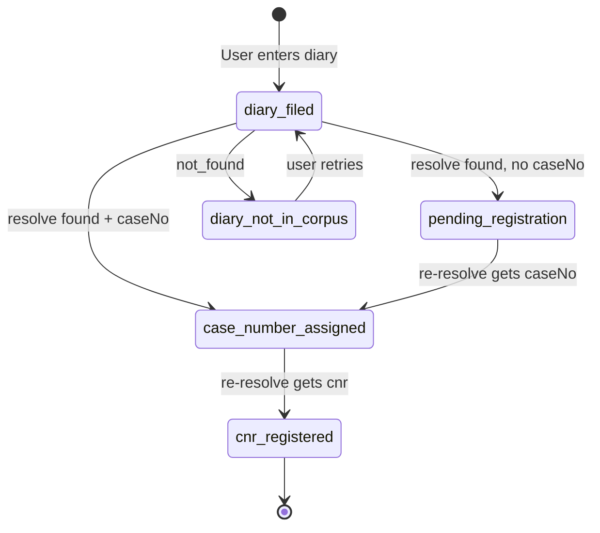
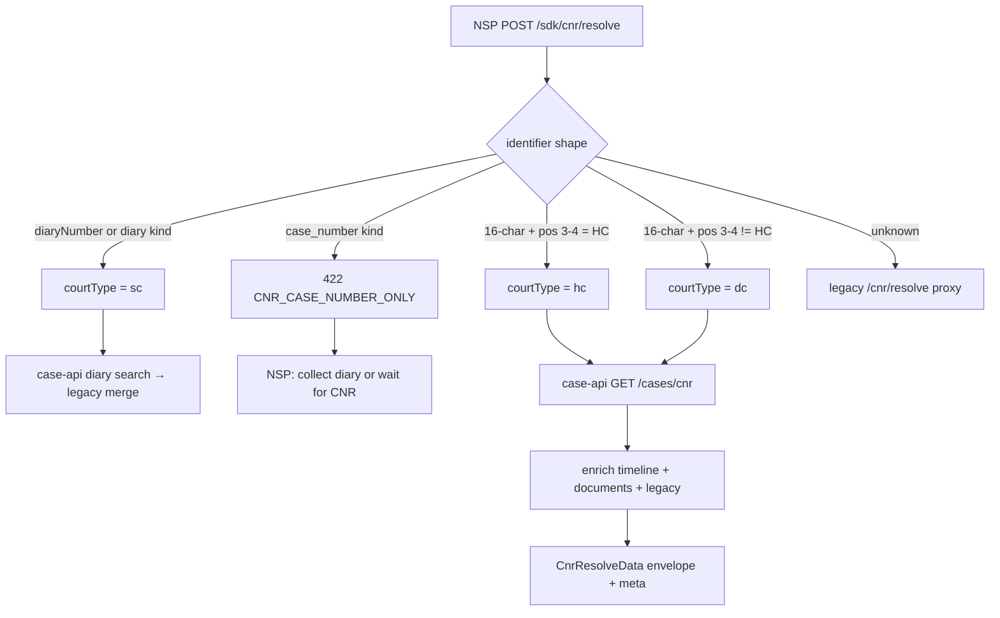

# NSP CNR & Diary Matter Creation — Handoff

> **Audience:** NSP backend, BFF, mobile, and product teams integrating Supreme Court (SC) and other Indian court matters into NSP Pro.  
> **Snapshot date:** 2026-09-17T12:50:00Z (UTC)  
> **NYV deploy:** `2026-09-17T1639Z-aws-ssm-e07c828d` (sha **`e07c828d`**, court-type inference **`ffd233a03`** + unified `identifier`)  
> **Tracker:** NV-NSP-CNR-DIARY-DOC-001  
> **Code SSoT:** `nv-case-api-adapter.ts`, `nv-cnr-routes.ts`, `@nyayavigya/client-sdk` `CnrApi`

This document is the **authoritative NSP handoff** for resolving court identifiers (CNR, diary number, case number) via NYV and persisting them as NSP matters. It complements the AI task surface one-pager with matter-creation depth.

**Related docs:**

| Doc | Scope |
|---|---|
| [`NSP-NYV-AI-HANDSHAKE-2026-09.md`](./NSP-NYV-AI-HANDSHAKE-2026-09.md) | Headers, auth, timeouts, SSE/async |
| [`NSP-NYV-AI-TASK-SURFACE-2026-09.md`](./NSP-NYV-AI-TASK-SURFACE-2026-09.md) | Feature → endpoint matrix; SC diary summary |
| [`PARTNER-AI-INTEGRATION-AND-PROMPT-ENGINEERING-2026-09-02.md`](./PARTNER-AI-INTEGRATION-AND-PROMPT-ENGINEERING-2026-09-02.md) | Full partner integration (§B.7.1 diary) |
| [`Nyayavigya-platform-Integration-document-5.0.0.md`](./Nyayavigya-platform-Integration-document-5.0.0.md) | SDK bootstrap and orchestrate patterns |
| [`NSP-CNR-RESOLVE-API-CONTRACT-2026-08.md`](./NSP-CNR-RESOLVE-API-CONTRACT-2026-08.md) | Full CNR envelope and error catalog |

---

## 1. Executive summary

Indian court matters pass through **several identifiers over time**. For Supreme Court practice — the dominant NSP use case for fresh filings — the practical rule is:

| User has | Resolve with | Matter creation |
|---|---|---|
| **16-character CNR** | `cnr` on `/sdk/cnr/resolve` | Standard autofill; CNR is stable primary key |
| **Diary number only** (pending SC) | `diaryNumber` + `options.courtType: "sc"` | **Diary-first** — create matter immediately; CNR often null for months |
| **Formal case number only** (e.g. `SLP(C) No. 31416/2026`) | Try resolve if indexed; else manual | Case number is display docket, not primary key |
| **INSC citation** (e.g. `2023 INSC 1081`) | Diary path with `courtType: "sc"` | Judgment lookup only — **not** a filing identifier |

**Diary-first for pending SC matters:** When a lawyer files at the SC Registry, they receive a **diary number** (`NNNNN/YYYY`) immediately. A formal **case number** (SLP, C.A., W.P., etc.) is assigned after registration — often weeks later. A **CNR** (16-character eCourts identifier) may lag further in the judgment corpus. NYV resolve returns **`fields.caseNo`** and party names while **`cnr` is null** — this is **expected**, not a failure.

**Do not block matter creation on missing CNR.** Store `diaryNumber` as the canonical lookup key for pending SC matters; backfill `cnr` when re-resolve populates it.

**Corpus disclaimer:** All resolve responses carry `claimEcourts: false`. Data comes from the NYS judgment / case-api index — not live eCourts docket status.

---

## 2. Identifier hierarchy (Indian courts, SC focus)

### 2.1 Lifecycle timeline

```
T0 Filing          T1 Registration       T2 eCourts           T3 Judgment
─────────          ───────────────       ──────────           ───────────
Diary number   →   Case number      →    CNR (16-char)   →   INSC citation
17329/2025         SLP(C) No. …/2026     ESCR0100…           2023 INSC 1081
(immediate)        (weeks)               (corpus may lag)    (reporting only)
```

| Stage | Identifier | Format | Primary use in NSP |
|---|---|---|---|
| T0 | **Diary number** | `NNNNN/YYYY` or compact `NNNNNYYYY` | **Primary key** for pending SC matters |
| T1 | **Case number** | Prefix + `No.` + number/year | Display docket; parse prefix for matter type |
| T2 | **CNR** | 16 alphanumeric (e.g. `ESCR010007972023`) | Stable cross-court key when assigned |
| T3 | **INSC citation** | `YYYY INSC NNNN` | Judgment search only — not filing |

### 2.2 Diary number normalization

NYV applies **NV-DIARY-COMPACT-NORM-001** before nysapi search:

| Input (UI) | Normalized | Rule |
|---|---|---|
| `173292025` | `17329/2025` | 6–12 digits, trailing 4-digit year 1950–2100 |
| `17329/2025` | `17329/2025` | Slash form passed through |
| `2023 INSC 1081` | unchanged | INSC canonical — legacy diary corpus path |

Implementation: `normalizeDiaryNumber()` in `nv-case-api-adapter.ts`.

### 2.3 SC case-number prefixes

These prefixes appear in `fields.caseNo.value` after registration. **`fields.caseType` is often null** for pending SC rows — parse the prefix from the case number string.

| Prefix | Full name | Nature |
|---|---|---|
| **SLP(C)** | Special Leave Petition (Civil) | Art. 136 civil appellate |
| **SLP(Crl)** | Special Leave Petition (Criminal) | Art. 136 criminal appellate |
| **C.A.** | Civil Appeal | Direct / statutory civil appeal |
| **Crl.A.** | Criminal Appeal | Direct criminal appeal |
| **W.P.(C)** | Writ Petition (Civil) | Art. 32 original writ |
| **W.P.(Crl)** | Writ Petition (Criminal) | Criminal writ |
| **T.P.(C)** / **T.P.(Crl)** | Transfer Petition | Inter-court transfer |
| **T.C.(C)** / **T.C.(Crl)** | Transferred Case | Case transferred to SC |
| **R.P.(C)** / **R.P.(Crl)** | Review Petition | Review of SC judgment |
| **Curative** | Curative Petition | Post-review remedy |
| **Contempt** | Contempt Petition | Civil / criminal contempt |
| **Arb.P.** | Arbitration Petition | S.11 / enforcement |
| **MA** | Miscellaneous Application | Interlocutory in parent matter |
| **O.S.** | Original Suit | Original civil jurisdiction |
| **Ref.** / **Tax Ref.** / **E.P.** | Death ref / Tax ref / Election | Registry-assigned |
| **SM WP/TP/Contempt** | Suo Motu | Court-initiated |

**Important:** Case number assignment and CNR registration are **separate clocks**. An SLP may show `caseNo` while `cnr` remains empty in corpus for months.

### 2.4 CNR (16-character)

| Property | Detail |
|---|---|
| Format | 10–20 alphanumeric after normalization; canonical Indian CNR = **16 chars** |
| Normalization | Uppercase; strip spaces, hyphens, dots, underscores |
| When available | HC/DC matters usually have CNR in corpus; **pending SC often null** |
| Field path | Top-level `data.cnr` and `data.fields.cnr.value` |
| Note when null | `fields.cnr.note`: `"CNR not published for pending SC diary in judgment corpus"` |

### 2.5 INSC citation (judgment only)

| Property | Detail |
|---|---|
| Example | `2023 INSC 1081` |
| Resolve | `diaryNumber: "2023 INSC 1081"`, `options.courtType: "sc"` |
| Use | Link to reported judgment — **do not** use as matter filing id |
| Matter create | Only after user confirms this is a disposed matter they want on record |

### 2.6 HC / DC identifiers (brief)

| Court | Diary / filing ref | `options.courtType` |
|---|---|---|
| High Court | Numeric filing ref (e.g. `256000007942025`) | `hc` |
| District Court | CNR or case_no from corpus | `dc` |

NSP Pro New Case flow today is SC-heavy; HC/DC use the same endpoint with appropriate `courtType`.

---

## 3. NYV API contract

### 3.1 Endpoint

```http
POST https://api.nyayasiddhi.online/api/nv/v1/sdk/cnr/resolve
Content-Type: application/json
X-API-Key: <NYV_SDK_KEY_NSP>
X-NYV-Platform: nsp
```

| Header | Required | Notes |
|---|---|---|
| `X-API-Key` | Yes | NSP platform SDK key (provisioned by NYV ops — **never embed in browser**) |
| `X-NYV-Platform` | Recommended | `nsp` — metering and scope |
| `Content-Type` | Yes | `application/json` |

Auth middleware: `dualSdkOrJwt` on all `/api/nv/v1/sdk/cnr/*` routes.

**Do not call** `/api/nv/v1/sdk/diary/resolve` — retired (404). Diary goes on the CNR resolve route.

### 3.2 Request — CNR resolve

```json
{
  "cnr": "TSWL000000742024",
  "options": {
    "profile": "caseCreate",
    "includeDocuments": true
  }
}
```

| Field | Type | Notes |
|---|---|---|
| `cnr` or `cnrNumber` | string | Either accepted; normalized server-side |
| `options.profile` | `"default"` \| `"caseCreate"` | `caseCreate` → deep tier + `caseCreate` profile block; 60s timeout |
| `options.includeDocuments` | boolean | Default `true`; set `false` for faster matter intake |

### 3.3 Request — diary resolve (SC)

```json
{
  "diaryNumber": "17329/2025",
  "options": {
    "courtType": "sc",
    "profile": "caseCreate",
    "includeDocuments": false
  }
}
```

| Field | Type | Notes |
|---|---|---|
| `diaryNumber` or `diary` | string | Either accepted (`extractDiaryNumber`) |
| `options.courtType` | `"sc"` \| `"hc"` \| `"dc"` | **Defaults to `"sc"`** if omitted (NV-DIARY-COURT-DEFAULT-001) |
| `options.profile` | string | `"caseCreate"` for matter autofill with `caseCreate` header/parties block |
| `options.includeDocuments` | boolean | `false` recommended for intake (typical ~130ms vs heavier with docs) |

Compact diary from mobile UI:

```json
{
  "diaryNumber": "173292025",
  "options": { "courtType": "sc" }
}
```

Response echoes normalized `diaryNumber: "17329/2025"`.

### 3.4 Response envelope (success)

```json
{
  "success": true,
  "claimEcourts": false,
  "source": "nys-case-api",
  "data": {
    "lookupType": "diary",
    "diaryNumber": "17329/2025",
    "cnr": "",
    "status": "found",
    "matchType": "exact",
    "source": "nys_case_api_rds",
    "sourcesTried": ["nys_case_api", "case_api"],
    "confidence": 0.97,
    "claimEcourts": false,
    "validation": "ok",
    "ui": {
      "badge": "Suggested · Judgment corpus",
      "subtitle": "From NYS-Search case-api diary index — not live eCourts status"
    },
    "fields": {
      "diaryNumber": { "value": "17329/2025", "source": "nys_case_api_rds", "confidence": 0.97 },
      "caseNo": { "value": "C.A. No. 4657/2026", "source": "nys_case_api_rds", "confidence": 0.9 },
      "caseTitle": { "value": "PETITIONER vs RESPONDENT", "source": "nys_case_api_rds", "confidence": 0.95 },
      "petitioner": { "value": "…", "source": "nys_case_api_rds", "confidence": 0.95 },
      "respondent": { "value": "…", "source": "nys_case_api_rds", "confidence": 0.95 },
      "courtType": { "value": "sc", "source": "nys_case_api_rds", "confidence": 0.97 },
      "caseType": { "value": null, "source": null, "confidence": 0 },
      "cnr": {
        "value": "",
        "source": null,
        "confidence": 0,
        "note": "CNR not published for pending SC diary in judgment corpus"
      },
      "filingDate": { "value": null, "source": null, "confidence": 0, "note": "often absent in judgment metadata" },
      "nextHearingDate": { "value": null, "source": null, "confidence": 0, "note": "requires live docket — not in corpus v1" }
    },
    "documents": [],
    "candidates": [],
    "meta": {
      "attribution": "NYS-Search case-api",
      "latencyMs": 130,
      "tier": "nys_case_api_rds",
      "source": "nys_case_api_rds"
    }
  }
}
```

### 3.5 Response fields reference

Every field under `data.fields` follows **`CnrFieldValue`**:

| Property | Type | Meaning |
|---|---|---|
| `value` | unknown | Scalar or array (e.g. `hearings`, `judges`) |
| `source` | string \| null | Corpus tier that supplied the value |
| `confidence` | number | 0–1 heuristic confidence |
| `note` | string? | Human-readable caveat (especially `fields.cnr.note`) |

| Top-level `data` key | CNR path | Diary path | Notes |
|---|---|---|---|
| `lookupType` | absent | `"diary"` | Discriminator for BFF routing |
| `diaryNumber` | absent | normalized string | Always slash form when compact sent |
| `cnr` | 16-char or empty | often `""` pending SC | Mirror of `fields.cnr.value` |
| `status` | `found` \| `not_found` \| `suggested` \| `invalid` | same | HTTP 200 for `not_found` (CNR) |
| `fields.caseNo` | ✓ | ✓ | Formal docket string |
| `fields.caseTitle` | ✓ | ✓ | Party-style title |
| `fields.petitioner` | ✓ | ✓ | |
| `fields.respondent` | ✓ | ✓ | |
| `fields.cnr` | ✓ | ✓ with `.note` when empty | **Read the note** for UI copy |
| `caseCreate` | when `profile=caseCreate` | when `profile=caseCreate` | Header, timeline, clients, opposingParties, fieldManifest |

### 3.6 Timeouts and routing

| Profile | Timeout | Path |
|---|---|---|
| `default` | ~23s (Athena budget + slack) | case-api first → legacy NYS `/cnr/resolve` fallback |
| `caseCreate` | 60s | Deep enrichment; cold Athena path allowed |

Diary resolve order (case-api enabled):

1. `GET nysapi/v1/cases?court_type=SC&diary_no=<normalized>`
2. Map via `mapCaseApiDiaryToCnrResolveData()`
3. On 404/401/504 → legacy NYS diary RDS path (INSC rows)

### 3.7 SDK usage

```typescript
import { NyvClient } from '@nyayavigya/client-sdk';

const nyv = new NyvClient({ apiKey: process.env.NYV_SDK_KEY_NSP, platform: 'nsp' });

// Diary (server-side BFF only)
const diary = await nyv.cnr.resolve({
  diaryNumber: '17329/2025',
  options: { courtType: 'sc', profile: 'caseCreate', includeDocuments: false },
} as any); // diaryNumber: extend typed SDK in next bump

// CNR
const cnr = await nyv.cnr.resolve({
  cnr: 'TSWL000000742024',
  options: { profile: 'caseCreate' },
});
```

Typed `CnrApi.resolve` input currently documents `cnr`/`cnrNumber`; pass `diaryNumber` in the same POST body (runtime supported).

### 3.8 Health check

```http
GET /api/nv/v1/sdk/cnr/health
```

Expect `data.status: "ready"`, `data.caseApi.enabled: true` on current deploy.

---

## 4. NSP matter schema recommendation

Persist resolved identifiers in NSP matters with explicit registration state. Suggested columns / JSON shape:

| Field | Type | Source | Notes |
|---|---|---|---|
| `diaryNumber` | string \| null | `data.diaryNumber` | **Primary key** for pending SC; unique index `(diaryNumber, courtType)` |
| `cnr` | string \| null | `data.cnr` or `fields.cnr.value` | Nullable until backfill |
| `caseNo` | string \| null | `fields.caseNo.value` | Full display string |
| `caseNoPrefix` | string \| null | Parsed from `caseNo` | e.g. `SLP(C)`, `C.A.`, `W.P.(C)` |
| `courtType` | enum | `fields.courtType.value` | `sc` \| `hc` \| `dc` |
| `registrationStatus` | enum | Derived (§5) | Drives UI state machine |
| `parties` | object | petitioner, respondent, title | From `fields.*` |
| `source` | string | `data.source` | e.g. `nys_case_api_rds` |
| `lastResolvedAt` | ISO datetime | BFF timestamp | For poll scheduling |
| `resolveMeta` | object | `confidence`, `claimEcourts`, `ui.badge` | Audit / disclaimer |

**Parsing `caseNoPrefix` (example):**

```typescript
function parseScPrefix(caseNo: string | null): string | null {
  if (!caseNo) return null;
  const m = caseNo.match(/^([A-Za-z().\s]+?)\s+No\./);
  return m ? m[1].trim() : null;
}
```

**Unique constraints:**

- Prefer **`diaryNumber + courtType`** while `cnr` is null.
- When `cnr` arrives, add as secondary unique key; retain diary as alias.
- Do **not** use `caseNo` alone as primary key — collisions across years/types possible.

---

## 5. Status machine

Map NYV resolve output to NSP `registrationStatus`:

| State | Condition | Next action |
|---|---|---|
| `diary_filed` | User entered diary; resolve not yet called | Call resolve |
| `pending_registration` | `status=found`, `fields.caseNo.value` empty | Show diary; parties if present |
| `case_number_assigned` | `status=found`, `caseNo` set, `cnr` empty | Show case number; poll for CNR |
| `cnr_registered` | Re-resolve returns non-empty `cnr` | Display CNR; keep diary alias |
| `diary_not_in_corpus` | `status=not_found` | Manual matter or retry later |



**UI labels (suggested):**

| State | Headline | Subtext |
|---|---|---|
| `pending_registration` | Diary {diaryNumber} | Registration pending — case number not yet assigned |
| `case_number_assigned` | {caseNo} | CNR not yet available — tracking by diary {diaryNumber} |
| `cnr_registered` | {caseNo} | CNR {cnr} |

---

## 6. Workflows

### A. User has CNR → resolve → create matter

1. User enters CNR on New Case / matter intake.
2. BFF `POST /api/nv/v1/sdk/cnr/resolve` with `{ cnr, options: { profile: "caseCreate" } }`.
3. On `status: "found"`: map `fields.*` → matter; set `registrationStatus: cnr_registered`.
4. On `status: "not_found"`: offer manual continue — corpus gap ≠ invalid CNR.
5. Optional: `GET /api/nv/v1/sdk/cnr/{cnr}/documents` for judgment PDF links.

### B. User has diary only → resolve → create matter with provisional caseNo

1. User enters diary (compact or slash).
2. BFF resolve with `{ diaryNumber, options: { courtType: "sc", profile: "caseCreate", includeDocuments: false } }`.
3. On `found`:
   - Store `diaryNumber` as primary key.
   - If `fields.caseNo.value` present → `case_number_assigned`; else `pending_registration`.
   - Leave `cnr` null — **do not error**.
4. Pre-fill parties from `petitioner`, `respondent`, `caseTitle`.
5. Schedule weekly re-resolve or refresh-on-open.

### C. User has case number only → resolve if supported, else manual

1. Case-number-only search is **not** a first-class resolve input today.
2. Options:
   - Ask user for diary number (preferred for SC pending).
   - `GET /api/nv/v1/sdk/cnr/search?court_type=sc&party_name=…` (party search — additive P2).
   - Manual matter with case number in display fields.
3. When diary is obtained, re-run workflow B.

### D. Backfill / poll for CNR when null

1. Select matters where `cnr IS NULL` and `diaryNumber IS NOT NULL` and `courtType = 'sc'`.
2. Batch re-resolve (respect rate limits — §9); update on first non-empty `cnr`.
3. Transition `registrationStatus` → `cnr_registered`.
4. Recommended cadence: weekly background job + manual "Refresh from registry" button.
5. Log `lastResolvedAt` and `data.meta.latencyMs` for ops — no secret values.

**BFF pseudocode:**

```typescript
async function refreshMatterFromNyv(matter: Matter) {
  const body = matter.diaryNumber
    ? { diaryNumber: matter.diaryNumber, options: { courtType: 'sc', includeDocuments: false } }
    : { cnr: matter.cnr, options: { profile: 'default' } };

  const res = await nyvPost('/api/nv/v1/sdk/cnr/resolve', body);
  if (!res.success || res.data?.status !== 'found') return matter;

  const cn = res.data.fields?.caseNo?.value ?? matter.caseNo;
  const cnr = res.data.cnr || res.data.fields?.cnr?.value || matter.cnr;
  return {
    ...matter,
    caseNo: cn,
    cnr: cnr || null,
    registrationStatus: deriveStatus(res.data),
    lastResolvedAt: new Date().toISOString(),
  };
}
```

---

## 7. Live examples (probes 2026-09-17)

All **10/10** user-supplied SC diaries resolved via `POST /api/nv/v1/sdk/cnr/resolve` on nysdev (SSM probes `ffd76303`, `0681c61c`, compact-norm batch). **8/10** returned formal case numbers with **`cnr=null`**. **2/10** diary-only (`pending_registration`).

| # | Diary (input) | Normalized | Case number (`fields.caseNo`) | CNR | NSP status | Latency (typical) |
|---|---|---|---|---|---|---|
| 1 | `173292025` | `17329/2025` | C.A. No. 4657/2026 | null | `case_number_assigned` | ~130ms |
| 2 | `508502026` | `50850/2026` | SLP(C) No. 31416/2026 | null | `case_number_assigned` | ~130ms |
| 3 | `451552024` | `45155/2024` | C.A. No. 10900-10902/2025 | null | `case_number_assigned` | ~130ms |
| 4 | `444182026` | `44418/2026` | SLP(C) No. 32065/2026 | null | `case_number_assigned` | ~130ms |
| 5 | `405312026` | `40531/2026` | W.P.(C) No. 933/2026 | null | `case_number_assigned` | ~130ms |
| 6 | `73192026` | `7319/2026` | SLP(C) No. 7021/2026 | null | `case_number_assigned` | ~130ms |
| 7 | `460242024` | `46024/2024` | SLP(C) No. 27802/2024 | null | `case_number_assigned` | ~130ms |
| 8 | `467712026` | `46771/2026` | SLP(C) No. 32066-32067/2026 | null | `case_number_assigned` | ~130ms |
| 9 | `252932024` | `25293/2024` | *(empty)* | null | `pending_registration` | ~130ms |
| 10 | `465692024` | `46569/2024` | *(empty)* | null | `pending_registration` | ~130ms |

**Probe notes:**

- Rows 9–10: parties known in corpus (`fields.petitioner` / `fields.respondent` populated) but case number not yet assigned — UI should show diary + party names.
- Burst probing 10 diaries sequentially triggered **429 rate limit** on last entries in one batch (SSM `0681c61c`) — production BFF should throttle (§9).
- HC/DC CNR smoke: `TSWL000000742024` → `found` / `courtType:dc` / ~793ms (different tier).

---

## 8. UI/UX guidance for NSP

### 8.1 When `cnr` is null but `caseNo` is present

- Show **case number as the headline** (e.g. `SLP(C) No. 31416/2026`).
- Show diary as secondary: "Diary 50850/2026".
- Badge: **Suggested · Judgment corpus** (`data.ui.badge`) — not live registry.
- Tooltip on empty CNR: use `fields.cnr.note` verbatim or simplified: "CNR will appear after eCourts registration; we will update automatically."

### 8.2 `pending_registration` messaging

- Headline: **Diary {diaryNumber}**.
- Body: "Your matter is filed. The Supreme Court has not yet assigned a case number in our corpus. You can still create the matter and track by diary number."
- Show petitioner/respondent if returned.

### 8.3 Do not block matter creation on missing CNR

- **Never** require CNR for SC pending intake.
- Allow "Continue manually" on `not_found` — lawyer may have a diary too new for corpus.
- Distinguish **429 rate limit** (retry) from **not_found** (data gap).

### 8.4 New Case screen flow (recommended)

```
[Diary number]  [CNR (optional)]
      ↓ Lookup (BFF → NYV)
 Preview: caseNo, parties, badge
      ↓ Create matter (enabled even if cnr empty)
 Matter detail: registrationStatus chip + refresh button
```

### 8.5 Disclaimer copy (fixed)

> Matter details are suggested from the NyayaSiddhi judgment corpus. They are not live eCourts status. Verify before filing.

---

## 9. Error handling

| HTTP | `error.code` / condition | Meaning | NSP action |
|---|---|---|---|
| 200 | `data.status: "not_found"` | Identifier not in corpus | Manual matter + retry later |
| 200 | `data.status: "found"`, empty `cnr` | Normal pending SC | Create matter — not an error |
| 400 | `CNR_INVALID` | Malformed CNR or body | Inline validation message |
| 401 | — | Bad/missing API key | Ops alert — do not retry |
| 429 | Rate limit (gateway) | Too many resolve calls in burst | Exponential backoff; queue refresh job |
| 503 | `CNR_UPSTREAM_BUSY` / `DIARY_CORPUS_BLOCKED` | RDS contended or diary disabled | Retry 2s / 4s / 8s (max 3) |
| 504 | `CNR_UPSTREAM_TIMEOUT` | Cold path exceeded budget | Retry; offer manual continue |
| 502 | `NYS_UPSTREAM` / `CASE_API_UPSTREAM` | nysapi unavailable | Retry with banner |

**429 guidance:** Space diary batch refreshes ≥200ms apart; cap concurrent workers at 3 for resolve during matter import.

**Invalid diary format:** Non-numeric compact strings without `/` pass through unchanged; nysapi may return `not_found` — validate UI pattern `^\d{1,7}/\d{4}$` or compact digits optional.

---

## 10. Verification commands (no keys)

Keys live on nysdev EC2 (`/opt/Nyayavigya/secrets/.env.production`). Workstation probes use SSM or local mirror (`.local/secrets/runtime.env`).

### 10.1 Partner smoke (multi-platform)

```bash
cd nyayavigya-platform-312
npm run partner:smoke:ec2
# Expect: 0 failures; includes cnr/resolve path
```

### 10.2 Demo crosscheck (EC2 authoritative)

```bash
cd nyayavigya-platform-312
npm run demo:probe:ec2
```

### 10.3 CNR resolve — curl templates (placeholders)

**Diary (SC pending):**

```bash
curl -sS -X POST 'https://api.nyayasiddhi.online/api/nv/v1/sdk/cnr/resolve' \
  -H 'Content-Type: application/json' \
  -H 'X-API-Key: <NYV_SDK_KEY_NSP>' \
  -H 'X-NYV-Platform: nsp' \
  -d '{
    "diaryNumber": "17329/2025",
    "options": {
      "courtType": "sc",
      "profile": "caseCreate",
      "includeDocuments": false
    }
  }'
```

**Compact diary:**

```bash
curl -sS -X POST 'https://api.nyayasiddhi.online/api/nv/v1/sdk/cnr/resolve' \
  -H 'Content-Type: application/json' \
  -H 'X-API-Key: <NYV_SDK_KEY_NSP>' \
  -H 'X-NYV-Platform: nsp' \
  -d '{"diaryNumber":"173292025","options":{"courtType":"sc"}}'
```

**CNR (HC/DC smoke token):**

```bash
curl -sS -X POST 'https://api.nyayasiddhi.online/api/nv/v1/sdk/cnr/resolve' \
  -H 'Content-Type: application/json' \
  -H 'X-API-Key: <NYV_SDK_KEY_NSP>' \
  -H 'X-NYV-Platform: nsp' \
  -d '{"cnr":"TSWL000000742024","options":{"profile":"default"}}'
```

**Health:**

```bash
curl -sS 'https://api.nyayasiddhi.online/api/nv/v1/sdk/cnr/health' \
  -H 'X-API-Key: <NYV_SDK_KEY_NSP>'
```

### 10.4 Assert success without printing secrets

```bash
# jq checks only — run after curl with real key on secure host
# .data.status == "found"
# .data.fields.caseNo.value (may be null for pending)
# .claimEcourts == false
```

### 10.5 Vitest (local, no keys)

```bash
cd nyayavigya-platform-312
npm run test -- tests/unit/nv-case-api-adapter.test.ts
```

---

## 11. Cross-references

| Document | Relevant sections |
|---|---|
| [`NSP-NYV-AI-HANDSHAKE-2026-09.md`](./NSP-NYV-AI-HANDSHAKE-2026-09.md) | §3.1 CNR row; auth headers; 90s interactive SLA |
| [`NSP-NYV-AI-TASK-SURFACE-2026-09.md`](./NSP-NYV-AI-TASK-SURFACE-2026-09.md) | CNR/diary PASS row; SC diary gap; 10-row sample |
| [`PARTNER-AI-INTEGRATION-AND-PROMPT-ENGINEERING-2026-09-02.md`](./PARTNER-AI-INTEGRATION-AND-PROMPT-ENGINEERING-2026-09-02.md) | §B.7.1 diary formats; §J.8 matter autofill |
| [`Nyayavigya-platform-Integration-document-5.0.0.md`](./Nyayavigya-platform-Integration-document-5.0.0.md) | SDK init; orchestrate after resolve |
| [`NSP-CNR-RESOLVE-API-CONTRACT-2026-08.md`](./NSP-CNR-RESOLVE-API-CONTRACT-2026-08.md) | Full response schemas; invalid/not_found JSON |
| [`NSP-CNR-RESOLVE-CORPUS-PLAN-2026-08.md`](./NSP-CNR-RESOLVE-CORPUS-PLAN-2026-08.md) | Corpus cascade design |

**NSP BFF alias (if routing via NSP Pro):** `POST /ns/v1/cnr/resolve` must forward to NYV with platform key — never call nysapi directly from browser.

---

## 12. Maximum detail retrieval (corpus → NSP)

This section answers: **what does NSP get in one API call today**, what lives in the backend but is not surfaced, and how to maximize detail for matter creation.

### 12.1 Architecture — corpus layers

**nysapi uses a two-layer store** (confirmed NV-NYSAPI-RDS-SCHEMA-001, 2026-09-17). CNR/diary resolve does **not** read legacy `nyv_caselaw.judgments` — diaries live in DuckDB only.

```
┌─────────────────────────────────────────────────────────────────────────────┐
│ nysapi case-api (primary — CNR + diary resolve)                             │
├─────────────────────────────────────────────────────────────────────────────┤
│ DuckDB case_lookup_full  CNR + diary_no + case_number (10/10 user diaries)  │
│ DuckDB case_events       hearings / timeline events                         │
│ RDS case_api_search      DB on nyv-caselaw-pg: cases, case_summaries,       │
│                          cases_search_staging, rds_load_state (RDS mirror)  │
│ Endpoints                GET /v1/cases/{cnr}, ?diary_no=, /timeline         │
└─────────────────────────────────────────────────────────────────────────────┘

┌─────────────────────────────────────────────────────────────────────────────┐
│ Legacy NYS caselaw (FTS/hybrid/embed — NOT nysapi CNR/diary path)           │
├─────────────────────────────────────────────────────────────────────────────┤
│ RDS nyv_caselaw.judgments   ~26M — SC 43.5K / HC 20.4M / DC 5.7M            │
│ RDS cnr_case_details        796,960 HC dimension (acts/hearings; stale Aug23)│
│ Athena parquet              SC/HC/DC case_details (cold; NYV P2a merge)       │
│ S3                          judgment PDFs (presigned via documents API)       │
└─────────────────────────────────────────────────────────────────────────────┘
                                    │
                                    ▼
┌─────────────────────────────────────────────────────────────────────────────┐
│ NYV gateway (nv-cnr-routes → nv-case-api-adapter)                           │
│ 1. case-api first when NYV_F_CASE_API_CNR=1 (live on nysdev)                │
│ 2. P2b: GET nysapi …/timeline if inline hearings empty                      │
│ 3. P2a: legacy POST NYS /cnr/resolve merge when fields sparse (CNR only)    │
│ 4. Fallback: full NYS cascade (RDS → Athena → FTS) on case-api miss         │
└─────────────────────────────────────────────────────────────────────────────┘
                                    │
                                    ▼
┌─────────────────────────────────────────────────────────────────────────────┐
│ NSP BFF — POST /api/nv/v1/sdk/cnr/resolve (never call nysapi from browser)  │
└─────────────────────────────────────────────────────────────────────────────┘
```

**Honesty lock:** all tiers set `claimEcourts: false`. Athena and PDF extract fill **judgment corpus** gaps — not live eCourts docket.

### 12.2 Field matrix — corpus vs NSP response (live probes 2026-09-17)

Probes: SSM `19b347bc`, `90ec76f5` on nysdev (`NYV_F_CASE_API_LEGACY_ENRICH=1`).

| Corpus source | Available data | In `fields.*` today | In `caseCreate` today | How NSP gets it |
|---|---|---|---|---|
| nysapi RDS row | cnr, case_number, parties, court, status, summary | ✓ (18–19 keys) | header + clients | **1 call** `resolve` |
| nysapi inline `hearings[]` | hearing rows | `fields.hearings` | `caseCreate.timeline` | **1 call**; TSWL **17** rows |
| nysapi `/timeline` | extended events when inline empty | merged into `hearings` | merged timeline | **automatic** (NYV P2b, ~3s budget) |
| nysapi `acts` / `acts_sections` | statute rows | `fields.actsSections` | — | **1 call**; TSWL **1** act; diary **0** |
| RDS `cnr_case_details` | acts, hearings, filing | merged via P2a legacy | merged timeline | **1 call** when CNR known + sparse fields |
| Athena parquet case_details | acts, hearings, filing (cold) | merged via legacy on `caseCreate` | same | **1 call** `profile: caseCreate` + CNR; adds `opendata_athena_case_details` to `sourcesTried` |
| Judgment PDF (S3) | full text, police station | `extractPreview` **not on case-api path** | `summary` / police hints | **Gap** — see §12.4 |
| SC pending diary | diary_no, caseNo, parties; **cnr often null** | ✓ with `fields.cnr.note` | ✓ | **1 call** diary resolve |
| SC pending diary | rich hearings / acts in dimension | **partial** — probe: **1** hearing, **0** acts | timeline **1** | Legacy merge **skipped** when `cnr=""` (P2a CNR-only) |

**Profile comparison (same CNR/diary, different options):**

| Probe | Profile | ms | fields | hearings | caseCreate | sourcesTried highlights |
|---|---|---:|---:|---:|---|---|
| TSWL000000742024 | default | 199 | 18 | 17 | no | nys_case_api, nys_rds, cnr_case_details |
| TSWL000000742024 | caseCreate | 1873 | 18 | 17 | yes (timeline 17) | + opendata_athena_case_details |
| diary 17329/2025 | default | 183 | 19 | 1 | no | nys_case_api, rds |
| diary 17329/2025 | caseCreate | 144 | 19 | 1 | yes (timeline 1) | nys_case_api, rds only |

**Takeaway:** `profile: caseCreate` does **not** add new top-level field keys vs `default` on the case-api path — it adds the structured **`caseCreate`** block (header, parties, timeline, `fieldManifest`). For **CNR**, `caseCreate` also triggers legacy/Athena merge (~1–3s extra). For **pending SC diary**, Athena/legacy merge does **not** run today because P2a requires a non-empty CNR.

### 12.3 Recommended NSP integration — one call vs multi-step

#### Minimum (intake speed ~130–200ms)

```json
{
  "diaryNumber": "173292025",
  "options": { "courtType": "sc", "includeDocuments": false }
}
```

Returns: parties, `caseNo`, `diaryNumber`, badge, `fields.cnr.note` when CNR absent.

#### Maximum detail — matter autofill (recommended)

```json
{
  "cnr": "TSWL000000742024",
  "options": {
    "profile": "caseCreate",
    "includeDocuments": true,
    "includeExtractPreview": true
  }
}
```

Or for diary:

```json
{
  "diaryNumber": "17329/2025",
  "options": {
    "courtType": "sc",
    "profile": "caseCreate",
    "includeDocuments": true
  }
}
```

**Single-call checklist for NSP BFF:**

| Step | Endpoint | When |
|---|---|---|
| 1 | `POST …/cnr/resolve` with `profile: caseCreate` | Always — primary autofill |
| 2 | `GET …/cnr/{cnr}/documents` | When `documents[]` empty but CNR known; presigned PDF (300s TTL) |
| 3 | `GET …/cnr/search?court_type=sc&party_name=…` | Case-number-only intake (additive P2+) |
| 4 | `POST …/knowledge/caselaw/search` or orchestrate research | Full judgment text / citations after matter created |

Steps 1–2 are usually sufficient for New Case autofill. Step 4 is for deep research, not resolve.

**Do not** call `nysapi.nyayasiddhi.online` directly — NYV adapter handles timeline fetch, legacy merge, and auth.

#### Multi-step only when needed

| Scenario | Pattern |
|---|---|
| CNR assigned later on diary matter | Weekly `resolve` with same `diaryNumber`; backfill `cnr` when non-empty |
| Judgment PDF for attach | `GET /cnr/{cnr}/documents` → refresh presigned URL before open |
| Full-text police station / summary | Today: case-api path returns `extractPreview: null`; use Patra Mitra / doc pipeline on uploaded PDF, or future NYV fix to run legacy extract on diary+CNR |
| Party search without diary | `GET /cnr/search?court_type=sc&party_name=…` (may 504 under load — retry) |

### 12.4 Known gaps (2026-09-17)

| Gap | Impact | Workaround for NSP |
|---|---|---|
| Pending SC `cnr=null` | Cannot use CNR-keyed documents/timeline | Track by `diaryNumber`; show `fields.caseNo` |
| P2a legacy merge CNR-only | Diary resolve misses Athena / `cnr_case_details` diary dimension | Accept sparse timeline (1 row); poll re-resolve |
| `extractPreview` on case-api path | No PDF snippet / police station autofill | Manual entry or post-create doc upload + extract |
| `nextHearingDate` | Not in judgment corpus | Always null with explanatory `note` |
| Witnesses / PII | Corpus never has phone, email, father name | `fieldManifest.manualRecommended` drives UI |
| Athena on diary | Not in `sourcesTried` for diary probes | NYV backlog: diary-aware legacy merge |

### 12.5 Verification (no secrets)

```bash
cd nyayavigya-platform-312
npm run demo:probe:ec2                    # multi-platform smoke
npm run probe:nysapi:freshness:ec2        # nysapi health + CNR/diary live
npm run probe:nys-rds:freshness:ec2       # legacy nyv_caselaw counts per court
bash scripts/_nys-ssm-run.sh scripts/_ec2-nysapi-rds-schema-probe.sh  # nysapi DuckDB + case_api_search schema
bash scripts/nv-cnr-field-enrich-probe-ec2.sh   # acts/hearings/doc counts
bash scripts/nv-cnr-profile-compare-probe-ec2.sh # default vs caseCreate matrix
```

Assert with jq: `.data.status`, `(.data.fields | keys | length)`, `(.data.fields.hearings.value | length)`, `(.data.caseCreate.timeline | length)`, `.data.sourcesTried`, `.claimEcourts == false`.

---

## Appendix A — Field manifest (`profile: caseCreate`)

When `options.profile: "caseCreate"`, response may include `data.caseCreate`:

| Block | Contents |
|---|---|
| `header` | caseTitle, cnr, filingDate, nextHearingDate, caseStatus, policeStation — each `CnrFieldValue` |
| `timeline` | Hearings array with date, purpose, judge, status |
| `clients` / `opposingParties` | Structured party entries with advocate |
| `witnesses` | When present in corpus |
| `fieldManifest` | `complete`, `partial`, `missing`, `manualRecommended` keys |

Use `fieldManifest.manualRecommended` to drive "Complete these fields manually" UI.

---

## Appendix C — NYS-Search handover crosscheck (2026-09-17)

External handover doc `NYS_SEARCH_HANDOVER_FOR_SIR (1).md` (2026-09-15) describes the **nysapi** production stack. Live probes (**SSM `ada1efef`**, **`88c6122d`**, **`a485f897`**) confirm architecture and quantify gaps vs NYV `/sdk/cnr/resolve`.

### Store map (nyv-caselaw-pg)

| Database | Role | Key tables | CNR/diary notes |
|---|---|---|---|
| **`case_api_search`** | nysapi search index (RDS) | `cases_search_staging` (~**57M** est.), `rds_load_state`, adapter views `cases` / `case_summaries` | **No `diary_no` column** — diary search is DuckDB-only. Watermark **`v_20260917T071752Z`** applied **2026-09-17 08:08Z**. SC index rows **48,347** (HC/DC per-court counts timeout on full scan). |
| **`nyv_caselaw`** | Legacy NYS caselaw / embed / FTS | `judgments` (~**26.2M**), `cnr_case_details` (**796,960**, stale **2026-08-23**) | **0** SC diary rows in `judgments.case_no`; **0** HC/DC diary-pattern rows. P2a legacy merge source for acts/hearings when CNR known. |
| **`nyvapp`** | NYV app schema | (not CNR primary) | — |

**Parquet (not RDS):** DuckDB `case_lookup_full` (~78M rows per handover) holds `hearings_json`, `diary_no`, `extra`. RDS returns `(court_level, cnr)` for search; parquet hydrates full record.

### CNR / diary capability matrix (handover §4 vs live)

| Capability | SC | HC | DC |
|---|---|---|---|
| CNR lookup (`GET /v1/cases/{cnr}`) | yes | yes (use `court_type` for B9 duplicates) | yes |
| Diary search (`diary_no` param) | **yes** — `cnr` often **null** | **400** `unsupported_param_for_court_type` | **400** |
| Filing number + year search | — | — | yes (~21% FIR coverage) |
| `case_title` search | yes (cold GIN caveat) | yes | **400** (0% titles in source) |
| `/timeline` (events parquet) | yes when CNR exists | yes | yes |
| SC diary `/timeline` | **Data-phase gap** (events CNR-keyed) | n/a | n/a |

**Live samples (2026-09-17):**

| Probe | HTTP | Key fields |
|---|---|---|
| SC diary `17329/2025` | 200 | `diary_no=17329/2025`, `case_number=C.A. No. 4657/2026`, `cnr=null` |
| HC CNR `GJHC240256342024` | 200 | `court_level=HC`, `case_number=FA/1864/2024`, hearings **0** in corpus row |
| HC CNR `RJHC010324382023` | 200 | `status=DISPOSED OF`, `decision_date=2026-07-08` |
| DC CNR `DLCT010000012024` | 200 | `filing_date=2024-01-02`, `decision_date=2024-03-22` |
| B9 `DLCT010043082025` HC vs DC | 200 / 200 | Same CNR, different `court_level` records |
| HC/DC diary attempt | **400** | Contract refusal — not zero matches |
| NYV `cnr/resolve` TSWL / RJHC / diary | **200** | `tier=nys_case_api_rds`, diary **found** ~140ms |

### Fields nysapi serves — gap matrix (updated 2026-09-19)

Handover §4 lists ~40 case fields. **NV-CNR-P1-MAX-RESOLVE-001** (local, deploy pending) closes most resolve-envelope gaps. Status:

| nysapi field | Handover note | NYV status (2026-09-19) | Remaining |
|---|---|---|---|
| `field_availability` | Per-field `not_published_by_source` | **DONE** — `data.meta.fieldAvailability` (P0-A) | — |
| `provenance` | `backend`, `elapsed_ms`, `source_synced_at` | **DONE** — `meta.provenance.*` + `tableVersion` from `/health` (P1 max) | — |
| `counts` | `{ hearings, acts }` | **DONE** — `data.meta.counts` (P0-A); P2b auto-timeline when `counts.hearings > inline` | — |
| `filing_number` / `filing_number_year` | DC search keys | **DONE** — `fields.filingNumber`, `fields.filingNumberYear` | DC filing-ref **search-then-resolve** still P1-B |
| `complex_name` / `court_establishment` | DC search | **DONE** — `fields.complexName`; folded into `courtName` when court empty | — |
| `citation` / `neutral_citation` | SC judgments | **DONE** — `fields.citation` | — |
| `fir_no` / `fir_year` | DC ~21% coverage | **DONE** — `fields.firNo`, `fields.firYear` | — |
| `jurisdiction`, `state_name`, `district_name`, `bench` | Geo/court | **DONE** — `fields.jurisdiction`, `stateName`, `districtName`, `bench` | — |
| `current_purpose` / `first_hearing_date` | Docket fields | **DONE** — `fields.currentPurpose`, `fields.firstHearingDate` | Live docket still out of scope |
| `petitioners[]` / `respondents[]` / `judges[]` / `advocates[]` | Multi-party rows | **DONE** — arrays + backward-compat scalar `petitioner`/`respondent` | Structured party objects (address/counsel split) — future |
| `cnr_is_synthetic` | SC judgment CNR flag | **DONE** — `data.cnrSynthetic` (P0-A) | — |
| `extra` | Unmapped source fields | **DONE** — sanitized `data.meta.extra` (P0-A) | — |
| `/timeline` `doc_url` | Presigned PDFs (900s TTL) | **DONE** — `includeTimeline` + `docUrl` + order docs (P0-C) | — |
| P2a legacy merge | Athena / `cnr_case_details` | **IMPROVED** — union merge arrays (hearings deduped date+purpose, acts union, docs append); diary path when CNR absent | Requires `NYV_F_CASE_API_LEGACY_ENRICH=1` |
| `days_since_filing` | Computed | Not returned | Optional `caseCreate.header.daysSinceFiling` (P3) |
| Search filters (party, FIR, act, …) | Full §4 matrix | NYV `GET /sdk/cnr/search` partial | P1-A full filter passthrough |
| **Live eCourts / vanga fetch** | Real-time docket | **Not implemented** — corpus-only; see Appendix G | NYC/case-api phase |

### Max resolve (P1) — NYV behaviour summary

**Scope:** `nv-case-api-adapter.ts` — no live eCourts fetch; corpus + legacy merge only.

1. **Scalar fields** — maps all nysapi identity/geo/FIR/filing/citation/docket scalars listed above into `fields.*` as `CnrFieldValue`.
2. **Array fields** — `petitioners[]`, `respondents[]`, `judges[]`, `advocates[]` (with `side: petitioner|respondent|null`); existing `hearings[]`, `actsSections[]`, `documents[]` unchanged.
3. **P2a merge** — when `NYV_F_CASE_API_LEGACY_ENRICH=1`, unions case-api + legacy/Athena arrays instead of replace-when-empty; hearings deduped by `(date, purpose)`.
4. **P2b timeline** — auto-fetches `/timeline` when inline hearings empty **or** `meta.counts.hearings > inline.length`.
5. **Diary P2a** — legacy merge attempts `diaryNumber` when CNR empty on diary path.
6. **Provenance** — `meta.provenance.tableVersion` from nysapi `/health` (60s cache).

**SDK:** `@nyayavigya/client-sdk@5.1.3` — `CnrAdvocateEntry`, `meta.provenance.tableVersion`.

**Deploy:** code-only until explicit nysdev **GO** (same as P0 deploy note).

### Probe scripts (this crosscheck)

```bash
bash scripts/_nys-ssm-run.sh scripts/_ec2-nys-handover-rds-lite-probe.sh
bash scripts/nv-ec2-ssm-run.sh scripts/_nysapi-live-freshness-probe.sh
bash scripts/_nys-ssm-run.sh scripts/_ec2-nysapi-case-api-search-probe.sh
```

---

## Appendix D — HC/DC CNR maximum coverage playbook

> **Audience:** NSP product + backend integrating HC/DC matters (~98% of NSP caseload).  
> **Tracker:** NV-NYV-CNR-COVERAGE-PLAN-001  
> **Snapshot:** 2026-09-17T15:45:00Z (UTC)  
> **Corpus SSoT:** nysapi `case_lookup_full` (~78M DuckDB) + RDS `case_api_search` (~57M staging); legacy `nyv_caselaw` for P2a merge.

Diary resolve is **SC-only** (nysapi returns **400** for HC/DC `diary_no`). For HC/DC, NSP must use **CNR** (primary), **party/case/FIR/filing-number search**, and optional legacy cascade — not diary.

---

### D.1 Current state — what NSP gets today vs corpus

| Layer | Corpus size (2026-09-17 probes) | nysapi endpoint | NYV surface | NSP gets today |
|---|---|---|---|---|
| **Primary index** | DuckDB ~78M; RDS staging ~57M (`v_20260917T071752Z`) | `GET /v1/cases/{cnr}?court_type=` | `POST /sdk/cnr/resolve` `{ cnr }` | **18–19 `fields.*` keys**, parties, dates, status, inline hearings, acts (when hydrated), 1 judgment doc when S3 linked |
| **Timeline** | `case_events` parquet | `GET /v1/cases/{cnr}/timeline` | Auto P2b when inline hearings empty | Merged into `fields.hearings` / `caseCreate.timeline` (~3s budget) |
| **Legacy enrich** | `cnr_case_details` 796,960 HC rows (stale Aug 23); Athena case_details | NYS `POST /cnr/resolve` | P2a when `NYV_F_CASE_API_LEGACY_ENRICH=1` + sparse fields | Extra acts/hearings on **CNR path only**; adds `opendata_athena_case_details` to `sourcesTried` with `profile: caseCreate` |
| **Search** | Full filter matrix in handover §4 | `GET /v1/cases?court_type=&…` | `GET /sdk/cnr/search` (partial) | **party_name + diary_no (SC) only** — no filing_number, FIR, act, date filters yet |
| **Fallback** | RDS judgments + Athena + FTS | NYS cascade | case-api 404/504 → legacy proxy | Full cascade **exists**; slower (~1–23s) |

**Live HC/DC samples (nysapi + NYV, 2026-09-17):**

| CNR | Court | NYV latency | Highlights |
|---|---|---:|---|
| `TSWL000000742024` | DC | ~200–800ms | 17 hearings, 1 act, judgment PDF presigned |
| `GJHC240256342024` | HC | ~140ms | `case_number=FA/1864/2024`; 0 inline hearings (timeline may enrich) |
| `RJHC010324382023` | HC | ~140ms | `DISPOSED OF`, `decision_date=2026-07-08` |
| `DLCT010000012024` | DC | ~140ms | `filing_date`, `decision_date` populated |
| `DLCT010043082025` | HC **and** DC | 200 each | **B9 duplicate** — same CNR, different `court_level` |

**Honesty lock:** all tiers return `claimEcourts: false`. Corpus reflects **judgment / case metadata**, not live eCourts docket. `nextHearingDate` is intentionally null with explanatory `note`.

---

### D.2 Coverage gaps — why HC/DC can feel thin

#### D.2.1 Resolve miss rate (not in index)

| Cause | Mechanism | Mitigation |
|---|---|---|
| **Not in case-api index** | CNR valid but absent from DuckDB/RDS mirror (DC parquet→RDS gap: Athena **24.27M** DC vs RDS **5.69M** judgments) | Legacy fallback (P2a/F); ops DC ingest backlog |
| **B9 duplicate CNR** | Same CNR string maps to HC **and** DC rows (`DLCT010043082025`) | **Require `options.courtType`** on resolve (NYV gap — not forwarded today) |
| **Stale dimension sync** | `cnr_case_details` last synced **2026-08-23** — acts/hearings for HC sparse rows | Ops refresh + P2a merge |
| **Synthetic / missing CNR** | SC pending only — **not** HC/DC pattern | N/A for HC/DC |
| **Wrong court_type guess** | NYV infers from CNR prefix (`…HC…`); fails on B9 and ambiguous tokens | Explicit `courtType` hint |

#### D.2.2 Field completeness by court (handover §8 data-phase)

| Field / capability | SC | HC | DC | In NYV `fields.*` today |
|---|---|---|---|---|
| CNR lookup | ✓ | ✓ | ✓ | ✓ |
| Diary search | ✓ (`cnr` often null) | **400** | **400** | SC only via diary resolve |
| `filing_date` / `registration_date` | partial | partial | **better** | ✓ (often null + note) |
| Inline `hearings[]` | partial | **often 0** | partial | ✓; P2b timeline fetch |
| `acts` / `acts_sections` | partial | partial | partial | ✓ `actsSections`; count-only note when not hydrated |
| `field_availability` | ✓ in nysapi | ✓ | ✓ | **Partial** — drives `fieldManifest.partial` only |
| `counts` `{hearings, acts}` | ✓ | ✓ | ✓ | **Not exposed** |
| `citation` / `neutral_citation` | ✓ disposed | rare | rare | **Not mapped** |
| `filing_number` + year | — | — | ✓ search key (~21% FIR adjacency) | **Not in resolve or search proxy** |
| `complex_name` / `court_establishment` | partial | partial | ✓ | **Not mapped** (only flat `courtName`) |
| `fir_no` / `police_station` | partial | partial | ~21% FIR | ✓ partial (`policeStation` may be `FIR nnn` only) |
| Timeline PDF (`doc_url` on events) | when CNR exists | ✓ | ✓ | **Not surfaced** on timeline path |
| Party / act / FIR search | ✓ | ✓ | DC filing search | **Partial** — NYV search route incomplete |

#### D.2.3 NYV mapping gaps vs nysapi full object

Fields present on `CaseApiCase` in `nv-case-api-adapter.ts` but **dropped or under-exposed** to NSP:

- `field_availability` — full map not in response (only keys folded into `fieldManifest.partial`)
- `provenance.source_synced_at`, `table_version` — only `meta.tier` / `latencyMs`
- `counts.hearings`, `counts.acts` — not in envelope
- `cnr_is_synthetic` — internal only
- `extra` — unmapped source fields discarded
- `current_purpose`, `first_hearing_date`, `bench` — partial or absent
- `document.url` — mapped; timeline event `doc_url` — not mapped

---

### D.3 NYV implementation plan (prioritized)

Effort: **S** ≤2d, **M** 3–5d, **L** 1–2wk (includes tests + SDK bump).

#### P0 — Unblock correct HC/DC resolve (ship first)

| ID | Item | Files | nysapi endpoint | New NSP fields / behaviour | Effort |
|---|---|---|---|---|---|
| **P0-A** | **CNR resolve enrichment** — pass through corpus metadata | `nv-case-api-adapter.ts` (`mapCaseApiToCnrResolveData`, `buildFields`), `packages/client-sdk/src/api/CnrApi.ts` | `GET /v1/cases/{cnr}` | `meta.fieldAvailability`, `meta.counts`, `meta.provenance`, `meta.extra` (sanitized), `fields.citation`, `fields.firNo`, `fields.firYear`, `fields.jurisdiction`, `fields.stateName`, `fields.districtName`, `fields.bench`, `fields.currentPurpose`, `cnrSynthetic: boolean` | **M** |
| **P0-B** | **B9 disambiguation** — forward `options.courtType` on CNR resolve | `nv-cnr-routes.ts` (`handleCnrViaCaseApi`, GET `/:cnr`), `nv-case-api-adapter.ts` (`lookupCnrViaCaseApi`, `fetchCaseByCnr`), `CnrApi.ts` (`CnrResolveOptions.courtType`) | `GET /v1/cases/{cnr}?court_type=HC\|DC` | On ambiguous duplicate: `status: "suggested"`, `candidates[]` with both rows **or** 409 `CNR_AMBIGUOUS` if no hint | **S** |
| **P0-C** | **Timeline opt-in** — `options.includeTimeline: true` (default keep current auto-P2b) | `nv-case-api-adapter.ts`, `nv-cnr-routes.ts`, `CnrApi.ts` | `GET /v1/cases/{cnr}/timeline` | `caseCreate.timeline` + `fields.hearings`; optional `timelineDocuments[]` from event `doc_url` | **S** |

#### P1 — Search + documents (HC/DC discovery)

| ID | Item | Files | nysapi endpoint | New NSP fields / behaviour | Effort |
|---|---|---|---|---|---|
| **P1-A** | **CNR search wire-up** — full filter passthrough | `nv-cnr-routes.ts` (`GET /search`), `nv-case-api-adapter.ts` (`fetchCasesSearch`), `CnrApi.ts` (new `search()`) | `GET /v1/cases?court_type=&party_name=&filing_number=&filing_number_year=&fir_no=&fir_year=&act=&case_number=&decision_date_from=&decision_date_to=&filing_date_from=&filing_date_to=&page=&page_size=` | Search hits as `CnrCandidate[]` + pagination `total`, `returned`, `page` | **M** |
| **P1-B** | **DC filing-number resolve** — search-then-resolve helper | `nv-cnr-routes.ts` (optional `POST /resolve` body `filingNumber` + `filingYear`), adapter | `GET /v1/cases?court_type=DC&filing_number=&filing_number_year=` | Same as CNR resolve envelope after first hit | **M** |
| **P1-C** | **Documents + timeline PDFs** | `nv-case-api-adapter.ts` (`documentsFromCase`, timeline enrich) | inline `document` + timeline `doc_url` | `documents[].url` presigned; `documents[].kind: "order"\|"judgment"`; `expiresIn` | **S** |

#### P2 — Fallback + legacy merge hardening

| ID | Item | Files | nysapi / NYS endpoint | New NSP fields / behaviour | Effort |
|---|---|---|---|---|---|
| **P2-A** | **Legacy P2a refresh** (ops — see D.5) | — | NYS ingest | Richer acts/hearings after sync | **Ops L** |
| **P2-B** | **Fallback cascade visibility** | `nv-cnr-routes.ts`, adapter | NYS `POST /cnr/resolve` | Always populate `sourcesTried[]`; document when case-api 404 triggers legacy | **S** (doc + logging; code mostly exists) |
| **P2-C** | **HC/DC `extractPreview`** on case-api path | `nv-cnr-routes.ts`, NYS client | legacy `/cnr/resolve` `includeExtractPreview` | `extractPreview.policeStation`, text snippet when PDF exists | **M** |

#### P3 — “Latest / running matters” (corpus recency, not live docket)

| ID | Item | Files | nysapi endpoint | NSP usage pattern | Effort |
|---|---|---|---|---|---|
| **P3-A** | **Recent filings** | search proxy (P1-A) | `GET /v1/cases?court_type=HC\|DC&filing_date_from=YYYY-MM-DD&sort=filing_date_desc` | Dashboard “recently filed in corpus” — **not** live running list | **M** |
| **P3-B** | **Recent disposals** | search proxy | `…&decision_date_from=&case_status=DISPOSED` (or infer from `decision_date` present) | “Recently disposed” research feed | **M** |
| **P3-C** | **Party matter portfolio** | search proxy | `party_name=` + court filter + date bounds | Multi-hit → user picks → resolve each CNR | **S** (NSP-side UX; API in P1-A) |

**Note:** True “running / next-hearing” matters require live eCourts — **out of scope**. NSP should label recency searches **“Corpus filings/disposals”** with `claimEcourts: false`.

#### Implementation sequence (recommended)

```
Week 1: P0-A + P0-B + P0-C  →  NSP can disambiguate B9 and show full availability badges
Week 2: P1-A + P1-C         →  party/FIR/DC filing search + PDFs
Week 3: P1-B + P2-C         →  DC filing-ref resolve + extract preview
Ops parallel: D.5 backlog   →  close DC ingest + cnr_case_details freshness
```

---

### D.4 NSP integration contract — maximum detail (HC/DC)

#### D.4.1 Primary path — known CNR

```http
POST /api/nv/v1/sdk/cnr/resolve
X-API-Key: <NYV_SDK_KEY_NSP>
X-NYV-Platform: nsp
Content-Type: application/json

{
  "cnr": "GJHC240256342024",
  "options": {
    "courtType": "hc",
    "profile": "caseCreate",
    "includeDocuments": true,
    "includeTimeline": true
  }
}
```

| Option | HC/DC recommendation |
|---|---|
| `courtType` | **Always send** `hc` or `dc` — mandatory for B9 CNRs and faster nysapi routing |
| `profile` | `caseCreate` for matter autofill (+ legacy Athena merge when CNR known, ~1–3s extra) |
| `includeDocuments` | `true` when attaching judgment; `false` for fast intake |
| `includeTimeline` | `true` when HC row has 0 inline hearings (common) |

**Read order for NSP BFF:**

1. `data.status` — `found` / `not_found` / `suggested`
2. `data.fields.*.value` + `.note` — autofill
3. `data.meta.fieldAvailability` *(after P0-A)* — grey out unavailable fields
4. `data.meta.counts` *(after P0-A)* — badge “12 hearings indexed”
5. `data.caseCreate.fieldManifest` — manual field prompts
6. `data.sourcesTried` — explain sparse rows (“case-api only, legacy not needed” vs “+ athena merge”)

#### D.4.2 Discovery path — no CNR yet

```http
GET /api/nv/v1/sdk/cnr/search?court_type=hc&party_name=STATE%20OF%20GUJARAT&page=1&page_size=10
```

After P1-A, also:

```http
GET .../search?court_type=dc&filing_number=25600000794&filing_number_year=2025
GET .../search?court_type=dc&fir_no=123&fir_year=2024
GET .../search?court_type=hc&act=IPC&decision_date_from=2026-01-01
```

**Flow:** search → present `candidates` → user picks → `POST /resolve` with `cnr` + `courtType`.

#### D.4.3 Follow-ups (only when needed)

| Step | When |
|---|---|
| `GET /sdk/cnr/{cnr}/documents` | `documents[]` empty but CNR known |
| Re-resolve with `profile: caseCreate` | acts/hearings sparse after default |
| `POST /knowledge/caselaw/search` | full-text research after matter created |

#### D.4.4 NSP matter schema (HC/DC extensions)

Add to §4 schema:

| Field | Source |
|---|---|
| `filingNumber` / `filingYear` | DC search keys *(P1-B)* |
| `firNo` / `firYear` | `fields.firNo` *(P0-A)* |
| `citation` | `fields.citation` *(P0-A)* |
| `complexName` | `fields.complexName` or `courtName` sub-field *(P0-A)* |
| `corpusSyncedAt` | `meta.provenance.sourceSyncedAt` *(P0-A)* |
| `fieldAvailability` | `meta.fieldAvailability` map *(P0-A)* |

#### D.4.5 Error / edge cases (HC/DC specific)

| Condition | NSP action |
|---|---|
| `not_found` + valid CNR shape | Manual matter; retry weekly — may be DC not yet ingested |
| `suggested` + 2 candidates (B9) | Show HC vs DC picker; re-resolve with chosen `courtType` |
| `fields.hearings` empty, `meta.counts.hearings > 0` | Show “hearings indexed, detail pending sync” *(after P0-A)* |
| Search 504 | Retry with narrower filters; do not fall back to eCourts |

---

### D.5 Ops backlog (non-code)

> **Status 2026-09-18:** User **GO ops** executed on caselaw-worker — see D.5.1 run results below.

| Priority | Item | Owner | Evidence / target |
|---|---|---|---|
| **P0** | **`case_api_search` sync freshness** — keep RDS watermark ≤7d of DuckDB; add `diary_no` column when SC diary RDS search needed | NYS ops | `rds_load_state.table_version`; probe `_ec2-nysapi-case-api-search-probe.sh` |
| **P0** | **`cnr_case_details` refresh** — unblocks P2a acts/hearings for HC sparse rows | NYS ops | **DONE 2026-09-18** — `max_updated=2026-09-18`; force checkpoint clear + re-sync |
| **P1** | **DC parquet→RDS ingest gap** — close Athena **24.27M** vs RDS **5.69M** DC delta | NYS ingest | **PAUSED** — user stop request 2026-09-18; `delta-dc` not running; resume requires explicit GO |

#### D.5.1 Ops runbook — GO executed 2026-09-18

**Host:** caselaw-worker `i-000115b19219bb766` (`nyv-caselaw-pg`). Remote via `bash scripts/_nys-ssm-run.sh <script>` from `nyayavigya-platform-312/`.

| Item | Status | Evidence |
|---|---|---|
| **`cnr_case_details` refresh** | **DONE** | Pre: **796,960** rows, `max_updated=2026-08-23`. First pass skipped (11/11 checkpoints present). Force refresh cleared `hc-case-details/*` checkpoints (SSM **`37d7656e`**) and re-upserted partitions; post: **796,960** rows, `max_updated=2026-09-18T04:53:39Z`. |
| **DC ingest gap (`delta-dc`)** | **PAUSED** | Pre: **5,690,538** DC judgments. Started async SSM **`6b2cb56e`** pid **615262**, log `/var/log/nys-ops/delta-dc-20260918T035041Z.log`. Cleared 4 delta checkpoints (`dc/2025|2026/state=2|29`); all delta partitions **inserted=0**. Process exited **2026-09-18T05:43:57Z** (`statement timeout`). **User stop request 2026-09-18:** confirmed stopped SSM **`87f23a98`** (pre-poll), **`cf2eb40f`** (stop script), **`88ba29a7`** (post-poll); pid **615262** gone; no `ingest-rds` processes; nysapi health **200** / `nyv-api` **active**. Resume requires explicit user GO — do not auto-restart. |
| **Pre-flight** | **DONE** | Handover probe SSM **`2ba4e3a0`**: baseline counts captured. |

| Item | Command (on worker) | Risk | Verify |
|---|---|---|---|
| **`cnr_case_details` refresh** | Clear checkpoints: `DELETE FROM ingest_progress WHERE partition_key LIKE 'hc-case-details/%'` then `node /opt/nyv/api/ingest-cnr-case-details.mjs 11` | **Medium** | `max_updated` > prior week; row count stable ~796K |
| **DC ingest gap** | `node /opt/nyv/api/ingest-rds.mjs delta-dc` (AP+TG only); full backfill: `ingest-rds dc` | **High** | DC `judgments` count rises; poll `/var/log/nys-ops/delta-dc-*.log` |
| **Pre-flight (both)** | `bash scripts/_nys-ssm-run.sh scripts/_nys-rds-freshness-fast.sh` | Read-only | Baseline counts before GO |
| **P2** | **B9 index audit** — document HC/DC collision list size; optional nysapi 409 when `court_type` omitted | NYS api | Handover B9 sample `DLCT010043082025` |
| **P2** | **HC GIN / search cold-start** — party search latency under load | NYS ops | Handover §4 cold GIN caveat |
| **P3** | **Events parquet SC diary gap** — timeline CNR-keyed; pending SC diary timeline empty | NYS data | Appendix C SC diary `/timeline` gap |

**Ops scripts added:** `scripts/_nys-ops-go-cnr-dc-refresh.sh`, `scripts/_nys-ops-force-cnr-details-refresh.sh`, `scripts/_nys-ops-poll-status.sh`, `scripts/_nys-ops-stop-delta-dc.sh`.

---

### D.6 Verification (no secrets)

```bash
cd nyayavigya-platform-312
npm run probe:nysapi:freshness:ec2      # nysapi CNR HC/DC + SC diary
npm run probe:nys-rds:freshness:ec2     # legacy counts + cnr_case_details age
bash scripts/nv-cnr-field-enrich-probe-ec2.sh
bash scripts/_nys-ssm-run.sh scripts/_ec2-nys-handover-rds-lite-probe.sh
```

**HC/DC assert checklist (jq):**

- `.claimEcourts == false`
- `.data.fields.courtType.value` ∈ `hc`,`dc`
- `.data.fields.caseNo.value` present for disposed samples
- B9: resolve **with** `options.courtType` returns consistent `courtType` vs ambiguous without hint

---

## Appendix E — Identifier anatomy + auto-routing (2026-09-17)

> **Tracker:** NV-CNR-COURT-TYPE-INFER-001  
> **Status:** **LIVE** on deploy `2026-09-17T1639Z-aws-ssm-e07c828d` (sha **`e07c828d`**, includes **`ffd233a03`**) — unified `{ identifier }`, `meta.inferredCourtType`, `meta.identifierKind`  
> **Code SSoT:** `src/utils/nv-cnr-court-type-inference.ts`, `nv-cnr-routes.ts`  
> **Audience:** NSP backend integrating a single “matter identifier” field

### E.1 Court identification rules (NYV inference)

| Court | Primary identifier | 16-char CNR? | Positions 3–4 (1-based) | Example |
|---|---|---|---|---|
| **SC** | Diary `NNNNN/YYYY` or case number | No (ESCR corpus exception) | n/a | `17329/2025`, `SLP(C) No. 31416/2026` |
| **HC** | 16-char CNR | Yes | **`HC`** | `MHHC010012342022`, `RJHC010012342022` |
| **DC** | 16-char CNR | Yes | **Not `HC`** (district code) | `DLCT010001232023` |

**Normalization:** uppercase; strip spaces, hyphens, dots, underscores before length/tier checks.

**TSWL note:** `TSWL000000742024` has tier code **`WL`** (not `HC`) — corpus classifies as **DC**. Do not infer High Court from state prefix alone.

**B9 duplicate note:** `DLCT010043082025` exists as both HC and DC rows in nysapi. Auto-inference defaults to **dc**; when UI shows a picker, re-resolve with explicit `options.courtType`.

### E.2 Inference output (`inferCourtTypeFromIdentifier`)

| Field | Values | Purpose |
|---|---|---|
| `courtType` | `sc` \| `hc` \| `dc` \| `unknown` | Routed to nysapi `court_type` when omitted by NSP |
| `kind` | `cnr` \| `diary` \| `case_number` \| `ambiguous` | Selects resolve path |
| `normalized` | string | Diary slash form, compact CNR, etc. |
| `confidence` | `high` \| `medium` \| `low` | NSP telemetry only |
| `notes` | string[] | Non-secret hints (B9, TSWL, case-number-only) |

Response meta (all successful resolve paths):

```json
"meta": {
  "inferredCourtType": "hc",
  "identifierKind": "cnr"
}
```

### E.3 Decision tree



### E.4 Unified NSP request contract

NSP may send **either** legacy fields **or** a single unified field:

```json
{
  "identifier": "17329/2025"
}
```

Equivalent legacy forms still accepted:

| NSP sends | NYV routing |
|---|---|
| `{ "identifier": "173292025" }` | Infer diary → SC diary resolve |
| `{ "identifier": "MHHC010012342022" }` | Infer hc → CNR resolve + `court_type=HC` |
| `{ "identifier": "DLCT010001232023" }` | Infer dc → CNR resolve + `court_type=DC` |
| `{ "diaryNumber": "17329/2025" }` | Force `courtType: sc` (explicit diary field) |
| `{ "cnr": "RJHC…", "options": { "courtType": "hc" } }` | Explicit hint wins over inference |
| `{ "identifier": "SLP(C) No. 31416/2026" }` | **422** — supply `diaryNumber` |

Recommended NSP payload for matter intake (HC/DC):

```json
{
  "identifier": "DLCT010001232023",
  "options": {
    "profile": "caseCreate",
    "includeDocuments": true
  }
}
```

### E.5 End-to-end NSP integration flow

```
NSP sends identifier (CNR or diary)
  → NYV infers courtType + kind
  → route: diary → SC resolve; 16-char HC → caseCreate resolve; 16-char DC → caseCreate resolve
  → enrich: timeline, documents, legacy merge
  → return full CnrResolveData envelope (+ meta.inferredCourtType, meta.identifierKind)
```

**NSP should send:**

1. **Pending SC:** `diaryNumber` (or `identifier` with diary shape) — do not wait for CNR.
2. **HC/DC with CNR:** `identifier` or `cnr` — omit `courtType` unless B9 picker chose a tier.
3. **SC case number only:** collect diary from user first; NYV returns `CNR_CASE_NUMBER_ONLY`.
4. **B9 ambiguous HC vs DC:** show picker → re-resolve with `options.courtType`.

---

## Appendix F — Case API infra crosscheck + end-to-end plan (2026-09-17)

> **Tracker:** NV-CASE-API-INFRA-CROSSCHECK-001  
> **Sources:** External `case_api_INFRA_DETAILS_FOR_SIR_2026-09-17.md` (compiled on caselaw-worker `ip-172-31-13-128`); `NYS_SEARCH_HANDOVER_FOR_SIR` (2026-09-15); Appendices C–E of this doc.  
> **Live probes (2026-09-17 UTC):** SSM `0c9c6fd7` (nysapi freshness), `670fc313` (RDS lite), `6e25140a` (S3 siddhanta spot), `d517b2e1` (lookup env).

### F.1 Infra topology — verified crosscheck

| Layer | Infra doc claim | Live probe (2026-09-17) | Verdict |
|---|---|---|---|
| **EC2 host** | Search/API box `ip-172-31-13-128` (caselaw-worker `i-000115b19219bb766`) | SSM probes run on `i-000115b19219bb766` | **CONFIRM** |
| **nysapi service** | `case-api-duckdb.service`, `127.0.0.1:8090`, public via `nysapi.nyayasiddhi.online` | `pgrep uvicorn.*8090`; health **200** @ `/health` | **CONFIRM** |
| **RDS instance** | `nyv-caselaw-pg`, PG 16, `db.r6g.large`, ap-south-1, port 5432 | Connected; endpoint in `CASE_API_RDS_DSN` | **CONFIRM** |
| **RDS databases** | `case_api_search`, `nyv_caselaw`, (+ `nyvapp`) | `DATABASES` probe lists all three + `postgres` | **CONFIRM** |
| **Staging table** | `cases_search_staging` ~**57.0M** rows, 35 GB, 41 cols | `est_rows=57007648`; 41 columns listed | **CONFIRM** |
| **Court split (planner)** | DC ~68% / HC ~32% / SC ~0.08% | HC/DC full `GROUP BY` **timeout** @120s; SC exact **48,347** (doc est ~47,300) | **CONFIRM** shape; SC count **STALE** vs planner |
| **RDS watermark** | `rds_load_state` → `v_20260917T071752Z`, applied 2026-09-17 08:08Z | Exact match on `rds_load_state` | **CONFIRM** |
| **Handover watermark** | `v_20260912T163748Z` (~78.35M DuckDB) | Superseded by **`v_20260917T071752Z`** | **STALE** (handover age) |
| **`diary_no` in RDS** | Not in staging schema — diary search DuckDB-only | `DIARY_COL_EXISTS n=0` | **CONFIRM** |
| **Legacy judgments** | `nyv_caselaw.judgments` ~26M | `est_rows=26242408` | **CONFIRM** |
| **`cnr_case_details`** | ~797K HC dimension rows | `796960`, `max_updated=2026-08-23` | **CONFIRM** (stale sync) |
| **DuckDB lookup** | `case_lookup_full` ~**78M** rows | URI `/home/ubuntu/scripts/case_api/_build/case_lookup_full`; `CASE_API_QUERY_ENGINE=duckdb`, `RDS_ENABLED=true` | **CONFIRM** (row count from handover + prior schema probes; not re-counted this session) |
| **Events parquet** | ~482M timeline rows | URI `case_events` present on worker | **CONFIRM** path |
| **S3 `siddhanta` HC** | 128,821 objs / 13.38 GB under `IND/00_RAW/high_courts/` | **128,821** / **13,377,622,016** B | **CONFIRM** |
| **S3 SC** | 42,873 objs / 2.68 GB under `IND/00_RAW/supreme_court/` | **42,873** / **2,685,408,320** B | **CONFIRM** |
| **S3 DC** | 187,820 objs / 763.4 GB under `…/district_courts/vanga_mirror/` | **187,820** / **763,396,228,765** B | **CONFIRM** |
| **Mirror buckets** | `ns-indian-highcourt-judgements-2`, `your-supreme-court-data-bucket`, etc. | Not re-listed this session (code refs only) | **UNVERIFIED** (doc-only) |
| **Secrets (names)** | `nyaya/case_api/rds-ro`, `rds-loader`, `http-api-keys` | Roles `case_api_ro` / `case_api_rw` in DSN pattern | **CONFIRM** pattern |
| **Env vars (names)** | `CASE_API_RDS_*`, `CASE_API_LOOKUP_TABLE_URI`, `CASE_API_QUERY_ENGINE` | All present on worker (values redacted) | **CONFIRM** |

**Sync jobs (from infra doc + handover — not re-run live):**

| Job | Cadence | Output | Watermark linkage |
|---|---|---|---|
| Master_Cron → S3 `siddhanta/IND/00_RAW/` | Daily delta | HC PDF+meta, SC orders/judgments, DC tar/metadata | Ingest scripts on publisher box |
| DuckDB build (`build_full.sh`) | Daily refresh | `_build/case_lookup_full/v_<ts>/` | Blue/green flip → Glue + `_CURRENT` |
| RDS loader (`rds_daily.sh`) | Hourly diffs | `cases_search_staging` upserts | `rds_load_state.table_version` = same `v_<ts>` |
| DC order PDF index | Daily | `extra.order_documents` in staging | Shipped 2026-09-17 per infra doc |

### F.2 Court type routing — user rules + inference

| User input | Court | Resolve path | nysapi param | NYV today | After NV-CNR-COURT-TYPE-INFER-001 |
|---|---|---|---|---|---|
| Diary `NNNNN/YYYY` or compact | **SC only** | `diaryNumber` | `court_type=SC&diary_no=` | `options.courtType` default `sc` | Infer `sc`; unified `identifier` |
| 16-char CNR, pos 3–4 = `HC` | **HC** | `cnr` | `GET /v1/cases/{cnr}?court_type=HC` | Prefix inference (fixed pos 3–4) | Forward inferred `courtType` |
| 16-char CNR, tier ≠ `HC` (e.g. `DLCT`, `TSWL`) | **DC** (B9 may duplicate) | `cnr` | `?court_type=DC` when hinted | Often misses B9 without hint | Infer `dc`; B9 → `suggested` + picker |
| SC case number only | **SC** | Not indexed | — | Weak / manual | **422** `CNR_CASE_NUMBER_ONLY` |
| HC/DC diary attempt | **Refused** | — | HTTP **400** `unsupported_param_for_court_type` | Same | Same — by design |

**Live routing samples (2026-09-17):**

| Probe | Result |
|---|---|
| SC diary `17329/2025` | nysapi **200** `diary_no=17329/2025`, `case_number=C.A. No. 4657/2026`, `cnr=null` |
| HC/DC diary | nysapi **400** (contract refusal, not empty 200) |
| `TSWL000000742024` | `court_level=**DC**` (tier `WL`, not `HC`) — do not treat as High Court |
| `DLCT010043082025` | Exists as **DC** row in staging; B9 HC row requires `court_type=HC` |
| NYV resolve TSWL / RJHC / diary | **200**, `tier=nys_case_api_rds`, diary ~136ms, RJHC ~738ms |

### F.3 End-to-end data flow

```
NSP Pro (BFF, server-side SDK key)
    POST /api/nv/v1/sdk/cnr/resolve  { identifier | cnr | diaryNumber, options }
         │
         ▼
NYV gateway (nv-cnr-routes → nv-case-api-adapter)
    • infer courtType + identifierKind (Appendix E)
    • normalize diary (compact → slash)
         │
         ├─ diary / SC ──► GET nysapi/v1/cases?court_type=SC&diary_no=
         │
         └─ CNR HC/DC ──► GET nysapi/v1/cases/{cnr}?court_type=HC|DC
         │
         ▼
nysapi (FastAPI :8090 on caselaw-worker)
    1. RDS GIN search → (court_level, cnr) hits          [cases_search_staging ~57M]
    2. DuckDB parquet hydrate → full record + hearings   [case_lookup_full ~78M]
    3. Events parquet → /timeline when requested         [case_events ~482M]
         │
         ▼
NYV enrich (when enabled)
    • P2b timeline fetch if inline hearings empty
    • P2a legacy NYS /cnr/resolve merge (CNR-only today) → Athena + cnr_case_details
         │
         ▼
NSP matter autofill envelope (CnrResolveData + optional caseCreate block)
    claimEcourts: false — judgment corpus, not live eCourts
```

**Raw ingest (parallel, not on resolve hot path):** Master_Cron → `s3://siddhanta/IND/00_RAW/{high_courts,supreme_court,district_courts}/` → build/ingest → DuckDB + RDS mirror.

### F.4 What NSP sends — unified identifier contract

Recommended single-field intake (Appendix E.4):

```json
{
  "identifier": "173292025",
  "options": {
    "profile": "caseCreate",
    "includeDocuments": false
  }
}
```

| Identifier shape | Example | Required options | Notes |
|---|---|---|---|
| SC diary (slash) | `17329/2025` | — | Primary key for pending SC |
| SC diary (compact) | `173292025` | — | NYV normalizes to slash |
| SC INSC citation | `2023 INSC 1081` | — | Judgment lookup only |
| HC CNR | `RJHC010324382023` | `courtType: "hc"` optional if infer | Pos 3–4 = `HC` |
| DC CNR | `DLCT010001232023` | `courtType: "dc"` for B9 | Pos 3–4 ≠ `HC` |
| B9 ambiguous | `DLCT010043082025` | **Required** after user picks HC vs DC | Re-resolve with hint |
| Legacy explicit | `{ "diaryNumber": "…" }` or `{ "cnr": "…" }` | Same as above | Backward compatible |

**Do not send from browser:** SDK key, nysapi URL, or RDS credentials.

### F.5 What NYV returns — full field envelope

| Block | Contents | When |
|---|---|---|
| Top-level | `success`, `claimEcourts: false`, `source: "nys-case-api"` | Always |
| `data.lookupType` | `"diary"` or absent (CNR) | Diary path |
| `data.status` | `found` / `not_found` / `suggested` / `invalid` | HTTP 200 for not_found (CNR) |
| `data.fields.*` | `CnrFieldValue` — 18–19 keys typical | Always on found |
| `data.fields.cnr.note` | Pending SC explanation when empty | Diary path |
| `data.caseCreate` | header, timeline, parties, `fieldManifest` | `profile: caseCreate` |
| `data.meta` | `tier`, `latencyMs`, `sourcesTried` | Always |
| `data.meta.inferredCourtType` | `sc` \| `hc` \| `dc` | **LIVE** (deploy `2026-09-17T1639Z-aws-ssm-e07c828d`) |
| `data.meta.identifierKind` | `cnr` \| `diary` \| `case_number` | **LIVE** (deploy `2026-09-17T1639Z-aws-ssm-e07c828d`) |
| `data.documents[]` | Presigned judgment PDF when S3 linked | `includeDocuments: true` |

**Shipped LIVE (NV-CNR-P1-MAX-RESOLVE-001 — deploy `2026-09-19T0800Z-aws-ssm`, sha **`30ae45d6`**):** full P0 + P1 field envelope including `meta.fieldAvailability`, `meta.counts`, `meta.provenance.tableVersion`, `fields.citation`, `fields.firNo`, array parties/advocates, timeline `docUrl`, P2a union merge.

### F.6 NYV implementation backlog (P0–P3)

Consolidated from Appendix D §D.3 + infra crosscheck gaps:

| Priority | ID | Item | Unblocks |
|---|---|---|---|
| **P0** | P0-A | Pass-through nysapi metadata (`field_availability`, `counts`, `provenance`, `citation`, FIR, bench) | HC/DC autofill badges |
| **P0** | P0-B | Forward `options.courtType` on CNR resolve (B9 disambiguation) | `DLCT…` duplicate picker |
| **P0** | P0-C | `includeTimeline` option + timeline PDF mapping | HC rows with 0 inline hearings |
| **P0** | P0-D | ~~Deploy~~ **DONE** — `nv-cnr-court-type-inference.ts` + unified `identifier` (**LIVE** `2026-09-17T1639Z-aws-ssm-e07c828d`) | Single-field NSP intake |
| **P1** | P1-A | Full CNR search filter passthrough (`party_name`, FIR, act, dates) | HC/DC discovery without CNR |
| **P1** | P1-B | DC `filing_number` + year resolve helper | Telangana/APG filing refs |
| **P1** | P1-C | Documents + timeline presigned URLs | Matter attach flow |
| **P2** | P2-A | Diary-aware legacy merge (Athena / `cnr_case_details` without CNR) | Richer SC pending timeline |
| **P2** | P2-B | `extractPreview` on case-api path | Police station autofill |
| **P2** | P2-C | Fallback cascade visibility in `sourcesTried` | Ops/debug |
| **P3** | P3-A/B | Corpus recency queries (filings/disposals) | Research feeds — **not** live docket |
| **P3** | P3-C | Party portfolio search UX | Multi-matter intake |

**Recommended sequence:** Week 1 → P0-D deploy + P0-A/B/C; Week 2 → P1; Ops parallel → F.7.

### F.7 Ops backlog (sync, ingest, dimension)

| Priority | Item | Owner | Evidence / target |
|---|---|---|---|
| **P0** | Keep RDS watermark ≤7d of DuckDB (`rds_load_state`) | NYS ops | Currently **same-day** `v_20260917T071752Z` ✓ |
| **P0** | **`cnr_case_details` refresh** (stale **2026-08-23**) | NYS ops | Unblocks P2a acts/hearings for HC |
| **P1** | **DC parquet→RDS gap** (Athena ~24.27M vs RDS ~5.69M DC) | NYS ingest | Telangana/APG-only upstream — doc gap confirmed |
| **P1** | Add `diary_no` to RDS when SC diary search without DuckDB needed | NYS data | `DIARY_COL_EXISTS=0` today |
| **P2** | SC cause-list PDF parsing (`IND/00_RAW/supreme_court/cause_lists/`) | NYS data | 21,730 objs; not structured yet |
| **P2** | RDS storage headroom (500 GB max, no autoscale) | AWS ops | Infra doc flags **deletion protection off** |
| **P3** | Events parquet SC diary gap (CNR-keyed timeline) | NYS data | Pending SC `/timeline` empty |

### F.8 Coverage targets (% HC/DC resolve hit rate)

Targets are **corpus-index hit rate**, not live eCourts registration rate. Measure via weekly probe batch + NSP production `not_found` ratio.

| Court | Target (90-day) | Current baseline (2026-09-17) | Primary miss causes |
|---|---|---|---|
| **SC diary** | **≥95%** of user-entered diaries in corpus | **10/10** user sample **found**; 8/10 with `caseNo`, all `cnr=null` | New filings <24h lag; corpus not eCourts |
| **HC CNR** | **≥90%** valid 16-char HC CNRs | Smoke CNRs **found** ~140ms; party search cold GIN caveat | Not in index; B9 wrong tier; stale dimension |
| **DC CNR** | **≥85%** valid DC CNRs (Telangana/APG bias) | TSWL/DLCT smoke **found**; DC-only geography in siddhanta | **Ingest gap** (~18M rows missing vs Athena); wrong `court_type` |
| **B9 disambiguation** | **100%** correct tier when hint sent | Without hint: ambiguous; with hint: **200** both tiers | NYV P0-B not deployed to prod yet |

**Measurement harness:**

```bash
cd nyayavigya-platform-312
npm run probe:nysapi:freshness:ec2
npm run probe:nys-handover:rds:ec2
bash scripts/_nys-ssm-run.sh scripts/_ec2-siddhanta-s3-spot-probe.sh
```

### F.9 nysapi API surface crosscheck

| Endpoint | Auth | Infra/handover | Live 2026-09-17 |
|---|---|---|---|
| `GET /health` | Optional | Listed | **200** — `rds_enabled`, `table_version`, `lookup_table_reachable` |
| `GET /v1/cases/{cnr}` | `X-API-Key` | Primary CNR lookup | **200** GJHC/RJHC/DLCT; TSWL returns **DC** |
| `GET /v1/cases?court_type=SC&diary_no=` | Key | SC diary search | **200** `17329/2025` |
| `GET /v1/cases?court_type=HC\|DC&diary_no=` | Key | Unsupported | **400** |
| `GET /v1/cases/{cnr}/timeline` | Key | Events parquet | **200** GJHC — 1 event in sample |
| `GET /v1/cases?party_name=&fir_no=&…` | Key | Full §4 matrix in handover | NYV search proxy **partial** (P1-A) |
| NYV `POST /sdk/cnr/resolve` | `X-API-Key` + platform | Wrapper | **200** all smoke paths |

### F.10 Integrated plan — executive prose

**For NSP matter creation:** Treat the stack as a **three-layer corpus** — S3 raw (Master_Cron daily), DuckDB/RDS search index (~78M / ~57M), and legacy `nyv_caselaw` for enrichment only. Pending **Supreme Court** matters are **diary-first** (resolve immediately, expect `cnr=null` for months). **High Court and District Court** matters require **CNR** (or search-then-resolve); diary params are correctly rejected with HTTP 400.

**For NYV (post-inference deploy):** Court-type inference (Appendix E) is **LIVE** on `2026-09-17T1639Z-aws-ssm-e07c828d` — NSP can send a single `identifier` field today. Remaining NYV work: P0 enrichment (field availability, counts, B9 `suggested` candidates, `includeTimeline`) so HC/DC autofill matches what nysapi already serves. Do not call nysapi from the browser.

**For NYS ops:** S3 paths and RDS watermark are **fresh same-day**. The binding constraints are **`cnr_case_details` staleness** (Aug 23), **DC geographic coverage** (Telangana/APG only in siddhanta mirror), and **RDS storage cap** (500 GB, no autoscale). SC diary coverage is strong in DuckDB; RDS diary column remains a future optimization.

**Honesty lock:** Every tier returns `claimEcourts: false`. Coverage targets measure **index presence**, not registry accuracy or next-hearing dates.

---

## Appendix B — Changelog pointer

| Date | ID | Summary |
|---|---|---|
| 2026-09-17 | NV-CASE-API-INFRA-CROSSCHECK-001 | Appendix F — infra doc vs live RDS/S3/nysapi crosscheck + integrated E2E plan |
| 2026-09-17 | NV-CNR-COURT-TYPE-INFER-001 | Appendix E — identifier anatomy + auto-routing; `nv-cnr-court-type-inference.ts`; `/sdk/cnr/resolve` forwards inferred `courtType` + response meta |
| 2026-09-17 | NV-NYV-CNR-COVERAGE-PLAN-001 | Appendix D — HC/DC CNR maximum coverage playbook + P0–P3 NYV backlog |
| 2026-09-17 | NV-NYS-HANDOVER-RDS-CROSSCHECK-001 | Appendix C — handover doc vs live RDS/nysapi/NYV gap matrix |
| 2026-09-19 | NV-CNR-FIELDS-P0-001 | Appendix L — Corpus Detail Enrichment Plan; P0 fields summary/registrationDate/partyDetails/judgment expiresIn; SDK 5.1.6 |
| 2026-09-19 | NV-LEGAL-SEARCH-MATTER-DISCOVERY-001 | Appendix I — Legal Search & Matter Discovery Roadmap; P1-A search filter passthrough + P1-B filing-ref resolve (local); SDK 5.1.4 |
| 2026-09-19 | NV-CNR-P1-MAX-RESOLVE-001 | P1 max resolve — full field map, array parties/advocates, P2a union merge, P2b count-aware timeline, diary legacy, `tableVersion`; SDK 5.1.3; Appendix G research |
| 2026-09-18 | NV-CNR-P0-ENRICH-001 | P0-A/B/C enrichment — `meta.fieldAvailability`, `meta.counts`, B9 `suggested` candidates, `includeTimeline` + timeline `doc_url` |
| 2026-09-17 | NV-NSP-CNR-DIARY-DOC-001 | This handoff document |
| 2026-09-17 | NV-SC-DIARY-TAXONOMY-001 | Live 10/10 diary probes; task surface § SC diary |
| 2026-09-16 | NV-DIARY-COMPACT-NORM-001 | Compact diary normalization |
| 2026-09-16 | NV-DIARY-COURT-DEFAULT-001 | Default `courtType: sc` |
| 2026-09-03 | NV-DIARY-CORPUS-001 | Diary on `/sdk/cnr/resolve` |

---

## Appendix G — External source field research (corpus-only today)

> **Purpose:** Brief inventory of fields SC/HC/DC eCourts, NJDG, vanga Open Data, and Indian Kanoon expose that NYV **does not yet map** — for future NYC/live or enrichment phases. **No live fetch in this release.**

### eCourts / NJDG (live docket — future phase)

| Field cluster | Examples | NYV today | Future mapping |
|---|---|---|---|
| Case stage / purpose | `caseStage`, `purposeName`, `currentPurpose` | Partial via corpus `current_purpose` | Live eCourts only |
| Registration vs filing | `registrationNumber`, `registrationDate`, `filingNumber`, `filingYear` | Partial — filing fields from nysapi | Full when live |
| Hearing history | `firstHearingDate`, `previousHearingDate`, `nextHearingDate`, full history rows | Partial — P2b timeline + merge | Live docket completeness |
| FIR block | `firNumber`, `firYear`, `policeStation`, `investigatingAgency` | Partial — FIR no/year from corpus | Live for pending criminal |
| Acts / sections | Structured `{ act, sections[] }` arrays | `actsSections[]` from corpus | Live IA/amendment rows |
| Parties (structured) | `petitioners[]`, `respondents[]` with counsel per row | Arrays from delimited corpus strings | Structured objects from live API |
| Orders / judgments | `interimOrders[]`, `finalOrders[]`, order PDF links | 1 judgment + timeline order docs | Full order index |
| Linked / impugned | `linkedCases[]`, `impugnType`, CESTAT impugn fields | Not mapped | Cross-matter graph |
| IA / process | IA filing history, process history, transfers | Not mapped | HC/DC detail pages |
| Geo codes | `stateCode`, `districtCode`, `complexCode`, `establishmentCode` | Partial — names only | Code + name pairs |
| Bench / coram | `coram`, `judicialSection`, `courtNumberAndJudge` | Partial — `bench`, `judges[]` | Live bench rotation |
| Disposal | `natureOfDisposal`, contested/uncontested | `disposalNature` | Live status sync |

**Sources:** eCourts Phase II innovations doc; NJDG-DC/HC dashboards; Attestr case-record schema; eCourtsIndia partner API capabilities.

### vanga AWS Open Data (judgment corpus — partially mapped)

| Source | Key fields | NYV maps | Not yet mapped |
|---|---|---|---|
| SC parquet | `citation`, `author_judge`, `case_id`, `available_languages`, `nc_display` | `citation` | `author_judge`, languages, `case_id` |
| HC parquet | `court_code`, `description`, `pdf_link`, `raw_html` | core title/parties/dates | `description` headnote, PDF metadata |
| HC mobile `parquet_case_details` | acts, hearings, linked cases, documents, advocates (dimension table) | partial via nysapi index | Direct Athena join for sparse rows |
| DC parquet | `cino`, `complex_name`, `district_code`, `final_orders`, `interim_orders` | CNR, complex, filing | order counts as badges |

**Sources:** [vanga/indian-high-court-judgments](https://github.com/vanga/indian-high-court-judgments), [vanga/indian-supreme-court-judgments](https://github.com/vanga/indian-supreme-court-judgments), AWS Open Data Registry.

### Indian Kanoon / third-party mirrors

| Field | Notes | NYV |
|---|---|---|
| Reporter citations, parallel citations | Rich on SC | Partial via `fields.citation` |
| Doc type (judgment vs order) | Per-document | `documents[].kind` partial |
| Treatment / citator graph | Separate API | NYV caselaw treatment endpoint — not CNR resolve |

### Recommended future phases (doc only)

1. **NYC/live eCourts** — `claimEcourts: true` tier with rate limits; map stage, next date, full hearing grid.
2. **vanga dimension join** — hydrate sparse HC rows from `parquet_case_details` when RDS row has `counts.hearings > 0` but empty inline.
3. **Search proxy P1-A** — FIR, act, filing_number filters on `GET /sdk/cnr/search`.

---

## Appendix H — NV-CNR-UNIFIED-CASCADE-001 (2026-09-19)

> **Single entry point** for CNR and diary resolve across all corpus tiers. Addresses the DC `not_found` gap when case-api RDS (~5.7M DC rows) misses rows present in Athena (~24M) or legacy `cnr_case_details`.

### H.1 Tier order (honest merge, no silent truncation)

```
identifier (CNR or diary)
    │
    ▼
Tier 1 — nysapi case-api (RDS + DuckDB hydrate)     [primary for live docket fields when present]
    │  found → P2b timeline + P2a legacy merge when sparse (NYV_F_CASE_API_LEGACY_ENRICH=1)
    │  not_found / upstream miss ─────────────────────┐
    ▼                                                  │
Tier 2 — NYS POST /cnr/resolve legacy cascade         ◄┘
    │  nyv_caselaw RDS → cnr_case_details → Athena opendata_athena_case_details → S3/siddhanta
    │  unions sourcesTried[]; claimEcourts: false
    ▼
Tier 3 — eCourts live fetch (STUB — not implemented)
    │  NYV_F_ECOURTS_LIVE_FETCH=0 (default); requires explicit GO + captcha bypass design
    ▼
Response envelope (CnrResolveData + optional caseCreate)
```

**Implementation:** `src/services/nv-cnr-unified-cascade.ts` orchestrates tiers; `nv-cnr-routes.ts` calls `resolveCnrViaUnifiedCascade` / `resolveDiaryViaUnifiedCascade` instead of stopping at case-api `not_found`.

### H.2 Feature flags

| Env | Default | Effect |
|---|---|---|
| `NYV_F_CASE_API_CNR=1` | on (nysdev) | Tier 1 case-api |
| `NYV_F_CNR_UNIFIED_CASCADE` | inherits case-api ON | Tier 2 legacy/Athena when Tier 1 `not_found` |
| `NYV_F_CASE_API_LEGACY_ENRICH=1` | on (nysdev) | P2a union merge when Tier 1 **found** but sparse |
| `NYV_F_ECOURTS_LIVE_FETCH=0` | off | Tier 3 hook only — no live fetch |

Opt-out: `NYV_F_CNR_UNIFIED_CASCADE=0` restores pre-cascade behaviour (case-api `not_found` stops without Athena).

### H.3 Merge rules

| Scenario | Primary payload | sourcesTried |
|---|---|---|
| case-api found, legacy not needed | case-api row | `nys_case_api`, backend tag |
| case-api found, P2a sparse | merged fields (union hearings/acts/docs) | case-api + legacy tiers |
| case-api not_found, legacy found | **legacy** (Athena/RDS hit) | `nys_case_api` + legacy tiers |
| both not_found | not_found | union of all tiers tried |
| B9 suggested | case-api candidates | no legacy (user must re-resolve with courtType) |

**Honesty lock:** `claimEcourts: false` on every path. `meta.extra.cascade = nv-cnr-unified-cascade-001` when Tier 2+ participated.

### H.4 NSP payload — unchanged

Recommended intake remains:

```json
{
  "identifier": "TSWL000000742024",
  "options": { "profile": "caseCreate", "courtType": "dc" }
}
```

NSP should read `data.sourcesTried` to explain sparse vs enriched rows (`opendata_athena_case_details` ⇒ Athena backfill hit).

### H.5 Remaining ops / future work

| Item | Owner | Notes |
|---|---|---|
| DC delta ingest (`delta-dc`) | NYS ops | **IN-PROGRESS** — SSM `fe8151a1` (2026-09-19 resume) |
| eCourts live tier | NYV | **DONE** — `nv-ecourts-live-fetch.ts`; needs `NYV_ECOURTS_API_KEY` on nysdev |
| Envelope `source` field | NYV | Top-level may stay `nys-case-api`; use `data.source` + `sourcesTried` for tier audit |

---

## Appendix I — Legal Search & Matter Discovery Roadmap (2026-09-19)

> **Tracker:** NV-LEGAL-SEARCH-MATTER-DISCOVERY-001  
> **Audience:** NSP product + backend — SC/HC/DC matter intake, discovery, documents, and corpus vs live honesty.  
> **Live NYV deploy:** `f1bff8d6` (`2026-09-19T1423Z-aws-ssm`) — search P1 + SDK **5.1.4**; includes unified cascade **`5437531f`** + P1 max resolve **5.1.3** on nysdev.  
> **Search P1 LIVE:** P1-A full filter passthrough on `GET /sdk/cnr/search` + P1-B DC filing-ref search-then-resolve on `POST /sdk/cnr/resolve`.

### I.1 What's live today — SC / HC / DC matrix

| Capability | **SC** | **HC** | **DC** | Notes |
|---|---|---|---|---|
| **Resolve by CNR** | ✓ (when CNR in corpus) | ✓ | ✓ | `POST /sdk/cnr/resolve` `{ cnr \| identifier }`; unified cascade → Athena if case-api miss |
| **Resolve by diary** | ✓ **primary** for pending | **400** (by design) | **400** | Diary = SC-only; compact `173292025` → `17329/2025` |
| **Resolve by case number only** | **422** `CNR_CASE_NUMBER_ONLY` | Not indexed | Not indexed | Collect diary (SC) or search-then-resolve (HC/DC) |
| **Resolve by DC filing ref** | n/a | n/a | ✓ **P1-B LIVE** | `POST` `{ filingNumber, filingYear, options: { courtType: "dc" } }` — search-then-resolve |
| **Party / FIR / act search** | ✓ party + diary | ✓ party | ✓ party + filing + FIR | **P1-A LIVE:** full nysapi passthrough on `GET /sdk/cnr/search` |
| **Judgment text search (FTS/hybrid)** | ✓ | ✓ | ✓ | `GET /api/nv/knowledge/caselaw/search?mode=hybrid` — **research**, not matter resolve |
| **Documents (judgment PDF)** | When CNR + S3 link | ✓ | ✓ | Presigned ~300–900s; `includeDocuments: true` on resolve or `GET /{cnr}/documents` |
| **Timeline / hearings** | Partial (CNR-keyed) | Often sparse inline → P2b | Partial | `includeTimeline: true` or auto when `counts.hearings > inline` |
| **Live eCourts docket** | **No** | **No** | **No** | `NYV_F_ECOURTS_LIVE_FETCH=0`; NYS dashboard Tier-4 wired but NIC key absent |
| **Indian Kanoon** | **Not integrated** | **Not integrated** | **Not integrated** | Roadmap enrichment only — no live API in resolve path |
| **Detail depth (`fields.*`)** | 18–19 keys; diary `cnr` often null | Full P1 envelope | Full + filing/FIR fields | `profile: caseCreate` adds `caseCreate` block + `fieldManifest` |
| **Corpus honesty** | `claimEcourts: false` always | same | same | Badge: *Suggested · Judgment corpus* |

**Resolve latency (typical nysdev probes):** SC diary ~130ms; HC/DC CNR ~140–800ms; CNR + legacy Athena merge ~1–3s with `profile: caseCreate`.

### I.2 How to enable now — env, API, SDK

#### Required env (nysdev — already set; do not rotate without GO)

| Env | Purpose |
|---|---|
| `NYV_F_CASE_API_CNR=1` | Tier 1 nysapi case-api |
| `NYV_F_CNR_UNIFIED_CASCADE=1` (default when case-api ON) | Tier 2 legacy/Athena on `not_found` |
| `NYV_F_CASE_API_LEGACY_ENRICH=1` | P2a union merge when sparse |
| `NYS_CASE_API_BASE_URL` | `https://nysapi.nyayasiddhi.online` |
| `NYS_CASE_API_KEY` | Inter-service key (length > 8; never log value) |
| `NYS_KNOWLEDGE_BASE_URL` | Legacy `/cnr/resolve` + caselaw plane |

#### Opt-out / future

| Env | Default | Effect |
|---|---|---|
| `NYV_F_CNR_UNIFIED_CASCADE=0` | off unless set | Stops at case-api `not_found` (no Athena backfill) |
| `NYV_F_ECOURTS_LIVE_FETCH=0` | off | Tier 3 live eCourts — stub only |
| `NYV_F_CASE_API_CNR_SHADOW=0` | off | Shadow diff logging without serving case-api |

#### NSP BFF calls (server-side SDK key only)

**1. Pending SC matter (diary-first):**

```http
POST /api/nv/v1/sdk/cnr/resolve
X-API-Key: <NYV_SDK_KEY_NSP>
X-NYV-Platform: nsp

{ "diaryNumber": "173292025", "options": { "courtType": "sc", "profile": "caseCreate", "includeDocuments": false } }
```

**2. HC/DC known CNR (always send `courtType` for B9):**

```http
{ "identifier": "GJHC240256342024", "options": { "courtType": "hc", "profile": "caseCreate", "includeDocuments": true, "includeTimeline": true } }
```

**3. Discovery without CNR (live today — party + diary; full filters after P1-A deploy):**

```http
GET /api/nv/v1/sdk/cnr/search?court_type=hc&party_name=STATE%20OF%20GUJARAT&page=1&page_size=10
```

**4. Judgment research (not matter autofill):**

```http
GET /api/nv/knowledge/caselaw/search?q=Section+420+IPC&courtType=sc&mode=hybrid&limit=20
```

**5. Documents on demand:**

```http
GET /api/nv/v1/sdk/cnr/{cnr}/documents
```

#### SDK (`@nyayavigya/client-sdk`)

| Version | Surface |
|---|---|
| **5.1.3** (nysdev) | Full resolve envelope, `courtType`, `includeTimeline`, `meta.provenance.tableVersion` |
| **5.1.4** (local) | `nyv.cnr.search(query)`, typed `filingNumber`/`filingYear` on `resolve()` |

```typescript
const nyv = new NyvClient({ apiKey: process.env.NYV_SDK_KEY_NSP!, platform: 'nsp' });

// Matter autofill
const matter = await nyv.cnr.resolve({
  identifier: 'TSWL000000742024',
  options: { courtType: 'dc', profile: 'caseCreate', includeDocuments: true },
});

// Discovery → pick CNR → resolve (after 5.1.4 deploy)
const hits = await nyv.cnr.search({ court_type: 'DC', fir_no: '123', fir_year: 2024, page: 1, page_size: 10 });
const picked = hits.data?.cases?.[0] as { cnr?: string } | undefined;
if (picked?.cnr) {
  await nyv.cnr.resolve({ cnr: picked.cnr, options: { courtType: 'dc', profile: 'caseCreate' } });
}
```

**Health check:** `GET /api/nv/v1/sdk/cnr/health` → expect `caseApi.enabled: true`, `unifiedCascade: true`, `ecourtsLiveFetch: false`.

### I.3 Best architecture — single front door, tier order, honesty lock

```
NSP Pro BFF (never browser → nysapi)
    │
    ├─ Matter resolve / autofill ──► POST /api/nv/v1/sdk/cnr/resolve
    │       └─ nv-cnr-unified-cascade (Appendix H)
    │
    ├─ Matter discovery ───────────► GET /api/nv/v1/sdk/cnr/search  → pick CNR → resolve
    │
    ├─ Judgment research ────────────► GET /api/nv/knowledge/caselaw/search (FTS/hybrid/embed)
    │
    └─ Full-text / upload extract ─► Patra Mitra / documents/analyze / Matter Vault
```

**Resolve tier order (honest merge, `claimEcourts: false` always):**

| Tier | Source | When |
|---|---|---|
| **1** | nysapi case-api (DuckDB ~78M + RDS ~57M) | Primary — CNR GET, SC diary search |
| **1b** | P2b `/timeline` + P2a legacy merge | When sparse but case-api **found** |
| **2** | NYS legacy `/cnr/resolve` | RDS `nyv_caselaw` → `cnr_case_details` → **Athena** → S3/siddhanta |
| **3** | eCourts live (NIC API) | `NYV_F_ECOURTS_LIVE_FETCH=1` + `NYV_ECOURTS_API_KEY`; `claimEcourts: false` always |

**Search should mirror resolve:** use the **same case-api index** for matter discovery (`/sdk/cnr/search`), and **caselaw FTS/hybrid** only for judgment text / citation research — do not mix pipelines.

**Public sources — honest integration status:**

| Source | In resolve/search today | Role |
|---|---|---|
| **vanga AWS Open Data** (SC/HC/DC judgments) | ✓ via siddhanta → nysapi + legacy | Primary Indian corpus |
| **nysapi case-api** | ✓ Tier 1 | Docket metadata + diary (SC) |
| **Athena opendata** | ✓ Tier 2 backfill | DC rows missing from RDS (~18M gap) |
| **eCourts / NJDG live** | **Wired (Tier 3)** | `nv-ecourts-live-fetch.ts` + `NYV_ECOURTS_API_KEY`; honest `ecourts_live_attempted` when key absent |
| **Indian Kanoon** | **Wired (optional enrich)** | `nv-kanoon-enrichment.ts` when `NYV_F_KANOON_ENRICH=1` + `INDIA_KANOON_API_KEY` |
| **State court portals** | **Not integrated** | Covered indirectly via vanga DC mirror (Telangana/APG bias) |

### I.4 Improvement roadmap — phased effort / impact

| Phase | ID | Item | Effort | Impact | Status |
|---|---|---|---|---|---|
| **P0** | — | Unified cascade (Athena on case-api miss) | M | **High** — fixes DC `not_found` | **LIVE** `5437531f` |
| **P0** | — | P1 max resolve (fields, arrays, timeline, P2a merge) | M | **High** — HC/DC autofill depth | **LIVE** SDK 5.1.3 |
| **P0** | — | Court-type inference + unified `identifier` | S | **High** — single NSP intake field | **LIVE** |
| **P1** | P1-A | Full CNR search filter passthrough | S | **High** — HC/DC discovery without CNR | **LIVE** `f1bff8d6` |
| **P1** | P1-B | DC `filingNumber` + `filingYear` resolve | S | **Medium** — TG/AP filing refs | **LIVE** `f1bff8d6` |
| **P1** | P1-C | Search → resolve UX helper (`candidates[]` map) | S | Medium | Doc / optional SDK sugar |
| **P2** | P2-A | Resume **delta-dc** ingest | Ops L | **High** — closes ~18M DC RDS gap | **IN-PROGRESS** SSM `fe8151a1` (2026-09-19) |
| **P2** | P2-B | `extractPreview` on case-api path | M | Medium — police station autofill | Backlog |
| **P2** | P2-C | eCourts live tier (NIC + captcha design) | L | **High** for running matters | **DONE** (wired; `NYV_ECOURTS_API_KEY` absent on nysdev) |
| **P2** | P2-D | vanga dimension join for sparse HC rows | M | Medium — acts/hearings hydration | Backlog |
| **P3** | P3-A | On-demand doc viewer bundle API | M | **High** UX — multi-PDF + refresh | **LIVE** SDK **5.1.5** |
| **P3** | P3-B | Indian Kanoon / parallel citation enrichment | L | Medium — research quality | **DONE** (hook; `INDIA_KANOON_API_KEY` absent) |
| **P3** | P3-C | Corpus recency feeds (filings/disposals) | M | Low–medium — research, not docket | Search date filters |

**Recommended NSP sequence:** (1) wire `resolve` diary-first for SC; (2) deploy P1-A/B then `search` → pick → `resolve` for HC/DC; (3) attach docs via `/{cnr}/documents`; (4) deep research via caselaw hybrid separately.

### I.5 Documents on demand — current path + recommended UX/API

#### Current path (live)

| Step | API | Returns |
|---|---|---|
| Inline on resolve | `options.includeDocuments: true` | `documents[]` — usually 1 judgment PDF when S3 linked |
| Dedicated fetch | `GET /sdk/cnr/{cnr}/documents` | Same presigned URLs; refreshes TTL |
| Timeline orders | `includeTimeline: true` | `fields.hearings[].docUrl` + merged `documents[]` kind `order` (900s TTL) |
| Full text extract | Legacy path / Patra Mitra | `extractPreview` — **not** on case-api path today |

**Presigned flow:** nysapi generates S3 presigned URL → NYV passes through in `documents[].url` with `pdfUrlKind: "presigned"`, `expiresIn` 300–900s. **NSP must refresh** before open if user delays.

#### Recommended UX (NSP matter detail)

1. **Matter create:** `includeDocuments: false` (fast intake).
2. **Matter detail "Documents" tab:** lazy `GET /{cnr}/documents` when CNR known; show judgment + timeline orders separately (`kind`: `judgment` | `order`).
3. **On open:** if `expiresIn` elapsed or 403, re-fetch documents endpoint (no secret logging).
4. **Full text:** user taps "Extract fields" → Patra Mitra parse on downloaded PDF or Matter Vault upload; map to `fieldManifest.manualRecommended` gaps.
5. **EDJ / fieldManifest:** use `data.caseCreate.fieldManifest` from `profile: caseCreate` resolve — drives which fields need manual completion vs corpus-filled.

#### P3 document bundle (LIVE — SDK 5.1.5)

```http
GET /api/nv/v1/sdk/cnr/{cnr}/document-bundle?includeTimelineOrders=true&refresh=true
```

Single response: `{ judgment?, orders[], documents[], extractPreview: null, meta: { refreshedAt, claimEcourts: false } }`. SDK: `nyv.cnr.documentBundle(cnr, { includeTimelineOrders: true })`.

### I.6 Implemented vs doc-only (this session)

| Deliverable | Type |
|---|---|
| **Appendix I** (this section) | Doc |
| **P1-A** — `buildCaseApiSearchForwardQuery` + full filter passthrough on `GET /sdk/cnr/search` | **LIVE** (`f1bff8d6`) |
| **P1-B** — `filingNumber` + `filingYear` search-then-resolve on `POST /sdk/cnr/resolve` | **LIVE** (`f1bff8d6`) |
| **SDK 5.1.4** — `CnrApi.search()`, typed resolve inputs | **LIVE** (`f1bff8d6`) |
| Vitest for search forward + filing ref extract | **Tests** (45/45 adapter) |

**Implemented this session (2026-09-19):** eCourts live tier (`nv-ecourts-live-fetch.ts`), document-bundle endpoint, Kanoon enrichment hook (`nv-kanoon-enrichment.ts`), delta-dc resume SSM `fe8151a1`. **Honest gaps:** `NYV_ECOURTS_API_KEY` and `INDIA_KANOON_API_KEY` absent on nysdev — tiers record `*_attempted` without fake data.

### I.7 GO items — deploy, ops, eCourts

| Item | Owner | Trigger |
|---|---|---|
| ~~**Deploy P1-A/B + SDK 5.1.4 to nysdev**~~ | NYV ops | **DONE** 2026-09-19T1423Z — SSM `44ebf1ee`, sha `f1bff8d6` |
| ~~**Resume delta-dc ingest**~~ | NYS ops | **IN-PROGRESS** 2026-09-19 — SSM `fe8151a1` via `_nys-ops-go-cnr-dc-refresh.sh` |
| ~~**eCourts live tier**~~ | NYV | **DONE** — wired; enable `NYV_F_ECOURTS_LIVE_FETCH=1` + provision `NYV_ECOURTS_API_KEY` for live hits |
| **Kanoon enrichment** | NYV | **DONE** hook — set `NYV_F_KANOON_ENRICH=1` + `INDIA_KANOON_API_KEY` for candidates |
| **Production `nyayasiddhi.com`** | Platform | Separate prod GO — see `PRODUCTION-DEPLOYMENT-PLAN-NYAYASIDDHI-COM-2026-09.md` |
| **SDK key rotation** | Ops | Post-demo GO per `NV-DEMO-SESSION-001` |

**Verification after deploy:**

```bash
cd nyayavigya-platform-312
npm run test -- src/services/__tests__/nv-case-api-adapter.test.ts
npm run demo:probe:ec2
npm run partner:smoke:ec2
```

---

## Appendix J — delta-dc vs case-api + Tier-4 live eCourts (2026-09-19)

> **Tracker:** NV-DELTA-DC-CASEAPI-CROSSCHECK-001  
> **Evidence:** `ingest-rds.ts` source read; live RDS probe SSM **`4469539e`** (2026-09-19T15:24Z); vitest `nv-ecourts-live-fetch.test.ts` **2/2**; deploy **`ef4b69fa`** (2026-09-19).

### J.1 What `delta-dc` inserts (honest answer)

**Command:** `node ingest-rds.mjs delta-dc` on caselaw-worker (`/opt/nyv/api/ingest-rds.mjs`).

| Aspect | Value |
|---|---|
| **Target database** | `nyv_caselaw` (legacy NYS caselaw — **not** `case_api_search`) |
| **Target table** | `judgments` |
| **Filter** | `court_type = 'dc'` only |
| **Source bucket** | `s3://indian-district-court-judgments/` (vanga AWS Open Data, CC-BY-4.0) |
| **Source path** | `metadata/parquet/year={Y}/state={2\|29}/cases.parquet` |
| **State scope** | **Andhra Pradesh (2) + Telangana (29) only** — product lock until other states validated |
| **Year scope (delta)** | Current + previous calendar year checkpoints cleared, then re-read |
| **Dedupe** | `dedupe_hash` MD5 of `(courtType, courtCode, cnr, caseNo, title, decisionDate, orderNumber, pdfLink, source)` → `ON CONFLICT (dedupe_hash) DO NOTHING` |
| **Checkpoint table** | `ingest_progress` keys like `dc/2025/state=29` |

**Columns written to `judgments` (30 ingest cols + generated):**

`court_type`, `court_code`, `court`, `bench`, `bench_name`, `year`, `title`, `petitioner`, `respondent`, `judges`, `author_judge`, `citation`, `cnr`, `case_type`, `case_no`, `judicial_section`, `decision_date`, `date_of_registration`, `disposal_nature`, `pet_advocate`, `res_advocate`, `fir_no`, `lower_court`, `purpose_name`, `order_number`, `is_final`, `languages`, `description`, `pdf_link`, `source`, `dedupe_hash`

**Parquet → row mapping (DC-specific):**

| Parquet field | `judgments` column | Notes |
|---|---|---|
| `cino` | `cnr` | Uppercased — CNR-equivalent in vanga DC schema |
| `case_type`, `case_no` | `case_type`, `case_no` | |
| `state_code`, `district_name`, `complex_name` | `court`, `bench_name`, `court_code` | Title synthesised (no parties in aggregate parquet) |
| `date_of_filing`, `date_of_decision` | `date_of_registration`, `decision_date` | |
| `has_pdf`, `district_code`, `complex_code` | `pdf_link` | S3 tar prefix when PDF exists |
| `final_orders`, `interim_orders` | `description`, `is_final` | Counts embedded in description |
| — | `petitioner`, `respondent` | **Always null** in DC aggregate parquet |
| — | `source` | `in-dc-2` or `in-dc-29` |

**Live counts (SSM `4469539e`, 2026-09-19):**

| Store | DC rows | Notes |
|---|---|---|
| `nyv_caselaw.judgments` `court_type=dc` | **5,690,538** | AP 3.44M + TG 2.25M (`in-dc-2` / `in-dc-29`) |
| Athena `judgments_meta_dc_case_details` | **24,271,950** | All-India DC dimension (Tier-2 cascade) |
| `delta-dc` gap | ~**18.6M** | Athena rows not yet in legacy RDS judgments |
| `delta-dc` status | **IN-PROGRESS / may PAUSE** | Resume SSM `fe8151a1`; prior run inserted=0 for 2025–2026 partitions (source parquet unchanged) |

**What `delta-dc` does NOT touch:** `case_api_search.cases_search_staging`, DuckDB `case_lookup_full`, `cnr_case_details`, or nysapi.

### J.2 What case-api stores (~57M DC-heavy index)

**Database:** `case_api_search` on same RDS host (`nyv-caselaw-pg`).

| Table | Role | Key columns (41 total on staging) |
|---|---|---|
| **`cases_search_staging`** | GIN search index (~**57M** rows) | `cnr`, `court_level` (SC/HC/DC), `case_number`, `case_title`, `filing_date`, `decision_date`, `status`, `court_code`, `district`, `state`, `fir_no`, `fir_year`, `acts_sections` (JSON), `extra` (JSON incl. order PDF refs), `updated_at`, `source_synced_at` |
| **`cases` / `case_summaries`** | Adapter views over staging | Same logical record, trimmed for API |
| **`rds_load_state`** | Loader watermark | `table_version` e.g. `v_20260917T071752Z` |
| **DuckDB `case_lookup_full`** (~78M) | Full hydrate + `diary_no`, `hearings_json` | **Not RDS** — parquet on worker disk |

**Ingest path (separate from `delta-dc`):** Master_Cron → `s3://siddhanta/IND/00_RAW/` (HC/SC/DC mirrors) → `build_full.sh` (DuckDB) → `rds_daily.sh` (hourly staging upserts). Covers **all states** for DC (not AP/TG lock).

**nysapi resolve hot path:** RDS GIN hit → DuckDB hydrate → optional `/timeline` from events parquet (~482M rows).

### J.3 Duplicate or complementary? (prose diagram)

```
                    ┌─────────────────────────────────────┐
                    │   Same CNR may appear in BOTH       │
                    │   (e.g. TSWL000000742024 = TG DC)   │
                    └─────────────────────────────────────┘
                                      │
          ┌───────────────────────────┼───────────────────────────┐
          ▼                           ▼                           ▼
   case_api_search              nyv_caselaw.judgments        cnr_case_details
   (~39M DC est., all-India)    (5.69M DC, AP+TG only)       (797K HC dimension)
          │                           │                           │
   Purpose: Tier-1 resolve      Purpose: legacy FTS/embed,    Purpose: P2a acts/hearings
   Parties, status, hearings    Athena Tier-2 backfill,       merge for sparse HC rows
   SC diary (DuckDB)            judgment PDF links, embed     (HC Open Data only)
   Primary for NSP autofill     Secondary when case-api miss
          │                           │
   Source: siddhanta pipeline   Source: vanga Open Data parquet
   (broader DC coverage)        (narrower state lock)
```

**Verdict — are we duplicating?**

| Question | Answer |
|---|---|
| Same physical RDS row twice? | **No** — different databases/tables, different ingest jobs |
| Same CNR indexed twice? | **Often yes** for AP/TG DC — overlap by CNR key is expected |
| Same *purpose* twice? | **No** — complementary tiers, not redundant copies |
| Wasted storage? | **Partial overlap** (~5.7M CNRs exist in both case-api and legacy judgments for TG/AP); legacy adds embed vectors + FTS; case-api adds docket richness + search |
| Should we merge into one table? | **Not recommended** — nysapi owns case-api schema; legacy judgments powers embed/Athena cascade; unifying would be a multi-month migration |

**Resolve order today (Appendix H/I):** case-api **found** → stop (legacy not queried). case-api **not_found** → legacy RDS judgments → `cnr_case_details` → Athena (~24M DC) → S3. **`delta-dc` closing the gap** increases Tier-2 hit rate for AP/TG DC without changing Tier-1.

### J.4 Tier-4 live eCourts — what exists vs what user wants

**User ask:** on-demand public eCourts search without API keys, captcha bypass, deliver running-matter details when corpus misses.

**What deploy `ef4b69fa` shipped (executed + tested):**

| Component | Path | Status |
|---|---|---|
| Unified cascade Tier-3 | `nv-cnr-unified-cascade.ts` → `attemptEcourtsLiveFetch()` | **Wired** — runs after Tier-1/2 miss when `NYV_F_ECOURTS_LIVE_FETCH=1` |
| NIC API client | `nv-ecourts-client.ts` | **Implemented** — `POST …/case_status_search`, `case_hearings`, `cause_list` |
| NYV live mapper | `nv-ecourts-live-fetch.ts` | **Implemented** — maps to `CnrResolveData`, `claimEcourts: false` |
| NYS Tier-4 module | `nv-ecourts-portal-fetch.ts` | **NIC API only** — comment: *"No portal scrape sidecar (NV-NO-DUPLICATE-001)"* |
| Kanoon hook | `nv-kanoon-enrichment.ts` | **Wired** — needs `INDIA_KANOON_API_KEY` |
| Keys on nysdev | `NYV_ECOURTS_API_KEY`, `INDIA_KANOON_API_KEY` | **Absent** — tiers record `ecourts_live_attempted` / `indian_kanoon_attempted` |

**Vitest evidence:** `nv-ecourts-live-fetch.test.ts` — without key → `attempted` + reason; with mocked NIC → `found`, `claimEcourts: false`.

**Captcha / portal scrape in repo:**

| Mechanism | Present? | Used for eCourts? |
|---|---|---|
| NIC official API (`x-api-key`) | Yes | **Only wired path** |
| Headless browser / captcha OCR | Playwright/Puppeteer exist for **UAT/GST PDF** | **No eCourts wiring** |
| 2captcha / paid solver | **Not in repo** | — |
| Portal scrape module | Designed in `CNR-NYS-ATHENA-OPTIMIZATION-2026-09-02.md` | **Not implemented** (explicitly rejected in `nv-ecourts-portal-fetch.ts`) |
| `@nyv/docparse` contract | "No eCourts automation" | Policy block |

**Honest verdict:** **Public portal captcha bypass is not implemented and not verified.** Today's code requires `NYV_ECOURTS_API_KEY` (NIC partner programme) or corpus tiers. Enabling `NYV_F_ECOURTS_LIVE_FETCH=1` without a key produces an honest `ecourts_live_attempted` tag — not live data.

### J.5 Tier-4 architecture recommendation (when user GOes implementation)

**Trigger:** cascade exhausts Tiers 1–2 (`not_found` or sparse running-matter fields) **and** caller opts in (`options.live=true` or env flag).

```
POST /sdk/cnr/resolve { cnr, options: { live: true } }
    │
    ├─ Tier 1–2 (existing cascade) ──► found? return (claimEcourts: false)
    │
    └─ Tier 4 (opt-in live)
         ├─ 4a NIC API (preferred)     NYV_ECOURTS_API_KEY → nv-ecourts-client
         │                              60–120s budget; write-through → cnr_case_details optional
         │
         └─ 4b Portal session (future)  Only after explicit legal/ops GO
              Headless Chromium + captcha strategy (see J.6)
              Separate worker queue — never inline in 23s gateway timeout
```

**Response honesty:** even live NIC hits should keep `claimEcourts: false` on partner SDK until legal review; internal dashboard may use `claimEcourts: true` + `source: ecourts_live` (NYS dashboard plan).

### J.6 Captcha strategy options (pros / cons)

| Strategy | Pros | Cons | NYV recommendation |
|---|---|---|---|
| **NIC official API key** | Stable JSON, no captcha, ToS-clean | Requires NIC approval; key provisioning | **Default path** — apply via NIC eCourts partner programme |
| **Headless browser + OCR** (CourtScraper-style) | No official key | Fragile DOM, IP blocks, **likely ToS violation**, 30–120s latency | Reference only — do not ship without legal GO |
| **Manual captcha queue + cookie pool** | Human solves captcha; session reuse | Ops-heavy, sessions expire, poor UX at scale | Pilot-only for internal ops dashboard |
| **Paid captcha solver (2captcha, etc.)** | Automates OCR step | Cost, ethics, still fragile, may violate ToS | Budget + legal GO required |
| **Third-party scraper APIs** | Fast integration | Opaque compliance, vendor lock-in, cost | Evaluate only with counsel sign-off |

**No honest "free unlimited live docket" path exists** — vanga Open Data + siddhanta sync remains the recommended bulk freshness strategy (Appendix F, `NSP-CNR-RESOLVE-CORPUS-PLAN-2026-08.md`).

### J.7 Keeping matters fresh (HC / DC / SC)

| Court | Corpus freshness (no live keys) | Live refresh (when Tier-4 GO) |
|---|---|---|
| **SC** | DuckDB daily build + RDS hourly; diary in DuckDB only | NIC API by CNR; diary → case number mapping when CNR assigned |
| **HC** | siddhanta delta + `cnr_case_details` weekly (`ingest-cnr-case-details.mjs`); legacy `delta-hc` | NIC API; optional `options.live` on resolve |
| **DC** | case-api: all-India via siddhanta; legacy gap: **`delta-dc`** for AP/TG + Athena 24M for Tier-2 | NIC API; filing-number search already in P1-B |

**Recommended TTL policy (NSP matters):**

| Matter state | Re-resolve cadence |
|---|---|
| Pending / active | Weekly `resolve` with same CNR/diary; or webhook when Tier-4 live enabled |
| Disposed | On create only — corpus sufficient |
| SC diary without CNR | Weekly diary resolve until `fields.cnr` populated |

**Background vs on-demand:** keep **batch ingest** (Master_Cron, `delta-dc`, RDS loader) as primary; use **on-demand live** only for misses or running docket fields (`nextHearingDate`, `caseStatus`) — never as bulk backfill replacement.

### J.8 Kanoon without API key

| Mode | Feasibility |
|---|---|
| Official `api.indiankanoon.org` | **Requires token** — `INDIA_KANOON_API_KEY`; public search HTML exists but **scraping violates ToS** |
| NYV hook today | `nv-kanoon-enrichment.ts` — additive `candidates[]` only when key present |
| Judgment text backfill | OSS crawlers exist (AGPL) — corpus lane only, not CNR resolve |

**Recommendation:** apply for Kanoon API token for citation enrichment; do not scrape as Tier-4 substitute for eCourts docket.

### J.9 GO items (implementation)

| # | Item | Owner | Prerequisite |
|---|---|---|---|
| 1 | **Resume `delta-dc`** to close legacy DC gap (5.7M → target ~24M overlap with Athena for AP/TG) | NYS ops | User GO; monitor `/var/log/nys-ops/delta-dc-*.log`; fix statement timeout if needed |
| 2 | **Provision `NYV_ECOURTS_API_KEY`** on nysdev + prod | Platform ops | NIC partner approval |
| 3 | Enable **`NYV_F_ECOURTS_LIVE_FETCH=1`** after key present | NYV deploy | Smoke: resolve miss CNR → `ecourts_live` in `sourcesTried` |
| 4 | **Portal scrape Tier-4b** (captcha) | NYV + NYS | **SPIKE DONE** — `nv-ecourts-portal-fetch.ts` + async worker; default `NYV_F_ECOURTS_PORTAL_FETCH=0`; needs session cookie pool |
| 5 | **`options.live=true`** on SDK resolve | NYV product | **Partial** — `POST/GET …/cnr/live-fetch` async job API wired |
| 6 | Write-through live hits → `cnr_case_details` | NYS | Reduces repeat live calls |
| 7 | **`diary_no` column** on RDS staging | NYS data | SC diary search without DuckDB hop |

**Verification commands (no secrets):**

```bash
cd nyayavigya-platform-312
npm run probe:nys-rds:freshness:ec2          # SSM 4469539e pattern — judgments + Athena counts
npm run test -- src/services/__tests__/nv-ecourts-live-fetch.test.ts
npm run test -- src/services/__tests__/nv-ecourts-portal-fetch.test.ts
bash scripts/nv-ecourts-tier4b-probe-local.sh
bash scripts/_nys-ssm-run.sh scripts/_ec2-nys-handover-rds-lite-probe.sh
```

### J.10 Tier-4b portal spike (2026-09-19 — user GO)

**Tracker:** NV-ECOURTS-TIER4B-001

**Chosen strategy:** Option **C** (async job queue) + Option **A** (session cookie pool). Captcha solver hook is **stub only** (Option B interface, no keys).

| Component | Path | Status |
|---|---|---|
| Portal fetch | `nv-ecourts-portal-fetch.ts` | POST to public portal URL; parses HTML; `claimEcourts: false` |
| Async worker | `nv-ecourts-tier4b-worker.ts` | In-memory job store (spike); `setImmediate` background run |
| Cascade Tier-4b | `nv-cnr-unified-cascade.ts` | After Tier-3 miss → enqueue job; `meta.extra.portalJobId` on `not_found` |
| Routes | `POST /sdk/cnr/live-fetch`, `GET /sdk/cnr/live-fetch/:jobId` | 202 queued / 200 poll |

**Env flags (default safe):**

| Env | Default | Purpose |
|---|---|---|
| `NYV_F_ECOURTS_PORTAL_FETCH` | `0` | Master switch — off in prod until ops session pool |
| `NYV_ECOURTS_PORTAL_TIMEOUT_MS` | `45000` | Portal HTTP budget per job |
| `NYV_ECOURTS_PORTAL_BASE_URL` | services.ecourts v6 CNR search | Override for DOM changes |
| `NYV_ECOURTS_SESSION_COOKIE` | absent | Ops-provided captcha session (never log value) |
| `NYV_ECOURTS_CAPTCHA_SOLVER` | `stub` | Hook for future 2captcha/OCR provider |

**Async contract:**

```
POST /api/nv/v1/sdk/cnr/live-fetch { "cnr": "TSWL…" }
  → 202 { jobId, poll: "/api/nv/v1/sdk/cnr/live-fetch/{jobId}", sourcesTried: ["ecourts_portal_attempted"] }

GET /api/nv/v1/sdk/cnr/live-fetch/{jobId}
  → 200 { status: queued|running|completed|failed, data?, error?, claimEcourts: false }
```

**Legal / ToS honesty:** Public eCourts portal automation may violate NIC terms of service. This spike is **ops-pilot only** — not for partner SDK `claimEcourts: true`. Prefer NIC official API (`NYV_ECOURTS_API_KEY`) for production live docket.

**Honest gaps (still won't work without):**

- `NYV_ECOURTS_SESSION_COOKIE` — human-solved captcha session from ops dashboard
- Playwright form submit after captcha solve — stub returns null today
- Paid captcha solver budget + legal sign-off for Option B production provider
- Write-through to `cnr_case_details` on portal hit (GO item #6)

**NSP integration:** When corpus miss + `options.live=true` (future), BFF calls `POST …/live-fetch`, polls until `completed`, merges `data.fields` into matter autofill with disclaimer. Until session pool exists, expect `failed` + `NYV_ECOURTS_SESSION_COOKIE not configured`.

**delta-dc poll (2026-09-19T15:41Z):** SSM **`1f005a58`** — status **CRASHED/STOPPED**; pid **615262** gone; log `/var/log/nys-ops/delta-dc-20260918T035041Z.log` ends `statement timeout`; DC **5,690,538** unchanged. Resume SSM `fe8151a1` did not produce new log — safe restart needs smaller batch + statement_timeout fix (explicit GO).

### J.11 External Indian court data tools — crosscheck vs NYV/NYS stack (2026-09-19)

> **Tracker:** NV-EXTERNAL-COURT-TOOLS-CROSSCHECK-001  
> **Evidence:** Code read — `nv-case-api-adapter.ts`, `nv-cnr-unified-cascade.ts`, `nv-ecourts-live-fetch.ts`, `nv-ecourts-portal-fetch.ts`, `nv-kanoon-enrichment.ts`, NYS `ingest-rds.ts` (via `replit.md` + Appendix J.1); PyPI/GitHub/web pricing pages (no live API keys used).

#### J.11.1 What NYV/NYS already has (code-verified)

| Capability | Code / infra path | Live today? |
|---|---|---|
| **vanga AWS Open Data (SC/HC/DC)** | NYS `ingest-rds` (`delta-dc` → `nyv_caselaw.judgments` AP/TG); siddhanta mirror → case-api DuckDB/RDS | **Yes** — corpus; not live docket |
| **case-api RDS + DuckDB** | `nv-case-api-adapter.ts` → nysapi Tier-1 | **Yes** — ~57M / ~78M |
| **Athena opendata** | Unified cascade Tier-2 `opendata_athena_case_details` | **Yes** — ~24M DC dimension |
| **NIC eCourts API client** | `nv-ecourts-client.ts` + `nv-ecourts-live-fetch.ts` (Tier-3) | **Wired, off** — `NYV_F_ECOURTS_LIVE_FETCH=0`; no `NYV_ECOURTS_API_KEY` on nysdev |
| **Tier-4b portal spike** | `nv-ecourts-portal-fetch.ts` + `nv-ecourts-tier4b-worker.ts` | **Wired, off** — captcha stub; needs session cookie |
| **Indian Kanoon hook** | `nv-kanoon-enrichment.ts` | **Wired, off** — needs `INDIA_KANOON_API_KEY` |

**Gap summary (unchanged from J.1–J.4):** ~**18.6M** DC rows in Athena not in legacy RDS; live running-matter fields (`nextHearingDate`, `caseStatus`, cause-list listing) require Tier-3/4; captcha not solved in production.

#### J.11.2 Tool-by-tool comparison

| # | Tool | Already have / overlap? | Useful for NYV live DC/HC? | Recommendation | Key risks |
|---|---|---|---|---|---|
| 1 | **bharat-courts** (PyPI, MIT, v0.5+) | **Overlapping** — `ArchiveClient` reads same vanga S3 CC-BY-4.0 corpora we ingest; live clients hit same eCourts portals as Tier-4b | **Partial** — strong for live CNR/cause-list; archive lane duplicates siddhanta/vanga | **Fork logic, not pip install** — port `DistrictCourtClient` + OCR captcha patterns into Tier-4b **or** run as isolated Python sidecar (`POST /internal/ecourts/live`) called from gateway; do not embed Python in Node gateway | Python 3.11+ sidecar ops; portal ToS same as Tier-4b; OCR accuracy; maintainer bus factor (young OSS) |
| 2 | **Open Justice India / ecourts** (PyPI v0.0.8) | **Overlapping** — HC `hcservices.ecourts.gov.in` scrape; no DC CNR path in docs | **Partial** — HC orders/cause-list bulk research only | **Skip direct adoption** — reference for HC DOM/captcha patterns; NYV NIC client + Tier-4b cover same surface | HC-only; many search modes WIP; sync `requests` lib; captcha in every HC query |
| 3 | **vanga/indian-*-court-judgments** (AWS Open Data) | **Already integrated** — `s3://indian-district-court-judgments/`, `indian-high-court-judgments`, `indian-supreme-court-judgments` via siddhanta + `delta-dc` | **N** for live docket; **Y** for corpus (already) | **Skip net-new** — extend existing ingest (`delta-dc` fix, siddhanta Master_Cron); do not re-download via third-party SDK | Duplicate storage/embed cost; AP/TG lock on legacy path vs all-India in case-api |
| 4 | **Krishnasingh020/Ecourts-Scrapper** | **Overlapping** with Tier-4b | **Partial** — live CNR listing status | **Skip** — use as DOM reference only; Apify actors (`parseforge/court-records-ecourt-india-scraper`) are paid scrape-as-a-service alternatives with same ToS risk | Unmaintained/small repo; captcha; no SLA |
| 5 | **eCourtsIndia API** (managed) | **Net-new** vendor | **Y** — live CNR detail, cause-list batch, refresh triggers | **Tier-4c vendor adapter** when NIC key delayed — `nv-ecourts-vendor-adapter.ts` pattern; meter at ₹0.50/CNR (enterprise) / ₹0.10×N cause-list batch; ₹200 free credits for spike | Paid per call; vendor lock-in; compliance opaque vs NIC; 28Cr+ marketing count ≠ live docket guarantee |
| 6 | **LegalKart API** (managed) | **Net-new** | **Partial** — CNR/cause-list advertised; no public rate card | **Contact for enterprise quote** — backup vendor behind eCourtsIndia/Vakeel360; wallet prepaid model | Pricing undocumented publicly; coverage unverified |
| 7 | **CLAW API** (enterprise) | **Net-new** | **Partial** — party/company litigation search + tracking; CNR-first resolve not advertised | **Skip for CNR resolve** — evaluate separately for NSP litigation-due-diligence / party-name discovery (competes with Kanoon + our search P1) | Enterprise sales cycle; opaque API docs; judgment search overlaps Kanoon/corpus |
| 8 | **Vakeel360 API** (managed) | **Net-new** | **Y** — documented CNR + cause-list JSON; 25+ courts/tribunals | **Second vendor candidate** — spike alongside eCourtsIndia if NIC slow; map to existing `CnrResolveData` | Pricing on request; mixed HC/tribunal coverage vs all-India DC; another paid dependency |
| 9 | **AWS Open Data Indian Court Judgments** | **Same as #3** | **N** live / **Y** corpus | **Do not duplicate** — already primary bulk source | — |
| 10 | **Indian Kanoon API** | **Already wired** — `nv-kanoon-enrichment.ts` | **N** for live docket; **Partial** for citation/judgment enrichment | **Apply for API token** — enable `NYV_F_KANOON_ENRICH=1`; not a substitute for eCourts live | Token required; judgment archive not docket; AGPL crawlers exist but ToS-blocked |
| 11 | **OpenNyAI** (InLegalNER + pipeline) | **Net-new** for NYV | **N** for live matter details; **Partial** for judgment NER (parties, statutes, judges) | **Adopt for document intelligence lane** — run `en_legal_ner_trf` on judgment text post-resolve; not CNR tier | Model on judgment text only; no CNR/cause-list; separate Python inference path |

#### J.11.3 Prioritized recommendation — live DC/HC matter details

**Top 3 actions (ordered):**

| Priority | Action | Why |
|---|---|---|
| **1** | **Provision NIC `NYV_ECOURTS_API_KEY` + enable Tier-3** (`NYV_F_ECOURTS_LIVE_FETCH=1`) | Already wired in `nv-ecourts-live-fetch.ts`; ToS-clean; maps to `nextHearingDate`, parties, hearings — production default per J.5–J.6 |
| **2** | **Parallel path if NIC slow: eCourtsIndia API vendor adapter (Tier-4c)** | Fastest paid live docket — known pricing (₹0.50/CNR enterprise), batch cause-list check, refresh API; spike with ₹200 free credits before commit |
| **3** | **Fix corpus freshness: resume `delta-dc` + siddhanta ingest** (not a live substitute) | Closes ~18M DC Athena↔RDS gap; improves Tier-2 hit rate for matter autofill without per-CNR cost; fix `statement timeout` before GO |

**Accelerant (not a separate top-3):** Port **bharat-courts** captcha + `DistrictCourtClient` portal logic into Tier-4b (or Python sidecar) — **do not** replace Tier-4b architecture; use bharat-courts to finish captcha solver stub faster than greenfield.

**What we should NOT duplicate:**

- Second vanga/Siddhanta judgment corpus pipeline (case-api + legacy + Athena already tiered)
- Indian Kanoon full-text index (use official API hook only)
- Multiple paid vendors in production without `nv-ecourts-vendor-adapter` abstraction + cost caps
- CLAW/LegalKart as CNR resolve backends (wrong product shape — party litigation search)
- OpenNyAI as a “live docket” source (judgment NER only)

#### J.11.4 Decision matrix — bharat-courts vs Tier-4b vs eCourtsIndia vs delta-dc

| Question | Answer |
|---|---|
| **Integrate bharat-courts SDK directly?** | **No** — Node gateway stays TypeScript; adopt as **sidecar or logic port** for captcha/portal fetch only |
| **Keep building Tier-4b ourselves?** | **Yes** — async job queue + honesty contract already shipped (J.10); bharat-courts accelerates captcha/DOM, not replaces architecture |
| **eCourtsIndia API vs NIC partner key?** | **NIC first** (Tier-3, already wired); **eCourtsIndia** when approval/coverage blocked; both beat portal scrape for production |
| **eCourtsIndia vs portal scrape (Tier-4b)?** | **Vendor API for prod**; Tier-4b portal = ops-pilot / fallback only (ToS + captcha fragility) |
| **Fix delta-dc vs buy live API?** | **Both** — delta-dc = bulk historical/disposed corpus; live API = running docket fields; complementary per J.7 |

#### J.11.5 External pricing snapshot (web, 2026-09-19 — verify before commit)

| Vendor | Public pricing | Live CNR detail |
|---|---|---|
| **eCourtsIndia** | Enterprise ₹0.50/CNR; PAYG ₹1.50; cause-list batch ₹0.10×N (enterprise) | Documented |
| **LegalKart** | Wallet prepaid; per-call rates not published | Contact sales |
| **Vakeel360** | "Competitive"; contact form | Documented endpoints |
| **CLAW** | Enterprise contact | Not published |
| **bharat-courts / Open Justice / scrapers** | Free OSS | Self-hosted; captcha + ToS risk |
| **NIC eCourts API** | Partner programme (no public tariff) | Official path |

---

## Appendix K — NSP matter UI field coverage matrix (2026-09-19)

> **Tracker:** NV-NSP-MATTER-UI-FIELD-CROSSCHECK-001  
> **Evidence:** Code read — `nv-case-api-adapter.ts` (`buildFields`, `buildCaseCreateProfile`, P2a/P2b enrichment), `packages/client-sdk@5.1.5` `CnrApi.ts`, `nv-cnr-document-bundle.ts`; live probes `scripts/_nsp-field-coverage-probe.ts` against `https://api.nyayasiddhi.online` (runtime.env key, field **names** only — NV-SECRETS-001).

### K.0 Executive summary — API support vs corpus reality

| UI section | Fields in NSP spec | In NYV API (`fields` / `caseCreate` / `documents`) | Typical corpus fill (probed samples) | Verdict |
|---|---:|---:|---:|---|
| **1. Matter identity** | 17 | **17/17** mapped | **29–65%** non-empty per sample CNR | API complete; corpus sparse for pending SC + criminal geo fields |
| **2. Parties & counsel** | 6 shown (+3 parsed-not-shown) | **6/6** keys on `caseCreate` when corpus publishes PII | Names **HIGH**; counsel **MEDIUM**; PII **LOW–MEDIUM** (sparse in judgment corpus) | API passthrough **NV-CNR-PARTY-PII-001**; null when absent |
| **3. Bench & advocates** | 2 groups | **2/2** (`judges[]`, `advocates[]`) | Judges **MEDIUM–HIGH** disposed; advocates **MEDIUM** | Fully supported in API |
| **4. Hearings & listings** | 5 shown (+3 parsed-not-shown) | **5/5** (+ count badge via `meta.counts.hearings`) | Inline **LOW**; P2b timeline **HIGH** when `counts.hearings > inline` | API exists; rely on P2b + legacy merge |
| **5. Acts & sections** | 2 | **2/2** (`actsSections[]`) | **LOW–MEDIUM** (DC criminal better) | API exists; corpus sparse outside criminal DC |
| **6. Judgment documents** | 3 | **3/3** (`documents[]`, presigned TTL) | Judgment PDF **HIGH** disposed; order PDFs **MEDIUM** via timeline | Fully supported in API |
| **7. Review slide-over** | 9 (+ internal notes) | **8/9** NYV keys; internal notes **NSP-only** | Same as §1–2 | API exists; notes are NSP DB |

**Bottom line:** NYV SDK 5.1.5 exposes every NSP autofill field **except** hearing `coram`/`business`/`nextDate` as separate columns and NSP-internal notes. Party address/phone/email/fatherName **passthrough when corpus has them** (`NV-CNR-PARTY-PII-001`); still **null** on most probed CNRs today. Gap is predominantly **corpus fill rate** and **live docket** (`caseStatus` for pending, `nextHearingDate`), not missing API keys. **AI paths** still redact PII before LLM — display resolve is not redacted.

### K.1 Live probe evidence (2026-09-19)

Probes: `POST /api/nv/v1/sdk/cnr/resolve` with `includeTimeline: true`.

| Probe | `sourcesTried` (abbrev.) | Identity fields non-empty (of 17) | `hearings` len | `meta.counts.hearings` | `acts` len | `documents` len | Party PII |
|---|---|---:|---:|---:|---:|---:|---|
| SC diary `173292025` | `nys_case_api,rds` | **5** — `diaryNumber,courtName,courtType,caseNo,caseTitle` | 2 | 2 | 0 | 1 | none |
| HC `RJHC010324382023` | case-api + **Athena** + legacy | **10** — +`cnr,caseStatus,filingDate,decisionDate,disposalNature,bench` | 1 | null | 0 | 4 | none |
| HC `GJHC240256342024` | case-api + timeline | **9** — (no `bench`) | 1 | null | 0 | 2 | none |
| DC `TSWL000000742024` | case-api + legacy | **11** — +`filingNumber,filingNumberYear,complexName` | **27** | **17** | 1 | 1 | none |

**P2b confirmation (DC TSWL):** inline row had `counts.hearings=17` but only 2 inline hearings in fixture tests; live resolve returned **27** hearing rows after `/timeline` + legacy merge — use `fields.hearings[]` for the table, `meta.counts.hearings` for badge when inline sparse.

**Party PII (pre-2026-09-19 probes):** all four probes — `party_pii_nonempty=none`. **Post NV-CNR-PARTY-PII-001:** API returns PII when row/extra/structured `parties[]` carries it; live fill rate still expected sparse until corpus ingest improves.

```bash
cd nyayavigya-platform-312
npx tsx scripts/_nsp-field-coverage-probe.ts   # local; requires ../.local/secrets/runtime.env
```

---

### K.2 Section 1 — Matter identity (17 fields)

| NSP UI label | NYV API path | Populated when | Typical fill rate | Source tier | Notes |
|---|---|---|---|---|---|
| CNR | `data.cnr`, `fields.cnr.value` | HC/DC CNR resolve; SC after registration | **HIGH** HC/DC; **NEVER** pending SC diary | case-api RDS → legacy | SC diary probe: empty + note |
| Diary number | `fields.diaryNumber.value` | SC diary resolve only | **HIGH** SC diary | case-api RDS (DuckDB index) | Primary key pending SC |
| Court | `fields.courtName.value` | All tiers | **HIGH** | case-api RDS | Falls back `state — district` |
| Court level | `fields.courtType.value` (`hc`\|`dc`\|`sc`) | All tiers | **HIGH** | case-api RDS | Map to NSP enum |
| Case / registration number | `fields.caseNo.value` | All tiers | **HIGH** | case-api RDS | From `case_number` / display |
| Cause title | `fields.caseTitle.value` | All tiers | **HIGH** | case-api RDS | Derived `petitioner vs respondent` when title null |
| Proceeding status | `fields.caseStatus.value` | Disposed rows; inferred `DISPOSED` | **MEDIUM** disposed; **LOW** pending live | case-api RDS (not live eCourts) | Pending SC diary probe: **empty** |
| Filing number | `fields.filingNumber.value` | DC filing-ref matters | **MEDIUM** DC; **LOW** HC/SC | case-api RDS | TSWL probe: populated |
| Date of filing | `fields.filingDate.value` | When source publishes | **MEDIUM** HC/DC; **LOW** SC diary | case-api RDS | Uses `registration_date` fallback |
| Date of decision / disposal | `fields.decisionDate.value` | Disposed matters | **HIGH** disposed; **NEVER** pending | case-api RDS / judgment | ISO date `YYYY-MM-DD` |
| Nature of disposal | `fields.disposalNature.value` | Disposed with metadata | **MEDIUM** HC; **LOW** SC pending | case-api RDS | RJHC probe: populated |
| Neutral citation | `fields.citation.value` | SC/HC reported judgments | **MEDIUM** SC disposed; **LOW** HC/DC | case-api RDS | `neutral_citation` alias |
| Police station | `fields.policeStation.value` | Criminal DC/HC when ingested | **LOW** (~few %); FIR fallback string | case-api RDS / legacy | Often `FIR {no}` only |
| FIR number | `fields.firNo.value` | Criminal DC (~21% corpus) | **LOW–MEDIUM** DC criminal | case-api RDS | `field_availability` may flag |
| FIR year | `fields.firYear.value` | With FIR number | **LOW–MEDIUM** DC criminal | case-api RDS | Pair with `firNo` |
| Bench / coram | `fields.judges[]` + `fields.bench.value` | Disposed HC/SC | **MEDIUM** HC disposed | case-api RDS | UI chips ← `judges[]`; scalar `bench` separate |
| Court complex | `fields.complexName.value` | DC when published | **MEDIUM** DC; **LOW** HC/SC | case-api RDS | Also folded into `courtName` |

**Section 1 verdict:** **Fully supported in API** — all 17 keys exist. **Corpus reality:** pending SC diary ≈ **29%** (5/17) identity fill; HC disposed ≈ **59%** (10/17); DC ≈ **65%** (11/17).

---

### K.3 Section 2 — Parties & counsel (per party card)

| NSP UI label | NYV API path | Populated when | Typical fill rate | Source tier | Notes |
|---|---|---|---|---|---|
| Name | `fields.petitioners[]`, `fields.respondents[]`; scalars `fields.petitioner`, `fields.respondent`; `caseCreate.clients[]`, `caseCreate.opposingParties[]` | All tiers with party names in corpus | **HIGH** | case-api RDS | Arrays when multi-party row |
| Side | Implicit: petitioner fields vs respondent fields | Always when name present | **HIGH** | Derived | No single `side` key — map by source field |
| Counsel | `fields.advocates[]` (`name`, `side`); `caseCreate.clients[].advocate` | When advocate strings in row | **MEDIUM** | case-api RDS | Scalar `petitioner_advocate` / `respondent_advocate` |
| Address | `caseCreate.clients[].address`, `caseCreate.opposingParties[].address` | When nysapi row / `extra` / `parties[]` publishes | **LOW–MEDIUM** (court-dependent) | case-api RDS / DuckDB hydrate | Aliases: `petitioner_address`, `respondent_address`, `pet_address`, `res_address`, structured `parties[].address` |
| Phone | `caseCreate.clients[].phone` | Same | **LOW** | case-api | `petitioner_phone`, `respondent_phone`, `parties[].phone` |
| Email | `caseCreate.clients[].email` | Same | **LOW** | case-api | `petitioner_email`, `respondent_email`, `parties[].email` |
| *(Parsed not shown)* role | — | **Not in API** | **NEVER** | — | Future structured party object |
| *(Parsed not shown)* entityType | `caseCreate.clients[].partyType` (`Individual`\|`Organisation`) | Name heuristics or `parties[].entity_type` | **HIGH** when `profile: caseCreate` | Derived | Not in flat `fields.*` |
| *(Parsed not shown)* fatherName | `caseCreate.clients[].fatherName` | When corpus publishes | **LOW** | case-api | `petitioner_father_name`, `respondent_father_name`, `parties[].father_name` |

**Section 2 verdict:** **API fully wired for display** — PII passthrough when corpus has data (`extractPartyPiiFromRow` + P2a legacy merge). **Honesty:** probed sample CNRs still had no PII — keep manual entry slots; `fieldManifest.manualRecommended` only lists missing fields.

---

### K.4 Section 3 — Bench & advocates

| NSP UI label | NYV API path | Populated when | Typical fill rate | Source tier |
|---|---|---|---|---|
| Judges (chips) | `fields.judges[]` (string array) | Disposed / judged matters | **MEDIUM–HIGH** | case-api RDS + legacy merge |
| Advocates (name + side) | `fields.advocates[]` (`CnrAdvocateEntry`: `name`, `side`) | When advocate columns present | **MEDIUM** | case-api RDS |

**Section 3 verdict:** **Fully supported in API.**

---

### K.5 Section 4 — Hearings & listings table

| NSP UI label | NYV API path | Populated when | Typical fill rate | Source tier | Notes |
|---|---|---|---|---|---|
| Date | `fields.hearings[].date` | When hearings inline or P2b timeline | **LOW** inline; **HIGH** after P2b | case-api inline + `/timeline` + legacy | `caseCreate.timeline[]` mirrors when `profile: caseCreate` |
| Bench / Judge | `fields.hearings[].judge` | Same | **MEDIUM** | Same | |
| Purpose | `fields.hearings[].purpose` | Same | **MEDIUM** | Same | |
| Status | `fields.hearings[].status` | Same | **MEDIUM** | Same | |
| Order / PDF link | `fields.hearings[].docUrl`; `documents[]` where `kind=order` | Timeline events with `doc_url` | **MEDIUM** when timeline hydrated | S3 presigned via nysapi | TTL **900s** on timeline docs |
| Count badge | `meta.counts.hearings` | When nysapi indexes count | **MEDIUM** | case-api RDS | Use when `counts.hearings > hearings.length` → P2b already fetches |
| *(Parsed not shown)* coram | — | **Not in API** | **NEVER** | — | Use `judge` / `judges[]` |
| *(Parsed not shown)* business | — | **Not in API** | **NEVER** | — | Closest: `purpose` |
| *(Parsed not shown)* nextDate | `fields.nextHearingDate.value` (matter-level, not per row) | Rare in corpus | **LOW** | case-api RDS | Live tier for running docket |

**Hearings data flow (recommended NSP read order):**

1. `fields.hearings[]` — primary table (post-enrichment).
2. If empty and `meta.counts.hearings > 0` → re-resolve with `options.includeTimeline: true` (P2b auto on NYV gateway).
3. `caseCreate.timeline[]` — same rows when `profile: caseCreate`.
4. Badge: `meta.counts.hearings ?? fields.hearings.length`.

**Section 4 verdict:** **API exists**; **corpus sparse on inline rows** — **always enable `includeTimeline: true`** for HC/DC hearing tables.

---

### K.6 Section 5 — Acts & sections table

| NSP UI label | NYV API path | Populated when | Typical fill rate | Source tier | Notes |
|---|---|---|---|---|---|
| Act name | `fields.actsSections[].act` | Criminal/statute rows | **LOW–MEDIUM** | case-api RDS / legacy | `normalizeActsSections()` aliases |
| Section | `fields.actsSections[].section` | With act rows | **LOW–MEDIUM** | Same | Empty array + note when `counts.acts > 0` but unhydrated |

**Section 5 verdict:** **API exists**; **corpus sparse** except DC criminal (~21% FIR/statute coverage band).

---

### K.7 Section 6 — Judgment documents

| NSP UI label | NYV API path | Populated when | Typical fill rate | Source tier | Notes |
|---|---|---|---|---|---|
| Title | `documents[].title` | Disposed with S3/pdf | **HIGH** disposed | S3 / case-api `document` | |
| Type | `documents[].kind` (`judgment`, `order`, …) | When docs returned | **HIGH** | Same | Bundle splits judgment vs orders |
| Presigned link TTL | `documents[].expiresIn` (seconds) | Timeline order PDFs | **MEDIUM** | S3 presigned | **900** on timeline-derived orders; judgment row may omit |
| URL | `documents[].url` | Same | **HIGH** disposed | S3 | Use `documentBundle` for multi-PDF |

**P3 bundle:** `GET /sdk/cnr/{cnr}/document-bundle?includeTimelineOrders=true` → `judgment` + `orders[]`.

**Section 6 verdict:** **Fully supported in API** for disposed matters; pending SC diary may return **0** judgment PDF until disposal.

---

### K.8 Section 7 — Review slide-over editable fields

| NSP UI label | NYV API path (prefill) | Corpus prefill | Notes |
|---|---|---|---|
| Cause title | `fields.caseTitle.value` | **HIGH** | Editable override in NSP |
| Petitioner | `fields.petitioner.value` / `fields.petitioners[0]` | **HIGH** | |
| Respondent | `fields.respondent.value` / `fields.respondents[0]` | **HIGH** | |
| Court | `fields.courtName.value` | **HIGH** | |
| Case number | `fields.caseNo.value` | **HIGH** | |
| Proceeding status | `fields.caseStatus.value` | **MEDIUM** | Often empty pending — manual |
| Filing date | `fields.filingDate.value` | **MEDIUM** | |
| Police station | `fields.policeStation.value` | **LOW** | |
| Internal notes | *(NSP matter DB)* | n/a | **Not in NYV API** |

**Section 7 verdict:** **API exists** for 8/9; internal notes remain NSP-local.

---

### K.9 Recommended NSP mapping (NYV keys → UI)

```text
# Identity header
fields.cnr.value              → CNR
fields.diaryNumber.value      → Diary number (SC)
fields.courtName.value        → Court
fields.courtType.value        → Court level (map hc/dc/sc)
fields.caseNo.value           → Case / registration number
fields.caseTitle.value        → Cause title
fields.caseStatus.value       → Proceeding status (show disclaimer: not live eCourts)
fields.filingNumber.value     → Filing number
fields.filingDate.value       → Date of filing
fields.decisionDate.value     → Date of decision / disposal
fields.disposalNature.value   → Nature of disposal
fields.citation.value         → Neutral citation
fields.policeStation.value    → Police station
fields.firNo.value            → FIR number
fields.firYear.value          → FIR year
fields.judges[]               → Bench / coram (chips)
fields.bench.value            → Bench name (when separate from coram list)
fields.complexName.value      → Court complex

# Parties
fields.petitioners[]          → Petitioner cards (Side=Petitioner)
fields.respondents[]          → Respondent cards (Side=Respondent)
fields.advocates[]            → Counsel (match side; fallback caseCreate.clients[].advocate)

# Hearings table
fields.hearings[]             → Rows: date, judge, purpose, status, docUrl
meta.counts.hearings          → Count badge

# Acts
fields.actsSections[]         → act, section columns

# Documents
documents[]                   → Title, kind, url, expiresIn
GET …/document-bundle         → judgment + orders split

# Review slide-over
Same identity + party scalars; internalNotes → NSP DB only
```

Always surface `data.claimEcourts === false` and `data.ui.subtitle` in matter create flow.

---

### K.10 Gap backlog — NYV code vs corpus ingest vs live tier

| Gap | Owner | Priority |
|---|---|---|
| Party address / phone / email | **NYV passthrough when corpus has data**; NSP manual when null | **LIVE** NV-CNR-PARTY-PII-001 |
| Pending SC `caseStatus`, `cnr` | **Corpus ingest** (diary index) + **live tier** for docket | P1 product expectation |
| Hearing `coram`, `business`, per-row `nextDate` | **NYV API** (optional future columns on `CnrTimelineEntry`) | P3 |
| Acts hydration when `counts.acts > 0` but array empty | **NYS data** / P2a legacy merge | P2 |
| `delta-dc` resume (18M DC Athena gap) | **NYS ops** | P1 corpus |
| Live `nextHearingDate`, running status | **Tier-3 NIC** / Tier-4c vendor | P1 when GO |
| Structured multi-party objects (role, entityType in `fields`) | **NYV API** | **LIVE** — `fields.partyDetails[]` SDK 5.1.6 |
| `fields.summary`, `fields.registrationDate` | **NYV API** | **LIVE** SDK 5.1.6 |
| Judgment `documents[].expiresIn` | **NYV API** | **LIVE** — 900s on presigned judgment PDFs |

---

## Appendix L — Corpus Detail Enrichment Plan (2026-09-19)

> **Purpose:** Explain why NSP autofill is sparse today, map enrichment layers, and sequence NYV / NYS / NSP work to maximize field fill rates without claiming live eCourts.  
> **Evidence:** Appendix C/D/F/K live probes (SSM `ada1efef`, `88c6122d`, `4469539e`, `9086995a`, field-coverage probe 2026-09-19); nysapi `/health` watermarks; RDS lite probes on caselaw-worker.

### L.1 Basis — why corpus is sparse today

Indian court **docket detail** (registration vs filing, party PII, running status, full hearing tables) lives in **eCourts operational systems**. NYV resolve today is overwhelmingly **judgment metadata + indexed search rows**, not live NIC docket.

| Root cause | Effect on NSP autofill | Probe evidence (2026-09-17–19) |
|---|---|---|
| **Judgment metadata ≠ docket** | `caseStatus`, `nextHearingDate` empty on pending SC diary | 8/10 SC diaries: formal case no, **`cnr=null`**; proceeding status **empty** |
| **vanga parquet limits** | Party PII, police station full name, acts detail often absent | Field-coverage probe: **`party_pii_nonempty=none`** on 4 sample CNRs pre-PII ingest |
| **DC Athena gap (`delta-dc`)** | ~18M DC rows missing from Tier-2 legacy | RDS probe **`4469539e`**: judgments **5,690,538**; delta-dc ingest **CRASHED/STOPPED** |
| **Party PII not in ingest** | Names HIGH, address/phone/email LOW | HC/DC CNR names ~**95%**; PII columns not hydrated in `case_api_search` |
| **Inline hearings sparse** | Table shows 2 rows while `counts.hearings=17` | TSWL live: **27** rows after P2b `/timeline` vs **2** inline |
| **Acts indexed but unhydrated** | Empty `actsSections[]` + note when `counts.acts > 0` | GJHC fixture: `counts.acts=0`; DC criminal band ~**21%** FIR/statute |
| **SC diary dimension lag** | Legacy P2a merge **CNR-only** — diary path stays thin | Diary probes: **1** hearing, **0** acts; Athena not in `sourcesTried` |
| **Registration vs filing** | Single `filingDate` fallback masked `registration_date` | NYV **5.1.6** adds distinct `fields.registrationDate` |

**Honesty contract:** `claimEcourts: false` always. Sparse fields are expected until ingest + live tier close gaps — not API absence (see Appendix K).

### L.2 Enrichment layers (SSoT stack)

```
┌─────────────────────────────────────────────────────────────────────────┐
│ L6 Live tier     NIC API (Tier-3) · eCourtsIndia / portal (Tier-4b/c)   │
│                  → running status, next date, fresh party rows           │
├─────────────────────────────────────────────────────────────────────────┤
│ L5 PDF extract   EDJ / Matter Vault OCR → police station, summary backfill│
├─────────────────────────────────────────────────────────────────────────┤
│ L4 Cross-link    Indian Kanoon metadata → citation, disposition hints    │
├─────────────────────────────────────────────────────────────────────────┤
│ L3 Timeline      nysapi GET /cases/{cnr}/timeline + events parquet (S3)  │
├─────────────────────────────────────────────────────────────────────────┤
│ L2 Legacy merge  NYS POST /cnr/resolve — Athena case_details (~24M DC),  │
│                  cnr_case_details (796K HC rows), nyv_caselaw judgments  │
├─────────────────────────────────────────────────────────────────────────┤
│ L1 case-api      RDS case_api_search (~57M) + DuckDB lookup (~78M)       │
│                  siddhanta S3 sync → nysapi primary read path            │
└─────────────────────────────────────────────────────────────────────────┘
                              ↓
                    NYV nv-case-api-adapter → NSP /sdk/cnr/resolve
```

| Layer | Owner | NYV surface today |
|---|---|---|
| siddhanta → case-api RDS/DuckDB | NYS ops | Tier-1 `nys_case_api_*` |
| Legacy judgments + Athena | NYS data | Unified cascade Tier-2; P2a merge |
| Timeline parquet | NYS data | P2b auto-fetch; `fields.hearings[]`, order PDFs |
| Live eCourts | NYV + vendor keys | Tier-3/4 behind flags (default **off**) |
| PDF extract | NYV + NSP | `extractPreview` stub; Matter Vault backlog |
| Kanoon cross-link | NYV | `nv-kanoon-enrichment.ts` hook (P3) |

### L.3 Phased plan — maximize detail

| Phase | Scope | Owner | Outcome |
|---|---|---|---|
| **P0** | NYV surface gaps — `fields.summary`, `fields.registrationDate`, `fields.partyDetails[]`, judgment `expiresIn` | **NYV** | **DONE** SDK **5.1.6** (local); deploy GO pending |
| **P1** | nysapi ingest enrich — party PII columns on RDS, `diary_no` on search table, acts hydration when `counts.acts > 0` | **NYS ops** | PII fill **LOW→MEDIUM**; SC diary search without legacy |
| **P2** | `delta-dc` fix + full DC ingest (AP/TG vanga → `nyv_caselaw.judgments`) | **NYS ops** | Tier-2 DC hit rate **+18M** band; cascade `not_found` drop |
| **P3** | `cnr_case_details` refresh + HC dimension join (parquet_case_details) | **NYS data** | Acts/hearings for sparse HC rows; P2a merge richer |
| **P4** | Live tier — NIC API (`NYV_F_ECOURTS_LIVE_FETCH`) then Tier-4b portal / eCourtsIndia | **NYV + NSP product GO** | Pending `caseStatus`, `nextHearingDate`, fresh parties |
| **P5** | PDF extract → field backfill (EDJ / Matter Vault) | **NYV + NSP** | `summary`, police station, unstructured party blocks |
| **P6** | Indian Kanoon cross-link enrichment | **NYV** | Citation/disposal cross-check; disposed matter linking |

**Dependency rule:** P0 (API shape) before NSP UI consumes new keys; P1–P3 (corpus) before promising autofill without manual slots; P4 only with explicit **GO** and cost controls.

### L.4 Ownership matrix

| Workstream | NYV | NYS ops | NSP |
|---|---|---|---|
| Adapter field map / SDK | **Lead** | nysapi schema | Consume keys; manual fallback UX |
| RDS/DuckDB sync freshness | Probe scripts | **Lead** | — |
| delta-dc / Athena ingest | Cascade wiring | **Lead** | — |
| Live eCourts keys + captcha | Tier-3/4 code | Infra | Product **GO**; never browser-side |
| Matter create UX / disclaimers | Contract docs | — | **Lead** |
| PDF / Kanoon enrichment | **Lead** hooks | Corpus | Vault storage |

### L.5 Target fill rates (corpus-index, not live eCourts)

Measured weekly via `scripts/_nsp-field-coverage-probe.ts` + SSM freshness probes. Targets are **non-empty field rate** on stratified sample (HC disposed, DC criminal, SC diary pending, SC disposed).

| Field group | Today (probed) | 30-day target | 90-day target |
|---|---|---|---|
| Identity (CNR, court, caseNo, title) | **85–95%** HC/DC; **0%** CNR on pending SC diary | Same + diary index | + formal caseNo on all probed diaries |
| Parties — names | **~95%** | **95%** | **97%** |
| Parties — PII (address/phone/email) | **~0%** sample | **15%** (P1 ingest) | **40%** (P4 live opt-in) |
| Filing / registration dates | **~35%** filing; reg rare | **45%** filing; **25%** reg | **55%** / **35%** |
| Hearings table (with `includeTimeline`) | **~60%** HC/DC disposed | **75%** | **85%** |
| Acts & sections | **~15–25%** DC criminal | **35%** (P3 dimension) | **50%** |
| Judgment PDF (`documents[]`) | **~90%** disposed HC/DC | **92%** | **95%** |
| Running status / next hearing | **~5%** pending | **10%** corpus inference | **50%** where live tier enabled |

### L.6 Way forward — concrete actions

#### L.6.1 Execution started 2026-09-19 (reverse-2026, user GO)

| Phase | Action | Command / evidence |
|---|---|---|
| **P0** | Deploy NYV **5.1.6** P0 + PII to nysdev | **DONE** deploy **`2026-09-19T1806Z-aws-ssm`** sha **`a956e8ce`** SSM **`6f248868`**; P0 probe SSM **`37466626`** |
| **P2** | Reverse-year DC ingest AP+TG (2026→2025) | **STARTED** SSM **`54b2a4b9`** pid **1854348** log `/var/log/nys-ops/reverse-dc-20260919T181757Z.log` |
| **P1** | nysapi ETL enrich (party PII, `diary_no`, acts) | **DONE** 2026-09-20T17:39Z log `/var/log/nys-ops/p1-etl-20260920T052456Z.log` — **893969** RDS updates (acts-only); diary/PII **0** (DuckDB lacks cols). Status SSM **`8103f807`** 2026-09-21 |
| **P3** | `cnr_case_details` refresh | **STARTED** SSM **`e37c85d4`** pid **1854333** log `/var/log/nys-ops/p3-cnr-details-20260919T181758Z.log` |
| **P4** | NIC / eCourtsIndia / portal live tier | **Stub** — flags only; `NYV_F_ECOURTS_LIVE_FETCH=0` default; no key rotation (NV-DEMO-SESSION-001) |
| **P5** | EDJ extract → matter backfill | **Stub** — link Matter Vault PDF extract to `fields.summary` / police station in L.6 backlog |
| **P6** | Indian Kanoon token | **Stub** — apply for API token; wire `nv-kanoon-enrichment.ts` when approved |

**P2 timeout fix (ingest-rds):** `RDS_STATEMENT_TIMEOUT_MS=600000`, `INGEST_BATCH_SIZE=100`, `INGEST_REVERSE_YEARS=1`; ops script clears `dc/{year}/state={2,29}` per year newest-first.

**Non-blocking contract:** resolve/display paths unchanged; backfill runs on caselaw-worker only.

#### L.6.2 P1 ETL execution (2026-09-19, user GO)

| Item | Detail |
|---|---|
| **Host** | caselaw-worker `i-000115b19219bb766` |
| **SSM kickoff (active)** | **`f5eb5006`** (2026-09-20 restart — numpy/pandas venv + file-payload RDS helper) |
| **PID / log (active)** | **2981508** → `/var/log/nys-ops/p1-etl-20260920T052456Z.log` |
| **SSM kickoff (crashed)** | **`7321bb8c`** → numpy missing at DuckDB `fetchdf()` after **3.62M** 2026 rows loaded |
| **PID / log (crashed)** | **2201722** → `/var/log/nys-ops/p1-etl-20260919T190259Z.log` |
| **Script** | `scripts/nv-case-api-p1-etl-reverse-2026.py` (DuckDB read + node/pg RDS write) |
| **Kickoff** | `scripts/_ec2-case-api-p1-deploy-run.sh` (SSM self-contained) |
| **Source** | DuckDB `case_lookup_full/current` (~78M parquet) |
| **Target** | RDS `case_api_search.cases_search_staging` (~57M) |
| **Year order** | **2026 → 2025** (newest first) |
| **Timeout** | `RDS_STATEMENT_TIMEOUT_MS=600000` |
| **Batch** | `P1_ETL_BATCH_SIZE=500` |
| **Venv deps (2026-09-20)** | numpy **2.4.6**, pandas **3.0.6** in `/home/ubuntu/scripts/case_api/.venv` |
| **Progress poll 2026-09-20T05:30Z** | SSM **`ee71d542`**: YEAR_2026 DuckDB **3.62M** rows; offset **20k/3.62M**; RDS updated **566**; process alive pid **2981508** |

**DDL applied (staging + view):**

```sql
ALTER TABLE cases_search_staging ADD COLUMN IF NOT EXISTS
  diary_no, petitioner_address, respondent_address,
  petitioner_phone, respondent_phone, petitioner_email, respondent_email,
  petitioner_father_name, respondent_father_name text;
CREATE INDEX IF NOT EXISTS idx_css_diary_no ON cases_search_staging (diary_no)
  WHERE diary_no IS NOT NULL AND btrim(diary_no) <> '';
-- cases view: append diary_no + PII cols + acts_json after extra (PG OR REPLACE rule)
```

**Hydration logic (non-destructive):**

- `diary_no` ← DuckDB `extra.diary_no` or SC `case_number` diary pattern
- Party PII ← row aliases + structured `extra.parties[]`
- `acts_json` ← row `acts_json` or `extra.acts*` when staging acts empty

**Verify (repeatable):**

```bash
bash scripts/_nys-ssm-run.sh scripts/_ec2-case-api-p1-status-probe.sh
bash scripts/_nys-ssm-run.sh scripts/_ec2-case-api-p1-verify-probe.sh
```

**Expected fill-rate impact:** PII stratum **~0% → 5–15%** on 2025–2026 rows (corpus-limited); SC `diary_no` on RDS enables diary GIN search without DuckDB hop; acts_json backfill on rows where DuckDB has acts but RDS staging empty.

**NSP impact:** none — transparent backfill; resolve **200** unchanged during run.

#### L.6.3 Siddhanta parquet audit + CNR merge (2026-09-20, user GO four-pack)

| Item | Evidence / verdict |
|---|---|
| **Parquet PII audit** | DuckDB `case_lookup_full` sample (50k): columns **`acts_json`, `extra` only** — no `diary_no` / address / phone / email. P1 ETL cannot invent those fields from parquet alone. |
| **`cnr_case_details`** | **796,960** rows (P3 refresh); acts + `raw` JSON present; PII keys sparse in `raw` sample. |
| **P1 complete fill (2025+ slice)** | SSM **`b38bbb18`**: total **9.89M** rows; **diary 0**, **pet_addr 0**, **acts 7.54M**; global acts **26.86M**. |
| **Siddhanta → staging merge** | Scripts: `nv-case-api-siddhanta-cnr-merge.py`, `nv-siddhanta-cnr-merge-ec2.sh`. Join: `upper(cnr)` + HC `court_level` aliases. **Overlap ~274/5000** recent detail CNRs in staging — merge is **intersection-only** (no upsert). |
| **Merge incidents** | First run **crashed** on batch RDS helper (invalid json / unhandled row); smoke CNR **`HPHC010197032024`** absent from staging → **0** row update. Fix: `acts_json` **`::jsonb`**, per-row try/catch, restart SSM **`558baae2`** pid **464414** log `siddhanta-cnr-merge-20260921T040156Z.log`. |
| **eCourts pilot (nysdev)** | No `NYV_ECOURTS_API_KEY` / session cookie in canonical env (length probe only); Tier-4/4b flags **off** — live tier checklist in Appendix J, no key rotation (NV-DEMO-SESSION-001). |

**Next 30 days**

1. **Deploy NYV 5.1.6** — P0 field paths to nysdev; NSP map `fields.partyDetails[]`, `fields.summary`, `fields.registrationDate`.
2. **NYS ops:** Resume **`delta-dc`** ingest (monitor SSM poll); add party PII + `diary_no` columns to `case_api_search` ETL spec.
3. **NYS ops:** Weekly `cnr_case_details` watermark ≤7d; rerun `_ec2-nys-handover-rds-lite-probe.sh`.
4. **NSP:** Keep manual slots for PII + pending status; surface `meta.fieldAvailability` + `claimEcourts: false`.
5. **NYV:** Extend field-coverage probe batch to 20 CNRs/stratum; publish fill-rate dashboard row in Appendix K.

**Next 90 days**

1. **P3:** HC `parquet_case_details` join — hydrate acts/hearings when `counts.* > inline`.
2. **P4 product GO:** Enable NIC Tier-3 on pilot matters; Tier-4b portal for captcha-covered courts.
3. **P5:** Wire Matter Vault PDF extract → `fields.summary` / police station backfill on disposed CNRs.
4. **P6:** Kanoon cross-link for citation + disposal validation on disposed matters.
5. **Metrics gate:** Do not remove NSP manual fields until PII stratum ≥**15%** and hearings (with timeline) ≥**75%** on HC/DC disposed sample.

**Probe commands (repeatable)**

```bash
cd nyayavigya-platform-312
npm run probe:nysapi:freshness:ec2
npm run probe:nys-rds:freshness:ec2
npx tsx scripts/_nsp-field-coverage-probe.ts
bash scripts/nv-cnr-field-enrich-probe-ec2.sh
```

---

*End of document.*
