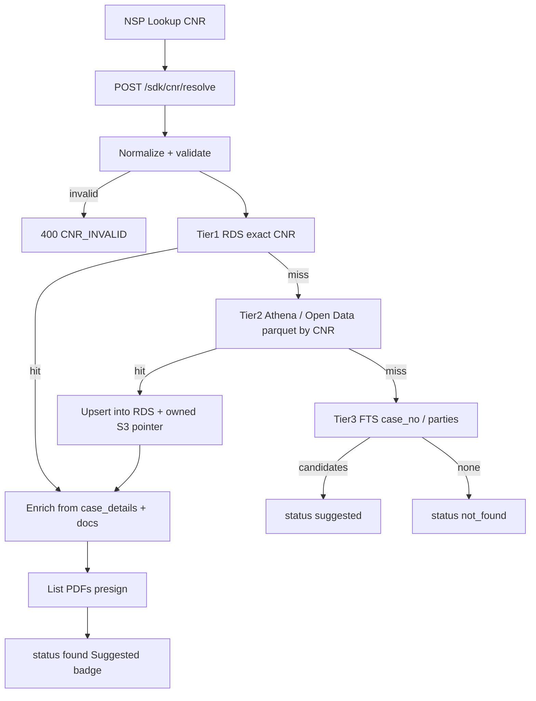

# NSP CNR Resolve — Corpus-only API + E2E plan (no live eCourts)

> **Status:** IMPLEMENTED (A–D code landed 2026-08-09; EC2 deploy pending explicit GO if not covered)  
> **Scope:** BOTH — NYV partner API + NYS data plane (RDS / Athena / owned S3)  
> **Out of scope for this phase:** Live NIC eCourts case-status scrape / `NYV_ECOURTS_API_KEY`  
> **Honesty:** Never claim “eCourts” or “Court Sync (eCourts)” in NSP UI for this path. Badge: **Suggested · Judgment corpus** (or Open Data SC/HC/DC).  
> **Related:** Court Sync = NyayaSearch knowledge (not eCourts); Patra Mitra for parse; EDJ for large ingest.

---

## 1. Product decision (locked for v1)

| Decision | Choice |
|---|---|
| Live eCourts | **Deferred** — do not block CNR autofill on it |
| Data plane | Own dump (RDS + owned S3) + **vanga AWS Open Data** mirrors (SC/HC; **DC = Andhra Pradesh + Telangana only** for now) |
| NSP UX on miss | Modal: “Not found in judgment corpus” + **manual continue** (not fake eCourts error) |
| Exact CNR hit | Autofill 02b with field-level provenance + **Suggested** badge |
| Ambiguous / fuzzy | Modal pick list — never silent overwrite |
| Attribution | CC-BY-4.0 to Open Data / vanga where required |

---

## 2. CNR Resolve API (draft)

### 2.1 Mount & auth

```
POST /api/nv/v1/sdk/cnr/resolve
GET  /api/nv/v1/sdk/cnr/:cnr
GET  /api/nv/v1/sdk/cnr/:cnr/documents
```

- **Auth:** `X-API-Key` (NSP: `NYV_SDK_KEY_NSP`) + `X-NYV-Platform: nsp`
- **Gateway:** NYV mounts routes; NYS implements data resolve (NYV BFF proxies like knowledge plane)
- **Alternate NYS direct (internal):** `POST /api/cnr/resolve` on nyayasearch worker (same payload)

### 2.2 Request

```http
POST /api/nv/v1/sdk/cnr/resolve
Content-Type: application/json
X-API-Key: <NYV_SDK_KEY_NSP>
X-NYV-Platform: nsp

{
  "cnr": "MHCC010123452024",
  "options": {
    "includeDocuments": true,
    "includeExtractPreview": false,
    "fuzzyLimit": 5,
    "jurisdiction": "IN"
  }
}
```

Also accept `cnrNumber` alias. Normalize: trim, uppercase, strip spaces/hyphens.

### 2.3 Validation (before any store call)

| Check | Rule |
|---|---|
| Present | non-empty |
| Shape | Prefer `/^[A-Z0-9]{16}$/` after normalize (Indian CNR commonly 16 chars) |
| Soft accept | Length 10–20 alphanumeric → continue with `validation: "soft"` |
| Reject | `< 10` or non-alnum → `400 CNR_INVALID` |

No live eCourts checksum required in v1; optional court-code table later.

### 2.4 Response (success — exact)

```json
{
  "success": true,
  "data": {
    "cnr": "MHCC010123452024",
    "status": "found",
    "matchType": "exact",
    "source": "nys_rds",
    "sourcesTried": ["nys_rds", "opendata_hc_parquet"],
    "confidence": 0.97,
    "claimEcourts": false,
    "ui": {
      "badge": "Suggested · Judgment corpus",
      "subtitle": "From NyayaSearch / Open Data judgment index — not live eCourts status"
    },
    "fields": {
      "courtName": { "value": "High Court of Bombay", "source": "nys_rds", "confidence": 0.97 },
      "courtType": { "value": "hc", "source": "nys_rds", "confidence": 0.97 },
      "caseType": { "value": "CRL", "source": "opendata_hc", "confidence": 0.9 },
      "caseNo": { "value": "…", "source": "nys_rds", "confidence": 0.9 },
      "petitioner": { "value": "…", "source": "nys_rds", "confidence": 0.95 },
      "respondent": { "value": "…", "source": "nys_rds", "confidence": 0.95 },
      "judges": { "value": ["…"], "source": "nys_rds", "confidence": 0.85 },
      "decisionDate": { "value": "2024-03-12", "source": "nys_rds", "confidence": 0.95 },
      "disposalNature": { "value": "…", "source": "opendata_hc", "confidence": 0.8 },
      "filingDate": { "value": null, "source": null, "confidence": 0, "note": "often absent in judgment metadata" },
      "nextHearingDate": { "value": null, "source": null, "confidence": 0, "note": "requires live docket — not in corpus v1" },
      "caseStatus": { "value": "DISPOSED", "source": "opendata_hc", "confidence": 0.7, "note": "inferred from disposal / decision date when present" },
      "actsSections": { "value": [], "source": "opendata_hc_case_details", "confidence": 0.75 },
      "advocates": { "value": [], "source": "opendata_hc_case_details", "confidence": 0.7 }
    },
    "documents": [
      {
        "id": "jdg_…",
        "kind": "judgment",
        "title": "…",
        "decisionDate": "2024-03-12",
        "s3Path": "s3://ns-highcourt-data-bucket/…",
        "pdfUrlKind": "presigned",
        "sourceArchive": "hc"
      }
    ],
    "candidates": []
  }
}
```

### 2.5 Response — suggested / not found

| `status` | Meaning | NSP UX |
|---|---|---|
| `found` | Exact CNR | Prefill 02b; badge Suggested |
| `suggested` | Fuzzy / case-no near match | Modal pick → then prefill |
| `not_found` | No corpus hit | Modal_CNR_Lookup_corpus_miss + manual |
| `invalid` | Validation fail | Inline error |

```json
{
  "success": true,
  "data": {
    "cnr": "…",
    "status": "suggested",
    "matchType": "fuzzy",
    "claimEcourts": false,
    "ui": { "badge": "Possible matches · Judgment corpus" },
    "fields": null,
    "documents": [],
    "candidates": [
      {
        "cnr": "…",
        "title": "…",
        "courtName": "…",
        "decisionDate": "…",
        "confidence": 0.62,
        "source": "nys_fts"
      }
    ]
  }
}
```

### 2.6 Documents sub-API

```http
GET /api/nv/v1/sdk/cnr/{cnr}/documents
```

Returns judgment/order list + presign hooks (reuse NYS `caselaw/documents/:id/pdf-url` / Athena extract). Optional:

```http
POST /api/nv/v1/sdk/cnr/{cnr}/attach-preview
{ "documentId": "…", "openPatraMitra": true }
```

→ opens Patra Mitra session on extracted text for counsel review (not required for autofill).

### 2.7 SDK (client-sdk additive)

```ts
nyv.cnr.resolve({ cnr })
nyv.cnr.get(cnr)
nyv.cnr.listDocuments(cnr)
```

SemVer bump + package CHANGELOG when implemented.

### 2.8 NSP field map → case create (02b)

| Resolve field | NSP case form |
|---|---|
| `courtName` / `courtType` | Court |
| `caseType` / `caseNo` | Case type / number |
| `petitioner` / `respondent` | Parties |
| `decisionDate` | Decision / disposed date (if form has it) |
| `cnr` | CNR (locked from input) |
| `documents[0]` | Optional “Attach judgment” |
| `nextHearingDate` | **Leave empty** in v1 (show helper: “Not available from judgment corpus”) |

Every bound control shows source chip from `fields.*.source`.

---

## 3. Resolve cascade (no live eCourts)



| Tier | Store | Query | Latency target |
|---|---|---|---|
| 1 | NYS Postgres `judgments` (+ optional `cnr_case_details`) | `WHERE upper(cnr) = $1` + index | &lt; 150 ms |
| 2 | Athena over HC/SC parquet (public or owned CTAS) + HC `parquet_case_details` | `cnr = '…'` / partition prune by year if known | &lt; 3–8 s (cache result) |
| 3 | Existing caselaw FTS / hybrid | `q=cnr` or tokens | &lt; 500 ms |

**On Tier-2 hit:** write-through to RDS so next NSP lookup is Tier-1 (cache warming).

---

## 4. Data plane — own dump + vanga S3

### 4.1 Public Open Data (read; prefer sync not scrape)

| Corpus | Bucket (public, `--no-sign-request`) | Key objects |
|---|---|---|
| Supreme Court | `s3://indian-supreme-court-judgments/` | `metadata/parquet/`, `data/tar/`, metadata includes **`cnr`** |
| High Courts | `s3://indian-high-court-judgments/` | `metadata/parquet/`, `metadata/parquet_case_details/` (**per-CNR** rich fields), `data/tar/` |
| District | `s3://indian-district-court-judgments/metadata/parquet/year=*/state={2\|29}/cases.parquet` | **AP (2) + Telangana (29) only** — `cino`→CNR; `ingest-rds dc\|delta-dc`; daily via `nys-cnr-index-sync` |

Repos / code: [vanga/indian-supreme-court-judgments](https://github.com/vanga/indian-supreme-court-judgments), [vanga/indian-high-court-judgments](https://github.com/vanga/indian-high-court-judgments), [vanga/indian-district-court-judgments](https://github.com/vanga/indian-district-court-judgments). License: **CC-BY-4.0** (attribute).

### 4.2 Already in Nyayasiddhi (reuse)

- Athena tables / CTAS over public parquet → owned result paths (`judgments_meta`, `judgments_meta_hc`)
- Owned PDF buckets + sibling fallback (`ns-highcourt-data-bucket`, etc.)
- RDS caselaw with `cnr`, `case_no`, parties, `s3_path` / `pdfLink`
- Extract API + archive search

### 4.3 New / reinforce for CNR v1

1. **`judgments_cnr_uidx`** (or confirm `judgments_cnr_idx`) — exact lookup path in API code (not only FTS).  
2. **`cnr_case_details` table** (NYS) — sync from HC `metadata/parquet_case_details` (one row per CNR: acts, hearings snapshot, advocates, linked docs).  
3. **Ingest job** `nys-cnr-index-sync` — daily:  
   - `aws s3 sync` parquet deltas from public → staging  
   - merge CNR rows into RDS  
   - optional PDF pointer reconcile to owned bucket  
4. **Attribution row** in API `meta.attribution` for Open Data.

---

## 5. E2E implementation plan (phased)

### Phase A — Index + NYS resolve (1–2 weeks)

| # | Work | Owner |
|---|---|---|
| A1 | Confirm CNR coverage % on RDS SC/HC; backfill nulls from parquet where possible | NYS |
| A2 | DDL: `cnr_case_details` + unique index on `judgments(cnr)` where not null | NYS |
| A3 | `POST /api/cnr/resolve` on NYS (Tier1→2→3) | NYS |
| A4 | Unit/integration tests: exact / soft / not_found / fuzzy | NYS |
| A5 | Smoke on worker with known CNRs from parquet sample | NYS |

### Phase B — NYV partner surface + SDK (3–5 days)

| # | Work | Owner |
|---|---|---|
| B1 | Proxy ` /api/nv/v1/sdk/cnr/*` → NYS (dualSdkOrJwt / SDK key) | NYV |
| B2 | `nyv.cnr.*` in `@nyayavigya/client-sdk` + CHANGELOG bump | NYV |
| B3 | FEATURES-REGISTRY + playbook § CNR corpus resolve | BOTH docs |
| B4 | Partner smoke: NSP key resolve exact + not_found | NYV |

### Phase C — NSP Lookup Case UX (NSP repo)

| # | Work | Owner |
|---|---|---|
| C1 | CNR field → call resolve; bind 02b with Suggested badge | NSP |
| C2 | Modal_CNR_corpus_miss + manual path | NSP |
| C3 | Modal candidate picker for `suggested` | NSP |
| C4 | Optional “Attach judgment PDF” via documents[] | NSP |
| C5 | Copy: never “eCourts” / “Court Sync (eCourts)” | NSP |

### Phase D — Continuous corpus freshness (ongoing)

| # | Work | Owner |
|---|---|---|
| D1 | Daily parquet sync job (SC+HC); metrics: new CNRs / day | NYS |
| D2 | Write-through cache from Athena hits | NYS |
| D3 | District Open Data AP+TG (`court_type=dc`, `cino`) — code landed; worker DDL+backfill needs GO | NYS |
| D4 | Lawyer-upload enrichment (see §6) | NSP+NYV |

**Exit criteria (v1):**  
- Exact CNR from HC/SC corpus → autofill &lt; 2s p95 (warm RDS)  
- `claimEcourts: false` always  
- not_found → manual without blocking case create  
- Docs + smoke evidence in Project-Tracker  

---

## 6. Free / low-cost ways to improve “freshness” (no paid NIC)

There is **no free official real-time eCourts case-status API**. Anything “live” either uses restricted keys, fragile scraping (CAPTCHA, ToS, outage risk), or lagging Open Data. Recommended stack:

### Tier S — Best free default (do this)

**AWS Open Data daily sync (vanga pipelines)**  
- Sync `metadata/parquet` (+ HC `parquet_case_details`) into owned S3 / Athena / RDS.  
- Near-daily freshness for **published** judgments/orders — not pending hearings.  
- Pros: legal (CC-BY), scalable, already your architecture.  
- Cons: lag; pending matters miss.

### Tier S2 — Write-through on demand

On Tier-2 Athena hit, upsert RDS so hot CNRs stay fast. Pros: self-warming cache. Cons: first hit slower.

### Tier C — Community / user enrichment (high value for NSP)

When a lawyer creates a case with CNR + uploads order PDF / typed parties:  
- Store in **tenant matter** (private)  
- Optionally contribute **non-PII judgment metadata** to org/global index if policy allows  
Pros: fills gaps Open Data lacks. Cons: governance + consent.

### Tier D — District corpus adoption

**District AP+TG:** `cino` mapped to `judgments.cnr` with `court_type=dc`. Same RDS exact resolve path. Other states deferred until product expands scope.

### Avoid as “realtime free product spine”

| Method | Why not as primary |
|---|---|
| High-concurrency scrape of services.ecourts.gov.in / judgments portal | CAPTCHA, IP blocks, ethics; vanga already asks you to use Open Data |
| Claiming Court Sync = eCourts | False advertising |
| Unofficial third-party paid “CNR APIs” without contract | Legal/reliability risk |

### If true realtime status is required later (separate phase)

1. Official / licensed NIC or state API if obtainable.  
2. Existing NYV `/api/nv/ecourts/*` adapter **only when** key+SLA exist — badge `Live eCourts`.  
3. Until then keep corpus resolve as default.

---

## 7. Ops metrics

| Metric | Target |
|---|---|
| CNR exact hit rate (HC sample) | Track weekly % |
| p95 resolve (RDS hit) | &lt; 200 ms |
| p95 resolve (Athena cold) | &lt; 8 s |
| Daily parquet sync success | &gt; 99% job success |
| NSP autofill acceptance (user keeps fields) | Product analytics |

---

## 8. Acceptance tests (NSP)

1. Valid CNR present in RDS → 200 `found`, parties/court filled, badge Suggested, `claimEcourts=false`.  
2. Valid CNR only in HC parquet → 200 `found` after Tier-2; second call Tier-1.  
3. Unknown CNR → `not_found`; case create still possible manually.  
4. Garbage CNR → 400.  
5. Fuzzy case number → `suggested` + ≥1 candidate; no silent autofill.  
6. Document list returns presignable owned/sibling path when PDF mirrored.  
7. UI copy audit: zero “eCourts” strings on this path.

---

## 9. Implementation sketch (owners)

| Component | Path (intended) |
|---|---|
| NYS resolve service | `NYS-Agentic-AI/artifacts/api-server/src/routes/cnr.ts` + `lib/cnrResolve.ts` |
| NYS sync job | `scripts/nys-cnr-index-sync` (parquet → RDS) |
| NYV routes | `nyayavigya-platform-312/src/routes/nv-cnr-routes.ts` mount `/api/nv/v1/sdk/cnr` |
| SDK | `packages/client-sdk/src/api/CnrApi.ts` |
| NSP | Lookup Case → resolve → 02b |

---

## 10. Summary

- **API:** `POST /api/nv/v1/sdk/cnr/resolve` — corpus cascade, provenance, never eCourts claim.  
- **Plan:** Index → NYS resolve → NYV/SDK → NSP UX → daily Open Data sync.  
- **Realtime free:** There is no honest free live docket API; **best method** is **vanga Open Data → owned S3/Athena/RDS** (already in progress) + write-through + optional lawyer enrichment; live eCourts later as optional Tier 0.
