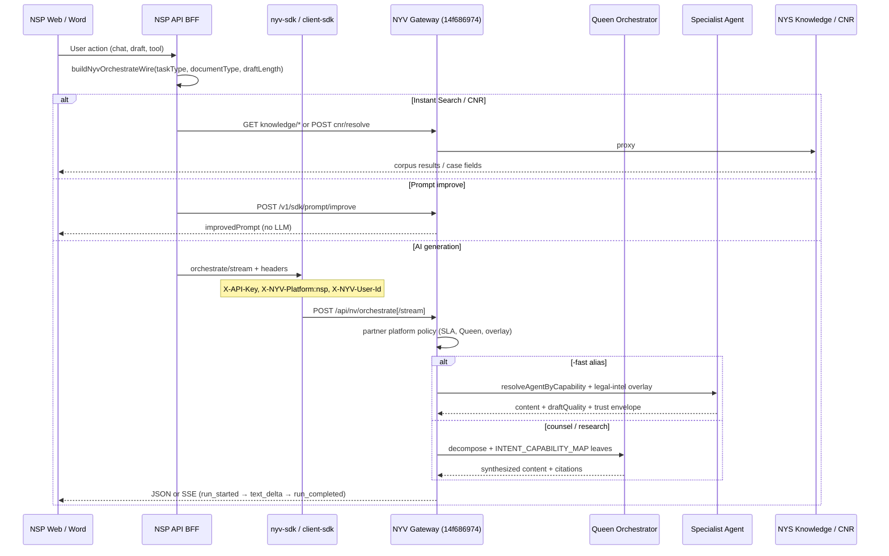

# NSP → NYV AI Task Surface — Quick Reference (2026-09)

> **Audience:** NSP backend / BFF / mobile leads  
> **Snapshot date:** 2026-10-04T18:35:00Z (UTC)  
> **Live deploy:** **`2026-10-04T1820Z-aws-ssm`** (NV-NSP-SLA-QE-001). **Full green:** `npm run nsp:ai:matrix:ec2` (QE + `llm_route_budget`) + `npm run nsp:wavec:ec2` (Legal Work / Matter Vault / evidence-pack / `analyzeDocument`+`document-analyst`).  
> **Client SDK:** **`@nyayavigya/client-sdk` 5.2.0** (56 CNR resolve keys; registry format **5.1.0**, **164** agents on health)  
> **Live API:** `https://api.nyayasiddhi.online`  
> **No secrets in this doc.** SDK keys live on nysdev canonical env only. **Case search / resolve detail:** [`NSP-CASE-SEARCH-INTEGRATION-2026-09.md`](./NSP-CASE-SEARCH-INTEGRATION-2026-09.md).

**Superset contract (detail):** [`NSP-NYV-AI-HANDSHAKE-2026-09.md`](./NSP-NYV-AI-HANDSHAKE-2026-09.md)  
**Bundle index:** [`NSP-NYV-HANDOFF-README-2026-09-16.md`](./NSP-NYV-HANDOFF-README-2026-09-16.md)

---

## Executive summary

On deploy **`49c047445`**, NSP reaches NYV through **`POST /api/nv/orchestrate`** and **`POST /api/nv/orchestrate/stream`**, plus dedicated SDK routes (prompt improve, CNR, knowledge, intelligence). **Counsel-grade gate:** live eval **15 ok / 0 fail / 0 blocked** (SSM `5bd36184`). **Stream SSE (NV-NSP-STREAM-META-001):** `run_completed` includes `draftQuality`, `qualityEnvelope`, `riskBadge`, `auditHash`; `inferredDocumentType` on draft streams when NYV infers doc type. **NSP P1 UI closed** on Pro **`fb439-e339e717-09171715`** (2026-09-17): chat-only `draftQuality`, `DraftComprehensiveUpgradeBanner`, hub `#/ai-usage?tool=` deep-links. **Remaining product limits:** pre-2000 SCR para structure; pending SC diary `cnr=null` (use `fields.caseNo` e.g. C.A./SLP number); generic SLP tsquery 0-hit.

---

## Master table: NSP feature → NYV taskType → endpoint → mode → status

| NSP feature / surface | NYV `taskType` | NYV endpoint | Mode | Status |
|---|---|---|---|---|
| **Legal chat (default rail)** | `legal-chat-fast` | `POST /api/nv/orchestrate` or `/stream` | Sync / SSE | **PASS** |
| **Legal chat (counsel / “best”)** | `legal-chat` | same | Sync or worker | **PASS** (not for 55s UI threads) |
| **Prompt improve / enhancement** | — (not orchestrate) | `POST /api/nv/v1/sdk/prompt/improve` | Sync | **PASS** |
| **Legal draft — Fast** | `legal-draft-fast` | orchestrate / stream | Sync / SSE | **PASS** |
| **Legal draft — Standard** | `legal-draft-fast` + `options.draftLength: medium` | orchestrate / stream | Sync / SSE | **PASS** |
| **Legal draft — Comprehensive** | `legal-draft` + `draftLength: comprehensive` | orchestrate (worker) | Async poll (NSP BFF durable SSE meta) | **PASS (code)** — wired FB-423/424/428; E2E prod verify recommended |
| **Doc-grounded draft (fast)** | `doc-draft-fast` | orchestrate / stream | SSE preferred | **PASS** |
| **Doc-grounded draft (counsel)** | `legal-draft` / `doc-draft-deep` | orchestrate | Async | **PASS (code)** — same comprehensive worker path |
| **Legal research (deep)** | `legal_research` / `analysis` | orchestrate | Counsel / worker (~600s) | **PASS** |
| **Case summary / summarization** | `summarize` / `case-summary` | orchestrate | Sync / queued worker | **PASS** |
| **Matter summarizer** | `summary` | orchestrate | Sync | **PASS** |
| **Doc pipeline summarize** | — | `POST /api/nv/sdk/docs-pipeline/documents/summarize` | Sync | **PASS** |
| **Doc intelligence (`analyzeIntelligenceLong`)** | `analyzeDocument` + `agentKey: document-analyst` | `POST /api/nv/orchestrate` (NSP `nsp-ai-summary` worker) | Sync **90–180s** | **PASS** — probe `nsp:wavec:ec2`; `qualityEnvelope.ok` |
| **Wave C — Legal Work evaluate** | — | `POST /api/nv/legal-work/evaluate` | Sync up to **180s** (202 if still running) | **PASS** |
| **Wave C — Matter Vault** | — | `/api/nv/matter-vault/*` (+ `/packs` alias) | Sync | **PASS** |
| **Wave C — evidence pack** | — | `GET /api/nv/compliance/evidence-pack` | Sync | **PASS** |
| **Caselaw search (Instant Search)** | — | `GET /api/nv/knowledge/caselaw/search?mode=fts\|hybrid` | Sync | **PASS** — hybrid auto **FTS fallback** when empty (`searchMode: fts_fallback` in payload) |
| **Statute / acts lookup** | `statute-research` (orchestrate) / direct | `GET /api/nv/knowledge/statutes/search` | Sync | **PASS** |
| **CNR / diary resolve** | — | `POST /api/nv/v1/sdk/cnr/resolve` | Sync | **PASS** — unified `{ identifier }`; SDK **5.2.0** / **56** resolve keys + optional `nspParseGuide`; gap closure **`NV-CASE-CORPUS-FIELD-GAP-CLOSURE-001`** (linkedMatters, incidentDate, caseTypeDisplay, court/complex codes). See [`NSP-CASE-SEARCH-INTEGRATION-2026-09.md`](./NSP-CASE-SEARCH-INTEGRATION-2026-09.md). |
| **NyayaWatch rules (NSP alias)** | — | `GET /api/nv/intelligence/nyayawatch/rules` (**alias**) · canonical `GET /api/nv/nyaya-tools/watch/rules` | Sync | **PASS** — same handler + `dualSdkOrJwt` auth (**NV-NSP-NYAYAWATCH-ALIAS-001**) |
| **AI tools (Hub / Assist)** | per tool: `research`, `risk-assessment`, `legal-research`, etc. | orchestrate via NSP BFF | Sync / queue | **PASS** |
| **Legal Chat tools: web search** | `web-search` + `tools: ['web-search']` | orchestrate **and** `/stream` | SSE + sync | **PASS** (NV-NSP-AI-PARITY-001 — live SERP on stream; `web_search_ready` + `run_completed.webSearch`) |
| **Legal Chat tools: instant search** | — | NSP → knowledge plane (`instantSearchParallel`) | Sync | **PASS** |
| **Web search (Hub / workflow)** | `web-search`, `workflow-suggest`, `trending` | orchestrate | Sync 90s | **PASS** |
| **Legal intelligence overlay** | all orchestrate paths | enforced in gateway | — | **PASS** |
| **Memory / context** | any + `enableMemory: true` | orchestrate | — | **PASS** |
| **Extract case fields** | — | `POST /api/nv/v1/sdk/intelligence/extract-case` | Sync / durable enrich | **PASS** |
| **Patra Mitra (doc companion)** | — | `POST /api/nv/v1/sdk/patra-mitra/*` | Sync | **PASS** |
| **Contract review / compliance** | `contract_review`, `compliance-check` | orchestrate | Sync / queue | **PASS** |
| **Legal feed / regulatory** | — | `GET /api/nv/v1/sdk/legal-intelligence/feed*` | Sync | **PASS** |
| **Precedent search (Assist)** | `caselaw-research` / `precedent-research` | orchestrate + knowledge | Sync | **PASS** |
| **Draft evaluation** | `evaluate-draft` | orchestrate | Sync SLA lean | **PASS** |
| **Voice STT (Legal Chat mic)** | — | `POST /api/nv/legal-chat/voice/transcribe` | Sync | **PASS** |

**Do NOT use for partner drafts:** `POST /api/nv/gateway/documents/draft` (hardcodes Queen; `-fast` SLA never applies).

**Four honoured `-fast` aliases only:** `legal-chat-fast`, `legal-draft-fast`, `doc-draft-fast`, `document-draft-fast`.

---

## Architecture flow (NSP BFF → NYV)



---

## Key request / response fields

### NSP must send (orchestrate)

| Field | Required | Notes |
|---|---|---|
| `X-API-Key` | Yes | Also `Authorization: Bearer <key>` |
| `X-NYV-Platform: nsp` | Yes | Selects best-outcome depth |
| `X-NYV-User-Id` or body `userId` | Recommended | Per-user memory (numeric) |
| `prompt` | Yes | Task instruction |
| `taskType` | Yes | Use `-fast` aliases for interactive UI |
| `parameters.documentType` | Recommended | NYV infers if omitted (HTTP 200, not 400) |
| `options.draftLength` | Recommended | `low` / `medium` / `comprehensive` |
| `sessionId` | Recommended | Multi-turn continuity |
| `enableMemory` | When needed | Requires `userId` |
| `ragDocumentIds` | When doc-grounded | Index first — do not paste whole files |
| `syncTimeoutMs` | Optional | ≤90s auto-routes bare draft/chat to `-fast` unless `qualityMode: counsel` |

### NSP can read (orchestrate response)

| Field | When present | Partner action |
|---|---|---|
| `content` | Always on success | Render answer / draft body |
| `draftQuality` | Draft paths | `voiceOk`, `structureMarkers`, `routingHint`, `inferredDocumentType`, `documentTypeSource` |
| `qualityEnvelope` | Most paths | Quality gate outcome |
| `riskBadge` / `auditHash` / `trust` | Partner trust envelope | Display / audit |
| `citations` | Research / counsel | Source list |
| `documentContext` | Inline doc sent | Check `truncated` — index if true |
| `routing.path` | Always | `specialist` vs `queen` — debug misconfig |
| `requestPhase` | In-flight | Show progress; never map to timeout while `generating` |
| `optionalDegraded` | With content | Success with optional quiet note |
| `sessionId` / `requestId` | Always | Log correlation |

**Stream rule:** gated SSE deltas (`gated: true`) → **replace** entire editor body, not append.

**Comprehensive async (NSP BFF):** emit one SSE meta event (`mode: durable`, `taskId`, `pollPath`) then `[DONE]` — zero `text_delta`. Worker calls NYV with bare `legal-draft`, `options.draftLength: comprehensive`, `enableCoT: true`. Full contract: handshake §3.4.

---

## Compliance & governance per request

Every orchestrate call on deploy **`fe966a94`** follows **NV-ARCH-001**: tenant auth → safety ring → response engineering → audit. **Fast paths shorten Queen/CoT depth — they do not skip PII, hallucination/citation, quality envelope, or partner trust fields.**

### Request lifecycle (summary)

`SDK/JWT auth` → `consentGate (ai_processing)` → `platform policy (-fast vs counsel)` → `quality envelope ingress` → **PII redact input** → `compliance pre-check` → `LLM via NV-LLM-001 ring only` → **hallucination + citation verify** → `HITL queue if high/critical risk` → `buildUnifiedOrchestrationContract` → **`sanitizeOrchestrationPayloadForClient`** → JSON or SSE `run_completed` → async IronLedger hash chain.

### Storage per request

| Layer | What | Fast | Queen |
|---|---|---|---|
| **`nv_audit_logs`** (IronLedger) | Hash-chained audit: requestId, input/output SHA-256, agent, model | Yes | Yes |
| **`usage_logs`** | Tokens, model, latency, tier | Yes | Yes |
| **`hitl_reviews`** | Pending review when risk high/critical (async — does not block delivery) | Yes | Yes |
| **`nv_cam_actions`** | DPDPA consent breach events | Yes | Yes |
| **Memory tiers** (session / Postgres / Redis) | When `enableMemory:true` + userId | Yes (may skip RAG) | Full fan-in |
| **Partner response** | `auditHash` fingerprint — NSP should persist with `requestId` | Yes | Yes |

Plaintext prompts/responses are **not** stored in IronLedger — hashes only. HITL stores truncated output (≤20k chars).

### PII redaction & output sanitize

| Stage | Service | Always-on? |
|---|---|---|
| **Input** | `nv-client.redactPII` + `safety-pipeline` Step 1 (30+ patterns; +JCN if `NYV_F_PII_JCN=1`) | **Yes** |
| **Output content** | `nv-client-outcome-sanitize.ts` — strips CoT, Queen traces, GRPO internals, overlay markers, `<thinking>` blocks | **Yes** |
| **Fast polish** | `nv-fast-delivery-polish` + `nv-partner-human-polish` (removes “As an AI…” markers) | Fast only |
| **SSE terminal** | `run_completed` sanitized + **sync-parity** `draftQuality`/`inferredDocumentType` (NV-NSP-STREAM-META-001); corrective gated delta when polish changes body | **Yes** |

Partners receive: `content`, `citations`, `qualityEnvelope`, `riskBadge`, `auditHash`, `attestationRequired`, `draftQuality`. Partners **never** receive: `executions`, `chainOfThought`, `grpoSignals`, `queenTrace` (unless internal `NYV_EXPOSE_ORCHESTRATION_DIAGNOSTICS=1`).

### Fast vs Queen — compliance comparison

| Control | Fast (`*-fast`) | Queen (counsel) |
|---|---|---|
| PII shield | **Always** | **Always** |
| Hallucination + citation | **Always** (NSP cannot opt out) | **Always** + post-synthesis |
| Quality envelope (13 steps) | **Mandatory** — fail-closed in prod | **Mandatory** |
| CoT | **OFF** (internal never leaked) | ON internally; stripped from partner payload |
| Maker-checker | Skipped (SLA) | ON when risk / counsel requires |
| RAG / memory depth | Reduced (chat-fast may skip RAG without docs) | Full Step-0 fan-in |
| HITL queue | When risk elevated | Same |
| `attestationRequired` | Computed from draft quality + risk | Same |
| IronLedger audit | When `auditWire` ON (default non-dev) | Same |

### NSP responsibilities (legal platform)

1. **Persist** on every call: `requestId`, `sessionId`, `riskBadge`, `auditHash`, `qualityEnvelope`, `attestationRequired`.
2. **Block export** when `attestationRequired:true` — NYV signals only; gate is NSP UX.
3. **Do not treat HITL as “passed”** until review completes — initial response may still deliver while review is pending.
4. **Maintain DPDP consent** for `ai_processing` — NYV logs breaches to CAM (observation mode default; enforce with `NV_DPDPA_CONSENT_ENFORCE=1` when ready).

**Code SSoT:** `nv-quality-envelope.ts`, `nv-client-outcome-sanitize.ts`, `safety-pipeline.ts`, `nv-orchestration-response-contract.ts`.

---

## Known gaps

| Gap | Owner | Status |
|---|---|---|
| **Legal Chat draft — `draftQuality` on chat-only stream** | **NSP** | **DONE** `fb439-e339e717-09171715` — Fast default on chat-only stream |
| **UI honour `draftQuality.routingHint`** | **NSP** | **DONE** `fb439` — `DraftComprehensiveUpgradeBanner` comprehensive upgrade CTA |
| **Hub catalogue null routes** | **NSP UI** | **DONE** `fb439` — catalogue + `#/ai-usage?tool=` deep-link |
| **Comprehensive async E2E in prod** | **NSP** | Code wired (durable SSE + worker); prod smoke still recommended |
| **`documentType` on every draft stream/worker** | **NSP** (recommended) | NYV infers if omitted — no 400 |
| **CNR ops backlog (`cnr_case_details` refresh + DC ingest)** | **Ops** | **PAUSED** — Appendix D.5.1; `delta-dc` stopped 2026-09-18; P1 max resolve **LIVE** deploy `2026-09-19T0800Z-aws-ssm` (**`30ae45d6`**) |
| **SC pending diary `fields.cnr` null** | **Data limit** | Wiring **DONE** — diary resolve returns `fields.caseNo` (C.A./SLP/W.P.); store diary as primary key; backfill CNR when assigned |
| **Pre-2000 SCR paragraph structure** | **Corpus era** | Marginal letters vs numbered paras — documented limit |
| **Generic SLP tsquery 0-hit** | **NYS search** | Use specific statute/citation queries; `mode=fts` for section queries |
| **Caselaw `mode=default` empty** | **Query UX** | Prefer explicit `mode=fts` or `mode=hybrid` |
| **Prompt improve not in typed SDK** | **NYV SDK** | Route live; call via raw POST |
| **DPDP consent enforcement** | **NYV ops** | Observation-only default; flip `NV_DPDPA_CONSENT_ENFORCE=1` when ready (GO-gated) |
| **HITL async advisory** | **By design** | Does not block delivery — NSP must hold export if review required |

### SC diary-only case creation (NSP)

> **Full handoff:** [`NSP-CNR-DIARY-MATTER-CREATION-2026-09.md`](./NSP-CNR-DIARY-MATTER-CREATION-2026-09.md) — API contract, matter schema, workflows, UI/UX, error handling, verification. **Court-type auto-routing:** **Appendix E** — send `{ "identifier": "…" }` (16-char CNR or SC diary); NYV infers HC/DC/SC via chars 3–4; response `meta.inferredCourtType`. **Infra + E2E plan (verified):** **Appendix F** — RDS/S3/nysapi topology, NSP→NYV→nysapi flow, P0–P3 + ops backlog. **Maximum corpus detail:** **§12** + `profile: caseCreate`. **HC/DC coverage:** **Appendix D**. **Gap matrix:** **Appendix C**.

**Live probes 2026-09-17:** all **10/10** user diaries resolved via `cnr/resolve`; **8/10** have formal case numbers with **`cnr=null`**; **2/10** diary-only (parties known, no case number yet).

#### Identifier lifecycle (before and after CNR)

| Stage | Identifier | Example | When |
|---|---|---|---|
| T0 Filing | **Diary number** | `17329/2025` | Immediately at Registry counter |
| T1 Registration | **Case number** | `SLP(C) No. 31416/2026` | After verification + registration |
| T2 eCourts | **CNR** (16-char) | `ESCR010007972023` | At registration; corpus sync may lag |
| T3 Judgment | **INSC citation** | `2023 INSC 1081` | After reporting — not a filing id |

Compact diary: `173292025` → NYV normalizes to `17329/2025` (NV-DIARY-COMPACT-NORM-001).

#### SC case-number prefixes (official portal types)

| Prefix | Full name | Nature |
|---|---|---|
| **SLP(C)** | Special Leave Petition (Civil) | Art. 136 civil appellate |
| **SLP(Crl)** | Special Leave Petition (Criminal) | Art. 136 criminal appellate |
| **C.A.** | Civil Appeal | Direct/statutory civil appeal |
| **Crl.A.** | Criminal Appeal | Direct criminal appeal |
| **W.P.(C)** | Writ Petition (Civil) | Art. 32 original writ |
| **W.P.(Crl)** | Writ Petition (Criminal) | Criminal writ |
| **T.P.(C)** / **T.P.(Crl)** | Transfer Petition | Inter-court transfer |
| **T.C.(C)** / **T.C.(Crl)** | Transferred Case | Case transferred to SC |
| **R.P.(C)** / **R.P.(Crl)** | Review Petition | Review of SC judgment |
| **Curative** | Curative Petition | Post-review remedy |
| **Contempt** | Contempt Petition | Civil/criminal contempt |
| **Arb.P.** | Arbitration Petition | S.11 / enforcement |
| **MA** | Miscellaneous Application | Interlocutory in parent matter |
| **O.S.** | Original Suit | Original civil jurisdiction |
| **Ref.** / **Tax Ref.** / **E.P.** | Death ref / Tax ref / Election | Registry-assigned |
| **SM WP/TP/Contempt** | Suo Motu | Court-initiated |

Any prefix may appear **while `cnr` is still null** in corpus/API — case number and CNR are separate clocks.

#### NSP status machine

| State | Condition | UI |
|---|---|---|
| `diary_filed` | User entered diary; resolve pending | Show diary as docket |
| `pending_registration` | Found, **`caseNo` empty** | "Registration pending" (e.g. VARALI, CANARA BANK diaries) |
| `case_number_assigned` | Found, **`caseNo` set**, `cnr` empty | Show **`caseNo`** prominently |
| `cnr_registered` | Re-resolve returns `cnr` | Display CNR; retain diary as alias |
| `diary_not_in_corpus` | `status=not_found` | Manual matter / retry |

#### Resolve workflow

1. Normalize diary → `NNNNN/YYYY` (compact `173292025` → `17329/2025`).
2. `POST /api/nv/v1/sdk/cnr/resolve` with `{ identifier: "173292025", options: { profile: "caseCreate" } }` — **prefer `identifier`** (legacy `diaryNumber` / `cnr` still accepted). Live 2026-09-17: returns `meta.inferredCourtType=sc`, `identifierKind=diary`.
3. On **found**: store **`diaryNumber`** as primary key; **`fields.caseNo`** as provisional docket; parse prefix from `caseNo` string (`fields.caseType` often null for pending SC).
4. Leave **`cnr` empty** until re-resolve populates it — **normal** for months after SLP/C.A./W.P. assignment.
5. Poll weekly or on user refresh; when CNR appears → `cnr_registered`.
6. Do **not** use case number alone as primary key — collisions across years/types possible.

**User sample mapped (2026-09-17):**

| Diary | Case number | Stage |
|---|---|---|
| `17329/2025` | C.A. No. 4657/2026 | case_number_assigned |
| `50850/2026` | SLP(C) No. 31416/2026 | case_number_assigned |
| `45155/2024` | C.A. No. 10900-10902/2025 | case_number_assigned |
| `44418/2026` | SLP(C) No. 32065/2026 | case_number_assigned |
| `40531/2026` | W.P.(C) No. 933/2026 | case_number_assigned |
| `7319/2026` | SLP(C) No. 7021/2026 | case_number_assigned |
| `46024/2024` | SLP(C) No. 27802/2024 | case_number_assigned |
| `46771/2026` | SLP(C) No. 32066-32067/2026 | case_number_assigned |
| `25293/2024` | *(empty)* | pending_registration |
| `46569/2024` | *(empty)* | pending_registration |

---

## Verification (no keys in doc)

```bash
cd nyayavigya-platform-312
npm run partner:smoke:ec2          # 7 platforms, 0 failures expected
npm run demo:probe:ec2              # full crosscheck
npm run demo:probe:draft-length:ec2 # draft SLA / token bands
```

Probes **SKIP** (not PASS) when keys absent locally — EC2 SSM is authoritative.

---

## Cross-refs

| Doc | Scope |
|---|---|
| [`NSP-CNR-DIARY-MATTER-CREATION-2026-09.md`](./NSP-CNR-DIARY-MATTER-CREATION-2026-09.md) | CNR/diary resolve → NSP matter creation (schema, status machine, live probes) |
| [`NSP-NYV-AI-HANDSHAKE-2026-09.md`](./NSP-NYV-AI-HANDSHAKE-2026-09.md) | Authoritative superset — headers, tiers, SSE/async, LLM sequence, errors |
| [`NSP-NYV-HANDOFF-README-2026-09-16.md`](./NSP-NYV-HANDOFF-README-2026-09-16.md) | Bundle index + verification commands |
| [`NSP-NYV-DRAFT-HANDSHAKE-2026-09.md`](./NSP-NYV-DRAFT-HANDSHAKE-2026-09.md) | Stream vs async draft routing, worker payload |
| [`NSP-NYM-AI-TASK-ENDPOINTS-2026-08-17.md`](./NSP-NYM-AI-TASK-ENDPOINTS-2026-08-17.md) | Per-endpoint timeout matrix, error mapping |
| [`NSP-LEGAL-INTELLIGENCE-SDK-SURFACE-2026-08.md`](./NSP-LEGAL-INTELLIGENCE-SDK-SURFACE-2026-08.md) | Instant Search, feed, intelligence SDK |
| [`PATRA-MITRA-API-NSP-NYM-NYS-2026-08.md`](./PATRA-MITRA-API-NSP-NYM-NYS-2026-08.md) | Patra Mitra full API |
