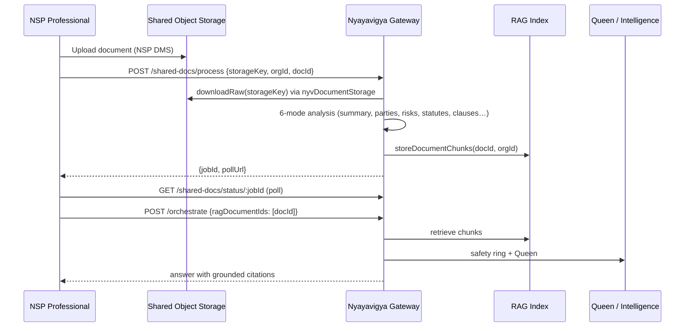

# NSP Partner SDK Integration Guide — Nyayavigya Platform 5.0.0

> **Audience:** Nyayasiddhi Professional (NSP) engineering — backend, mobile proxy, and QA.
> **Status:** Dev-live sandbox (`https://api.nyayasiddhi.online`) — developer testing GO; customer-facing production gated on cutover checklist.
> **SDK version:** `@nyayavigya/client-sdk` **5.0.10**
> **Updated:** 2026-08-12 — Patra Mitra typed API · orchestrate trust fields · CNR · partner smoke.
> **Authority chain:** DB scopes → `docs/canonical/04-sdk-and-api-canonical-2026-05-07.md` → this guide.
> **Companion:** [`NSP-API-HANDOFF-2026-08-12.md`](./NSP-API-HANDOFF-2026-08-12.md) (short API pack), `ECOSYSTEM-SDK-INTEGRATION-GUIDE-2026-07.md` (all 7 platforms), `04c-sdk-troubleshooting-2026-05-11.md`

---

## Table of contents

1. [Executive summary](#1-executive-summary)
2. [Live environment & onboarding](#2-live-environment--onboarding)
3. [Authentication & scopes](#3-authentication--scopes)
4. [SDK installation & NyvClient surface](#4-sdk-installation--nyvclient-surface)
5. [API ↔ SDK mapping (full feature matrix)](#5-api--sdk-mapping-full-feature-matrix)
6. [Feature integration playbooks](#6-feature-integration-playbooks)
7. [Architecture — long prompts](#7-architecture--long-prompts)
8. [Architecture — shared documents (NSP → Nyayavigya)](#8-architecture--shared-documents-nsp--nyayavigya)
9. [Testing & verification](#9-testing--verification)
10. [Troubleshooting](#10-troubleshooting)
11. [Reference links](#11-reference-links)

---

## 1. Executive summary

Nyayavigya is the **AI backbone** for the Nyayasiddhi ecosystem. NSP (Nyayasiddhi Professional) integrates via:

| Layer | What you use |
|---|---|
| **HTTP API** | Single gateway: `https://api.nyayasiddhi.online` — all paths under `/api/nv/*` |
| **Official SDK** | `@nyayavigya/client-sdk` v5.0.10 — typed wrappers; auto-unwraps `{ success, data }` |
| **Auth** | `X-API-Key: nyv_live_sk_…` (env: `NYV_SDK_KEY_NSP`) |
| **OpenAPI** | Live paths at `GET /api/nv/docs` |
| **API handoff (Aug 2026)** | [`NSP-API-HANDOFF-2026-08-12.md`](./NSP-API-HANDOFF-2026-08-12.md) |

Every AI call traverses the **NV-ARCH-001 safety ring**: tenant isolation → guardrails → Queen orchestration (when engaged) → agent allocation → RAG/memory → LLM routing → citation/hallucination checks → partner `riskBadge`/`auditHash` + audit hash chain.

**NSP-specific highlights (Aug 2026):**

- **Queen auto-orchestration** (`NYV-SDK-AUTO-ORCH-001` + ecosystem best-outcome): complex prompts on `/api/nv/orchestrate` engage multi-agent Queen with RAG/citation ON — no `orchestrationMode` needed for most legal work.
- **Partner trust fields:** `riskBadge`, `auditHash`, `trust` on every orchestrate outcome (live `2026-08-12T1734Z`).
- **Patra Mitra:** `nyv.patraMitra.*` for Word/selection/short-doc companion.
- **CNR resolve:** `nyv.cnr.*` corpus autofill (`claimEcourts:false`).
- **Edge timeout:** ALB + console nginx **600 s** for orchestrate/research.
- **Shared documents:** NSP uploads to object storage, then `/api/nv/shared-docs/process` for RAG.

---

## 2. Live environment & onboarding

### 2.1 URLs

| Surface | URL |
|---|---|
| API gateway | `https://api.nyayasiddhi.online` |
| Console (key mgmt, playground) | `https://console.nyayasiddhi.online/console/login` |
| OpenAPI browser | `https://api.nyayasiddhi.online/api/nv/docs` |
| Postman (Console download) | `https://console.nyayasiddhi.online/downloads/postman/nyayavigya-v5.postman_collection.json` |

Local dev (Cursor): gateway `http://127.0.0.1:5000`, console `http://127.0.0.1:3004`.

### 2.2 First 15 minutes (smoke)

```bash
export NYV_SDK_KEY_NSP="<from-secrets-store>"   # never commit

# 1. Public health
curl -sS -o /dev/null -w '%{http_code}\n' https://api.nyayasiddhi.online/health
# → 200

# 2. SDK health
curl -sS -o /dev/null -w '%{http_code}\n' \
  -H "X-API-Key: $NYV_SDK_KEY_NSP" \
  https://api.nyayasiddhi.online/api/nv/gateway/health
# → 200

# 3. Agent registry (164 agents live)
curl -sS -H "X-API-Key: $NYV_SDK_KEY_NSP" \
  https://api.nyayasiddhi.online/api/nv/gateway/agents | jq '.data | length'

# 4. Orchestrate (real LLM)
curl -sS -X POST https://api.nyayasiddhi.online/api/nv/orchestrate \
  -H "X-API-Key: $NYV_SDK_KEY_NSP" \
  -H "Content-Type: application/json" \
  -d '{"prompt":"In one sentence, what is breach of contract under Indian law?","jurisdiction":"IN","taskType":"summarize"}'
# → 200, envelope with model + requestId
```

Automated smoke:

```bash
cd nyayavigya-platform-312
npm run partner:smoke:ec2
# or: NYV_PLATFORM=NSP npm run partner:smoke:ec2
```

### 2.3 SDK key handling

| Rule | Detail |
|---|---|
| Env var name | `NYV_SDK_KEY_NSP` |
| Retrieve | Console `/console/sdk-hub?tab=keys` (org_admin+) or secure handoff — **never** paste key values in tickets/docs |
| Browser apps | **Never** embed the live key in frontend bundles — proxy via NSP backend (see `examples/nsp-web-quickstart/`) |
| Rotation | Deferred during dev testing per ops policy — do not rotate mid-UAT without coordination |

---

## 3. Authentication & scopes

### 3.1 Headers (NV-AUTH-HEADER-001)

```http
X-API-Key: nyv_live_sk_<your-key>
Content-Type: application/json
```

Fallback: `Authorization: Bearer nyv_live_sk_…`

**Do not use:** `X-NV-SDK-Key`, `X-SDK-Key`, `X-NYV-API-Key` (east-west only).

NSP shared-docs additionally accepts:

```http
X-NSP-Client: nyayasiddhi-professional/1.0.0
```

### 3.2 NSP intended scopes

| Scope | Enables |
|---|---|
| `agents:read` | List agents, patterns, topologies |
| `agents:execute` | Orchestrate, patterns, streaming |
| `documents:read` | Doc intelligence, search, shared-doc read |
| `documents:write` | Upload, parse, shared-doc process |
| `research:read` | `/gateway/research/query`, legal research |
| `usage:read` | Usage/cache/guardrail stats (may 403 until cutover scope expansion) |

> **Note:** Live DB may show wildcard `["*"]` for all keys during dev — granular scopes above are the **production target**. See canonical §1 drift note.

### 3.3 Response envelope

Success:

```json
{
  "success": true,
  "data": { },
  "requestId": "…",
  "platform": "5.0.0"
}
```

The SDK **auto-unwraps** `data` — in TypeScript you read `result.answer`, not `result.data.answer`.

Error:

```json
{
  "success": false,
  "error": {
    "code": "SCOPE_INSUFFICIENT",
    "message": "…",
    "retryable": false,
    "requestId": "…"
  }
}
```

---

## 4. SDK installation & NyvClient surface

### 4.1 Install (Node 22+)

```bash
# From repo tarballs (recommended for pinned builds)
npm install ./sdk-dist/v5.0.0/nyayavigya-client-sdk-5.0.0.tgz \
            ./sdk-dist/v5.0.0/nyayavigya-types-5.0.0.tgz

# Or workspace link during co-development
npm install @nyayavigya/client-sdk@5.0.0
```

### 4.2 Initialize

```typescript
import { NyvClient } from '@nyayavigya/client-sdk';

const nyv = new NyvClient({
  apiKey: process.env.NYV_SDK_KEY_NSP!,
  baseUrl: 'https://api.nyayasiddhi.online',
  defaultJurisdiction: 'IN',
  defaultPlatform: 'nys-professional',
  timeout: 600_000,  // REQUIRED for long orchestrate (default 30s is too short)
  debug: false,
});

// Quick health
const health = await nyv.healthCheck();

// Convenience helpers
const ragAnswer = await nyv.ask('Explain Section 138 NI Act', 'IN');
const analysis = await nyv.analyzeDocument(pdfBuffer, 'contract.pdf');
```

### 4.3 NyvClient module map

| SDK namespace | Primary API prefix | Purpose |
|---|---|---|
| `nyv.patterns.*` | `/api/nv/patterns/*` | 22 reasoning patterns (CoT, ReAct, GraphRAG, swarm, …) |
| `nyv.documents.*` | `/api/nv/documents/*`, `/api/nv/doc-analyze/*` | Upload, RAG search, clause analysis |
| `nyv.agents.*` | `/api/nv/gateway/agents`, `/api/nv/agents/*` | Agent registry & execution |
| `nyv.intelligence.*` | `/api/nv/intelligence/*` (legacy) + gateway legal | Precedents, contract analysis, NER |
| `nyv.docAi.*` | `/api/nv5/doc-ai/*` | Deterministic format conversion (PDF/DOCX/OCR) |
| `nyv.legalPipeline.*` | `/api/nv5/legal-pipeline/*` | Chunker, embeddings, reranker (deterministic) |
| `nyv.workflows.*` | `/api/nv5/workflows/*` | Async multi-step jobs |
| `nyv.stream.*` | `/api/nv/stream/*` | SSE streaming (AGUI lifecycle) |
| `nyv.compliance.*` | `/api/nv/compliance/*` | Policy checks |
| `nyv.voice.*` | `/api/nv/voice/*` | STT/TTS (NSPM primary) |
| `nyv.memory.*`, `nyv.cache.*`, `nyv.credits.*` | various | Memory tiers, cache stats, billing |
| `nyv.orchestrateApi` / `nyv.queen` | `/api/nv/orchestrate` | Queen orchestration (600s timeout) |
| `nyv.gateway.*` | `/api/nv/gateway/*` | Research, draft, citations, hallucination, usage |
| `nyv.partnerIntelligence.*` | `/api/nv/v1/sdk/intelligence/*` | Case risk, hearing prep, insights |
| `nyv.docsPipeline.*` | `/api/nv/sdk/docs-pipeline/*` | Parse, summarize, compliance-check |
| `nyv.ecosystemDocuments.*` | `/api/nv/ecosystem-documents/*` | EDJ async jobs |
| `nyv.orch.*` | `/api/nv5/orch/*` | KB, ROMA, BM25 selector (no LLM — feature-flagged) |
| `nyv.gov.*`, `nyv.complianceNv5.*`, `nyv.internal.*` | `/api/nv5/gov/*`, compliance, internal | Enterprise/gov surfaces (NSM, NSI) |

### 4.4 Queen orchestrate (recommended NSP path)

```typescript
const result = await nyv.orchestrate({
  prompt: 'Draft a legal notice for cheque bounce under NI Act Section 138',
  jurisdiction: 'IN',
  taskType: 'draft',
  ragDocumentIds: ['doc_from_shared_pipeline'],
});

const citations = await nyv.verifyCitations(result.content ?? '', 'IN');
const grounded = await nyv.checkHallucination(result.content ?? '', { inputText: userPrompt });
```

---

## 5. API ↔ SDK mapping (full feature matrix)

> **SDK 5.1.0 gap closure (2026-07-09):** All P0 NSP daily workflows below are callable via typed `@nyayavigya/client-sdk` methods — no raw `fetch` required. Run `npm run sdk:smoke:nsp` against local or EC2.

| Priority | NSP need | Gateway | SDK (`@nyayavigya/client-sdk@5.1.0`) |
|---|---|---|---|
| P0 | Queen orchestrate | `POST /api/nv/orchestrate` | `nyv.orchestrate()` / `nyv.orchestrateApi.run()` |
| P0 | Legal research Q&A | `POST /api/nv/gateway/research/query` | `nyv.legalResearch()` / `nyv.gateway.researchQuery()` |
| P0 | Docs pipeline | `/api/nv/sdk/docs-pipeline/*` | `nyv.docsPipeline.*` |
| P0 | Intelligence E1–E10 + D7 | `/api/nv/v1/sdk/intelligence/*` | `nyv.partnerIntelligence.*` |
| P0 | Shared doc indexing | `POST /api/nv/shared-docs/process` | `nyv.processNspSharedDoc()` / `nyv.ecosystemDocuments.processNspSharedDoc()` |
| P0 | Platform headers | `X-NSP-Client`, `X-NSP-Inter-Secret` | `NyvClientConfig.platformClient`, `interServiceSecret` |
| P1 | LLM catalog / router | `/api/nv/v1/sdk/llm/*` | `nyv.llmRouter.*` |
| P1 | CAM dashboard | `GET /api/nv/v1/sdk/cam/dashboard` | `nyv.cam.dashboard()` |
| P1 | Swarm topologies | `GET /api/nv/swarm/topologies` | `nyv.swarm.listTopologies()` |
| P1 | Case analysis | `POST /api/nv/sdk/legal/case-analysis` | `nyv.caseAnalysis()` / `nyv.legalSdk.caseAnalysis()` |

### 5.1 Core gateway (all NSP keys)

| Feature | HTTP | SDK | Scope |
|---|---|---|---|
| Health | `GET /api/nv/gateway/health` | `nyv.healthCheck()` | any |
| Agent list | `GET /api/nv/gateway/agents` | `nyv.agents.list()` | agents:read |
| Practice areas | `GET /api/nv/gateway/practice-areas` | `nyv.gateway.getPracticeAreas()` | agents:read |
| Translate | `POST /api/nv/gateway/translate` | `nyv.gateway.translate()` | any |
| Usage stats | `GET /api/nv/gateway/usage` | `nyv.getUsage()` / `nyv.gateway.getUsage()` | usage:read |
| LLM catalog | `GET /api/nv/v1/sdk/llm/catalog` | `nyv.llmRouter.catalog()` | any |
| Router explain | `POST /api/nv/v1/sdk/llm/router/explain` | `nyv.llmRouter.routerExplain()` | any (no LLM call) |

### 5.2 Legal research & orchestration

| Feature | HTTP | SDK | Notes |
|---|---|---|---|
| **Research query** | `POST /api/nv/gateway/research/query` | `nyv.legalResearch()` / `nyv.gateway.researchQuery()` | Agentic research; 5–30 s typical |
| **Queen orchestrate** | `POST /api/nv/orchestrate` | `nyv.orchestrate()` / `nyv.orchestrateApi.run()` | Primary NSP path for drafting, analysis, multi-domain |
| **Case analysis** | `POST /api/nv/sdk/legal/case-analysis` | `nyv.caseAnalysis()` / `nyv.legalSdk.caseAnalysis()` | Fact-pattern + citations |
| **Precedent finder** | `POST /api/nv/gateway/research/precedents` | `nyv.gateway.researchPrecedent()` / `nyv.findPrecedents()` | |
| **Streaming CoT** | `POST /api/nv/stream/cot` | `nyv.stream.streamPattern('cot', …)` | SSE tokens + tool events |
| **Pattern library** | `POST /api/nv/patterns/{pattern}` | `nyv.patterns.cot/react/graphRag/…` | 22 patterns |
| **Swarm topologies** | `GET /api/nv/swarm/topologies` | `nyv.swarm.listTopologies()` | X-API-Key accepted (Jun 2026) |

### 5.3 Document AI pipeline (`/api/nv/sdk/docs-pipeline/*`)

| Feature | HTTP path | Scope |
|---|---|---|
| Parse document | `POST …/documents/parse` | documents:write |
| **Intelligence** (multi-agent) | `POST …/documents/intelligence` | documents:read |
| **Summarize** | `POST …/documents/summarize` | documents:read |
| **Clause suggest** (drafting) | `POST …/clauses/suggest` | documents:read |
| **Compliance check** | `POST …/documents/compliance-check` | documents:read |
| Template library | `GET …/documents/templates` | documents:read |
| Clause library | `GET …/clauses/library` | documents:read |
| Classify clauses | `POST /api/nv/gateway/documents/classify-clauses` | documents:read |

SDK: `nyv.docsPipeline.parse()`, `.summarize()`, `.suggestClauses()`, `.complianceCheck()`, `.intelligence()`, etc. — or `nyv.documents.analyzeText` / `extractAndAnalyze` for the `/api/nv/doc-analyze/*` parallel surface.

### 5.4 Intelligence API (`/api/nv/v1/sdk/intelligence/*`)

Discovery: `GET /capabilities` — lists E1–E10 + D7.

| ID | Path | Purpose | SDK |
|---|---|---|---|
| E1 | `POST /dashboard-insights` | Firm morning briefing | `nyv.partnerIntelligence.dashboardInsights()` |
| E2 | `POST /case-risk-analysis` | Matter risk scoring | `nyv.partnerIntelligence.caseRiskAnalysis()` / `nyv.assessRisk()` |
| E3 | `POST /predict-outcome` | Litigation outcome prediction | `nyv.partnerIntelligence.predictOutcome()` |
| E4 | `POST /suggest-invoice-items` | Billing line suggestions | `nyv.partnerIntelligence.suggestInvoiceItems()` |
| E5 | `POST /hearing-prep-checklist` | Hearing prep | `nyv.partnerIntelligence.hearingPrepChecklist()` |
| **E6** | **`POST /classify-document`** | **Doc type / subtype / confidence** | `nyv.partnerIntelligence.classifyDocument()` |
| E7 | `POST /sentiment-analysis` | Tone analysis | `nyv.partnerIntelligence.sentimentAnalysis()` |
| E8 | `POST /legal-research` | Structured research JSON | `nyv.partnerIntelligence.legalResearch()` |
| E9 | `POST /translate-legal` | Legal translation | `nyv.partnerIntelligence.translateLegal()` |
| E10 | `POST /portfolio-risk-analysis` | Portfolio-level risk | `nyv.partnerIntelligence.portfolioRiskAnalysis()` |
| D7 | `GET /client-health/:clientId` | Client health score | `nyv.partnerIntelligence.clientHealth()` |

**E6 classify-document request:**

```json
{
  "document_id": "ns-doc-12345",
  "text": "<extracted document text>",
  "jurisdiction": "IN",
  "org_id": "your-org-uuid"
}
```

Response includes `document_type`, `document_subtype`, `classification_confidence`, `classified_at`.

### 5.5 Citation & statute verification

Built into orchestrate/research safety ring — not a separate partner POST for most flows.

| Signal | Where | Meaning |
|---|---|---|
| `safety.citationVerified` | orchestrate envelope | Ring verified citations against authority adapters |
| `grounding.requiresHumanReview` | orchestrate envelope | Low grounding — surface HITL in NSP UI |
| `citations[].verificationStatus` | research/intelligence | `verified` / `unverified` / `invalid` |
| Live adapters | IN, UK, EU (fully live); SG (best-effort); US/GC (degraded pending creds) | See PLATFORM-STATUS |

To **force** citation verification on orchestrate:

```json
{
  "prompt": "…",
  "jurisdiction": "IN",
  "enableCitationVerification": true,
  "preferences": { "requireCitations": true, "requireReasoning": true }
}
```

### 5.6 Doc format conversion (deterministic, no LLM)

| Step | HTTP | SDK |
|---|---|---|
| Submit job | `POST /api/nv5/doc-ai/jobs` (multipart) | `nyv.docAi.submit(file, opts)` |
| Poll | `GET /api/nv5/doc-ai/jobs/:id` | `nyv.docAi.getJob(id)` |
| Download | `GET /api/nv5/doc-ai/jobs/:id/result` | `nyv.docAi.getResultBytes(id)` |

Also: legacy alias `POST /api/nv5/doc-ai/convert/jobs` — same semantics.

### 5.7 Shared documents (NSP storage → Nyayavigya RAG)

| Step | HTTP | SDK |
|---|---|---|
| Process single doc | `POST /api/nv/shared-docs/process` | `nyv.processNspSharedDoc()` |
| Bulk (≤20) | `POST /api/nv/shared-docs/bulk-process` | HTTP (bulk) — use EDJ `createJob()` for new integrations |
| Poll job | `GET /api/nv/shared-docs/status/:jobId` | `nyv.ecosystemDocuments.getNspSharedDocStatus()` / EDJ `getJob()` |

See [§8](#8-architecture--shared-documents-nsp--nyayavigya) for full architecture.

### 5.8 Enterprise-only (NSP → use NSI key or request scope expansion)

| Path | Purpose |
|---|---|
| `POST /api/nv/sdk/enterprise/research/domain/legal` | Multi-jurisdictional enterprise research |
| `POST /api/nv/sdk/enterprise/compliance/*` | Framework assessments |
| `POST /api/nv/sdk/enterprise/contracts/*` | Contract portfolio |

NSP keys return **403** by design on enterprise paths.

---

## 6. Feature integration playbooks

### 6.1 AI legal research (fast path)

**When:** Single-domain Q&A, ≤2 min latency, citations desired.

```typescript
const result = await fetch(`${BASE}/api/nv/gateway/research/query`, {
  method: 'POST',
  headers: { 'X-API-Key': KEY, 'Content-Type': 'application/json' },
  body: JSON.stringify({
    query: 'Latest SC jurisprudence on Article 14 in administrative law 2024–2026',
    jurisdiction: 'IN',
    sources: ['statutes', 'case_law', 'regulations'],
  }),
}).then(r => r.json());
```

**Expected:** 5–30 s, envelope with citations array + relevance scores.

### 6.2 AI orchestration — drafting, multi-domain analysis, suggestions

**When:** Complex prompts, contract disputes, cross-statute analysis, long memos.

```typescript
const body = {
  prompt: `Analyze this NBFC digital lending agreement for RBI compliance gaps…`,
  jurisdiction: 'IN',
  tier: 'professional',           // optional — SDK auto-maps platform llmConfig to pro
  taskType: 'analysis',
  preferences: {
    preferCheaper: false,
    requireReasoning: true,
    requireCitations: true,
  },
  context: {
    practiceArea: 'banking',
    userRole: 'senior-associate',
  },
  // Optional: bind indexed NSP documents
  ragDocumentIds: ['doc-uuid-1', 'doc-uuid-2'],
  enableRAG: true,                // default ON for X-API-Key callers (Jun 2026)
  enableCitationVerification: true,
};

const result = await orchestrate(nyv, body);
// Check: result.data.autoOrchestrated === true → Queen engaged
// Check: result.data.orchestrationPattern → swarm | parallel | graphrag | …
```

**Explicit multi-agent (skip auto-detection):**

```json
{
  "prompt": "…",
  "orchestrationMode": "swarm",
  "agents": ["IN-014-constitutional", "IN-002-supreme-court"]
}
```

Valid modes: `sequential`, `parallel`, `hierarchical`, `swarm`, `dag`, `multi-agent`.

### 6.3 Document summarization

**Path A — docs-pipeline (Queen-orchestrated):**

```bash
curl -X POST https://api.nyayasiddhi.online/api/nv/sdk/docs-pipeline/documents/summarize \
  -H "X-API-Key: $NYV_SDK_KEY_NSP" \
  -H "Content-Type: application/json" \
  -d '{
    "content": "<full text or storage reference>",
    "jurisdiction": "IN",
    "summaryLevel": "detailed"
  }'
```

**Path B — SDK doc-analyze:**

```typescript
await nyv.documents.analyzeText(longText, {
  generateSummary: true,
  extractClauses: true,
  assessRisks: true,
});
```

**Path C — orchestrate with taskType:**

```json
{ "prompt": "Summarize this agreement highlighting indemnity clauses…", "taskType": "summarize" }
```

### 6.4 AI drafting & clause suggestions

```bash
curl -X POST …/api/nv/sdk/docs-pipeline/clauses/suggest \
  -H "X-API-Key: $NYV_SDK_KEY_NSP" \
  -d '{
    "context": "Commercial lease, Mumbai, landlord-friendly",
    "clauseType": "force_majeure",
    "jurisdiction": "IN",
    "existingDraft": "…optional partial draft…"
  }'
```

For full document drafting with RAG over matter files, prefer **orchestrate** with `ragDocumentIds` populated after shared-doc indexing (§8).

### 6.5 AI classification

**Primary:** Intelligence E6

```typescript
await fetch(`${BASE}/api/nv/v1/sdk/intelligence/classify-document`, {
  method: 'POST',
  headers: { 'X-API-Key': KEY, 'Content-Type': 'application/json' },
  body: JSON.stringify({
    document_id: docId,
    text: extractedText,
    jurisdiction: 'IN',
    org_id: orgUuid,
  }),
});
```

**Secondary:** Gateway classify-clauses (clause-level, not doc-level):

`POST /api/nv/gateway/documents/classify-clauses`

**Tertiary:** Shared-docs analysis returns structured `document_type`, `overall_risk_level`, statute arrays inline in job result.

### 6.6 AI legal statute verification

1. **Inline:** orchestrate/research with `enableCitationVerification: true` — ring calls jurisdiction adapters (India Code, legislation.gov.uk, EUR-Lex, etc.).
2. **Intelligence E8** `/legal-research` — returns `sections[]`, `precedents[]`, `formatted_citation`.
3. **NSP UI contract:** Display `verificationStatus` per citation; never show unverified citations as "confirmed" — use badge: Verified / Unverified / Invalid.

### 6.7 Streaming UX (progressive rendering)

```typescript
await nyv.stream.streamPattern(
  'graphRag',
  { task: 'Analyze force majeure in this contract…', jurisdiction: 'IN' },
  {
    onTextDelta: (d) => appendToUI(d),
    onToolCall: (t) => showToolBadge(t),
    onComplete: (envelope) => finalize(envelope),
  }
);
```

SSE events: `agent.start`, `agent.thinking`, `tool.call`, `tool.result`, `agent.token`, `agent.complete`.

---

## 7. Architecture — long prompts

### 7.1 Decision tree

```
Prompt received in NSP
        │
        ├─ Simple Q&A (<500 words, single domain)?
        │     └─ POST /gateway/research/query  (5–30 s)
        │
        ├─ Complex / multi-domain / long context?
        │     └─ POST /orchestrate
        │           ├─ complexity simple/moderate → single-agent ring (~5–60 s)
        │           └─ complexity complex/very_complex → Queen auto-orch (60–600 s)
        │
        ├─ Need progressive UI?
        │     └─ POST /stream/{pattern}  (SSE)
        │
        └─ Expected >600 s or batch?
              └─ POST /api/nv5/workflows/… async + poll
                    OR chunk prompt + synthesize
```

### 7.2 Configuration checklist

| Layer | Setting | Value (Jun 2026 dev-edge) |
|---|---|---|
| ALB idle timeout | AWS ALB | **600 s** |
| Console nginx `/api/` | proxy_read_timeout | **600 s** |
| SDK client | `timeout` in NyvClient | **≥ 600_000 ms** |
| Fetch / axios | request timeout | Match 600 s |
| NSP backend | upstream timeout | Match 600 s (don't kill at 120 s) |

### 7.3 Orchestrate request shape for long work

```json
{
  "prompt": "<full prompt — Queen handles decomposition>",
  "jurisdiction": "IN",
  "tier": "professional",
  "taskType": "analysis",
  "mode": "sync",
  "ragDocumentIds": ["…"],
  "previousMessages": [
    { "role": "user", "content": "…" },
    { "role": "assistant", "content": "…" }
  ],
  "preferences": {
    "requireReasoning": true,
    "requireCitations": true,
    "preferCheaper": false
  }
}
```

**Response fields to log:**

| Field | Use |
|---|---|
| `autoOrchestrated` | Queen engaged automatically |
| `orchestrationPattern` | swarm / parallel / graphrag |
| `agentsUsed` | Agent IDs for audit |
| `totalTime` / `latencyMs` | SLA tracking |
| `tokensIn` / `tokensOut` | Cost |
| `requestId` | Support correlation |

### 7.4 Patterns for >600 s or very large context

1. **Workflows API** — submit async job, poll status (`nyv.workflows.*`).
2. **Prompt chunking** — split by section (facts / issues / analysis / recommendations); orchestrate each; final synthesis call with `previousMessages`.
3. **RAG-first** — index large docs via shared-docs (§8); pass `ragDocumentIds` instead of embedding full text in prompt.
4. **Streaming** — improves perceived latency even when total time is long.

### 7.5 Anti-patterns

| Don't | Do instead |
|---|---|
| Send 200 KB of doc text in `prompt` | Index via shared-docs + `ragDocumentIds` |
| Use SDK default 30 s timeout | Set 600 s for orchestrate |
| Retry 504 immediately in a loop | Backoff; check if partial job exists; reduce prompt |
| Force `orchestrationMode: swarm` on every call | Let auto-orch decide — simple prompts stay fast |

---

## 8. Architecture — shared documents (NSP → Nyayavigya)

### 8.1 Design principles

1. **Platform-mediated sharing** — Nyayavigya mediates access; not peer-to-peer between NSP tenants.
2. **Default private** — documents visible only to uploader org until granted.
3. **Auto ecosystem grant** — files ≥ **50 MB** (`auto_share_threshold_mb`) receive ecosystem-wide read grants (all 7 platforms) to avoid duplicating large corpora.
4. **Audit everything** — grants and cross-platform reads land in `nv_audit_logs` with hash chain.

### 8.2 End-to-end flow



### 8.3 API contract

**Process single document:**

```http
POST /api/nv/shared-docs/process
X-API-Key: nyv_live_sk_…
X-NSP-Client: nyayasiddhi-professional/1.0.0
Content-Type: application/json

{
  "storageKey": "nsp/org-123/matter-456/contract.pdf",
  "orgId": 123,
  "docId": 456,
  "jurisdiction": "IN",
  "documentType": "commercial_contract"
}
```

**Poll:**

```http
GET /api/nv/shared-docs/status/{jobId}
```

**Completed result includes:** `overall_risk_level`, `confidence_score`, party/risk/obligations/statute counts, `chunksStored: true`.

### 8.4 Cross-platform grants (advanced)

Service: `nv-doc-sharing-service.ts`

| Function | When |
|---|---|
| `issueGrant()` | Manual share to another platform org |
| `checkAccess()` | Agent read path — called before cross-platform RAG |
| `requestGrantOrEscalate()` | Denied access → Maker-Checker (ROMA P07) |

Grant reasons: `auto-large-doc`, `manual`, `cross-platform-workflow`, `nyayavigya-orchestrator`.

### 8.5 Alternative upload path (direct SDK)

If NSP prefers not to use shared object storage keys:

```typescript
const upload = await nyv.documents.upload(pdfBuffer, {
  fileName: 'contract.pdf',
  jurisdiction: 'IN',
  metadata: { matterId: 'M-2026-001' },
});
await nyv.documents.waitForCompletion(upload.docId);
const search = await nyv.documents.search('indemnity cap', { jurisdiction: 'IN' });
```

Then pass `upload.docId` as `ragDocumentIds` in orchestrate.

### 8.6 Consent & DPDPA

Shared-docs routes enforce `consentGate({ purpose: 'ai_processing' })`. Bulk-process runs per-document consent pre-flight. Ensure NSP Professional captures user consent before calling process endpoints.

### 8.7 Recommended NSP data model

| NSP entity | Maps to |
|---|---|
| `ns_documents.id` | `docId` in shared-docs calls |
| `ns_organizations.id` | `orgId` |
| Object storage key | `storageKey` |
| `nyv_rag_index_status` | Poll `shared-docs/status` → `chunksStored` |
| Matter workspace | `ragDocumentIds[]` on orchestrate |

---

## 9. Testing & verification

### 9.1 Automated suites

| Script | Command | Coverage |
|---|---|---|
| Partner smoke | `npm run partner:smoke:ec2` | 6 steps × 7 platforms |
| NSP-only smoke | `NYV_PLATFORM=NSP npm run partner:smoke:ec2` | NSP key only |
| Full platform matrix | `NV_BASE_URL=https://api.nyayasiddhi.online node scripts/nv-sdk-platform-e2e.mjs` | ~140 cases |
| NSP orchestration quality | `bash scripts/_ec2-nsp-orchestration-retest.sh` | simple / complex / NBFC |
| All-platform smoke | `NYV_GATEWAY=… npx tsx scripts/nv-smoke-all-platforms.ts` | 102 SDK probes |

### 9.2 NSP integration test matrix (manual)

| # | Scenario | Endpoint | Pass criteria |
|---|---|---|---|
| T1 | Health | `/health`, `/gateway/health` | 200 |
| T2 | Simple research | `/gateway/research/query` | 200, citations present |
| T3 | Simple orchestrate | `/orchestrate` (short prompt) | 200, <60 s, model set |
| T4 | Complex orchestrate | `/orchestrate` (multi-domain) | 200, `autoOrchestrated=true`, >3k chars |
| T5 | Long orchestrate | `/orchestrate` (NBFC-style) | 200 within 600 s (not 504) |
| T6 | Doc upload + search | `/doc-analyze/extract` + `/documents/search` | COMPLETED + hits |
| T7 | Shared doc process | `/shared-docs/process` + poll | chunksStored |
| T8 | Classification | `/v1/sdk/intelligence/classify-document` | confidence > 0.5 |
| T9 | Summarize | `/docs-pipeline/documents/summarize` | summary field |
| T10 | Clause suggest | `/docs-pipeline/clauses/suggest` | suggestions array |
| T11 | Stream | `/stream/cot` | SSE tokens received |
| T12 | Doc convert | `/api/nv5/doc-ai/jobs` | job done + bytes |

### 9.3 Jurisdiction coverage

Test at minimum: **IN** (primary). Optional: UK, US, EU, SG, GC — citation verification depth varies (see §6.6).

### 9.4 CI contract for NSP team

Before promoting an NSP release candidate:

1. `npm run partner:smoke:ec2` — exit 0
2. T4 + T5 from matrix — pass on EC2
3. No `SCOPE_INSUFFICIENT` on intended paths
4. Log `requestId` for any failure → attach to Nyayavigya support ticket

---

## 10. Troubleshooting

Full reference: `docs/canonical/04c-sdk-troubleshooting-2026-05-11.md`

### 10.1 Symptom → cause → fix

| Symptom | Likely cause | Fix |
|---|---|---|
| **401** `AUTH_TOKEN_MISSING` | Missing header | Add `X-API-Key` |
| **401** `AUTH_INVALID_KEY` | Wrong/expired key | Re-fetch from Console; check env var name |
| **403** `SCOPE_INSUFFICIENT` | NSP key on enterprise route | Use NSI key or request scope expansion |
| **403** on shared-docs | Missing `X-NSP-Client` | Set `nyayasiddhi-professional` |
| **429** `RATE_LIMIT_EXCEEDED` | Parallel smokes on EC2 | Honor `Retry-After`; run sequentially |
| **504** on orchestrate | Upstream timeout < 600 s | Raise NSP proxy timeout; verify edge fix deployed |
| **200 but "basic" output** | Short prompt → single-agent path | Expected for simple prompts; use complex prompt or explicit `orchestrationMode` |
| **200, empty citations** | `requireCitations` not set / unverified adapters | Set preferences; check `citationVerified` flag |
| **`result.data.data`** | Double unwrap | SDK already unwraps — drop one `.data` |
| **ETIMEDOUT at 30 s** | SDK default timeout | Set `timeout: 600_000` |
| **Shared-doc job failed** | Bad storageKey or empty file | Verify key in NSP bucket; min 20 chars content |
| **403** on `/gateway/usage` | Scope not expanded yet | Non-blocker for integration (cutover item) |

### 10.2 Orchestrate envelope debugging

```bash
curl -sS …/orchestrate -d '…' | jq '{
  autoOrchestrated: .data.autoOrchestrated,
  pattern: .data.orchestrationPattern,
  agents: .data.agentsUsed,
  model: .model,
  source: .source,
  chars: (.data.content | length),
  requestId: .requestId
}'
```

**Healthy complex case:** `autoOrchestrated=true`, `source=queen-orchestrator`, pattern ∈ {swarm, parallel, graphrag}, tier `pro`.

### 10.3 Support bundle

When escalating to Nyayavigya ops, include:

1. `requestId` from error/success envelope
2. UTC timestamp
3. Platform SKU (NSP)
4. Endpoint path + HTTP status
5. Prompt length (chars) — **not** the prompt text if it contains client PII
6. Whether `ragDocumentIds` were attached

---

## 11. Reference links

| Document | Path |
|---|---|
| Canonical API (authoritative route map) | `nyayavigya-platform-312/docs/canonical/04-sdk-and-api-canonical-2026-05-07.md` |
| Troubleshooting & error codes | `nyayavigya-platform-312/docs/canonical/04c-sdk-troubleshooting-2026-05-11.md` |
| NSP handoff one-pager | `nyayavigya-platform-312/docs/integration-guides/nsp-handoff-2026-05-12.md` |
| NSP web quickstart | `nyayavigya-platform-312/docs/integration-guides/nsp-web.md` |
| Partner release pack | `documents/working/PARTNER-SDK-RELEASE-2026-05.md` |
| SDK release readiness | `documents/working/NYAYAVIGYA-SDK-RELEASE-READINESS-2026-06.md` |
| NSP orchestration re-test | `documents/working/NYAYAVIGYA-NSP-ORCHESTRATION-RETEST-2026-06-15.md` |
| Feature registry | `nyayavigya-platform-312/FEATURES-REGISTRY.md` |
| OpenAPI (live) | `https://api.nyayasiddhi.online/api/nv/docs` |
| Example proxy | `nyayavigya-platform-312/examples/nsp-web-quickstart/` |

---

*Generated: 2026-06-15 · Platform 5.0.0 · 164 agents · 107 topologies · dev-edge EC2 · SDK keys unchanged during dev testing.*
