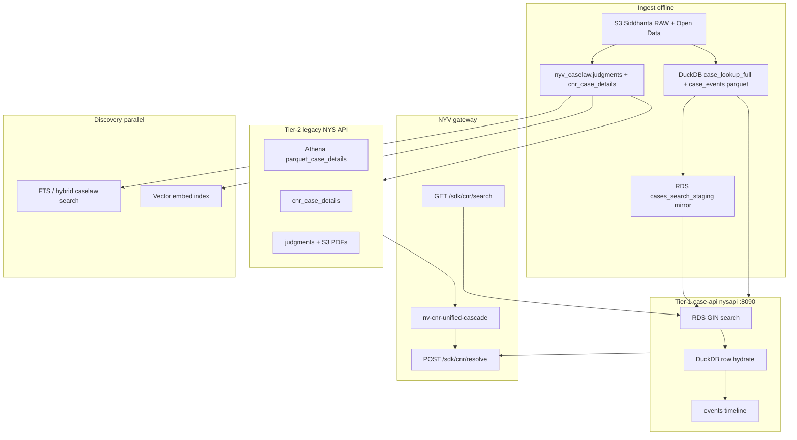

# NYV case corpus — field crosscheck & gap plan (2026-09)

> **Tracker:** `NV-CASE-CORPUS-FIELD-GAP-001`  
> **Scope:** NYV gateway resolve/search + NYS case-api / legacy corpus (not NSP product UI).  
> **Honesty:** All partner paths keep `claimEcourts: false` unless a verified live eCourts fetch succeeds.  
> **Related SSoT:** [`NSP-CNR-DIARY-MATTER-CREATION-2026-09.md`](./NSP-CNR-DIARY-MATTER-CREATION-2026-09.md) Appendices C–F · [`NYV-NYS-CLOSURE-ARCHITECTURE-2026-09.md`](./NYV-NYS-CLOSURE-ARCHITECTURE-2026-09.md)

---

## Executive snapshot (2026-09-23T15:35Z)

| Layer | Status | Evidence |
|---|---|---|
| **nysapi** (`nysapi.nyayasiddhi.online`) | **LIVE** | `/health` **200** `table_version=v_20260923T092637Z`, RDS reachable; `/v1/cases` **401** without key |
| **NYV gateway CNR/diary** | **LIVE** | SSM `366753f9` — TSWL/RJHC/GJHC **found**; SC diaries **17329/264 found** (legacy NYS **not_found**) |
| **NYV search passthrough** | **FIXED local** (deploy pending) | SSM `c098b0f8` — pre-deploy dropped `cnr` (returned `HPBI…` vs `TSWL…`); **NV-NYSAPI-SEARCH-PASSTHROUGH-001** |
| **Field hydration (acts/PII/live docket)** | **PARTIAL** | SSM field coverage — acts **0–1**, party PII **none**; corpus not live eCourts |

### nysapi accepted search params (worker `171becc8`, 2026-09-23)

`act`, `advocate_name`, `case_number`, `case_title`, `case_type`, `cnr`, `court_complex`, `court_establishment`, `court_type`, `diary_no`, `filing_number`, `filing_number_year`, `fir_number`, `page`, `page_size`, `party_name`, `police_station`, `want_total`, `year`.

**Not yet on nysapi:** `sort`, `case_status`, `decision_date_*`, `filing_date_*`, `registration_date_*`, `state_code` → **NYS** backlog (P3-A/B in Appendix D).

---

## Executive snapshot (2026-09-22T07:01Z)

| Layer | Scale (live) | Freshness | Field reality |
|---|---|---|---|
| **Tier-1 case-api** | RDS `cases_search_staging` ~**57M**; DuckDB `case_lookup_full` ~**78M** | RDS watermark **`v_20260918T124142Z`** (DuckDB **`v_20260922T064319Z`**) | Identity + parties + dates **strong**; **acts ~76%** on 2025+ slice; **diary_no / PII columns 0%** post-P1 DDL |
| **Tier-2 legacy** | `judgments` **~26M+** (DC **9.52M**); `cnr_case_details` **796,960** | details **`max_updated=2026-09-21`** | Fills **acts**, extra **documents**, **timeline** union, **`extractPreview`**, sparse **partyDetails** on cascade |
| **S3 Siddhanta** | HC **128,821** / SC **42,873** / DC **187,820** PDF objs | ingest pipelines | Judgment PDFs → presigned `documents[]` |
| **Embed / FTS** | India caselaw embed ~**76.8%** | throttled worker job | Instant Search / hybrid — not CNR resolve fields |

**Live probes this session**

| Probe | Result |
|---|---|
| `npm run demo:probe:ec2` | **Success** SSM `8baed77b-574d-4f38-8acc-6e137b5cb687` (2026-09-22 GO-003) + prior `d14f1261` — gateway **5.0.0**, CNR probes **200 found** |
| `scripts/_nsp-field-coverage-probe.ts` | SC diary **5/18** identity; HC/DC **9–11/18**; **party PII none**; acts **0–1** (DC TSWL **1**); `documents_len` **1–5** |
| `_ec2-case-api-p1-fill-probe.sh` | SSM `154c0fa0-d712-465f-812c-be1a20a690f7` — 2025+ rows **9,887,439**; **acts 7,544,417**; **diary 0**; **pet_addr 0**; all-time acts_json **26,855,944** |

---

## 1) Case-api + RDS crosscheck

### 1.1 Code contract (NYV)

| Artifact | Role |
|---|---|
| `src/services/nv-case-api-adapter.ts` | Maps nysapi `CaseApiCase` → SDK `CnrResolveData` (`buildFields`, `buildCaseCreateProfile`, P2a legacy merge, P2b timeline). **2026-09-24:** adapter gap closed for HC/SC rich columns + hearing date keys (**NV-CNR-RICH-FIELDS-001** / **NV-CNR-HEARING-DATE-001**); was drop-on-map RCA **430b1d4d-24db-4cd8-bbf7-1db91c41e839** |
| `packages/client-sdk/src/api/CnrApi.ts` | Partner types: `CnrResolveResponse`, `CnrFieldValue`, `CnrCaseCreateProfile`, `CnrResolveMeta`, search/bundle APIs |
| `src/services/nv-cnr-unified-cascade.ts` | Tier order: case-api → legacy (Athena/RDS/S3) → eCourts stub → Kanoon additive |

**nysapi row shape (`CaseApiCase`)** — columns the adapter can consume when hydrated:

- Identity: `cnr`, `diary_no`, `court_level`, `case_number`, `case_title`, `case_type`, `filing_number`, `filing_number_year`, `citation`, `neutral_citation`
- Court/geo: `court`, `state_name`, `district_name`, `bench`, `jurisdiction`, `complex_name`, `court_establishment`
- Parties/advocates: `petitioner`, `respondent`, `petitioners[]`, `respondents[]`, `petitioner_advocate`, `respondent_advocate`, PII scalars (`petitioner_address`, …), structured `parties[]` in `extra`
- Status/dates: `case_status`, `filing_date`, `registration_date`, `decision_date`, `next_date`, `first_hearing_date`, `current_purpose`, `disposal_nature`, `current_judge`
- Criminal refs: `fir_no`, `fir_year`, `police_station`
- Docket: `hearings[]` (`hearing_date`, `business_date`, …), timeline via `/timeline` (`event_date`); `counts.hearings`, `counts.acts`
- HC/SC richness (when hydrated): `bench_composition`, `judicial_section`, `coram`, `registration_number`, `hc_category_details`, `lower_court_reference`, `final_orders`, `interim_orders`, `ia_filings`, `registry_objections`, SC `case_category`, `interlocutory_applications`, `registry_defects`, `earlier_court_details`
- Acts: `acts`, `acts_sections`, `sections`, `extra.acts`, RDS `acts_json`
- Documents: `document` (S3 bucket/key + presigned `url`)
- Honesty: `field_availability`, `provenance`, `cnr_is_synthetic`

**Resolve emits (`data.fields.*`)** — built in `buildFields()` (always on `found`):

`courtName`, `courtType`, `caseType`, `caseNo`, `caseTitle`, `petitioner`, `petitioners`, `respondent`, `respondents`, `judges`, `advocates`, `decisionDate`, `disposalNature`, `filingDate`, `registrationDate`, `registrationNumber`, `registrationYear`, `summary`, `partyDetails`, `filingNumber`, `filingNumberYear`, `nextHearingDate`, `firstHearingDate`, `currentPurpose`, `policeStation`, `firNo`, `firYear`, `jurisdiction`, `stateName`, `districtName`, `bench`, `benchComposition`, `judicialSection`, `coram`, `hcCategoryDetails`, `lowerCourtReference`, `finalOrders`, `interimOrders`, `iaFilings`, `registryObjections`, `caseCategory`, `interlocutoryApplications`, `registryDefects`, `earlierCourtDetails`, `complexName`, `citation`, `hearings`, `caseStatus`, `actsSections`

**Diary path extras:** top-level `lookupType: "diary"`, `diaryNumber`, `fields.diaryNumber`; `fields.cnr` often empty with explanatory `note`.

**`profile: caseCreate` adds:** `caseCreate.header`, `timeline`, `clients[]`, `opposingParties[]`, `witnesses[]` (usually empty), `fieldManifest` (`complete` / `partial` / `missing` / `manualRecommended`).

**Legacy tier adds (P2a / unified cascade)** when `NYV_F_CASE_API_LEGACY_ENRICH=1` or case-api miss:

| Addition | Typical source tags |
|---|---|
| Richer `actsSections` | `cnr_case_details`, `opendata_athena_case_details` |
| Extra `hearings` / timeline union | legacy + `nys_case_api_rds_timeline` |
| More `documents[]` | judgments S3, Siddhanta, timeline order PDFs |
| `extractPreview` | legacy PDF text extract (`includeExtractPreview`) |
| `candidates[]` | Kanoon hook (additive) |
| `sourcesTried[]` | union of tier tags |

### 1.2 RDS `case_api_search.cases_search_staging`

**Pre-P1 (41 cols, ~57M rows):** search index — `cnr`, `court_level`, `case_number`, `case_title`, `filing_date`, `decision_date`, `status`, geo codes, `fir_no`, `fir_year`, `acts_sections` JSON, `extra` JSON (order PDF refs), sync timestamps. **No inline hearings** — hydrated from DuckDB on read.

**P1 DDL (+9 cols, non-destructive):** `diary_no`, party PII ×8 — see `scripts/sql/case-api-p1-staging-ddl.sql`.

**P1 ETL fill (executed, 2026-09-20 complete):**

- Reverse hydrate DuckDB → RDS for **acts** (`acts_json`): **~76.3%** of 2025+ decision/filing slice; **~47%** of all staging rows have non-empty `acts_json`.
- **diary_no / PII:** columns exist; **0 rows populated** (no upstream diary/PII in ingest source for RDS mirror).

**DuckDB vs RDS gap:** ~**21M** rows in DuckDB not mirrored to RDS staging; RDS watermark **5 days behind** last major DuckDB build — search-only paths that skip DuckDB hydrate see sparser rows.

### 1.3 Three-way matrix (has column → nysapi emits → partner sees)

| Field group | RDS staging | DuckDB hydrate | NYV resolve | Legacy merge |
|---|---|---|---|---|
| CNR | ✓ | ✓ | ✓ `fields` + header | May supply CNR for pending SC |
| SC diary | col ✓, **data 0%** | ✓ search | ✓ `diaryNumber` | P2a when CNR empty |
| Party names | ✓ | ✓ ~95% HC/DC | ✓ arrays + `partyDetails` | PII gap-fill sparse |
| Party PII | cols ✓, **data 0%** | sparse in parquet | passthrough if present | same |
| Hearings inline | ✗ (events parquet) | ✓ partial | ✓ `hearings` + P2b timeline | union dedupe |
| Acts detail | `acts_json` / JSON | ✓ / counts | ✓ or count-only note | Athena / details |
| Next hearing / live status | ✗ | rarely | note: not corpus | not live eCourts |
| Judgment PDF | via `extra` / join | ✓ `document` | `documents[]` | more PDFs |
| Witnesses | ✗ | ✗ | empty + `manualRecommended` | ✗ |
| `extractPreview` | ✗ | ✗ | via legacy only | ✓ |

---

## 2) End-to-end search & resolve path (SC / HC / DC)

### 2.1 Matter discovery (search)

```
Partner  GET /api/nv/v1/sdk/cnr/search?party_name=&fir_no=&court_type=&diary_no=&…
    → NYV passthrough
    → nysapi GIN on RDS cases_search_staging (filters)
    → optional DuckDB enrich for result cards
    → CnrSearchResponse (case rows, pagination, claimEcourts: false)
```

| Court | Primary keys in search | RDS diary column | nysapi behavior |
|---|---|---|---|
| **SC** | `diary_no`, party, dates, acts | **DuckDB-only** today (RDS diary **0%**) | Diary resolve **200**; HC/DC diary query **400** by contract |
| **HC** | `cnr`, party, `case_number`, FIR, acts | CNR + GIN | `court_type=HC` required for B9 duplicates |
| **DC** | `cnr`, **`filing_number`+year**, party, FIR | CNR + filing cols | Filing-ref **search-then-resolve** on NYV (P1-B) |

### 2.2 CNR / diary resolve cascade

```
POST /api/nv/v1/sdk/cnr/resolve
  → infer identifierKind + courtType (nv-cnr-court-type-inference)
  → Tier-1: GET nysapi/v1/cases/{cnr} or ?diary_no= (RDS hit + DuckDB hydrate + events)
  → P2b: GET /timeline if sparse hearings
  → P2a: legacy POST NYS /cnr/resolve (Athena parquet_case_details, cnr_case_details, judgments)
  → unified cascade if Tier-1 not_found → legacy tiers
  → optional Kanoon candidates
  → CnrResolveData envelope
```

**Tables / stores touched on hot path**

| Step | Store |
|---|---|
| Search / resolve index hit | RDS `case_api_search.cases_search_staging` |
| Full row + inline hearings | DuckDB `case_lookup_full` |
| Timeline orders | DuckDB / parquet `case_events` |
| Legacy acts / deep metadata | RDS `nyv_caselaw.cnr_case_details`, Athena **`parquet_case_details`**, `judgments` |
| PDFs | S3 Open Data + **`siddhanta`** keys in row / legacy |
| Instant Search (separate product path) | Postgres FTS + embed index on caselaw-worker |

### 2.3 Partner-exposable field catalog (grouped)

**Identity & keys:** `cnr`, `diaryNumber`, `caseNo`, `caseTitle`, `caseType`, `filingNumber`, `filingNumberYear`, `citation`, `cnrSynthetic`

**Parties:** `petitioner`, `respondents`, `petitioners`, `respondents`, `partyDetails[]` (name, fatherName, address, phone, email, advocate, partyType), `caseCreate.clients[]`, `caseCreate.opposingParties[]`, `advocates[]`, `witnesses[]` (usually empty)

**Court & venue:** `courtName`, `courtType`, `jurisdiction`, `stateName`, `districtName`, `bench`, `complexName`

**Status & dates:** `caseStatus`, `filingDate`, `registrationDate`, `decisionDate`, `disposalNature`, `nextHearingDate`, `firstHearingDate`, `currentPurpose`

**Criminal:** `firNo`, `firYear`, `policeStation`

**Acts:** `actsSections[]` (`act`, `section`), `meta.counts.acts` when detail missing

**Hearings / timeline:** `hearings[]`, `caseCreate.timeline[]` (date, purpose, judge, status, `docUrl`), `counts.hearings`

**Documents:** `documents[]` (judgment + orders), `GET …/document-bundle`, presigned TTL **900s**

**Text / extract:** `fields.summary`, `extractPreview` (legacy PDF snippet), EDJ separate API

**Meta / provenance:** `source`, `sourcesTried[]`, `meta.tier`, `meta.latencyMs`, `meta.provenance.tableVersion`, `meta.fieldAvailability`, `meta.extra` (sanitized scalars), `meta.inferredCourtType`, `meta.identifierKind`

**Honesty / UX:** `claimEcourts: false`, `confidence`, `ui.badge`, `ui.subtitle`, `validation`, `fields.*.note`, `caseCreate.fieldManifest`, `candidates[]` (Kanoon)

**Search-only (not full resolve):** same core row fields as nysapi search card + pagination meta

---

## 3) Public sources comparison (generic)

| Surface | Typical fields shown | Our corpus relative strength | Our gaps vs portal |
|---|---|---|---|
| **eCourts / NJDG (live docket)** | Real-time **case status**, **next date**, full **cause list**, complete **party PII**, **IA details**, **fee**, **vakalatnama** | We do **not** claim live status; judgment-centric **disposed** history, citations, PDFs | Pending matters, next hearing, sealed/redacted fields, exact bench roster today |
| **Indian Kanoon / similar** | Full judgment text, citations, doc IDs, basic metadata | We align on **judgment PDF + metadata**; Kanoon hook adds **candidates[]** | Kanoon has broader user-facing search UX; we integrate not replace |
| **High Court / SC websites** | Orders, rosters, cause lists | Siddhanta + Open Data **PDF archive** | Interim orders unless in events parquet / legacy |

**Product rule:** Position as **judgment corpus + indexed metadata** with honest `fieldManifest.manualRecommended` for portal-only fields (next hearing, witnesses, full PII).

---

## 4) Backend corpus architecture



| Tier | Technology | Partner-facing | Best for |
|---|---|---|---|
| **Tier-1 case-api** | RDS + DuckDB + events | `fields.*`, search, SC diary (DuckDB) | Fast CNR/diary resolve, hearings snippet, acts when hydrated |
| **Tier-2 legacy** | RDS + Athena + S3 | cascade fill, `extractPreview`, extra docs | Acts depth, HC dimension table, judgments not in staging |
| **Siddhanta / S3** | Object store | presigned PDFs | Primary judgment PDF when linked |
| **Embed / FTS** | Postgres + vectors | Instant Search API | Research, not matter autofill |
| **Tier-3 eCourts** | NIC API (gated) | future live fields | Next date / true status — **GO + key** |
| **Kanoon** | External API | `candidates[]` | Fallback discovery |

---

## 5) Gaps & prioritized backlog

### 5.0 Beta readiness gate (2026-09-22 — `NV-CASE-CORPUS-BETA-CLOSURE-001`)

| # | Gap | Closure (beta) | Partner can test | Manual / Tier-3 slots |
|---|---|---|---|---|
| **1** | Live next hearing / running status / live docket | **CLOSED (beta)** — `meta.fieldAvailability` (`tier3_required`), `fields.nextHearingDate.note`, `caseCreate.fieldManifest.manualRequired` | Identity, disposal-inferred `caseStatus`, hearings/timeline from corpus | `nextHearingDate`, `runningStatus`, live docket → **Tier-3 NIC key + GO** |
| **2** | Acts on resolve | **CLOSED (beta)** — NYV maps `acts_json` + legacy P2a merge when `counts.acts>0` | `fields.actsSections[]` on hydrated CNRs (TSWL/RJHC probes) | Pre-2024 / unhydrated rows may still show count-only note |
| **3** | Party PII | **PARTIAL (data)** — passthrough when sparse; **beta honesty** `corpus_unavailable` on PII keys | Party **names**, advocates, `partyDetails[]` when Siddhanta/`cnr_case_details` has data | Address/phone/email/fatherName — **0% RDS mirror**; EDJ or manual |
| **4** | RDS ↔ DuckDB lag (~21M) | **PARTIAL (data)** — watermark documented; bounded sync via worker `nys-cnr-index-sync.mjs` (user **GO** for full refresh) | Search/resolve on indexed CNRs; `meta.provenance.tableVersion` | National search coverage until RDS load catches DuckDB |
| **5** | Witnesses | **CLOSED (beta)** — `fieldManifest.manualRequired` + `meta.fieldAvailability.witnesses=manual_required`; `meta.betaReadiness.edjJobPath` | Empty `witnesses[]` with explicit UX contract | Manual matter slot or **EDJ** document job |

**Tier-3 live eCourts:** remains **BLOCKED (GO)** — no NIC key in demo session (`NV-DEMO-SESSION-001`). Enable only after explicit **GO** naming court pilot + key rotation window.

### 5.1 Critical for “best case search + matter creation”

| Gap | Impact | Owner | Blocker |
|---|---|---|---|
| **Live next hearing / pending status** | Matter UX expects portal-like status | Product honesty + Tier-3 | NIC eCourts **GO** — beta messaging **shipped** (§5.0) |
| **SC pending: CNR + timeline** | Diary matters lack CNR → no `/timeline` | NYS ingest | Corpus is judgment-biased; §10 one-pager |
| **Acts on resolve** | Charge framing, limitation | NYS + NYV | P1 **76%** on 2025+; NYV **`acts_json`** map + P2a (**beta closed** §5.0) |
| **Party PII** | Client intake | NYS ETL | **0%** RDS fill — beta **`corpus_unavailable`** (§5.0) |
| **RDS ↔ DuckDB sync lag** | Search misses ~21M rows | NYS ops | Watermark **`v_20260924T134911Z`** (full-scan reconcile **DONE** 2026-09-24); ops runbook §5.5 |
| **Witnesses** | Matter template | Product | **Beta manual_required** + EDJ path (§5.0) |
| **Tier-1 DC not_found** | National coverage | Cascade + staging | **delta-dc DONE** on judgments; staging gap remains → Tier-2 |

### 5.5 Ops runbook — RDS mirror refresh (Gap 4)

| Step | Command | Notes |
|---|---|---|
| Poll watermark | `bash scripts/_nys-ssm-run.sh scripts/_ec2-rds-watermark-only-probe.sh` | Fast read-only `rds_load_state` + `cnr_case_details` |
| Diagnose `rds_daily` fail | `bash scripts/_nys-ssm-run.sh scripts/_ec2-rds-daily-fail-diagnose.sh` | journal + log tail + watermark vs published |
| SC/ESCR CNR shrink investigate | `bash scripts/_ec2-rds-sc-escr-shrink-investigate-ec2.sh` | Optional env `FROM_VER` / `TO_VER`; lists dropped CNR ids only |
| Full-scan reconcile (ops GO) | `bash scripts/_nys-ssm-run.sh scripts/_nys-ops-go-rds-daily-fullscan-async.sh` | Poll: `_ec2-rds-fullscan-job-probe.sh`; expect **`FULL-SCAN RECONCILE DONE`** in log |
| Bounded daily sync (worker) | `bash scripts/_nys-ssm-run.sh scripts/_nys-ops-go-cnr-index-sync-bounded.sh` | Default **`NYS_CNR_DETAILS_LIMIT=5`**, **`NYS_NODE_HEAP_MB=8192`**; judgments `delta` + capped details |
| P3 acts / details retry | `bash scripts/_nys-ssm-run.sh scripts/_nys-ops-go-p3-cnr-details-async.sh` | OOM-safe: 8GB heap, limit **5**; log under `/var/log/nys-ops/p3-cnr-details-*.log` |
| Full RDS staging mirror | `rds_daily.sh` on worker | **DONE** — full-scan reconcile **2026-09-24** → watermark **`v_20260924T134911Z`**; see **§5.5.1** |
| Verify NYV | `npm run demo:probe:ec2` + `npx tsx scripts/_nsp-field-coverage-probe.ts` | Post-deploy acts + field manifest |

### 5.5.1 Gap 4 — `rds_daily.sh` (caselaw-worker)

| Check | Worker path | Status (2026-09-23) |
|---|---|---|
| case_api scripts dir | `/home/ubuntu/scripts/case_api/` | **EXISTS** |
| DuckDB build artifact | `…/_build/case_lookup_full` | **EXISTS** |
| **RDS mirror (canonical)** | **`/home/ubuntu/scripts/data_rds/rds_daily.sh`** | **EXISTS** (7174 B, Sep 12); systemd **`case-api-rds-daily.service`** + timer **enabled** |
| Legacy probe path | `/home/ubuntu/scripts/case_api/rds_daily.sh` | **MISSING** (prior SSM `9f7c1c4c` false **BLOCKED**) |
| Full DuckDB rebuild | `…/case_api/build_full.sh` | **MISSING** (publisher path; not required for delta mirror) |
| Python duckdb | `…/.venv/bin/python3` | **OK** (1.5.5) |

**Documented ingest chain (architecture only):** Master_Cron → `s3://siddhanta/IND/00_RAW/` → `build_full.sh` → DuckDB → **`rds_daily.sh`** → upsert `case_api_search.cases_search_staging` + bump `rds_load_state.table_version` to match DuckDB `v_<ts>`.

**Ops GO (2026-09-23 — NV-NYS-OPS-GO-004):**

1. Use **`/home/ubuntu/scripts/data_rds/rds_daily.sh`** (not `case_api/`). Wrapper: `scripts/_nys-ops-go-rds-daily-async.sh` (default path fixed).
2. Start: `bash scripts/_nys-ssm-run.sh scripts/_ec2-start-case-api-rds-daily.sh` **or** `systemctl start case-api-rds-daily.service` on worker.
3. Poll watermark: `bash scripts/_nys-ssm-run.sh scripts/_ec2-rds-watermark-only-probe.sh` until `rds_load_state.table_version` catches published DuckDB (job may run **up to ~3h**; prior run **2026-09-19** was **SIGTERM** mid-export).
4. **Do not** start duplicate `rds_daily` if `pgrep -f data_rds/rds_daily` already running.
5. **Do not** destructive RDS ops; read-only probes only per demo session rules.

| Item | Status | Evidence |
|---|---|---|
| Watermark **before** GO-004 | `v_20260918T124142Z` (~57M staging) | SSM `fa32a76c` |
| nysapi `/health` published | `v_20260923T014834Z` | same probe |
| `rds_daily` run | **IN-PROGRESS** (pid **3631363** + prior manual run) | SSM `8823dd75`, jobs poll `4247bb3a` |
| Watermark **after** (session) | **pending** — poll after job completes | — |

**2026-09-24 diagnose (NV-RDS-DAILY-FAIL-001):**

| Item | Status | Evidence |
|---|---|---|
| RDS watermark | **`v_20260923T092637Z`** (unchanged) | SSM `48848101`, `3ece9f04` |
| Published DuckDB | **`v_20260924T072259Z`** | nysapi `/health` |
| **`case-api-rds-daily.service`** | **FAIL exit 1** (~1s); **StartLimit** after retries | SSM `3ece9f04`, `16ac14be` |
| Root cause | (1) **REFUSING: distinct CNR counts FELL** SC/ESCR 38,376→38,366; (2) watermark tree **pruned** → *version no longer on disk* | [Diagnose rds_daily + AI follow-ups](9a8d3664-aac3-4f40-bf76-d5bdf19332a2) |
| Recovery (ops **GO**) | **`export_delta_for_rds.py --full-scan`** + `apply_delta_to_rds.sh` (error text says `--full-scan`; flag is **not** on `rds_daily.sh`). Bulk CSV path: `export_cases_for_rds.py` per `RDS_GAP_2026-09-12.md`. | **DONE** — log **`FULL-SCAN RECONCILE DONE`** 10:53:35Z; pid **4105193** completed; kickoff SSM **`40e90d07`** |
| Full-scan **before/after watermark** | **`v_20260923T092637Z`** → **`v_20260924T134911Z`** (applied 14:46:49Z) | Poll SSM **`dda674f9`**, **`98fd4e44`**; published DuckDB **`v_20260924T072259Z`**; FROM pin **`v_20260923T014834Z`** |
| CNR-shrink guard | **Not bypassed** — no **`--allow-shrink`** this run | Prior REFUSING SC/ESCR 38,376→38,366 (diagnose SSM **`3ece9f04`**) |
| Post-reconcile staging | **~56.95M** `cases_search_staging`; `cnr_case_details` **796,960** (`max_updated=2026-09-22`); DC **9,523,847** | SSM **`dda674f9`**, **`98fd4e44`** — **no** export/apply process; **no REFUSING/FATAL** |
| **`case-api-rds-daily.service`** | **`systemctl reset-failed`** after reconcile (timer may resume daily delta) | Ops follow-up Session-77 |

**2026-09-25 Gap 4 CLOSED (NV-RDS-DAILY-FAIL-001 / NV-RDS-SC-ESCR-SHRINK-001 — self-healed, no `--allow-shrink` needed):**

User GO was to force `export_delta --from v_20260924T134911Z --to v_20260924T163850Z --allow-shrink` + `apply_delta --force` for the intentional −10 ESCR CNR shrink. A read-only SSM precheck ran **first** and found the daily timer had **already resolved it**:

| Item | Status | Evidence |
|---|---|---|
| `case-api-rds-daily.service` last run | **Success 07:47:07Z** — `APPLIED v_20260924T134911Z -> v_20260925T072535Z (upserts=1059 deletes=0)` | SSM `0504af56-728a-4eb2-a39c-8fd7e552797e` (journalctl) |
| Shrink outcome | **0 deletions** — newer published corpus superseded the 10 dropped ESCR CNRs; `--allow-shrink` guard never tripped | same |
| RDS watermark now | **`v_20260925T072535Z`** (applied 07:46:55Z); nysapi `/health` **`table_stale:false`**, published `v_20260925T074306Z`; staging **~57.10M**; `cnr_case_details` **796,960**; DC **9,523,847** | SSM `fe395d11-8d2b-4583-b919-93075bf44634` |
| Timer / service health | timer **enabled+active** (next hourly), service **inactive after Success** → **no `reset-failed` needed** | SSM `0504af56` |
| `--allow-shrink` force | **Not run (correctly)** — target `v_20260924T163850Z` is **older** than current watermark; forcing it would regress. NV-EXECUTE-BEFORE-CLAIM / NV-VALIDATE-THE-PROBE | — |

**Verdict:** **DONE / CLOSED.** Watermark fresh, `table_stale:false`, deletes=0. Supersedes the 2026-09-24 full-scan reconcile row (`v_20260924T134911Z`).

**2026-09-24 SC/ESCR shrink investigate (NV-RDS-SC-ESCR-SHRINK-001 — investigate only, no `--allow-shrink`):**

| Item | Status | Evidence |
|---|---|---|
| Snapshots on disk | **BOTH** `v_20260924T134911Z` (RDS watermark) and `v_20260924T163850Z` (published `_CURRENT`) | SSM `78488790-dea2-452e-a94d-c86080d127c8` |
| Partition | `court_level=SC/cnr_prefix=ESCR/*.parquet` | Same probe |
| Distinct CNRs | **38,376 → 38,366** (−10); matches `export_delta_for_rds.py` REFUSING line | DuckDB diff in probe |
| Dropped CNRs (ids only) | `ESCR010002642026`, `ESCR010002652026`, `ESCR010002662026`, `ESCR010002682026`, `ESCR010002692026`, `ESCR010002702026`, `ESCR010002752026`, `ESCR010002762026`, `ESCR010002792026`, `ESCR010002812026` | Same probe |
| TO corpus | All 10 **absent** (not moved to another partition) | `TO_ABSENT` lines in probe |
| Verdict | **Likely intentional upstream dedupe** of invalid/superseded 2026 ESCR rows — **not** pruned watermark / partial parquet. **Separate user GO** required before one-shot `--allow-shrink` delta + apply. | `scripts/_ec2-rds-sc-escr-shrink-investigate-ec2.sh` |

**2026-09-22 user GO run (caselaw-worker):**

| Item | Status | Evidence |
|---|---|---|
| Bounded `nys-cnr-index-sync` | **PARTIAL** — judgments `delta` **DONE** (HC 2025 +5247, HC 2026 +194505; AP/TG DC 0 new); wrapper details step **OOM @4GB limit=50** | SSM `3e20f3ec`; log `/var/log/nys-ops/cnr-index-sync-20260922T085001Z.log`; pid **4174466** / **138968** stopped SSM `d2c776cb` |
| P3 `ingest-cnr-case-details` retry | **DONE** — **5** partitions, **179,281** upserted; **`max_updated=2026-09-22T09:26:04Z`** | SSM `26631bf4`; log `/var/log/nys-ops/p3-cnr-details-20260922T091922Z.log`; pid **182313** |
| `case_api_search` watermark | **UNCHANGED** `v_20260918T124142Z` (DuckDB lookup **`v_20260922T064319Z`**) | before/after SSM `642f903a` / `ed1d0d10` |
| P1 acts fill probe | **DONE** (unchanged totals) | SSM `5b2aff1c` — acts **7.54M/9.89M** on 2025+ slice |

**2026-09-22 user GO — NV-NYS-OPS-GO-003 (Gap 4 retry):**

| Item | Status | Evidence |
|---|---|---|
| Watermark **before** | `v_20260918T124142Z` | SSM `c975ef84` |
| Bounded sync **limit=5 heap=8192** | **IN-PROGRESS** — `ingest-rds.mjs delta` (2025–2026 HC partitions) still running at poll | SSM `2ddfec87`; log `/var/log/nys-ops/cnr-index-sync-20260922T094126Z.log`; pid **337394** |
| Watermark **after** (session) | **UNCHANGED** `v_20260918T124142Z` | SSM `f0d84c7a`, `211fcd2a` |
| `rds_daily.sh` | **BLOCKED** (missing) | SSM `9f7c1c4c` |
| NYV verify | **PASS** demo probe + field coverage | SSM `8baed77b`; local `_nsp-field-coverage-probe.ts` |

**Gap 4 verdict (GO-003):** **PARTIAL / not closed** — P3 details already fresh; bounded judgments/RDS delta sync running but **`rds_load_state` only moves via `rds_daily.sh`** (missing). DuckDB ahead **`v_20260922T064319Z`** vs RDS **`v_20260918T124142Z`**.

### 5.2 Prioritized backlog

| P | Item | Tree | Type |
|---|---|---|---|
| **P0** | Resume RDS mirror freshness (≤7d watermark) | NYS ops | `rds_load_state`, `_ec2-nysapi-case-api-search-probe.sh` |
| **P0** | Document partner field matrix in SDK one-pager (this doc → Appendix link) | NYV docs | Done here |
| **P1** | **Diary_no RDS backfill** from DuckDB for SC search parity | NYS ETL | User **GO** for batch job |
| **P1** | **Acts P3** re-run `ingest-cnr-case-details` (prior **OOM**) with memory fix | NYS ops | **DONE** 2026-09-22 — `_nys-ops-go-p3-cnr-details-async.sh` |
| **P1** | Expand acts visibility on resolve when `counts.acts>0` but empty array (already noted in adapter — ensure nysapi hydrates `acts_json`) | NYS + NYV | Code + data |
| **P2** | PII sourcing strategy (eCourts Tier-3 vs redacted-only policy) | Product + NYS | Legal/privacy **GO** |
| **P2** | SC CNR backfill when judgment registers CNR | NYS ingest | Pipeline |
| **P2** | Siddhanta → staging merge (overlap **updated=0** on last run — tune intersection) | NYS | `nv-case-api-siddhanta-cnr-merge.py` |
| **P3** | Cron install for `nys-cnr-index-sync.mjs` on worker | NYS ops | `NYS-EMBED-CNR-SCHEDULE.md` |
| **P3** | NYS dist rebuild on worker (pnpm + source) | NYS | **BLOCKED** SSM `5839fda7` |

### 5.3 30 / 60 / 90 day plan (GO gates)

| Window | Goals | GO gate | Verify probes |
|---|---|---|---|
| **30d** | RDS watermark ≤7d; acts resolve spot-check **≥80%** on 2024+ HC/DC sample set; publish partner field matrix | User **GO** NYS ops window for RDS load + P3 acts retry | `_ec2-case-api-p1-fill-probe.sh`, `_nsp-field-coverage-probe.ts`, `demo:probe:ec2` |
| **60d** | SC `diary_no` RDS populated for index search; unified cascade metrics dashboard; PII policy signed (collect vs manual-only) | **GO** diary RDS backfill + privacy review | `_ec2-nys-handover-rds-crosscheck-probe.sh`, diary search API tests |
| **90d** | Optional Tier-3 eCourts pilot (one court); embed SLO ≥85%; matter creation UAT with `fieldManifest` driven UI | **GO** NIC key + court pilot | UAT plan D5–D8 + live eCourts probe (no keys in repo) |

### 5.4 NYV vs NYS vs Ops split

| Workstream | Examples |
|---|---|
| **NYV** | Cascade tuning, `fieldManifest` UX docs, search passthrough, extractPreview merge (shipped), courtType inference |
| **NYS** | DuckDB build, P1/P3 ETL, nysapi hydrate, `cnr_case_details` ingest, Siddhanta merge |
| **Ops** | SSM probes, cron, RDS load monitoring, OOM-safe batch sizing |
| **Data source** | Open Data judgments, Siddhanta RAW, optional eCourts/Kanoon |

---

## Appendix A — Probe commands (safe, read-only)

```bash
# NYV nysdev smoke + CNR samples
cd nyayavigya-platform-312 && npm run demo:probe:ec2

# Partner field names only (local runtime.env)
cd nyayavigya-platform-312 && npx tsx scripts/_nsp-field-coverage-probe.ts

# NYS worker RDS fill rates
cd nyayavigya-platform-312 && bash scripts/_nys-ssm-run.sh scripts/_ec2-case-api-p1-fill-probe.sh
cd nyayavigya-platform-312 && bash scripts/_nys-ssm-run.sh scripts/_ec2-case-api-p1-status-probe.sh
```

---

## Appendix C — NSP partner export (resolve · search · caseCreate · documents)

> **SDK SSoT:** `packages/client-sdk/src/api/CnrApi.ts` · **NYV adapter:** `src/services/nv-case-api-adapter.ts` · **One-pager:** [`NSP-CNR-DIARY-ONE-PAGER-2026-09.md`](./NSP-CNR-DIARY-ONE-PAGER-2026-09.md)

### C.1 Identifier binding (by court)

| Court | Primary identifier | `POST …/cnr/resolve` body | Search (`GET …/cnr/search`) | Rejected / notes |
|---|---|---|---|---|
| **SC** | **Diary number** | `{ "diaryNumber": "<digits>" }` or `{ "identifier": "<diary>" }` | `diary_no=` (+ party/date filters) | `diary_no` on HC/DC → **400**; `fields.cnr` often empty pending judgment |
| **HC** | **CNR** (15-char) | `{ "cnr": "RJHC…" }` + optional `options.courtType: "hc"` | `court_type=HC`, `party_name`, `case_number`, FIR, acts | **B9 duplicates:** re-resolve with `courtType` hint |
| **DC** | **CNR** or **filing ref** | `{ "cnr": "TSWL…" }` or `{ "filingNumber", "filingYear" }` (search-then-resolve) | `filing_number` + `filing_number_year`, CNR, party, FIR | National coverage limited by staging lag (Gap 4) |

**SDK methods:** `CnrApi.resolve(input)`, `CnrApi.search(query)`, `CnrApi.get(cnr)`, `CnrApi.listDocuments(cnr)`, `CnrApi.documentBundle(cnr, query)`.

**Resolve options (`CnrResolveOptions`):** `profile: "caseCreate"` · `includeDocuments` (default true) · `includeTimeline` · `includeExtractPreview` · `courtType: sc|hc|dc` · `fuzzyLimit` · `jurisdiction`.

### C.2 Field lists — `POST /api/nv/v1/sdk/cnr/resolve`

**Always on envelope:** `success`, `claimEcourts: false`, `data.status`, `data.matchType`, `data.source`, `data.sourcesTried[]`, `data.confidence`, `data.ui`, `data.documents[]`, `data.candidates[]`, `data.meta`.

**SC diary — typical populated `data.fields.*` keys:** `diaryNumber`, `courtName`, `courtType`, `caseNo`, `caseTitle`, `hearings`, `summary` (when corpus has text); often **empty:** `cnr`, `filingDate`, `caseStatus`, `nextHearingDate`, PII scalars.

**HC/DC CNR — typical populated:** `cnr`, `courtName`, `courtType`, `caseNo`, `caseTitle`, `caseStatus`, `filingDate`, `decisionDate`, `disposalNature`, `bench` (HC), `filingNumber`/`filingNumberYear` (DC), `hearings`, `actsSections` (when hydrated), `advocates`, `petitioners`/`respondents`, `partyDetails` (sparse PII).

**Full resolve field key set (when tier hydrates):** see §2.3 — `buildFields()` emits the flat `fields` map; each value is `CnrFieldValue` `{ value, source, confidence, note? }`.

**`profile: caseCreate` adds `data.caseCreate`:** `header` (caseTitle, cnr, filingDate, nextHearingDate, caseStatus, policeStation), `timeline[]`, `summary`, `clients[]`, `opposingParties[]`, `witnesses[]` (usually empty), `fieldManifest` (`complete`, `partial`, `missing`, `manualRecommended`, `corpusUnavailable`, `manualRequired`).

### C.3 Search — `GET /api/nv/v1/sdk/cnr/search`

**Query params (passthrough):** `court_type` \| `courtType`, `party_name`, `diary_no`, `filing_number`, `filing_number_year`, `fir_no`, `fir_year`, `act`, `case_number`, `case_title`, `decision_date_from/to`, `filing_date_from/to`, `page`, `page_size`, `want_total`.

**Response:** `data.cases[]` (nysapi row cards), `returned`, `page`, `page_size`, `total`, `meta.latencyMs`, `claimEcourts: false`.

### C.4 Documents & presigned URLs

| Route | Purpose |
|---|---|
| Inline on resolve | `data.documents[]` when `includeDocuments: true` |
| `GET …/cnr/{cnr}/documents` | Presigned list if resolve omitted docs |
| `GET …/cnr/{cnr}/document-bundle` | Judgment + timeline orders (`includeTimelineOrders`, `refresh`, `courtType`) |

**`CnrDocument` shape:** `id`, `kind` (`judgment` \| `order`), `title`, `decisionDate`, `s3Path` (`s3://<bucket>/<key>` — **no credentials**), `pdfUrlKind: "presigned"`, `sourceArchive`, `url` (HTTPS presigned), `expiresIn: **900**` seconds.

**S3 key patterns (logical, no secrets):**

- Open Data judgments: `s3://indian-{supreme,district,high}-court-judgments/…`
- Siddhanta archive: `s3://siddhanta/IND/00_RAW/{supreme_court,high_courts,district_courts}/…`
- Row-linked docs: `document.doc_bucket` + `document.doc_key` on nysapi case row → presigned via NYV adapter (`PRESIGNED_DOC_TTL_SECONDS = 900`).

**Timeline order PDFs:** `includeTimeline: true` → `fields.hearings[].docUrl` + additive `documents[]` (same **900s** TTL).

### C.5 JSON path table (NSP copy-paste)

| Partner need | JSON path | Type / notes |
|---|---|---|
| Matter title | `data.fields.caseTitle.value` | string |
| CNR | `data.cnr` or `data.fields.cnr.value` | SC pending may be empty |
| SC diary | `data.fields.diaryNumber.value` | string |
| Court | `data.fields.courtName.value`, `data.fields.courtType.value` | |
| Status (corpus) | `data.fields.caseStatus.value` | not live eCourts |
| Next date honesty | `data.fields.nextHearingDate.note` | Tier-3 / manual |
| Parties | `data.fields.petitioners.value`, `data.fields.respondents.value` | arrays |
| PII block | `data.fields.partyDetails.value[]` | `{ name, fatherName, address, phone, email, advocate }` |
| Acts | `data.fields.actsSections.value[]` | `{ act, section }` |
| Hearings | `data.fields.hearings.value[]` | `{ date, purpose, judge, docUrl? }` |
| PDFs | `data.documents[].url`, `.expiresIn`, `.kind` | refresh before TTL |
| Manifest UX | `data.caseCreate.fieldManifest` | when `profile: caseCreate` |
| Beta honesty | `data.meta.fieldAvailability`, `data.meta.betaReadiness` | |
| Corpus freshness | `data.meta.provenance.tableVersion` | vs Gap 4 watermark |
| Bundle | `data.judgment`, `data.orders[]`, `data.documents[]` | document-bundle route |

---

## Appendix D — NSP beta launch matrix (NYV / NYS / NSP)

> **Full checklist:** [`NSP-BETA-LAUNCH-READINESS-2026-09.md`](./NSP-BETA-LAUNCH-READINESS-2026-09.md) · **Drafting book Wave D:** `NV-BOOK-SME-WAVE-D-001`

| Question | Answer |
|---|---|
| Can NSP open beta on matter + draft? | **Yes** — CNR/diary resolve, search, documents, `draftProfile` on orchestrate **LIVE** with honesty flags. |
| What blocks “national search” marketing? | NYS RDS watermark lag (`rds_daily.sh` missing); ~21M DuckDB rows not mirrored. |
| CNR/diary must-haves | SC diary resolve; HC/DC CNR; `caseCreate` manifest; `claimEcourts: false`; presigned doc TTL **900s**. |
| SME still pending (book) | Full CPC order tables; state court-fee; criminal/bail/writ/SLP **model forms** (not in OCR book). |

---

## Appendix E — NSP integration plan (nysapi-primary, 2026-09-23)

> **Handover SSoT:** external `case_api_NYS_SEARCH_HANDOVER_FOR_SIR part2.md` (2026-09-23).  
> **Architecture:** Tier 1 **nysapi** (`GET /v1/cases`, `/v1/cases/{cnr}`, `/timeline`) → Tier 2 **NYV legacy** (`/cnr/resolve` Athena/RDS/S3 via `nv-cnr-unified-cascade`) → Tier 3 **eCourts NIC** (`NYV_F_ECOURTS_LIVE_FETCH=0`, explicit GO) → Tier 4b portal async (off).

### E.1 Phases

| Phase | Goal | NYV | NYS (case-api box) | NSP |
|---|---|---|---|---|
| **P0 (now)** | Matter intake by CNR/diary + search | `POST/GET …/sdk/cnr/resolve`, `GET …/search`, cascade, `document-bundle` | Keep publish + RDS hourly; no second publisher | BFF → NYV only; map `fields.*` + `fieldManifest`; grey-out via `meta.fieldAvailability` |
| **P1 (30d)** | Search parity + freshness SLO | Deploy search passthrough fix; monitor cascade hit rate | Close Gap 4 (`rds_daily`); HC order presign mapping (§13.1 handover) | Search UX: court_type required; refuse unsupported filters with plain copy |
| **P2 (60d)** | Richer docket without live eCourts | Reduce legacy-only merges as nysapi hydrates acts/PII; keep P2a enrich flag | DC status decode table (§8.3); widen mobile-depth | Manual PII slots until probe ≥15% |
| **P3 (90d+)** | Optional live registry | Tier 3 NIC pilot after GO; never set `claimEcourts: true` without verified live fetch | Timeline/events parity for SC diary | “Live status” badge only when product + legal sign off |

### E.2 End-to-end flows (NSP)

1. **Discovery:** `GET /sdk/cnr/search?court_type=…&party_name=…` → pick row → `POST /sdk/cnr/resolve` with `cnr` + `courtType` if B9 duplicate.
2. **Direct CNR:** `POST /sdk/cnr/resolve` `{ identifier }` + `profile: caseCreate`, `includeDocuments: true`, `includeTimeline` when hearings sparse.
3. **SC diary:** `{ diaryNumber }` or compact identifier; expect empty `cnr` until judgment layer assigns synthetic/linked CNR.
4. **DC filing ref:** `{ filingNumber, filingYear }` on resolve → internal search-then-hydrate (no separate nysapi hop in UI).
5. **Documents:** prefer resolve `documents[]`; refresh via `GET …/document-bundle` or `…/documents` before **900s** TTL; do not call S3 directly.

### E.3 Partner-safe errors (NSP shows vs NYV logs)

| Situation | NSP user message (via `partnerSafeMessage`) | NYV logs / `meta.extra` (internal) |
|---|---|---|
| nysapi timeout/5xx | “Case lookup is temporarily unavailable…” | upstream status, latency, `CASE_API_UPSTREAM` |
| Cascade `not_found` | “We could not find this case in our indexed records…” | `sourcesTried[]`, `cascade=nv-cnr-unified-cascade-001`, legacy status |
| Search disabled | “Case search is not available on this environment…” | `NYV_F_CASE_API_CNR`, key length lens |
| Live fetch off | “Live court registry lookup is not enabled…” | `NYV_F_ECOURTS_PORTAL_FETCH` |

**NSP BFF rule:** never surface `sourcesTried`, `meta.extra.cascade`, field-level `source: opendata_athena_*`, or raw nysapi `error` codes in UI — use for support tooling only.

### E.4 Handover endpoint checklist (NYV gateway)

| nysapi | NYV NSP surface | Status |
|---|---|---|
| `GET /v1/cases/{cnr}` | resolve / `GET …/cnr/{cnr}` via `lookupCnrViaCaseApi` + cascade | **IMPLEMENTED** |
| `GET /v1/cases/{cnr}/timeline` | `options.includeTimeline` on resolve | **IMPLEMENTED** |
| `GET /v1/cases` (search) | `GET …/sdk/cnr/search` | **IMPLEMENTED** (flag + deploy) |
| `GET /health` | adapter watermark only; `GET …/sdk/cnr/health` is gateway readiness | **PARTIAL** (ops) |
| `/ui`, `/docs`, `/_cache` | not exposed (correct) | **N/A** |
| Legacy corpus resolve | fallback `POST /cnr/resolve` when case-api path off or cascade miss | **IMPLEMENTED** |

---

## Appendix F — NYV jurisdiction master data (proposed) — intelligent prefill by jurisdiction

> **Tracker:** `NV-CASE-MASTER-DATA-001` · **Scope:** NYV platform reference tables to prefill `courtType`, `courtName`, `stateName`, `districtName`, `complexName`, and `caseType` display when the corpus row does not publish them. **Static reference joins only — never sets `claimEcourts: true`.** Referenced by [`NSP-CASE-SEARCH-INTEGRATION-2026-09.md`](./NSP-CASE-SEARCH-INTEGRATION-2026-09.md) §16.

### F.1 Existing NYV/NYS master data — audit (grep, 2026-09-24)

| Asset | Where | Covers | Gap for CNR prefill |
|---|---|---|---|
| **`nv_courts`** (master table) | `migrations/2026-06-25-nv-llm-providers-courts.sql`; read in `nv-core-routes.ts`, `nv-jurisdiction-routes.ts` | SC + **25 HC** + tribunals across 6 jurisdictions — `court_id`, `name`, `code`, `court_type`, `state`, `jurisdiction`, `e_filing_enabled` | **No CNR-prefix / bench-code key** — cannot map `aphc`/`AP` → court row; no district or complex granularity |
| `nv-cnr-court-type-inference.ts` | `src/utils/` | Pure-string CNR→`courtType`, diary/case-number kind; SCIN→sc, HC tier at pos 3–4 | Infers **tier only**, not state / court name / establishment |
| `inferCourtTypeFromIdentifier` positions | same | pos 3–4 = tier code (`HC`/`CT`/`IN`) | pos 1–2 (state) + pos 5–6 (establishment) **unused** |
| nysapi row fields | handover §6.1 | `court_code` (`28_2`), `bench` (`aphc`), `state_name`, `district_name`, `complex_name` | present only within HC mobile-depth ~0.4% / DC ~99% — **null on the ~99.6% HC rows** |
| `nv_statutes` / jurisdiction registries | `nv-jurisdiction-routes.ts` | statute + agent counts by jurisdiction | not case-type / court-code masters |

**Verdict:** NYV has a **court-name master (`nv_courts`) but no CNR-prefix, district, court-complex, or case-type-code master.** No seed JSON for eCourts prefix→state/bench mapping exists in-tree. This is the gap this appendix closes.

### F.2 Proposed Postgres tables (naming `nv_*`, additive; migration under `migrations/`)

```sql
-- 1) CNR prefix rules: first 6 chars of an eCourts CNR → tier + state + establishment
CREATE TABLE IF NOT EXISTS public.nv_cnr_prefix_rules (
  cnr_prefix      VARCHAR(6)  PRIMARY KEY,        -- e.g. 'APHC01' (state+tier+estab) or 'APHC' rule row
  state_code      VARCHAR(2)  NOT NULL,           -- 'AP'
  court_tier      VARCHAR(2)  NOT NULL,           -- 'HC' | 'CT' | 'IN' | 'WL' ...
  court_type      VARCHAR(2)  NOT NULL,           -- 'HC' | 'SC' | 'DC'
  bench_code      VARCHAR(16),                    -- 'aphc'  (joins nv_court_jurisdictions)
  establishment   VARCHAR(200),                   -- 'Principal Bench at Andhra Pradesh'
  ssot_source     VARCHAR(40) NOT NULL DEFAULT 'ecourts_open_data',
  updated_at      TIMESTAMP   NOT NULL DEFAULT NOW()
);

-- 2) Court jurisdictions: bench/court_code → canonical court + state (extends nv_courts granularity)
CREATE TABLE IF NOT EXISTS public.nv_court_jurisdictions (
  bench_code      VARCHAR(16) PRIMARY KEY,        -- 'aphc'
  court_code      VARCHAR(16),                    -- '28_2'
  court_id        VARCHAR(80) REFERENCES public.nv_courts(court_id), -- 'IN-HC-AP'
  court_name      VARCHAR(300) NOT NULL,          -- 'High Court of Andhra Pradesh'
  court_type      VARCHAR(2)  NOT NULL,           -- 'HC'
  state_name      VARCHAR(120),                   -- 'Andhra Pradesh'
  ssot_source     VARCHAR(40) NOT NULL DEFAULT 'ecourts_open_data',
  updated_at      TIMESTAMP   NOT NULL DEFAULT NOW()
);

-- 3) Case-type codes: short code → display name, scoped by tier (+ optional state)
CREATE TABLE IF NOT EXISTS public.nv_case_type_codes (
  code            VARCHAR(24) NOT NULL,           -- 'CRLP', 'WP(C)', 'SLP(C)'
  court_type      VARCHAR(2)  NOT NULL,           -- 'HC' | 'SC' | 'DC'
  state_code      VARCHAR(2),                     -- nullable: some codes are state-specific
  display_name    VARCHAR(200) NOT NULL,          -- 'Criminal Petition'
  ssot_source     VARCHAR(40) NOT NULL DEFAULT 'manual_sme',
  updated_at      TIMESTAMP   NOT NULL DEFAULT NOW(),
  PRIMARY KEY (code, court_type, COALESCE(state_code, ''))
);

-- 4) District master: state + district code → district + default complex
CREATE TABLE IF NOT EXISTS public.nv_district_master (
  state_code      VARCHAR(2)  NOT NULL,           -- 'TS'
  district_code   VARCHAR(4)  NOT NULL,           -- establishment/district code from CNR
  district_name   VARCHAR(120) NOT NULL,          -- 'Warangal'
  default_complex VARCHAR(200),                   -- 'District & Sessions Court, Warangal'
  ssot_source     VARCHAR(40) NOT NULL DEFAULT 'ecourts_open_data',
  updated_at      TIMESTAMP   NOT NULL DEFAULT NOW(),
  PRIMARY KEY (state_code, district_code)
);
```

> **SSoT sources:** (a) **eCourts open data** — the NJDG/eCourts state+court+establishment master (public) seeds `nv_cnr_prefix_rules`, `nv_court_jurisdictions`, `nv_district_master`; (b) **manual SME** — `nv_case_type_codes` display names (the same short code means different things across courts, so this is curated, not scraped — handover §6.1 `case_type_full` caveat); (c) **sync from NYS lookup parquet** — periodically reconcile `bench_code`/`court_code`/`state`/`district` distinct values from `case_lookup_full` to catch new establishments. A DC numeric `case_status` decode table (`nv_case_status_codes`) is **deferred** pending an NJDG code master (handover §8.3).

### F.3 Prefill algorithm sketch (gateway, in `nv-case-api-adapter.ts` post-map step)

```
resolvePrefill(row, cnr):
  prefix4 = cnr[0:4]            # 'APHC'
  prefix6 = cnr[0:6]            # 'APHC01'
  rule = nv_cnr_prefix_rules[prefix6] ?? nv_cnr_prefix_rules[prefix4]
  if row.courtType == null:  courtType = rule.court_type            # CNR → tier
  if row.stateName == null:  stateName = stateName(rule.state_code) # CNR → state
  if row.bench present and row.courtName == null:
      j = nv_court_jurisdictions[row.bench]                          # 'aphc' → court
      courtName = j.court_name; stateName ??= j.state_name
  if row.districtName == null and courtType == 'DC':
      d = nv_district_master[(rule.state_code, rule.court_tier)]     # DC estab → district
      districtName = d.district_name; complexName ??= d.default_complex
  caseTypeDisplay = nv_case_type_codes[(row.caseType, courtType, state_code)]?.display_name
  # every prefilled field gets source='nyv_master', confidence≈0.8, note='prefilled from jurisdiction master'
```

**Honesty rule:** master-prefilled values carry `source: "nyv_master"` and a `note`, so NSP can distinguish corpus-published from reference-derived. Never overwrite a non-null corpus value.

### F.4 Priority — platform (NYV) vs client (NSP)

| P | Owner | Item |
|---|---|---|
| **P0** | NYV | Seed `nv_cnr_prefix_rules` + `nv_court_jurisdictions` from eCourts open data (25 HC benches + SC + DC state/estab prefixes); wire `resolvePrefill` for `courtType`/`courtName`/`stateName` (covers the ~99.6% HC rows lacking mobile-depth). Also fix `NV-CNR-NEXTDATE-KEY-001` (`next_date`→`next_hearing_date` alias). |
| **P0** | NSP | Consume `source: "nyv_master"` — badge prefilled fields as "auto-filled (reference)"; keep them editable. |
| **P1** | NYV | Seed `nv_case_type_codes` (SME curated top ~200 codes per tier); `nv_district_master` from eCourts; add `caseTypeDisplay` passthrough field. |
| **P1** | NSP | Court-type / state dropdowns default from prefill; show district/complex when master resolves. |
| **P2** | NYV+NYS | `nv_case_status_codes` (DC numeric decode) once NJDG master obtained; parquet-sync reconcile job for new establishments. |
| **P2** | NSP | Manual override UX for any master miss; feed corrections back as SME candidates. |

> **✅ P0 SEEDED (2026-09-25, `NV-COURT-MASTER-P0-001`):** the district-court complex master is live as **`nv_court_complexes`** (`migrations/2026-09-25-nv-court-complexes.sql` + Drizzle parity; `NV-SCHEMA-DRIFT-001` 0 violations), seeded from the open **vanga `courts.csv`** by `scripts/nv-seed-court-master-p0.ts` (`npm run seed:court-master`) — **3,566 complexes / 714 districts / 36 states/UTs** (idempotent upsert). Partner cascade routes are mounted at **`/api/nv/v1/sdk/jurisdiction`** (`court-types`/`states`/`districts`/`complexes`/`case-types`) — see `NSP-CASE-SEARCH-INTEGRATION-2026-09.md` §18. This closes the P0 "district/complex master" line of F.4. Note: `nv_court_complexes` is keyed by the eCourts **numeric** `(state,district,complex)` triple (the cascade hierarchy), complementary to `nv_district_master` which stays keyed by CNR establishment **letters** for the resolve-path prefill; a numeric↔letter crosswalk for DC resolve prefill remains **P1**.

### F.5 Crosscheck — `APHC010000832023` today (local code path, SDK 5.1.9) vs +master

| Field | Corpus today (post-5.1.9, this row) | With master (proposed) |
|---|---|---|
| `courtType` | `hc` (from `court_level`) | same (master only needed when `court_level` absent) |
| `courtName` | `High Court of Andhra Pradesh` (row `court`) | same; master fills when only `bench=aphc` present |
| `stateName` | `ANDHRAPRADESH` (mobile-depth) | normalized `Andhra Pradesh`; **filled on non-mobile-depth AP rows where today it is null** |
| `districtName` | `PRAKASAM` (mobile-depth) | filled on rows lacking mobile-depth |
| `complexName` | `Principal Bench at Andhra Pradesh` (establishment) | same |
| `caseType` | `CRLP` | + `caseTypeDisplay: "Criminal Petition"` |
| `nextHearingDate` | **null** (⚠︎ `next_date` key gap) | still corpus/tier3 — master does not add; fix key mapping separately |

**Net:** For this mobile-depth row, master adds mainly the **`caseType` display expansion** and **state normalization**. The large win is the **~99.6% of HC rows without mobile-depth**, where `stateName`/`districtName`/`courtName` are null today and become deterministically prefillable from the CNR prefix.

---

## Appendix G — Gap closure 2026-09-25 (`NV-CASE-CORPUS-FIELD-GAP-CLOSURE-001`)

> Implemented in `nyayavigya-platform-312` (NYV). Client SDK **5.1.9 → 5.2.0**. Full plan + before/after: `NSP-CASE-SEARCH-INTEGRATION-2026-09.md` §22; machine-readable parse contract: §21 + `NSP-RESOLVE-PARSE-CONTRACT.json`.

| # | Gap | Closure | Files |
|---|---|---|---|
| G12 | Linked matters (no field) | `fields.linkedMatters[]` (`CnrLinkedMatter`) from `linked_cases`/`linked`/`connected_cases` | `nv-case-api-adapter.ts` (`normalizeLinkedMatters`), `CnrApi.ts` |
| G11 | FIR incident date (never mapped) | `fields.incidentDate` from `date_of_incident`/`incident_date`/`occurrence_date`/`fir_date`; honest null today | `nv-case-api-adapter.ts` (`extractIncidentDate`) |
| DC-status | DC numeric `caseStatus`/`disposalNature` undecoded | text→label/category; numeric kept raw + "decode pending NJDG" note; `nv_dc_case_status_codes` table (13 text label rows). **Numeric master pending NJDG — confirmed by live probe (Session-79):** DC staging has **31,406,701** bare-numeric `case_status` (top `0`/`4`/`2`/`45`/`7`/`46`/`1`/`31`/`8`/`315`…) vs 131,556 non-numeric; `disposal_nature` **also numeric, identical count**; numeric-status ∧ text-disposal = **0 rows** → corpus co-publishes **no** label to derive a verifiable pair. Seeding numerics = fabrication (forbidden) | `nv-dc-status-codes.ts`, `migrations/2026-09-25-nv-dc-case-status-codes.sql`, `shared/schema.ts`; probe SSM `61a81bbb` |
| DC-estab | Numeric↔letter crosswalk (prefill) | `nv_dc_establishment_crosswalk` (CNR letters → eCourts numeric, backfilled from `nv_court_complexes`); prefill sets `courtCode`/`complexCode` | `migrations/2026-09-25-nv-dc-establishment-crosswalk.sql`, `nv-jurisdiction-prefill.ts`, `shared/schema.ts` |
| HC-orders | HC order `filename` presign | **P0 shipped** (`nv_hc_order_s3_map` + adapter presign-on-map). **P1 mirror BLOCKED (Session-82 SSM):** corpus `mobile_depth.finalOrder[].filename` is a **storage path** (`/orders/2023/…pdf`), not eCourts **download token** / mobile **`pdf_url`+`authtoken`** — `display_pdf.php` → **`ERROR_filename_validations`** (502 from **`GET /v1/hc/orders/pdf`** on worker). **No NIC/captcha secrets** on caselaw-worker (`ATHENA_TABLE_HC*` only). **`pdf_ok=0`**, map **0**, **`presign_active=N`** for pilot **`APHC010000832023`**. **Unblock:** Tier-3 live refetch + persist tokens → `bash scripts/nv-hc-order-mirror-p1-ec2.sh <CNR> 1` with `GATEWAY_DATABASE_URL`. Deploy route: `bash scripts/nv-case-api-hc-order-pdf-deploy-ec2.sh`. | `scripts/nv-hc-order-mirror-p1.mjs`, `scripts/case_api-patches/hc_order_pdf.py`; §21 NSP note |
| Parse-contract | NSP guessing shapes/absence | `data.nspParseGuide` (opt-in) + `NSP-RESOLVE-PARSE-CONTRACT.json` (56 keys) | `nv-nsp-parse-contract.ts`, `scripts/nv-export-nsp-parse-contract.ts`, `nv-cnr-routes.ts` |

**Guardrails:** `guardrail:server-types` 0, `guardrail:client-types` 0, `guardrail:schema-drift` **0 violations**; `nv-cnr-gap-closure.test.ts` + adapter suite **82 green**. **Deploy: pending explicit GO** (naming nysdev) — see §22.3.

The two deferred lines from Appendix F.4 are now advanced: **`nv_case_status_codes`** (DC decode) shipped as `nv_dc_case_status_codes` (decode wired; numeric master pending NJDG), and the **DC numeric↔letter crosswalk** shipped as `nv_dc_establishment_crosswalk`.

---

## Appendix B — Document history

| Date | Change |
|---|---|
| 2026-09-25 | **Appendix G** — gap closure (`linkedMatters`, `incidentDate`, DC status decode `nv_dc_case_status_codes`, DC establishment crosswalk, NSP parse contract; SDK 5.2.0) (`NV-CASE-CORPUS-FIELD-GAP-CLOSURE-001`) |
| 2026-09-24 | **Appendix F** — NYV jurisdiction master data proposal (`nv_cnr_prefix_rules`, `nv_court_jurisdictions`, `nv_case_type_codes`, `nv_district_master`); prefill algorithm; `APHC010000832023` crosscheck (`NV-CASE-MASTER-DATA-001`) |
| 2026-09-22 | Appendix D beta matrix + link to `NSP-BETA-LAUNCH-READINESS-2026-09.md` (`NV-BOOK-SME-WAVE-D-001`) |
| 2026-09-23 | Appendix E NSP integration plan + nysapi handover checklist; partner-safe messaging (`NV-PARTNER-SAFE-MESSAGE-001`) |
| 2026-09-22 | Initial crosscheck + gap plan (`NV-CASE-CORPUS-FIELD-GAP-001`); probes SSM `d14f1261`, `154c0fa0`, local field coverage |
| 2026-09-22 | Beta closure §5.0 (`NV-CASE-CORPUS-BETA-CLOSURE-001`); NYV `acts_json` + `betaReadiness` / `corpus_unavailable` honesty |
| 2026-09-22 | Appendix C NSP partner export + §5.5.1 `rds_daily` blocker + GO-003 ops evidence (`NV-NYS-OPS-GO-003`) |
