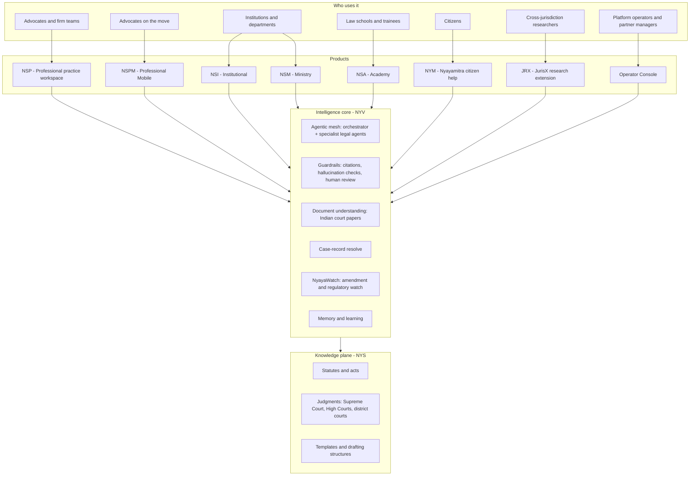
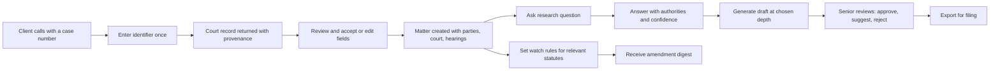
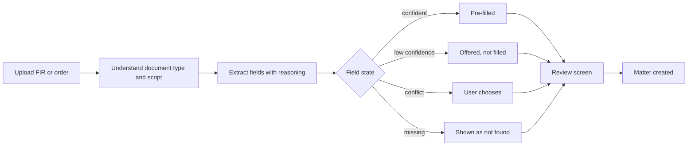
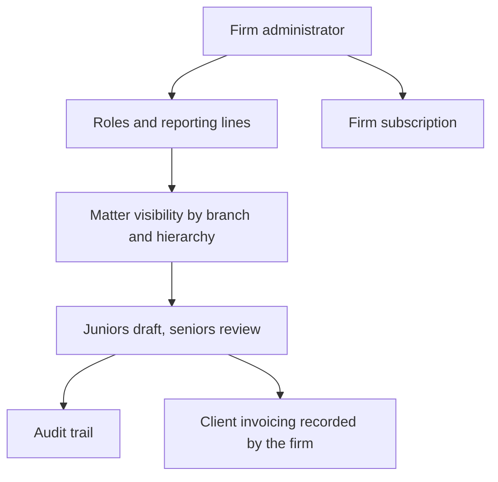
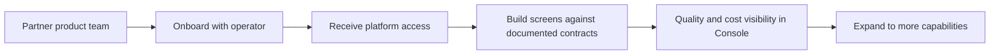
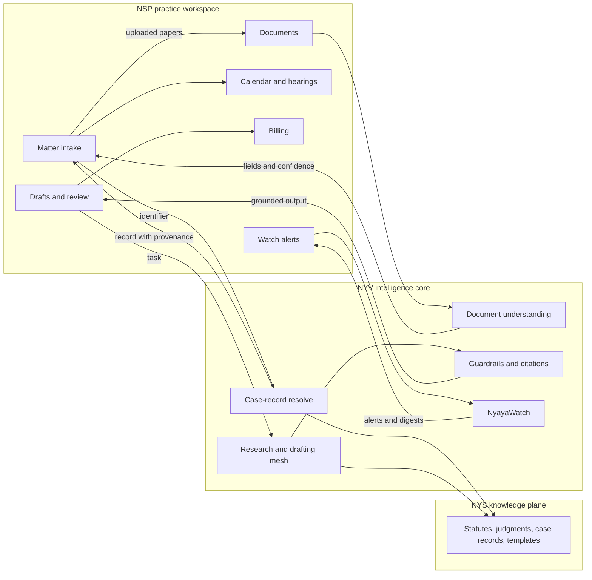
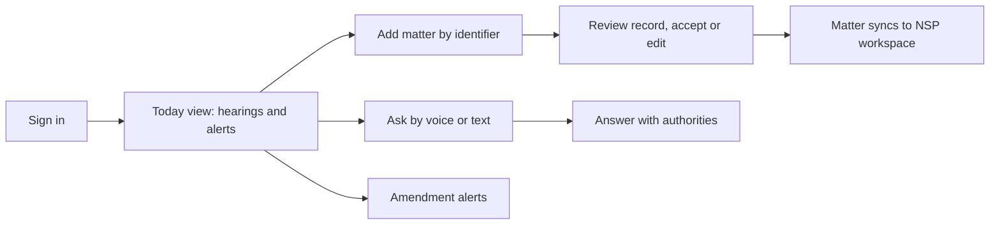
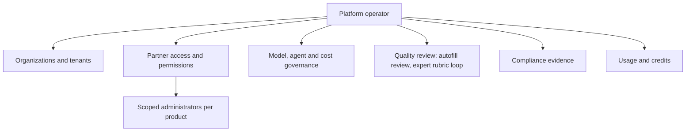
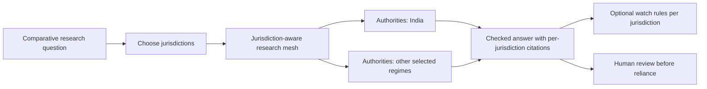

# Nyayavigya + Nyayasiddhi Professional — Comprehensive Product Notes

> **Audience:** founders, product and sales leaders, law-firm partners, institutional buyers, investors, partner product managers.
> **What this is:** the product story — who it serves, what it does for them, and why it is hard to copy. Nothing here describes operational state. For architecture, modules and an evidence-based maturity matrix, see the companion [`NYV-COMPREHENSIVE-TECHNICAL-PRODUCT-NOTES-2026-09.md`](./NYV-COMPREHENSIVE-TECHNICAL-PRODUCT-NOTES-2026-09.md).

---

## 1. The idea in one page

Indian legal work is unusually document-heavy, court-record-heavy and statute-heavy. Global legal-tech tools are built around other legal systems: other court identifiers, other statutes, other document conventions, other languages. Indian advocates and firms end up re-typing case particulars, searching for authorities by hand, drafting from blank pages, and tracking amendments by word of mouth.

**Nyayavigya (NYV)** is the intelligence layer: a legal AI operating system that combines a national corpus of statutes and judgments, a mesh of specialist legal agents, document understanding built for Indian court papers, and strong guardrails. **Nyayasiddhi Professional (NSP)** is the practice product built on it — the day-to-day workspace for advocates and firms — and sibling products serve mobile users, institutions, academies, ministries, citizens and cross-jurisdiction researchers.

The promise to a practitioner is simple: **start a matter from one identifier or one uploaded document, get a grounded first draft with authorities, and be told when the law changes — while keeping a qualified human in charge of every consequential step.**

---

## 2. The ecosystem at a glance

**How the pieces divide the work**

| Layer | Owns | Does not own |
|---|---|---|
| Product experiences (NSP, NSPM, NYM, JRX, …) | Screens, sign-in, firm and client data, billing experience, workflow | Legal reasoning, court corpus |
| NYV intelligence core | Reasoning, drafting, document understanding, guardrails, case-record resolve, watch | Product screens, a firm's own accounting |
| NYS knowledge plane | Statutes, judgments, templates | Customer data, product experience |

---

## 3. Personas

| Persona | What they want | How the ecosystem helps |
|---|---|---|
| **Junior advocate / associate** | Faster intake and first drafts without embarrassing mistakes | Matter creation from an identifier or document, grounded drafts, mentor-style explanations, submission to a senior for review |
| **Senior advocate / partner** | Quality control and leverage over a team | Review queue with approve, suggest and reject, visibility across scoped matters, confidence signals on every AI output |
| **Firm administrator / managing partner** | Clean operations, predictable billing, role-appropriate access | Hierarchy-aware permissions, firm subscription separate from client invoicing, audit trail |
| **Advocate on the move (mobile)** | Matter details and answers in a corridor, not at a desk | Same matters and intelligence in a mobile experience, voice or text questions, hearing reminders, watch alerts |
| **Institutional counsel / departmental legal cell** | Consistency, compliance, institutional memory | Shared knowledge, policy-aware review, compliance evidence |
| **Law student / trainee** | Learn the system of Indian law and citation practice | Explanations with authorities, old-to-new statute mapping |
| **Citizen** | Understand rights and next steps in their own language | Plain-language guidance in multiple Indian languages with sensible escalation to a professional |
| **Cross-jurisdiction researcher** | Compare regimes without losing rigor | Jurisdiction-aware research with per-jurisdiction authorities |
| **Platform operator / partner manager** | Onboard partners safely, see quality and cost, keep governance | Operator Console for organizations, access keys, model and agent governance, quality review, compliance evidence |
| **Subject-matter expert (SME reviewer)** | Improve the system with scarce expert time | Isolated rubric-based review whose feedback improves future answers |

---

## 4. Product pillars

### 4.1 Start a matter from one identifier

A single input field accepts a court case number, a Supreme Court diary number or a filing reference. The system works out which kind of identifier it is and which court family it belongs to, then returns a structured case record: parties, advocates, court and venue, dates, acts and sections, hearings and available documents. A *case-creation* shape of the same result pre-fills intake so the advocate reviews instead of types.

Key product qualities:

- **Every field carries its provenance and confidence**, so the user can see whether a value came from court records, a document, or their own entry.
- **Honest absence.** When a detail is not in the records, the product says *why* (not published, not applicable to this court, needs manual capture) instead of leaving a mystery blank.
- **A parse guide for builders.** Product teams integrating the record get a per-field contract — what the field is, whether it can repeat, how complete it tends to be, and what its absence means — so screens can be designed to match reality.
- **Positioned as a court-records library**, never as a real-time portal feed. Trust comes from saying precisely what the source is.

### 4.2 Start a matter from a document

Uploaded court papers — FIRs, charge-sheets, vakalatnamas, orders, notices, identity and firm certificates — are understood by a document engine built for Indian legal paperwork across many document types and Indian scripts.

- **Deterministic first.** The default path does not depend on a language model; it classifies, anchors, reads tables and resolves fields with explicit reasoning.
- **Four honest outcomes per field:** pre-filled (confident), offered (low confidence — suggested, not filled), conflicted (the user chooses; no silent default), or not found.
- **Optional AI backup.** When a document is hard and a firm opts in, a cost-efficient model may propose values *only for fields the deterministic pass could not confidently read*. It never overwrites a confident reading, never invents content and always falls back quietly to the deterministic result.
- **No vendor badges in lawyer-facing screens.** Users see "from document", not engine names.

### 4.3 Grounded research and drafting

- **Research with authorities.** Answers draw on statutes and judgments in the knowledge plane and are checked for unsupported claims and citation fidelity before they reach a lawyer.
- **Three drafting depths** — quick, standard and comprehensive — so the lawyer chooses speed or thoroughness per task.
- **Indian drafting structure.** Drafts follow the conventions of Indian pleadings, applications and notices (issue, facts, law, analysis, authorities, risks, next steps for advisory work; prayer and verification structure for court applications).
- **Old-to-new statute mapping.** Fast, deterministic answers to "what did this IPC/CrPC/Evidence Act provision become under the new criminal codes" without waiting for a model.
- **Human-in-the-loop by design.** Junior drafts flow to a senior who approves, suggests changes, rejects or marks final; AI output is assistance, never a silent filing.

### 4.4 NyayaWatch — know when the law moves

Lawyers define rules by jurisdiction, practice domain, keywords and specific statutes. NyayaWatch matches incoming amendments and regulatory events against those rules, scores their impact, groups them into periodic digests, and can check whether a statute is still in force. It reads from curated feeds and returns nothing rather than fabricating items when there is nothing to report.

### 4.5 A national, multi-court corpus

The knowledge plane spans the Supreme Court, the High Courts and district courts, with judgments, case records, acts and templates. Different court tiers publish different depth of detail; the product is built to show what exists for each court rather than to imply uniformity.

### 4.6 Agentic mesh and quality loop

- A **master orchestrator** plans the work, retrieves authorities, dispatches **specialist legal agents** (research, drafting, compliance, contract review, summarisation, risk, precedent) and assembles a checked answer.
- **Maker-checker patterns** and confidence-based escalation route doubtful output to a human.
- **Memory** keeps context across a matter so users are not repeating themselves.
- An **expert feedback loop** lets SMEs grade outputs on rubrics so the system improves where lawyers care.

### 4.7 Matter documents at scale

Large or externally stored documents are processed as background jobs; multi-document matter reviews apply a consistent playbook across a vault of papers; clause libraries and comparison tools support contract work.

### 4.8 Execution evidence and signing (honest positioning)

The ecosystem records *who agreed to what, when*, against a fingerprint of the exact document, and produces a verifiable platform attestation and completion certificate for each signing session. This is **execution evidence and an audit record**. It is **not** a qualified or court-grade digital signature, and the product does not claim to be a substitute for certified signature services.

The direction is to keep NYV's evidence layer and connect it to **certified trust-service providers** for signatures where the instrument and the forum require them, rather than to build a certifying authority. Section 9 states the comparison with dedicated signing platforms plainly.

### 4.9 Trust, privacy and governance

- Tenant isolation for every firm and organization; role hierarchies that mirror how firms actually work.
- Personal data is minimised before assistance calls; user-facing copy is reviewed for honesty.
- Every meaningful action is auditable on a tamper-evident chain.
- Compliance evidence for data-protection law, AI-management standards and EU AI Act-style obligations is collected rather than merely promised.

---

## 5. Journeys

### 5.1 Advocate journey — from call to first draft

### 5.2 Document-first intake

### 5.3 Firm-wide operation

### 5.4 Partner journey

---

## 6. NSP ↔ NYV — the practice product and the intelligence core

**Why this split matters.** NSP concentrates on what lawyers touch — matters, clients, calendars, drafts, reviews, invoices. NYV concentrates on what must be right — authorities, reasoning, extraction, guardrails. Because the intelligence is shared, every product in the ecosystem improves together.

---

## 7. NSPM — Professional Mobile, and the operations persona

*A note on naming:* in this ecosystem **NSPM means Nyayasiddhi Professional Mobile**, the mobile companion to NSP. The operator and partner-management persona is served by the **Operator Console**, shown separately below.

### 7.1 NSPM — the advocate on the move

### 7.2 Operator Console — platform and partner operations

---

## 8. JRX — JurisX, the cross-jurisdiction research extension

JurisX extends the Professional experience for users who work across legal systems. It is a research-oriented surface: comparative questions, jurisdiction-specific authorities, and watch rules that follow regulation in several regimes.

JurisX emphasises research quality and selectivity — the lawyer chooses when deep, multi-step reasoning is worth the wait — and leaves document-management sign-in and similar experience concerns with the product team that embeds it.

---

## 9. Advantages versus global legal players

> Descriptions of other vendors are general category characterisations for positioning and should be re-verified before external use. The last column describes the ecosystem honestly, including where it is not the leader.

| Capability area | Practice-management leaders (e.g. Clio) | Legal-AI assistants (e.g. Harvey) | Research platforms (e.g. Lexis+) | Agreement / signing platforms (e.g. DocuSign) | Contract lifecycle (e.g. Ironclad) | **NYV + NSP ecosystem** |
|---|---|---|---|---|---|---|
| **Research** | Light | Strong, broad | Deep editorial content and citators | — | — | Strong on Indian statutes and judgments with authority checks; no editorial citator equivalent |
| **Drafting** | Templates and automation | Workflow drafting | Drafting assist | — | Contract authoring | Indian pleading conventions, three depths, senior review flow; practitioner-grade drafts rather than sealed court forms |
| **Matter data** | Mature matters, billing, trust accounting | Workspaces | Light | — | Contract repository | Matters, clients, documents, hearings and court-record prefill; firm billing model separates subscription from client invoicing |
| **Signing** | Through integrations | Through integrations | — | **Core strength:** complete signing experience and formal signature standards | Through integrations | **Not a native strength.** Evidence attestation and completion records today; qualified signatures are a partner-connected direction. No claim of equivalence |
| **India-specific depth** | Limited | Limited | Limited | Regional coverage through partners | Limited | **Differentiator:** case-number and diary resolve across courts, documents designed for FIRs and orders, Indic scripts, BNS/BNSS/BSA mapping, data-protection posture for India |
| **Agentic capability** | Emerging | Strong workflows | Growing | Emerging | AI workflows | Orchestrator plus specialist legal agents, maker-checker, memory, expert feedback loop |
| **Partner and developer platform** | Open APIs and marketplace | Enterprise integrations | Enterprise integrations | Mature signature APIs | APIs | One intelligence platform serving seven product families; typed SDKs, mobile SDK, citizen SDK, enterprise SDK, agent-tool protocol |
| **Compliance posture** | Enterprise certifications | Enterprise security | Enterprise | Extensive certifications | Enterprise | Evidence collection and tamper-evident audit; formal third-party certification is a separate milestone |
| **Regulatory watch** | — | Limited | Alerts in some tiers | — | Clause-level monitoring | NyayaWatch tied to Indian statutes and amendments, matched to lawyer-defined rules |

### Where we lead

1. **Indian law depth** — identifiers, documents, scripts and statutes native to the system rather than retrofitted.
2. **A corpus-backed record of the case** — start from a number, not a blank form.
3. **Honesty as a feature** — provenance, confidence and explicit absence reasons on everything.
4. **One core, many products** — practitioners, mobile, institutions, academies, ministries, citizens and researchers share one evolving intelligence.
5. **Governed agentic work** — automation with review gates appropriate to a profession that cannot outsource accountability.

### Where we are honest about gaps

- **Signing** is the clearest gap relative to dedicated signature platforms: no native qualified or advanced signature, no signing ceremony experience, and no integration with Indian certified signature methods yet. The ecosystem should be described as providing execution *evidence*, and should connect to certified providers rather than imply equivalence.
- **Editorial citator depth** of established research publishers is not matched.
- **Formal certifications** are separate from the evidence we collect.
- **Real-time court portal data** is not presented as a native capability; records come from the corpus library.

---

## 10. Product themes

| Theme | What it means for customers |
|---|---|
| **One field for any case identifier** | Fewer intake screens; less user knowledge required about which identifier belongs to which court |
| **Parse guide** | Partner screens that match the real completeness of each field |
| **Document engine with optional AI backup** | Higher intake coverage on difficult papers without giving up predictability |
| **Execution attestation toward certified signatures** | Clear evidence today; a credible path to formal signatures through certified providers |
| **NyayaWatch** | Statute and regulatory change delivered to the lawyers affected by it |
| **Multi-court corpus** | Matters from the Supreme Court, High Courts and district courts in one flow |
| **Tiered drafting depth** | The lawyer controls the speed-versus-thoroughness trade-off |
| **Expert feedback loop** | Quality improves where practicing lawyers point |

---

## 11. Messaging guide

**Say**

- "Start from a case number or a document; review instead of retype."
- "Every field tells you where it came from and how sure we are."
- "AI assists; a qualified human decides."
- "Built for Indian courts, documents and statutes."
- "We record execution evidence and connect to certified signature providers."

**Do not say**

- That the system provides a qualified, advanced or court-grade electronic signature today.
- That it replaces a dedicated signature platform.
- That case details are a real-time feed from court portals.
- That AI output needs no lawyer review.
- That formal certifications are held where only evidence collection exists.

---

## 12. Glossary

| Term | Meaning |
|---|---|
| NYV | Nyayavigya — the legal intelligence core |
| NYS | The knowledge plane of statutes, judgments and templates |
| NSP / NSPM | Nyayasiddhi Professional / Professional Mobile |
| NSI / NSA / NSM | Institutional / Academy / Ministry products |
| NYM | Nyayamitra — citizen legal help |
| JRX | JurisX — cross-jurisdiction research extension |
| NyayaWatch | Amendment and regulatory watch |
| Parse guide | Per-field description of meaning, repeatability, completeness and absence reasons |
| HITL | Human in the loop — review and approval by a qualified person |
