# Nyayavigya (NYV) + Nyayasiddhi Professional (NSP) — Comprehensive Technical Product Notes

> **Audience:** CTO, principal architects, security and platform leads, partner integration engineers.
> **Scope:** NYV gateway (`nyayavigya-platform-312`), its knowledge plane (NYS), and the NSP/NSPM/JRX partner surfaces that consume it.
> **Companion:** [`NYV-COMPREHENSIVE-PRODUCT-NOTES-2026-09.md`](./NYV-COMPREHENSIVE-PRODUCT-NOTES-2026-09.md) (product-only, no endpoints, no status language).
> **Not duplicated here:** operational status, deploy stamps and probe ledgers live in [`PLATFORM-STATUS.md`](./PLATFORM-STATUS.md) and `Project-Tracker.md`. This document describes *architecture and capability*, plus an honest maturity matrix for document signing.
> **Alignment source:** `Nyayasiddhi-Professional/docs/product/NSP-TECHNICAL-PRODUCT-NOTES.md` (NSP-side architecture). NYV canonical docs stay here in `documents/working/`.
> **Secrets rule (NV-SECRETS-001):** key *names* only — never values.

---

## 0. Reading guide and naming clarifications

| Code | Product | Role in this document |
|---|---|---|
| **NYV** | Nyayavigya | AI OS / gateway: orchestration, safety ring, RAG, agents, document pipeline, partner API/SDK/MCP |
| **NYS** | NYS-Agentic-AI (`nyayasearch`, `nysapi`) | Knowledge plane: statutes, caselaw corpus, case-record lookup, templates |
| **NSP** | Nyayasiddhi Professional | Web + Word add-in Practice OS for advocates and firms (own BFF, own Postgres/RLS) |
| **NSPM** | Nyayasiddhi Professional **Mobile** | Mobile client of the NSP Practice OS; separate SDK key for attribution and routing |
| **JRX** | **JurisX** (Juris-X, NSP-Pro extension) | Cross-jurisdiction research tooling; wildcard-scope partner key; *selective* (not forced-max) orchestration |
| NSI / NSA / NSM | Institutional / Academy / Ministry | Sibling ecosystem platforms on the same gateway |
| NYM | Nyayamitra | Citizen-facing legal help (multi-language) |

**Correction to the brief.** The request described NSPM as a "platform/admin/partner-ops persona". The codebase says otherwise: `NYV_SDK_KEY_NSPM` is labelled *Nyayasiddhi Professional Mobile* (`src/services/nv-env-sdk-key-sync.ts`, `docs/audit/console-cpo-audit-2026-05-11.md` §4.1, `documents/working/NSP-JRX-API-KEY-OPS-SOP-2026-09-16.md` §1), and `src/utils/nv-partner-platform.ts` treats `NSP`/`NSPM` together as "Nyayasiddhi Professional". The platform/admin/partner-ops persona is the **NYV Console** (RBAC roles `super_admin`, `admin`, `platform_admin`, `enterprise_admin`, `org_admin`, … — `documents/working/PLATFORM-ADMIN-OPS-SOP-2026-09-16.md` §1). §3 therefore documents NSPM as mobile, and adds a separate **Platform Operations (Console)** flow for the ops persona.

**JRX note.** Sources label JRX as "JurisX™ — cross-jurisdiction tools, `*` wildcard scope" (`docs/canonical/13-api-and-sdk-2026-05-13.md`) and "Juris-X (NSP-Pro extension)" (`docs/audit/console-cpo-audit-2026-05-11.md`). `nv-partner-platform.ts` line ~196 explicitly exempts JRX from forced full-Queen orchestration. Depth beyond that is thin in the repo, so §4 is labelled accordingly.

---

## 1. System architecture

### 1.1 Layered view

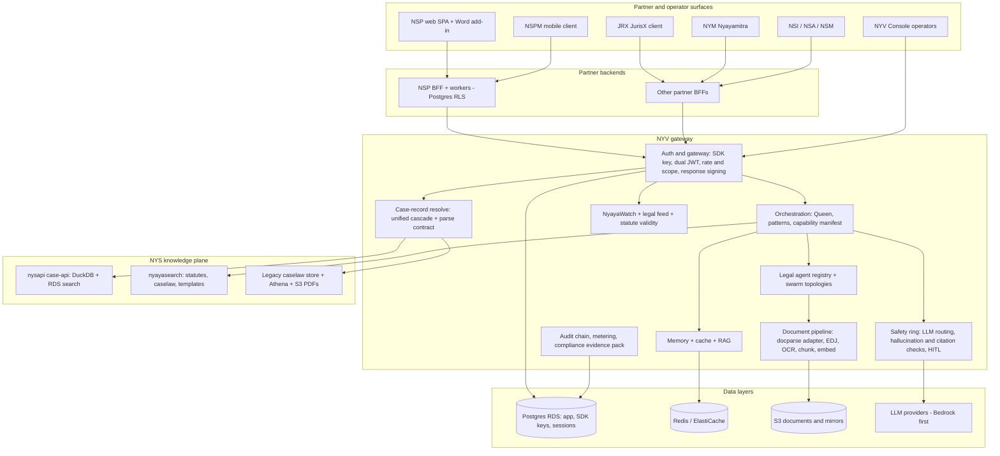

**Invariant (frozen contract):** frontends never call NYS or LLMs directly. All partner traffic is `Partner BFF → NYV → NYS`. NYV forwards to NYS with its own machine credential, never the partner's key (`PLATFORM-ADMIN-OPS-SOP` §2).

### 1.2 Module map (NYV tree)

| Concern | Primary modules (paths under `nyayavigya-platform-312/`) |
|---|---|
| Gateway entry and route mounts | `src/index.ts` (mounts under `/api/nv/*`, `/api/nv5/internal/*`) |
| SDK auth, scopes, platform identity | `src/middleware/nv-sdk-gateway.ts`, `src/utils/nv-partner-platform.ts`, `src/middleware/nv-response-signing-middleware.ts` |
| Orchestration | `src/orchestration/nv-queen-orchestrator.ts`, `capability-manifest.ts` (+ `capability-manifest.snapshot.json`), `nyayavigya-orchestration-core-v9.ts` |
| Agents | `config/agent-registries/Nyayavigya-Legal-registry-*.json` (Default + per-jurisdiction overlays), `src/agents/` |
| LLM routing and safety ring | `src/config/nv-llm-routing-policy.ts`, safety ring via `orchestrateLLM` (NV-LLM-001: no direct LLM calls outside the ring) |
| Case-record resolve | `src/services/nv-case-api-adapter.ts`, `nv-cnr-unified-cascade.ts`, `nv-cnr-document-bundle.ts`, `nv-nsp-parse-contract.ts`, `nv-jurisdiction-prefill.ts`, `nv-ecourts-*.ts`, `nv-nys-knowledge-client.ts` |
| Docparse | `packages/docparse/` (engine), `src/services/nv-docparse-adapter-service.ts`, `nv-docparse-ingest-helper.ts`, `nv-docparse-llm-fallback.ts` |
| Document pipeline | `src/services/document-pipeline/*` (parser, OCR adapter, legal chunker, embeddings, e-sign adapter, watermark, PDF/A), `src/routes/nv-sdk-doc-pipeline-routes.ts` |
| Ecosystem documents (EDJ) | `src/services/nv-ecosystem-document-job-service.ts`, `src/routes/nv-ecosystem-document-routes.ts` |
| Matter Vault | `src/services/nv-matter-vault-service.ts`, `src/routes/nv-matter-vault-routes.ts` |
| NyayaWatch and legal feed | `src/services/nyaya-tools/nv-nyayawatch-service.ts`, `src/routes/nv-nyaya-tools-routes.ts`, `src/routes/nv-intelligence-routes.ts` |
| Compliance and audit | `src/services/compliance/nv-compliance-evidence-pack.ts`, `src/routes/nv-audit-chain-routes.ts`, DPDP/EU-AI-Act/ISO-42001 services |
| Console | `client/src/pages/**` (operator UI: Document AI Hub, Command Centre, Instant Search, Autofill QA, …) |
| Partner SDKs | `packages/client-sdk`, `client-sdk-react-native`, `nyayamitra-sdk`, `enterprise-sdk`, `mcp-server`, `react-hooks`, `types`, `docparse` |

### 1.3 Data layers

| Layer | Store | Notes |
|---|---|---|
| Application state, SDK apps/keys, sessions | Postgres (RDS) | Drizzle; `shared/schema.ts`; org-scoped rows |
| SDK key auth | `sdk_applications` + `sdk_app_api_keys` (hashed) | env keys synced on boot (`nv-env-sdk-key-sync.ts`) |
| Cache, queues, AI store | Redis (TCP) | Canonical `NYV_REDIS_TCP_URL` |
| Documents and mirrors | S3 (owned buckets) | Presigned, short TTL on partner-facing links |
| Corpus: case-api | DuckDB (`case_lookup_full`) + RDS `case_api_search` | Tier-1 of resolve |
| Corpus: legacy | `nyv_caselaw.judgments`, `cnr_case_details`, Athena parquet, S3 PDFs | Tier-2 of resolve |
| Watch | `nv_schema.nv_nyayawatch_rules`, `nv_amendment_events`, `nv_regulatory_feeds`, `nv_statute_versions` | Persisted rules; empty feeds return empty, never synthetic items |
| e-Sign sessions | `nv_esign_sessions` | See §9 |
| Audit | Hash-chained audit tables | Verifiable chain |

---

## 2. NSP ↔ NYV gateway — matter intake, AI tasks, case records, documents, watch

### 2.1 End-to-end flow

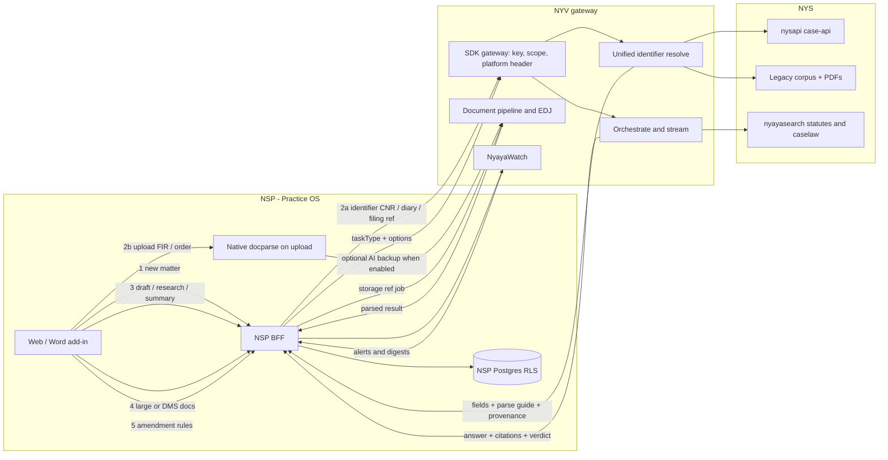

### 2.2 Step table

| # | NSP step | NYV module | Key behaviour |
|---|---|---|---|
| 1 | Matter intake, path "court record" | `POST /api/nv/v1/sdk/cnr/resolve` with `{ identifier }` | Single input: CNR, SC diary number, or filing reference. Gateway infers `inferredCourtType` and `identifierKind`; optional `options.profile: "caseCreate"` returns case-creation-shaped output |
| 1b | Search-then-resolve | `GET /api/nv/v1/sdk/cnr/search` (raw nysapi cards) → resolve | Search returns raw snake_case cards only; normalised keys exist only on resolve |
| 2 | Matter intake, path "upload" | NSP-native docparse (primary); NYV docparse adapter (for gateway callers) | Deterministic first; optional NYV AI backup only when explicitly enabled on the NSP side |
| 3 | AI tasks | `POST /api/nv/orchestrate` (+ `/stream`) | `taskType`: `legal-chat-fast`, `legal-chat`, `legal-draft-fast`, `legal-draft` (+ `draftLength`), `doc-draft-fast`, `legal_research`, `summarize`, `contract_review`, `compliance-check`, `evaluate-draft`, … — matrix in [`NSP-NYV-AI-TASK-SURFACE-2026-09.md`](./NSP-NYV-AI-TASK-SURFACE-2026-09.md) |
| 4 | Documents | Presigned `data.documents[]` on resolve; `GET .../cnr/{cnr}/document-bundle`; EDJ jobs for large/DMS docs | Partner-facing presign TTL is short; HC order paths are returned raw unless a mirrored, owned-bucket map row exists (no fabricated keys) |
| 5 | Watch | `GET /api/nv/intelligence/nyayawatch/rules` (NSP alias) → `nvNyayaToolsRouter` `/watch/*` (canonical `/api/nv/nyaya-tools/watch/*`) | Same handler, dual auth (`dualSdkOrJwt`) |
| 6 | Audit and metering | Response-signing for NSP-originated calls; usage metering with `metadata.partnerAi` | Transport integrity only — not document signing (see §9) |

### 2.3 Orchestration sequence (AI task)

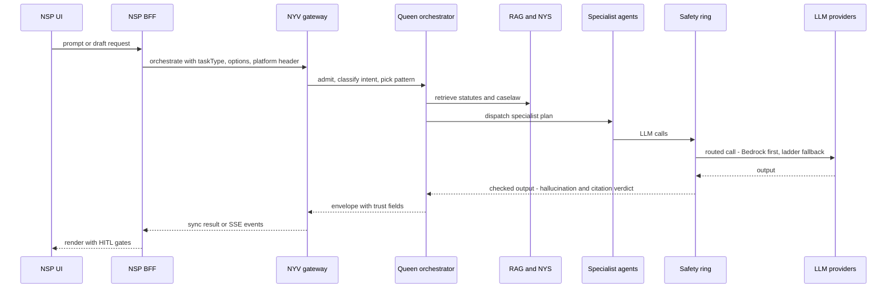

Ecosystem platforms (NSP/NSPM/NSI/NSA/NSM/NYM/NYV) get maximum-depth treatment (RAG + citations + hallucination check + memory + CoT) by default; "lean" hints are ignored unless an explicit allow flag is set. JRX is *selective*. (`src/utils/nv-partner-platform.ts`, `FEATURES-REGISTRY.md` §16.)

### 2.4 Unified identifier resolve — cascade

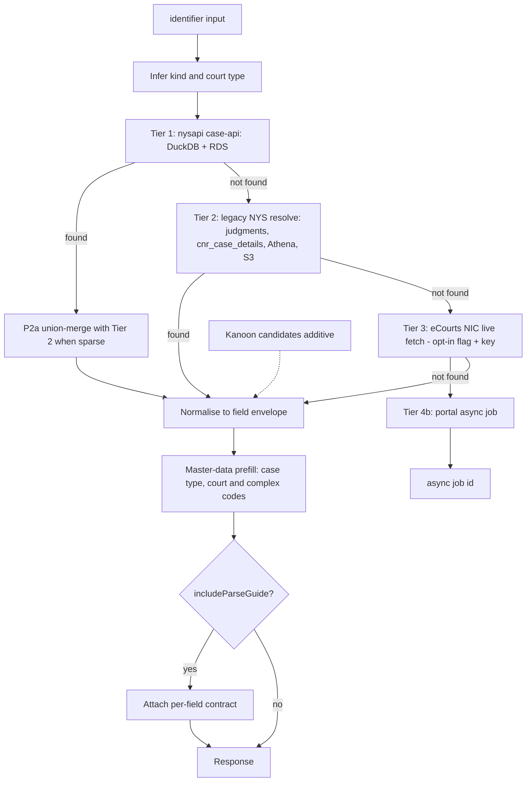

Contract facts (`src/services/nv-nsp-parse-contract.ts` is the SSoT; generated JSON at `documents/working/NSP-RESOLVE-PARSE-CONTRACT.json`):

- Every `data.fields.<key>` is a `CnrFieldValue { value, source, confidence, note? }`. On `found`, the key is always present; `.value` may be null/empty — read `absentWhen`.
- **Parse guide:** with `options.includeParseGuide: true`, `data.nspParseGuide` carries, per key, `{ path, type, cardinality, nestedSchema, availabilityTier, parseHint, absentWhen }`. `absentWhen` vocabulary: `null`, `not_in_corpus`, `not_applicable`, `tier_mobile_depth_only`, `tier3_required`, `manual_required`, `search_surface_only`.
- `claimEcourts` is always `false` — corpus and reference joins, never a live-eCourts claim.
- Documents (`data.documents[]`, presigned, short TTL) are separate from `data.fields.*`.
- Diary intake normalises into the same keys; `fields.cnr` is typically empty for pending SC diaries, and `/timeline` is CNR-keyed.

---

## 3. NSPM — Nyayasiddhi Professional Mobile (and the ops persona, separately)

### 3.1 NSPM mobile flow

NSPM is a Flutter client of the NSP Practice OS (`apps/mobile` in the NSP repo). It does **not** call NYV directly; it talks to the NSP BFF, which calls NYV with the NSPM SDK key for attribution, routing and rate/scope policy.

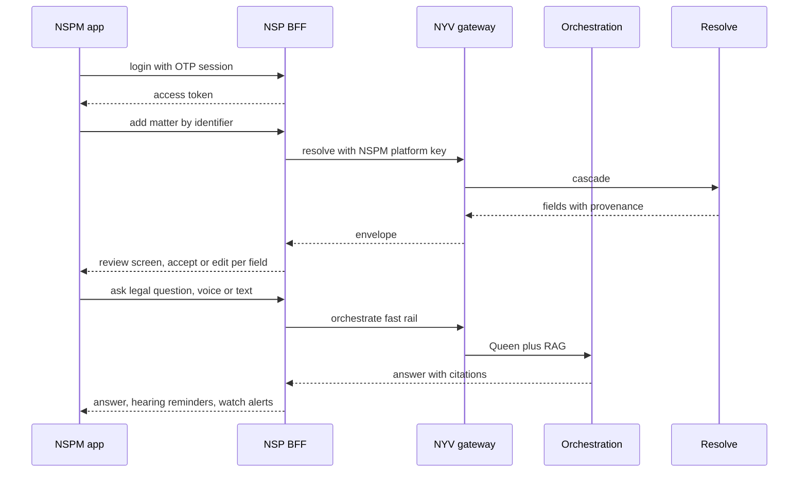

Platform identity and policy touchpoints: `src/middleware/nv-sdk-gateway.ts` (platform detection from key / `appType`), `src/config/nv-llm-routing-policy.ts` (per-platform aggregator preference; `NSPM: { primaryAggregator: 'bedrock', qualityFirst: true }`), `src/middleware/nv-integration-soft-policy.ts` (default soft-policy platforms NSP, NSPM, NYM).

### 3.2 Platform operations persona (NYV Console) — *not* NSPM

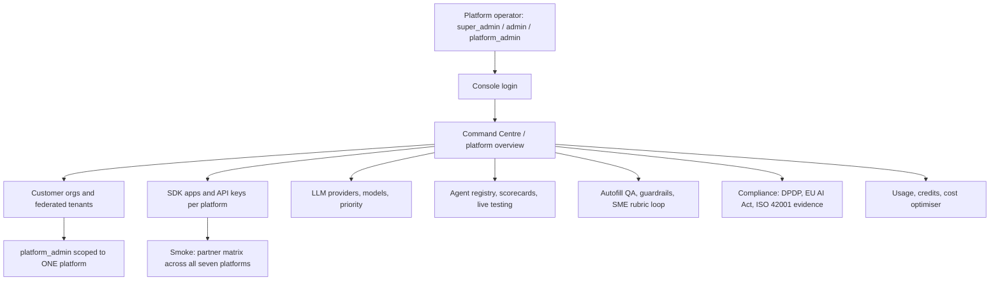

RBAC source: `src/services/rbac/rbac-service.ts`, `client/src/lib/rbac-registry.ts`. SME role is isolated (GRPO rubric only, no Console access). Key operations are documented in `PLATFORM-ADMIN-OPS-SOP-2026-09-16.md` and `NSP-JRX-API-KEY-OPS-SOP-2026-09-16.md`; this document does not restate them.

---

## 4. JRX — JurisX (cross-jurisdiction research extension)

*Evidence is thin in-repo; diagram reflects the documented role (cross-jurisdiction tools, wildcard scopes, selective orchestration) and the jurisdiction overlay machinery that exists in code.*

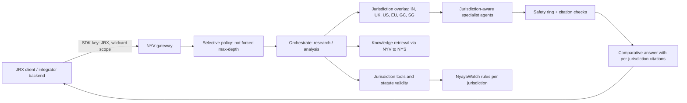

| Item | Source |
|---|---|
| Key name `NYV_SDK_KEY_JRX`, enterprise tier, wildcard scope | `NSP-JRX-API-KEY-OPS-SOP-2026-09-16.md`, `docs/canonical/13-api-and-sdk-2026-05-13.md` |
| Overlay jurisdictions IN, UK, US, EU, GC, SG (+ default primary) | `FEATURES-REGISTRY.md` §0; `NV_PRIMARY_JURISDICTION` merges one overlay at runtime |
| Word/DMS OAuth UX owned by NSP/JRX, not NYV | `Nyayavigya-platform-Integration-document-5.0.0.md`, `FEATURES-REGISTRY.md` §16 |
| Selective orchestration | `src/utils/nv-partner-platform.ts` (JRX returns `false` for forced full Queen) |

---

## 5. Document intelligence

### 5.1 Docparse (deterministic, provenance-bearing)

`packages/docparse` ("`@nyv/docparse`"): Indian legal document parsing, field extraction, autofill and analysis. **No LLM in the default path.** Characteristics from its README: 58 document types (fixture-verified), 41 grammar patterns, 58 anchors, 11 scripts, table detection on 4 grid families, Tesseract 5 with Indic script models (script-level models are mandatory — Devanagari language models drop leading date digits), hash-chained governance audit events.

Result states are explicit: fields pre-filled, `lowConfidence` (offer, do not pre-fill), `conflicts` (user must choose, no default), `absent` (show "not found").

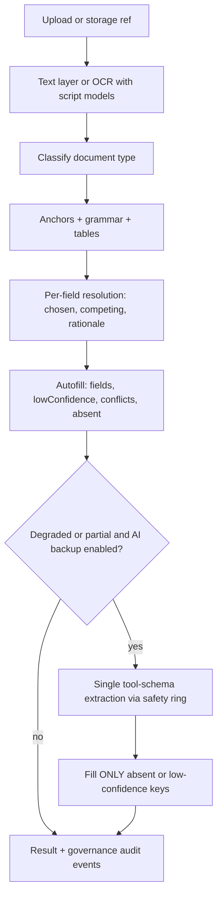

### 5.2 Optional AI backup — `nv-docparse-llm-fallback.ts` (NV-DOCPARSE-LLM-FALLBACK-001)

| Property | Value |
|---|---|
| Gate | `NYV_F_DOCPARSE_LLM_FALLBACK` (default OFF) |
| Model rail | Amazon Nova Micro (APAC profile), via `realLLMService.executeRequest` → `orchestrateLLM` (NV-LLM-001) |
| Overwrite rule | Never overwrites a deterministic value at confidence ≥ 0.7 |
| Recovered-field confidence | Stamped 0.6 (below deterministic RESOLVED) |
| Input bound | 12,000 characters; field values ≤ 400 characters |
| Validation | Zod tool schema; keys mirror `CourtDocField.key` space |
| Failure mode | Fail-soft: any error returns the deterministic result unchanged |
| Instruction | Return a field only if present verbatim; never invent |

NSP runs its own native `@nsp/doc-parse` as primary and may call the NYV document-analyst as a *backup* only when its own backup flag is set (NSP technical notes §5).

### 5.3 Pipeline services and large documents

- `src/routes/nv-sdk-doc-pipeline-routes.ts`: extract, pipeline, parse, intelligence/analyze, embeddings, compare, summarize, templates, clause library/suggest, compliance-check.
- Ecosystem Documents (EDJ): async jobs over a storage reference (`nyv_doc_id | presigned_get | nyv_shared_key`) with typed processing errors; used for large or DMS-sourced documents.
- Matter Vault: multi-document matter review with playbooks.
- Generation paths: DOCX/PDF conversion exists under completions routes (`nv-completions-routes.ts` convert); **none of these sign** (see §9).

---

## 6. Knowledge plane and corpus (multi-court)

| Tier | Store | Feeds |
|---|---|---|
| Tier 1 | nysapi case-api: DuckDB `case_lookup_full` + RDS `case_api_search` (watermarked by table version, surfaced as `meta.provenance.tableVersion`) | Core fields, inline hearings, counts, SC diary |
| Tier 2 | Legacy NYS: judgments (HC/SC/district), `cnr_case_details`, Athena parquet, S3 PDFs | Acts/sections, deep hearings, documents, `caseCreate`, `extractPreview` |
| Tier 3 | eCourts NIC (`nv-ecourts-live-fetch.ts`) | On-demand live fetch; opt-in, key-gated |
| Tier 4b | eCourts portal async worker (`nv-ecourts-tier4b-worker.ts`) | Job id on `not_found` |
| P6 | Kanoon enrichment (`nv-kanoon-enrichment.ts`) | Additive `candidates[]` |

Coverage spans Supreme Court, High Courts and district courts (district-court judgments ingested nationally across state prefixes). Field availability differs by court tier and is expressed in `absentWhen` — e.g. HC docket richness only where mobile-depth indexed; party PII is sparse by design (`manual_required`/`corpus_unavailable`). Detail and numbers: [`NYV-NYS-CLOSURE-ARCHITECTURE-2026-09.md`](./NYV-NYS-CLOSURE-ARCHITECTURE-2026-09.md), [`NYV-CASE-CORPUS-FIELD-GAP-PLAN-2026-09.md`](./NYV-CASE-CORPUS-FIELD-GAP-PLAN-2026-09.md). Corpus size figures are intentionally not repeated here (volatile).

Knowledge endpoints used by partners: caselaw search (FTS and hybrid), statute search, statute-mapping fast path (IPC/CrPC/IEA → BNS/BNSS/BSA answered from the knowledge plane without an LLM), legal feed, and Instant Search facade.

---

## 7. NyayaWatch (regulatory and amendment watch)

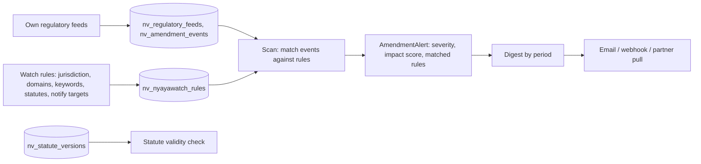

- Routes: `POST /watch/scan`, `POST /watch/digest`, `POST|GET /watch/rules`, `GET /watch/rules/:userId`, `DELETE /watch/rules/:ruleId`, `POST /watch/statute-validity` under `nvNyayaToolsRouter`; NSP alias under `/api/nv/intelligence/nyayawatch/*` with `dualSdkOrJwt`.
- Honesty: empty feeds return empty digests; no synthetic items. Gazette → matter notification is a deferred phase, and the Tavily regulatory sweep is flag-gated and off by default (`FEATURES-REGISTRY.md` §16).

---

## 8. Security, tenancy, compliance

| Area | Mechanism |
|---|---|
| Partner auth | `X-API-Key` (canonical), `Authorization: Bearer <key>` fallback, Console JWT on dual-auth routes; per-platform keys `NYV_SDK_KEY_{NSP,NSPM,NSI,NSA,NSM,NYM,JRX}` |
| Key source of truth | Postgres `sdk_applications` / `sdk_app_api_keys` (hashed); env mirror synced on boot |
| Scopes | DB scopes in `sdk_app_api_keys.scopes` (not static config) |
| Tenancy | Org-scoped rows on NYV; NSP enforces its own Postgres RLS with request-scoped org context |
| LLM safety | NV-LLM-001 single ring; hallucination/citation checks; HITL escalation targets |
| Transport integrity | `nv-response-signing-middleware.ts` HMACs responses for NSP-originated requests when a response secret is configured |
| PII | Redaction before counsel calls on the NSP side; sanitised envelope when platform header is NSP |
| Compliance evidence | `nv-compliance-evidence-pack.ts` maps controls (SOC2-style, ISO 42001) to evidence sources — *evidence collection, not certification* |
| Audit | Hash-chained audit trail (Console "Audit Chain"), change ledger in `Project-Tracker.md` |
| Data protection | DPDP, EU AI Act, BIPA consent surfaces exist in Console |

---

## 9. Document signing — maturity matrix (triple-pass audit)

**Method.** Three passes: (1) symbol/string grep across `src`, `shared`, `packages`, `migrations`, `scripts`, `client`; (2) full read of `nv-esign-adapter-service.ts`, the `docs.esign` manifest entry, internal routes and SDK clients; (3) **execution** — a throwaway probe (deleted after use) that ran the real attestation, watermark and PDF/A code paths, with positive controls (attestation determinism + case normalisation returned `true`). Dependencies checked in `package.json` (only `pdfkit` and `puppeteer` present; no `node-signpdf`, `@signpdf/*`, `node-forge`, `pkijs`, `asn1js`, `jsrsasign`, `pdf-lib`). Tests: **no test file references the e-sign service or `nv_esign_sessions`**.

### 9.1 Honest bottom line

NYV today provides **a persisted multi-signer *session ledger* with a platform-internal HMAC-SHA256 *intent attestation*.** It does **not** produce a signed PDF, does not embed PKCS#7/CMS, is not PAdES, does not integrate Aadhaar eSign, DSC or DocuSign, and its own code sets `legallyBindingClaim: false`. The HMAC is symmetric: only NYV (holder of the secret) can verify it, so it is not independently verifiable by a counter-party or court. "Signing" in the product must be described as *execution evidence / audit attestation*, never as a DocuSign-equivalent or a qualified/advanced electronic signature.

### 9.2 Matrix

Legend: **BUILT** = code exists and was exercised or read end-to-end; **BUILT-WEAK** = exists but does not deliver what its name implies; **PARKED** = intentionally unimplemented pending partner credentials/GO; **MISSING** = no code.

| # | Capability | Verdict | Evidence (paths under `nyayavigya-platform-312/`) | Notes |
|---|---|---|---|---|
| 1 | Persisted signing sessions (create / status / get / cancel / expire sweep) | **BUILT** | `src/services/document-pipeline/nv-esign-adapter-service.ts` (`createSigningSession`, `checkSigningStatus`, `getSession`, `cancelSession`, `expirePastDueSessions`); table `nv_esign_sessions` in `shared/schema.ts` (def ~L1917) and `migrations/2026-05-28-legal-doc-domain-catchup.sql` (~L150) | Fixed prior in-memory `Map` loss on restart. DB is source of truth; cache is read-through. `expirePastDueSessions` has **no caller** in `src`, `scripts`, `server` or `packages` (grep), so sessions only flip to `expired` lazily inside `checkSigningStatus` |
| 2 | Document hash binding (SHA-256 of the bytes) | **BUILT** | same file, `createSigningSession` | Hash stored; bytes themselves are not stored |
| 3 | Multi-signer model with roles (primary / witness / notary) and `order` | **BUILT-WEAK** | same file, `Signer` interface; `signDocument` | `order` is stored but **not enforced**; any listed signer email can sign at any time |
| 4 | Signer authentication (OTP / KBA / Aadhaar OTP / certificate) | **MISSING** | `signDocument(sessionId, signerEmail, signatureType)` | No identity proof. `signatureType` (`aadhaar-esign` / `dsc` / `docusign` / `digital`) is a **caller-supplied label**; the probe showed it only alters the HMAC input — it does not verify anything |
| 5 | Native HMAC-SHA256 attestation per signer + completion certificate (NV-ESIGN-NATIVE-001) | **BUILT-WEAK** (honest evidence, not a signature) | `buildNativeAttestation` (same file); probe output: `algorithm=HMAC-SHA256`, `legallyBindingClaim=false`, `sigLen=64`, deterministic, email case-normalised | Secret chain: `NYV_ESIGN_HMAC_SECRET` → `NYV_JWT_SECRET` → hard-coded dev constant. **Risk:** if neither env is set the dev constant signs attestations. Symmetric → not third-party verifiable. No `verifyAttestation` function exists |
| 6 | Signed-document download | **BUILT-WEAK** | `downloadSignedDocument` | Returns a **plain-text summary** buffer (session, hash, signer lines) — not the signed PDF, no embedded signature |
| 7 | Provider selection (`nyv-native` / `nyv-docusign` / `aadhaar-esign` / `docusign`) | **BUILT-WEAK (misleading)** | `selectProvider()`; file has no `fetch`/HTTP client | Setting `DOCUSIGN_API_KEY` or `AADHAAR_ESIGN_URL` only **relabels** the session `provider`; no outbound provider call exists. `NYV_DOCUSIGN_NATIVE=1` yields label `nyv-docusign` with the same HMAC-only behaviour |
| 8 | Capability-manifest entry `docs.esign` | **BUILT-WEAK** | `src/orchestration/capability-manifest.ts` L1644–1707; snapshot `capability-manifest.snapshot.json` | Ops: create / status / get only (no `sign`). Tiers mitra/enterprise/sovereign/white-label; `safetyClass: 'high-risk'`. If `signers` is omitted it fabricates `signer@example.com`, and a missing document becomes the text of the prompt. **Not bound in `INTENT_CAPABILITY_MAP`** (only string hits for `docs.esign` are the definition and snapshot) → not Queen-schedulable by intent (NV-MESH-001 gap). Wired to boot via `nv-internal-wire-chain.ts` import only |
| 9 | Partner/SDK HTTP surface for signing | **MISSING** (read-only admin peek exists) | `src/routes/nv5/internal/index.ts` L131–142: `GET /api/nv5/internal/esign/capabilities`, `GET .../esign/session/:sessionId` (`requireSdkKeyOnly` + `requireScope('admin')`); SDK `packages/client-sdk/src/api/InternalApi.ts` (`esign.session`) | The capabilities endpoint *lists* `createSigningSession`, `signDocument`, `downloadSignedDocument` but **no HTTP route performs them** |
| 10 | SDK signing client pointing at routes that do not exist | **BUILT-WEAK (dangling)** | `packages/client-sdk/src/api/ComplianceApi.ts` L36–42 call `POST /api/nv/compliance/digital-sign/create` and `GET /api/nv/compliance/digital-sign/:id`; `rg "digital-sign" src` finds no route handler | **Static finding** (grep across `src`; live 404 not probed). Same for `/api/nv/compliance/watermark` and `/watermark/verify` |
| 11 | Watermark service | **BUILT-WEAK** | `src/services/document-pipeline/nv-watermark-service.ts`; probe: marker appended **after `%%EOF`**; `verifyWatermark` returned `valid: true, metadata: null` on a **tampered body** | Verify only regex-matches the marker; it neither recomputes the hash nor reads metadata. Provides no tamper evidence. Exposed only as a capability descriptor |
| 12 | PDF/A generator | **BUILT-WEAK (skeleton)** | `src/services/document-pipeline/nv-pdfa-generator-service.ts`; probe head `"%PDF-A DOCUMENT\n% Ti"`, real-PDF-header check `false` | Emits labelled text, **not a valid PDF and not PDF/A**. `pdfkit`/`puppeteer` exist in dependencies but are unused here. Conflicts with NV-NO-STUB-001 if advertised |
| 13 | PKCS#7 / CMS detached signatures | **MISSING** | no crypto-PKI dependency in `package.json`; no code | `PLATFORM-STATUS.md` L13 states the same |
| 14 | PAdES (B-B / B-T / B-LT / B-LTA), signature field/appearance in PDF | **MISSING** | none | — |
| 15 | RFC 3161 trusted timestamping, OCSP/CRL, LTV, certificate-chain validation | **MISSING** | none | `signedAt` is the server clock |
| 16 | Aadhaar eSign (ESP/ASP integration) | **PARKED** | `AADHAAR_ESIGN_URL` read only in `selectProvider`; registry language in `documents/working/NYV-GLOBAL-BEST-LEGAL-AI-OS-GAPS-PLAN-2026-07.md` (W5) | Needs ASP onboarding with a CCA-empanelled ESP and commercial agreement |
| 17 | DSC (Class 3 USB token / HSM / remote signing) | **MISSING/PARKED** | `signatureType: 'dsc'` is a label only | — |
| 18 | DocuSign / Adobe Sign OAuth and envelope status | **PARKED** | `src/data/nv-mcp-connector-catalog.ts` L44–45 (`implementationStatus: 'stub'`); `src/data/nv-mcp-tools-registry.ts` L675 `docusign_envelope_status`; `FEATURES-REGISTRY.md` §0/§16 ("OAuth stubs — Not sold") | Returns `oauth_required` semantics; partners own OAuth UX |
| 19 | MCP verify tools `digital_signature_verify`, `esign_verify` | **BUILT-WEAK (catalog only)** | `src/data/nv-mcp-tools-registry.ts` L275, L282; `rg` finds no executable handler outside the catalog | Catalog entries, not verifiers. Do not cite as verification capability |
| 20 | Response signing (HMAC of API responses) | **BUILT** (different purpose) | `src/middleware/nv-response-signing-middleware.ts`; mounted at `src/index.ts` L524 | Transport integrity for NSP calls — **unrelated to document signing** |
| 21 | Compliance evidence mapping for e-sign attestation | **BUILT** (evidence mapper) | `src/services/compliance/nv-compliance-evidence-pack.ts` (control C1.2), note: "Platform-native intent attestation only; partner OAuth e-sign remains PARKED" | Honest wording already present |
| 22 | Type-only placeholders in other services | **BUILT-WEAK (types only)** | `src/services/e-filing/e-filing-service.ts` L47 `digitalSignature?: string // ML-DSA`; `src/services/contract-lifecycle/contract-lifecycle-service.ts` L108 `digitalSignatures?` | Fields without signing logic |
| 23 | Signing ceremony UX, invitations/reminders, tab/field placement, routing rules, bulk send | **MISSING** | none in NYV; NSP owns UX per integration guide | Would sit in NSP/partner UI; NYV needs the API |
| 24 | E-stamping / stamp-duty workflow (India) | **MISSING** | none | Material for execution of Indian agreements |
| 25 | Automated tests for any of the above | **MISSING** | no hits in `tests/`, `packages/`, `e2e/` for the service or table | Attestation code is untested |
| 26 | Documentation honesty | **BUILT** | `documents/working/PLATFORM-STATUS.md` L13, L199, L219, L420; `FEATURES-REGISTRY.md` L29, L387, L396; Gaps plan L16, L44, L80, L101 | No dedicated e-sign document exists under `documents/working/`; this section is the consolidated record. NSP-side notes do not mention e-sign |

### 9.3 Integrity risks worth fixing before any external "signing" claim

1. **Label spoofing:** `signatureType` is trusted input. A caller can record `aadhaar-esign` with no Aadhaar involved. Until a provider verifies, restrict accepted values to `digital`/`nyv-native` and reject the others.
2. **Provider relabelling:** `selectProvider()` should never return `docusign`/`aadhaar-esign` without a real provider call succeeding.
3. **Secret fallback:** remove the hard-coded dev constant; fail closed when no secret is configured in production.
4. **Watermark verification** must recompute the hash (or be removed from capability claims).
5. **PDF/A** must either produce a valid PDF/A (e.g. via a real renderer) or be withdrawn from the manifest.
6. **Dangling SDK methods** should be routed to real handlers or marked unavailable so partners do not integrate against a 404.
7. **No tests.** Add unit tests for the attestation, expiry sweep and signer-state transitions before extending.

### 9.4 Current vs. proposed target architecture

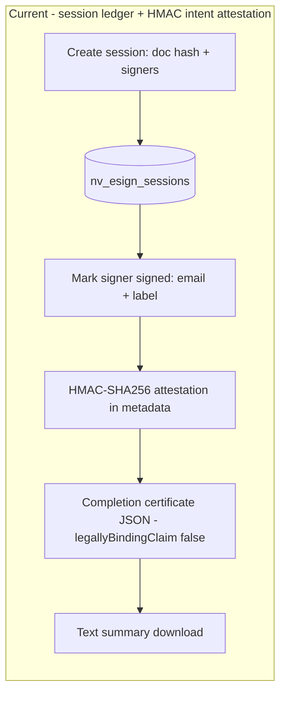

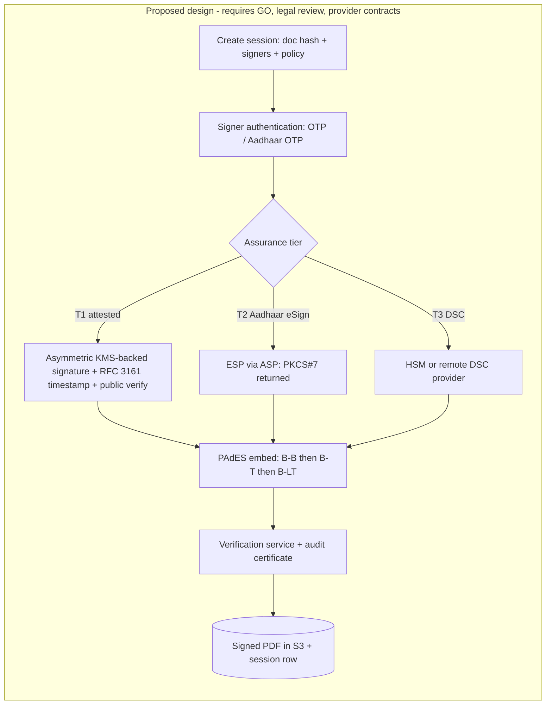

This target is a **design proposal only**. It needs counsel review on which tier is acceptable for which instrument under the Information Technology Act (electronic-signature provisions and the schedule of notified methods) and the Bharatiya Sakshya Adhiniyam, plus provider onboarding. No part of it is built.

---

## 10. Global legal players vs NYV + NSP — capability comparison

> Competitor characteristics are general, publicly positioned category descriptions — *verify before any external use*. The NYV+NSP column describes what the code and docs support; gaps are stated plainly.

| Capability area | Clio (practice mgmt) | Harvey (legal AI) | Lexis+ AI (research) | DocuSign (agreements) | Ironclad (CLM) | **NYV + NSP (actual)** |
|---|---|---|---|---|---|---|
| **Research** | Limited native | Strong multi-jurisdiction assistant | Deep editorial content + citator | n/a | n/a | RAG over NYS statutes/caselaw; Queen + citations + hallucination check; old→new statute mapping fast path; **strength: Indian statutes and courts**. No editorial citator equivalent; treatment-graph work exists as assessment docs only |
| **Drafting** | Templates, doc automation | Workflow-driven drafting | Drafting assist | n/a | Contract authoring | Tiered drafting (fast / standard / comprehensive), Indian draft-structure registry, HITL approve/reject with junior→senior flow on NSP; "practitioner / SME-approved drafts", not sealed court forms |
| **Matter data** | Mature matter/billing/trust accounting | Workspace/vault | Limited | n/a | Contract repository | NSP Practice OS: cases, clients, docs, calendar, billing (firm subscription + manual client ledger), hearings; court-record prefill from national corpus. Trust accounting depth not evidenced |
| **Signing** | Integrations | Integrations | n/a | **Core product**: envelopes, ceremony, audit, regional standards | Via integrations | **Gap.** Session ledger + HMAC intent attestation only (§9). No PKCS#7, PAdES, Aadhaar eSign, DSC, timestamping, ceremony UX. Partners own DocuSign/DMS OAuth |
| **India specifics** | Limited | Limited | Limited India depth | Regional support via partners | Limited | **Differentiator:** CNR/diary resolve across SC/HC/DC, 58-type Indian docparse (FIR, chargesheet, vakalatnama, orders), Indic OCR scripts, BNS/BNSS/BSA migration, court-master prefill, DPDP surfaces. Not live eCourts (honesty-locked) |
| **Agentic** | Emerging assistants | Agents/workflows | Assistants | Emerging | AI workflows | Queen orchestrator, 22 patterns, large specialist registry, maker-checker (flag-gated), swarm topologies, capability mesh; curated partner MCP tool set |
| **Partner SDK / API** | Open API/marketplace | Enterprise APIs | Enterprise APIs | Mature eSignature API | APIs | Seven platform keys, typed client SDK, React-Native, enterprise, citizen and MCP packages, EDJ async jobs, frozen contracts (orchestrate, CNR resolve, RAG). Signing API absent |
| **Compliance posture** | SOC 2-class | Enterprise security | Enterprise | Extensive certifications | Enterprise | Evidence mappers + audit chain; no SOC 2 Type II certificate; ISO 42001 / DPDP / EU AI Act services |
| **Multi-tenancy** | SaaS tenants | Enterprise tenants | Enterprise | Enterprise | Enterprise | Org-scoped NYV + NSP Postgres RLS; per-platform keys (NSP, NSPM, NSI, NSA, NSM, NYM, JRX) |

---

## 11. Verification and quality gates

| Gate | Command / source |
|---|---|
| Wiring | `npm run guardrail:no-new-orphans` (orphan budget 0; follows dynamic `import()`) |
| Stubs / placeholders | `npm run guardrail:no-placeholder` (PDF/A skeleton in §9 is a candidate finding) |
| Mesh binding | `npm run guardrail:intent-mesh` |
| Quality regressions | `npm run eval:quality-trend` |
| Partner matrix (keys never leave the host) | `npm run demo:probe:ec2` |
| Docparse | `packages/docparse` test suite (README: 373 tests) |
| Parse contract | `documents/working/NSP-RESOLVE-PARSE-CONTRACT.json` generated from `nv-nsp-parse-contract.ts` |

This revision is documentation only; no runtime code changed, so the full guardrail suite was not re-run.

---

## 12. Reference index

| Topic | Path |
|---|---|
| Status (reference only) | `documents/working/PLATFORM-STATUS.md` |
| NSP AI task surface | `documents/working/NSP-NYV-AI-TASK-SURFACE-2026-09.md` |
| NSP case search and resolve | `documents/working/NSP-CASE-SEARCH-INTEGRATION-2026-09.md` |
| Resolve parse contract | `documents/working/NSP-RESOLVE-PARSE-CONTRACT.json` |
| NYV ↔ NYS closure | `documents/working/NYV-NYS-CLOSURE-ARCHITECTURE-2026-09.md` |
| Integration guide (NSP, NYM, JRX) | `documents/working/NYV-PLATFORM-INTEGRATION-GUIDE-NSP-NYM-JRX-2026-07.md` |
| Admin ops / key ops | `documents/working/PLATFORM-ADMIN-OPS-SOP-2026-09-16.md`, `NSP-JRX-API-KEY-OPS-SOP-2026-09-16.md` |
| Gaps plan (incl. signing) | `documents/working/NYV-GLOBAL-BEST-LEGAL-AI-OS-GAPS-PLAN-2026-07.md` |
| Features registry | `FEATURES-REGISTRY.md` |
| NSP-side technical notes | `Nyayasiddhi-Professional/docs/product/NSP-TECHNICAL-PRODUCT-NOTES.md` (external repo) |

*As of doc revision 2026-09. Volatile figures (corpus sizes, agent counts, deploy identifiers, SDK version numbers) are deliberately omitted; consult the status and tracker documents for those.*
