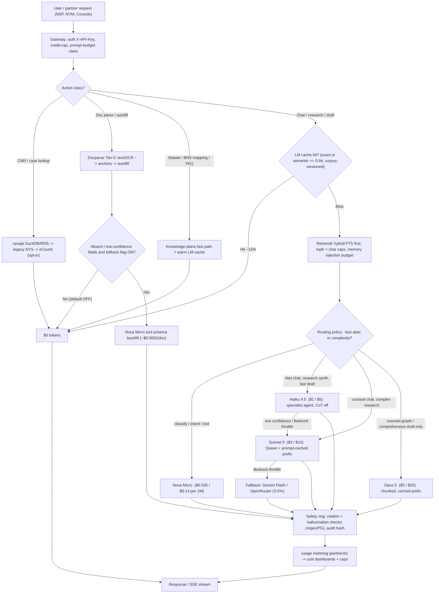

# NYV Deployment & Cost Plan — ~20,000 Users (target ≈85% LLM/infra cost reduction)

> **Scope:** NYV (`nyayavigya-platform-312/`) with its NYS dependency (caselaw worker, separate EC2). Classification: **NYV + NYS read-only dependency**.
> **Date:** 2026-09-30 · **Status:** PLAN (no infra change, no deploy, no key touched — NV-DEMO-SESSION-001 respected)
> **Region:** AWS **ap-south-1 (Mumbai)** · **FX planning rate:** ₹88 / USD (assumption; move it and every INR figure moves linearly)
> **Evidence class:** this is a **cost model, not a measurement.** Architecture facts were read from source and repo docs; **no live billing or probe was run** to produce these numbers. Every unit price is a *list-price estimate* and every hit-rate is an *assumption* (NV-EXECUTE-BEFORE-CLAIM-001). §8 turns the assumptions into Phase-0 measurements with go/no-go thresholds.
> **Supersedes nothing.** Complements the 10K-user reference in `Nyayavigya Documents 5.0.0-ShareReady-2026-08/13-Cloud-Cost-Reference.md` and `PRODUCTION-DEPLOYMENT-PLAN-NYAYASIDDHI-COM-2026-09.md` (both under repo-root `documents/working/`).

---

## 1. Executive summary

### 1.1 Target monthly OPEX (steady state, 20K registered users)

| Scenario | LLM (Bedrock + fallback) | Infra (AWS ex-LLM) | Contingency 15% | **Total USD / month** | **Total INR / month** |
|---|---:|---:|---:|---:|---:|
| **Optimistic** (cache 22%, Queen share 5%) | $11.0K | $2.6K | $2.0K | **≈ $15.6K** | ≈ ₹13.7 L |
| **Planning point (central)** | **$12.9K** | **$3.2K** | $2.4K | **≈ $18.5K** | **≈ ₹16.3 L** |
| **Pessimistic** (cache 5%, Queen share ×2, outputs +25%) | $20.2K | $4.5K | $3.7K | **≈ $28.4K** | ≈ ₹25.0 L |

**Budget band to commit: $15K–$29K / month (₹13–26 lakh); plan on ≈ $18.5K (≈ ₹16.3 L).**
That is ≈ **$0.93 per registered user / month (≈ ₹81)**, ≈ $1.54 per monthly-active user.

### 1.2 The 85% thesis — baseline vs optimized

| | **Naive baseline** | **Optimized (this plan)** |
|---|---|---|
| Definition | *Every* user action (incl. CNR lookups, statute mapping, doc parse, classification) goes to a frontier LLM through the full Queen path; single tier (Sonnet 5; Opus 5 for drafts); ~12K input / 2.5K output per call; no cache; no retrieval/memory caps; 2-tier-plus infra sized like the 10K "Medium" reference | Deterministic-first (docparse, CNR, statute fast path, hybrid FTS) → cache → cheapest *adequate* model tier; Queen only for counsel-grade work; prompt-cached system prefixes; capped RAG/memory; right-sized 2-tier infra |
| LLM / month | **≈ $122.5K** (1.56M actions) | **≈ $12.9K** (only ≈ 55% of actions ever reach a model; ≈ 6% reach Queen) |
| Infra / month | ≈ $13K (reference Medium, scaled) | ≈ $3.2K |
| **Total (with 15% contingency)** | **≈ $156K** (₹1.37 Cr) | **≈ $18.5K** (₹16.3 L) |
| **Reduction** | — | **LLM 89.5% · infra ≈ 75% · total ≈ 88%** (central) |

**Honest sensitivity:** the LLM reduction is **≥ 85% at the planning point (89.5%)**, **83.5% in the pessimistic case**, and **≈ 78% in a severe case where Queen-depth work reaches ≈ 19% of all actions** (§4.5). The single assumption that decides whether 85% holds is **how much traffic is allowed onto the Queen/counsel path** — it is a *product-routing* policy (interactive UI on `-fast` aliases), not a purely technical lever.

The levers that carry the $109.6K LLM saving at the planning point (approximate, overlapping — not additive to the dollar): (1) **do not call an LLM at all** for CNR / statute / docparse / deterministic misc (≈ 38% of actions, ≈ $44K of baseline spend removed), (2) **LM-cache hits** on chat and research (≈ 6.5% of actions, ≈ $6K), (3) **tier-down + output-token discipline + capped retrieval/memory** for everything that still reaches a model — Sonnet/Opus → Haiku 4.5 / Nova Micro, 12K → 3–9K input, SLA-capped output (≈ $60K), (4) **Bedrock prompt caching** on the Queen/draft prefixes (a few $K, inside item 3). Zero-token paths in total serve ≈ 45% of actions (items 1+2).

---

## 2. Architecture snapshot (what already exists — cost-relevant view)

| Layer | What it is | Cost relevance | Source |
|---|---|---|---|
| **Gateway** | Express/TSX on port 5000, Node heap 1.5 GB / container 2 GB; Console nginx on :80; queue + PG job workers `on` | Compute is small; **latency of LLM streams, not CPU, dominates**. One EC2 today (nysdev) | `docker-compose.aws-dev.yml` |
| **Safety ring / router** | NV-ARCH-001 chain; NV-LLM-001: all LLM via `realLLMService.executeRequest → orchestrateLLM` (single choke point = single metering point) | One seam for cost caps, cache, routing, audit | `src/services/real-llm-service.ts`, `intelligent-router/llm-orchestrator.ts` |
| **Routing policy** | Bedrock-first; task-class leads; `-fast` SLA ladder Haiku 4.5 → Nova 2 Lite → Nova Pro → Gemini Flash; Nova Micro (APAC/global) in catalog at $0.035/$0.14 per 1M | Biggest lever; **also the biggest risk** (pro/enterprise ladders lead with Opus 5 — §9) | `src/config/nv-llm-routing-policy.ts`, `model-catalog.ts` |
| **Agent mesh** | Queen + **164 agents** across 9 practice areas; specialist path (Queen OFF, CoT OFF) for `-fast`; `INTENT_CAPABILITY_MAP` (NV-MESH-001); adaptive router picks specialist vs Queen by complexity | Specialist routing removes multi-agent loops; Queen = 5–8× tokens | `src/orchestration/nv-queen-orchestrator.ts`, `nv-adaptive-router.ts`, `guardrails.md` §4 |
| **Docparse** | `packages/docparse` deterministic Indian legal doc parser (58 doc types, Tesseract 5 + Indic models, **no LLM in default path**); optional Nova Micro backfill `NYV_F_DOCPARSE_LLM_FALLBACK` (**OFF**; 12K-char input bound; never overwrites confidence ≥ 0.7) | Tier-0, zero tokens; CPU-only cost | `NYV-COMPREHENSIVE-TECHNICAL-PRODUCT-NOTES-2026-09.md` §5, `nv-docparse-llm-fallback.ts` |
| **Data — NYV** | RDS `nyv-dev-edge-pg` (PG16 + pgvector, `db.r7g.large`, Multi-AZ per PLATFORM-STATUS), ElastiCache Redis (Multi-AZ), S3 | OLTP, matter memory (RLS), rag_documents, metering | `PLATFORM-STATUS.md`, `nv-rag-live-service.ts` |
| **Data — NYS (separate EC2 `i-000115b19219bb766`)** | nysapi: **DuckDB `case_lookup_full` (~78M rows)** + RDS **`case_api_search`** (~57M staging rows) ; RDS `nyv-caselaw-pg` (`db.r6g.large`, 324 GB and growing; DC judgments 9.52M); Athena/S3 parquet; embed worker (~76.8% India semantic embed) | Zero-token CNR/caselaw/statute retrieval; **its own EC2 + RDS**, do not fold into NYV bill or DB | `NYV-NYS-CLOSURE-ARCHITECTURE-2026-09.md`, `DUAL-PROJECT-OPS-NYV-NYS-2026-07.md` |
| **Bedrock** | Bedrock-first (`NYV_BEDROCK_ENABLED=on`, `NYV_ROUTER_BEDROCK_FIRST=on`); embeddings Titan v2 (1024-d) → OpenAI/Gemini fallbacks (`nv-rag-live-service.ts`) | Pay-per-token; region pin decides compliance **and** ~10% price | `bedrock-request-builder.ts` |
| **Memory tiers** | L1 Redis session · L2 Postgres `nv_matter_memory` (FORCE RLS) · L3 recall policy · L4 graph/precedent · L5 ROMA store; injection capped by `nv-memory-injection-budget.ts` (whole items dropped, never sliced) | What is *not* sent to the LLM is the lever | `PLATFORM-STATUS.md` §C |
| **Caches** | LM cache hot/warm/cold (1K/5K/20K entries, 24 h absolute max-age, semantic serve ≥ 0.94, corpus-versioned keys); Redis-shared backend via `LMCACHE_SHARED_BACKEND=redis`; Bedrock prompt cache on system prefix (`NYV_PROMPT_CACHE`, default ON, ≥ 4,000 chars) ; agent-prompt cache | Repeat-question and prefix savings | `lm-cache-service.ts`, `bedrock-request-builder.ts` |
| **Metering / caps** | `sdk_usage_metering` (+ `metadata.partnerAi`), credit enforcer + `nv-credit-usage-recorder` (NV-CREDIT-UNIVERSAL-001), flush-delimiter fix NV-USAGE-METERING-FLUSH-001 | Required to *prove* the savings; caps are what stop a runaway key | tracker rows 2026-08-19, 2026-09-30 |

---

## 3. 20K-user assumptions

**Definitions.** *Registered* = 20,000. *MAU* = 60% = 12,000. *DAU* = 20% of registered = **4,000**. Working days/month = 26 → **104,000 user-days/month**. An *action* = one gateway call that a naive design would send to an LLM (chat turn, lookup, parse, classify, draft…). 15 actions per DAU per day → **1.56M actions/month**. (For scale: the 10K reference tier assumes 0.5M–2M *orchestrate* calls/month.)

| # | Action class | / DAU / day | / month | LLM path in **optimized** plan | LLM path in **baseline** |
|---|---|---:|---:|---|---|
| 1 | **Chat-fast** (`legal-chat-fast`) | 5.0 | 520,000 | Cache (15%) → else Haiku 4.5 specialist | Sonnet 5 via Queen |
| 2 | **Counsel** chat/research (Queen) | 0.8 | 83,200 | Sonnet 5 via Queen, prompt-cached prefix | Sonnet 5 via Queen |
| 3 | **Caselaw / statute research with synthesis** | 1.2 | 124,800 | Hybrid FTS retrieval (no LLM) → Haiku 4.5 synth (15% → Sonnet 5); 20% cache | Sonnet 5 |
| 4 | **Draft — fast** (`legal-draft-fast`, `doc-draft-fast`) | 0.4 | 41,600 | Haiku 4.5, SLA-capped output (4,096 medium) | Opus 5 |
| 5 | **Draft — counsel-grade** (`legal-draft`, agentic) | 0.1 | 10,400 | 60% Sonnet 5 / 40% Opus 5, chunked + prefix-cached | Opus 5 |
| 6 | **CNR / case lookup** | 2.5 | 260,000 | **Zero LLM** — nysapi (DuckDB/RDS) → legacy NYS → eCourts | Sonnet 5 |
| 7 | **Statute / BNS↔IPC mapping, FAQ** | 1.5 | 156,000 | **Zero LLM** (knowledge-plane fast path, LM-cache warm entries); 15% tiny Nova call | Sonnet 5 |
| 8 | **Doc parse / autofill** | 1.0 | 104,000 | **Docparse Tier-0**, zero tokens (Nova Micro backfill flag OFF) | Sonnet 5 |
| 9 | **Misc** (intent/classify, tool routing, autofill polish, memory ops) | 2.5 | 260,000 | 40% deterministic, 60% Nova Micro | Sonnet 5 |
| | **Total** | **15.0** | **1,560,000** | ≈ 55% reach any model; ≈ 6% reach Queen (path 2 + 5) | 100% frontier |

**Peak load (derived, so it is falsifiable in Phase 0):**

| Metric | Value | Basis |
|---|---:|---|
| Peak concurrent users | **400–500** (10–12% of DAU) | 10:00–19:00 IST working-hours skew; ref Medium tier 300–800 |
| Peak-hour actions | ≈ 9,000/h (15% of 60K/day) ≈ **2.5 req/s**; burst 3–4× ≈ **8–10 req/s** | 4,000 DAU × 15 |
| In-flight LLM calls at peak | **≈ 10–25** | ~55% of actions reach a model; Haiku ≈ 3.6 s, Queen 40–90 s |
| Open SSE streams at peak | ≈ 300–500 | 2 gateways × ~250 each (1.5 GB heap) |
| Peak Haiku tokens/min | ≈ **160K TPM**, ≈ 45 RPM | 2,600 chat calls/h × ~3.7K tokens |
| Bedrock quota ask | **≥ 500K TPM / 300 RPM** on the Haiku profile; ≥ 150K TPM on Sonnet/Opus profiles | 3× headroom; **quota lead time is a Phase-0 blocker** |

Volume assumptions are deliberately *behavioural* (a legal-practitioner mix skewed to lookups and chat). If NSP/NYM drive materially more drafting or counsel work per user, use the sensitivity table in §4.5.

---

## 4. Cost model

Unit prices (**estimates**): Bedrock on-demand per 1M tokens — Nova Micro $0.035 in / $0.14 out; Haiku 4.5 $1 / $5; Sonnet 5 $3 / $15; Opus 5 $5 / $25 (these four match `model-catalog.ts` `costInPer1M/costOutPer1M`; the older 10K reference doc uses higher Opus bands — *use the newer catalog, but re-verify with the AWS Pricing API before committing*). Prompt-cache: write 1.25×, read 0.1× (per `bedrock-request-builder.ts` comment). **Geo-pin premium +10%** applied to the whole LLM line for `apac.*` (data stays in APAC) vs `global.*` profiles (see §7).

### 4.1 CAPEX (one-time — deliberately minimal)

Everything is managed/serverless or already provisioned; **no Bedrock Provisioned Throughput, no reserved commitments up front, no new datacenter.**

| Item | USD one-time | INR | Note |
|---|---:|---:|---|
| Prod account cut-over: dual-run of old + new stack for ~2 weeks | $1,500–3,000 | ₹1.3–2.6 L | Reference Medium first-month infra is $4.5–8.5K; most of it already exists (RDS/Redis/ALB on `nyv-dev-edge-*`) |
| Load / soak test (k6 on spot) + Bedrock quota validation | $200–500 | ₹0.2–0.4 L | Phase-0 gate |
| Quota increases (Bedrock TPM/RPM, EC2, ElastiCache) | $0 | — | Free, but lead time 3–10 days |
| External security review + DPDP posture check (optional) | $3,000–8,000 | ₹2.6–7.0 L | Skippable for pilot; recommended before 5K→20K |
| ACM certs, Route 53 zone, WAF baseline rules | ≈ $0–100 | — | |
| Signing/PKI vendor onboarding | **not costed** | — | In-house e-sign is HMAC-only (§9); a DSC/Aadhaar-eSign provider would add per-signature fees |
| **Total** | **≈ $5K–12K** | **≈ ₹4.4–10.6 L** | ~70% optional. Internal engineering days are not costed |

Optional OPEX-reducing commitment: 1-yr no-upfront Compute Savings Plan / RDS & ElastiCache reserved nodes ≈ 20–30% off the ≈ $1.9K/month of steady compute+DB+cache — **defer until after Phase 2** (needs measured baseline).

### 4.2 OPEX — infra line items (monthly, **central**, ap-south-1 list-price estimates)

| Line | Sizing (start minimal) | USD / mo | Range |
|---|---|---:|---:|
| **EC2 — NYV gateway + console** | 2 × `m7g.xlarge` (4 vCPU/16 GB) behind ALB, gp3 EBS | 300 | 250–380 |
| **EC2 — docparse/OCR worker** | 1 × `c7g.xlarge`, flips `NYV_DOC_PROCESSOR_ENABLED=on` on this node only | 105 | 100–130 |
| **EC2 — NYS caselaw API** | 1 × `m7g.2xlarge` (existing `nyv-caselaw-worker` class) | 250 | 230–300 |
| **EC2 — NYS embed worker** | 1 × `m7g.xlarge`, off-peak / Spot-eligible | 100 | 50–125 |
| **EBS + snapshots (EC2)** | ~800 GB gp3 | 65 | 50–90 |
| **RDS — NYV OLTP** | `db.r7g.large` **Multi-AZ**, 250 GB gp3 | 500 | 450–650 |
| **RDS — NYS caselaw** | `db.r6g.large` single-AZ, ~1 TB gp3 (Multi-AZ = +$330) | 330 | 300–700 |
| **ElastiCache Redis** | start 2 × `cache.t4g.medium` Multi-AZ; upgrade to `cache.r7g.large` ×2 on trigger | 200 | 110–300 |
| **ALB (2) + WAF + Route 53** | public + admin split; rate-limit rules | 90 | 70–140 |
| **S3** (user docs, artifacts, corpus increments) | ~1.5–3 TB Standard/IA + requests | 150 | 100–250 |
| **Network** (egress ~1 TB, Bedrock/S3 VPC endpoints, NAT, cross-AZ, HC-bucket cross-region reads) | | 300 | 200–500 |
| **Observability** (CloudWatch logs ~200 GB/mo, metrics, alarms) | sample debug logs; Loki optional | 250 | 150–400 |
| **Backup** (RDS snapshots beyond free tier, AWS Backup for EBS) | 7-day PITR retained | 150 | 100–250 |
| **Secrets / KMS / SSM** | | 60 | 40–100 |
| **Corpus embeddings (incremental, user-independent)** | Titan v2 at ≈ $0.02/M tokens is tiny; cost is mostly the embed worker above | 300 | 150–800 |
| **Infra subtotal** | | **≈ $3,150 → $3.2K** | **$2.6K–4.5K** |

Not included: AWS Support plan (Business ≈ 10%/7% of spend, ≈ $1.4K at this size — decide at go-live), Sarvam/Indic vendor spend (NYM ≈ 3% of traffic, ≈ $150–700), Textract fallback for handwritten scans ($1.5 per 1K pages, opt-in).

### 4.3 OPEX — LLM line, **optimized** (central)

Per-call cost = tokens × price; prompt-cache read at 0.1×, write at 1.25× (15% of cached tokens assumed to be write/miss).

| Path | Calls / mo | Tokens per call (in / out) | Model | $/call | $/month |
|---|---:|---|---|---:|---:|
| Chat-fast (after 15% LM-cache hit) | 442,000 | 3.0K / 0.7K (task budget: chat ≤ 2.5K prompt + memory/RAG) | Haiku 4.5 | 0.0065 | **2,873** |
| Counsel chat/research (Queen) | 83,200 | 9K (55% cached prefix) / 2K + Queen overhead | Sonnet 5 | 0.0494 | **4,112** |
| Caselaw/statute synth (20% cache; 85% Haiku / 15% Sonnet) | 99,840 | 4K/0.9K · 8K/1.8K | Haiku 4.5 / Sonnet 5 | 0.0085 / 0.051 | **1,485** |
| Draft — fast | 41,600 | 3.5K / 3.0K (SLA cap 4,096) | Haiku 4.5 | 0.0185 | **770** |
| Draft — counsel-grade | 10,400 | 12K (7K cached) / 6K | 60% Sonnet 5 · 40% Opus 5 | 0.111 / 0.185 | **1,463** |
| Maker-checker / citation LLM verify (counsel path only, flag-gated) | — | — | Haiku 4.5 | — | 600 |
| Classification / intent / tool routing / statute-tiny | ~180K | 1K / 0.2K | Nova Micro | ≈ 0.00006 | 100 |
| Fallback (Bedrock throttle → Gemini Flash / OpenRouter), 3–5% of spend | — | — | Gemini 3.7 Flash etc. | — | 300 |
| Docparse Nova Micro backfill (flag OFF; if ON for 8% partial docs) | 8,300 | 3K / 0.5K | Nova Micro | 0.000175 | ≈ 1.5 |
| Query embeddings (RAG) | ~500K | ~200 tok | Titan v2 | — | ≈ 2 |
| **Subtotal** | | | | | **≈ $11.7K** |
| **× 1.10 geo-pin premium (apac.* profiles)** | | | | | **≈ $12.9K** |

### 4.4 Baseline vs optimized — scenario table

| | Baseline | Optimized (central) | Δ |
|---|---:|---:|---:|
| Actions reaching an LLM | 1,560,000 (100%) | ≈ 856,000 (55%) | −45% of calls |
| Avg input tokens per LLM-bound call | 12,000 | ≈ 3–9K by class | −50–75% |
| Avg output tokens per call | 2,500 | 700–3,000 by class | −20–70% |
| Model $/M (blended in/out) | Sonnet 5 $3/$15 (Opus $5/$25 drafts) | Nova Micro / Haiku dominant | −60–95% by class |
| Baseline math | 1.508M × ($0.036 in + $0.0375 out) = **$110.8K** + 52K drafts × $0.225 (Opus 5) = **$11.7K** | | |
| **LLM $ / month** | **$122.5K** | **$12.9K** | **−89.5%** |
| Infra $ / month | $13K | $3.2K | −75% |
| **Total incl. 15% contingency** | **$156K** | **$18.5K** | **−88%** |

Cross-check against the repo's own 10K reference: its *unoptimized* Medium mix (62% Queen/complex, 1M orchestrate) is $74–89K LLM; scaled to this plan's 1.56M actions that is ≈ $115–139K — the $122.5K baseline sits inside it. The reference's *optimized* $52K LLM at 10K users still assumes half of orchestrate traffic on Sonnet Queen; this plan's larger cut comes almost entirely from **reclassifying ~45% of actions as zero-token, tiering the rest down, and holding Queen to ~6%**, which the reference did not assume.

### 4.5 Sensitivity — where 85% breaks

| Case | Chat cache hit | Queen (counsel) volume | Output tokens | LLM $/mo | LLM reduction vs $122.5K |
|---|---:|---:|---:|---:|---:|
| Optimistic | 22% | ×0.8 (≈ 5%) | ×0.9 | $11.0K | 91% |
| **Central** | 15% | ×1 (≈ 6%) | ×1 | **$12.9K** | **89.5%** |
| Pessimistic | 5% | ×2 (≈ 11%) | ×1.25 | $20.2K | 83.5% |
| Severe (policy failure) | 5% | ×3.2 (≈ 19%) | ×1.25 | $26.4K | 78% |

Rules of thumb: each +1 percentage point of *all* actions moved from `-fast` (Haiku) to Queen adds ≈ **$640/month**. Cache hit-rate is a second-order lever (10 pp ≈ $340/month on chat). **Queen share and output length are the two levers to watch.** If pessimistic materialises, the fix is tiering *policy* (§5.4), not more infra.

---

## 5. Optimization playbook (mapped to existing code)

Legend: **EXISTS** = present in source (read, not executed here) · **CONFIG** = exists but needs a prod setting/policy · **BUILD** = not present; would need new work.

### 5.1 Tier-0 — docparse and deterministic paths (zero tokens)

| Lever | Status | Where | Effect |
|---|---|---|---|
| Docparse-first: text layer/OCR → classify → anchors/grammar/tables → autofill, `lowConfidence/conflicts/absent` states | EXISTS | `packages/docparse`, `nv-docparse-adapter-service.ts`, `nv-docparse-ingest-helper.ts` | 104K parses/mo at $0 tokens; only OCR CPU |
| Keep Nova Micro backfill **OFF** until Phase 2 eval shows recall gain worth ≈ $2/mo | CONFIG (`NYV_F_DOCPARSE_LLM_FALLBACK` absent = OFF on nysdev) | `nv-docparse-llm-fallback.ts`; spike script `scripts/nv-eval-nova-micro-docparse-spike.mjs` | Fail-soft, 12K-char bound, never overwrites ≥ 0.7 |
| CNR resolve cascade: nysapi (DuckDB/RDS) → legacy NYS Athena/RDS/S3 → eCourts (opt-in) | EXISTS | `nv-cnr-unified-cascade.ts`, `nv-case-api-adapter.ts` | 260K lookups/mo at $0 tokens (TSWL 380 ms, RJHC 3.1 s in PLATFORM-STATUS) |
| Statute/BNS↔IPC mapping and FAQ answered from knowledge plane / warm LM-cache entries | EXISTS | knowledge plane (statute fast path); `LEGAL_WARM_ENTRIES` in `lm-cache-service.ts` (statute FAQ 63 ms zero-token in probe) | 156K/mo at ≈ $0 |
| Hallucination check + citation verify are regex + Postgres (no spend) | EXISTS | `nv-orchestration-services.ts`; NV-CREDIT-UNIVERSAL-001 audit | Safety ring adds latency, not tokens |

### 5.2 RAG — hybrid FTS first, embedding cache, count caps

| Lever | Status | Notes |
|---|---|---|
| **FTS before vector**: default caselaw mode `fts`; `hybrid` only when needed (hybrid 0.5–3.5 s normally, stalled to 48 s under embed load — `docker-compose.aws-dev.yml` comments) | CONFIG | Keep `fts` default for `-fast`; hybrid for `caselaw-research` |
| **topK caps**: Auto-RAG `topK` (RRF merge sliced to `topK`), partner RAG floor topK 16 only on Queen; `-fast` skips partner RAG floor; doc-less drafts skip vector RAG (NV-FAST-DRAFT-NORAG-001) | EXISTS | `nv-auto-rag-router.ts`, `nv-agent-retrieval-policy.ts` |
| **Chunk/char caps**: `ragChunkCharCap` / `ragTotalCharCap` / `memoryCharCap` in `nv-context-budgets`; task-class prompt ceilings `micro_faq 600 · classify 1.2K · chat 2.5K …` | EXISTS | `src/config/nv-prompt-budget.ts` (measured origin: 19-token question reached provider as 5.0–5.4K tokens) |
| **Embedding cache**: query embeddings via Titan v2 ≈ $2/mo — cost is negligible; the real saving is *latency*. Keep `NYV_EMBEDDING_PROVIDER=bedrock` so OpenAI/Gemini fallbacks (extra vendor + egress) are not on the hot path | CONFIG | `nv-rag-live-service.ts`, `nv-embedding-cascade.ts` |
| Keep `ragLlmReformulate` (`NYV_F_RAG_LLM_REFORMULATE`) and `ragNeuralRerank` (`NYV_F_RAG_NEURAL_RERANK`) **OFF** in cost-mode (each adds an LLM/model call per query) | CONFIG | `nv-feature-flags.ts` |
| Grounding order NYS → tenant RAG/KB → matter memory → LLM (never paste the corpus) | EXISTS | `nv-agent-retrieval-policy.ts`; DUAL-PROJECT-OPS |

### 5.3 Memory — what not to send

- L1/L2/L3 memory is *retrieved*, not appended: `nv-memory-injection-budget.ts` drops whole low-relevance items to fit `memoryCharCap × maxItems` (EXISTS). Target: memory ≤ 280–480 chars/item, ≤ N items per request; **memory never carries corpus text**, only user/matter facts.
- Long-term matter memory is Postgres (RLS); recall uses a generated `value_tsv` + GIN (NV-MEM-RECALL-INDEX-001 — code shipped, **DDL blocked on stale admin credential** per tracker 2026-08-17; confirm applied before scale).
- `enableMemory:true` bypasses LM cache (NV-MEM-CACHE-BYPASS-001) — a *deliberate* trade: memory-on chat pays full price. Default `enableMemory` **off** for stateless FAQ-style `-fast` chat, on for matter-bound sessions. This is why the plan assumes only 15% cache hit, not 40%.
- Session vs long-term: keep session context in Redis with TTL; summarise (Nova Micro) *at session close*, not per turn.

### 5.4 Token — routing policy, prompt caching, SLM

| Lever | Status | Detail |
|---|---|---|
| **Serve interactive UI on `-fast` aliases only** (`legal-chat-fast`, `legal-draft-fast`, `doc-draft-fast`); bare `legal-chat/legal-draft` = counsel-grade | EXISTS (contract with NSP) / CONFIG (enforce for all partners + Console) | `nv-partner-platform.ts`; `PLATFORM-STATUS.md` NSP task matrix: fast 3.6 s chat / 6.5 s draft vs Queen 40–94 s |
| **Cost-mode routing profile for prod**: cap Opus 5 to counsel drafts only; `pro/enterprise/superadmin` ladders currently *lead* with `BEDROCK_BEST_INTELLIGENCE` (Opus 5 first) | **BUILD/CONFIG** — new policy profile in `nv-llm-routing-policy.ts` (`TIER_BEDROCK_LEAD`, `ECOSYSTEM_LEGAL_LEADS`), gated by env; must clear `eval:quality-trend` | Without this the "severe" case in §4.5 is the *default* for pro/enterprise users |
| **Bedrock prompt caching** on system prefix (`cache_control: ephemeral`, ≥ 4,000 chars, default ON, `NYV_PROMPT_CACHE=0` escape) | EXISTS | Big on Queen/draft (1.2–8.6K-token agent prompts, Sonnet/Opus). **Small on lean Haiku chat**: prompts ≈ 3K tokens, and Haiku-class minimum cacheable checkpoint is higher than Sonnet's (**verify against current Bedrock docs**) — do not assume chat savings from it |
| **Nova Micro for classification / intent / tool routing / summarise-at-close** | CONFIG — model exists in catalog (APAC + global profile ids), used today only by docparse fallback | ≈ 180K calls/mo for ≈ $100; never for user-facing legal analysis (`legalQuality` 72 vs Haiku 88) |
| **SLA output caps**: `NYV_DRAFT_FAST_SLA` default ON → low 2,048 / medium 4,096 / comprehensive 6,144 tokens; task `maxOutputTokens` (chat 2,048…) — output enforcement is opt-in pending the 40-prompt legal eval | EXISTS / CONFIG | Output tokens cost 5× input; this is ≈ $9K of the saving |
| **LM cache** shared across gateways: `LMCACHE_SHARED_BACKEND=redis`; keep corpus version key (`NYV_LEGAL_CORPUS_VERSION`) bumped on statute change; 24 h max-age | EXISTS / CONFIG | With 2 gateways, an in-process cache halves hit-rate unless Redis-shared is enabled |
| Enable `NYV_F_LMCACHE_SEMANTIC_EMBED` only after Phase 1 measures near-miss band; serve ≥ 0.94 | CONFIG | Avoid serving wrong-statute answers |
| Prompt-cost **cap/credit** enforcement ON: disable `NYV_NSP_UNLIMITED` / `NYV_PARTNER_DEMO_UNLIMITED` in prod; keep credit recorder + cap middleware | CONFIG | Dev compose sets both `=1` (bypass). The 2026-08-19 credit audit estimated exposure of ≈ $4,750/day for one uncapped `pro` key at 60 rpm — one runaway key can exceed the whole monthly plan in a week |

### 5.5 Domain agents reduce loops

- 164 agents / 9 practice areas + `INTENT_CAPABILITY_MAP` + `analyzePrompt` hints (NV-MESH-001; `npm run guardrail:intent-mesh`) let `-fast` requests bind **one named specialist** (e.g. A-047 case-law research, A-051 statute retrieval, A-001 drafting) with CoT forced OFF — vs Queen decomposition into multi-agent fan-out + maker-checker.
- `documentType → agent pin` (`nv-document-type-agent-pin.ts`) avoids router deliberation for 20 draft types.
- Adaptive router (`nv-adaptive-router.ts`, EMA path stats) escalates to Queen only for complexity: **keep the escalation threshold and JRX "selective orchestration" (`nv-partner-platform.ts`) unchanged** — do not add "always Queen for partners" flags (`NYV_NSP_COUNSEL_QUEEN=1` is the default for *bare* counsel tasks only).
- Guard: the tracker shows a 19-token question once reached the provider as ~5K tokens because layers only appended. Budget-first assembly (`nv-prompt-budget.ts`) is the fix; add it to the Phase-0 dashboard as **tokens-in per class**.

### 5.6 Decision / system prompts — template + cache, no corpus re-send

- Layered system prompt (registry constitution + legal overlay) is a **stable prefix → cache it**; user turn and retrieved snippets are the variable suffix (already how `bedrock-request-builder.ts` orders blocks).
- Overlay depth `compact` for `micro_faq/classify/chat`; `full` only for research/drafting (`overlayDepth` in `nv-prompt-budget.ts`).
- `nv-cost-optimization-suite.ts` holds an *in-process* system-prompt Map cache and speculative/compression helpers — treat it as scaffolding; the authoritative levers are the router + Bedrock cache above (**do not build a parallel pipeline** — NV-NO-DUPLICATE-001).
- Draft chunking (`nv-draft-chunk-*`) re-uses the same cached prefix across chunks; do not re-send full corpus per chunk.

---

## 6. Deployment topology for 20K

### 6.1 Start minimal — 2-tier + worker (recommended day-1)

```
                       Route 53 / ACM / WAF
                              |
                    ALB  nyv-edge (public)          ALB (admin/internal)
                       /               \
       EC2 gateway A (m7g.xl)    EC2 gateway B (m7g.xl)     <- stateless; sessions/rate-limit/LM-cache in Redis
       gateway + console(nginx)  gateway + console
              |    \                 /    |
              |     \               /     +--> EC2 docparse worker (c7g.xl, OCR)      [same VPC, private]
              |      +-> ElastiCache Redis (Multi-AZ)  <- L1 session, LM cache (shared), ROMA, rate limits
              +-> RDS PG16 + pgvector  db.r7g.large Multi-AZ   <- OLTP, matter memory, metering, rag_documents
              |
              +-> VPC endpoints: Bedrock runtime (ap-south-1), S3
              +-> NYS caselaw EC2 (m7g.2xl) :8080 via ALB host rule  --> RDS nyv-caselaw-pg + DuckDB + S3/Athena
                       (embed worker on separate EC2; isolated from query path)
```

Notes: (1) the dev `docker-compose.aws-dev.yml` still defines `postgres` + `redis` containers — **prod must point at RDS/ElastiCache and not run them** (compose is dev-edge reconstruction, per its header); (2) 2 gateways require the Redis-shared LM cache and shared rate-limit/session state before the second node is added; (3) NYS stays a **separate EC2 + RDS** (NV boundary — DUAL-PROJECT-OPS); Auto-RAG deadline `NYV_AUTO_RAG_EXTRAS_DEADLINE_MS=8000` and NYS circuit breaker (`NYS_KNOWLEDGE_CB_FAILURES=12`, cooldown 10 s) stay pinned in compose; (4) the arm64 (`m7g`) choice needs an arm64 image build for gateway/docparse/Tesseract — if that is unwanted, `m6i.xlarge` costs ≈ +20%.

### 6.2 Scale-out triggers (do nothing until a trigger fires)

| Trigger (sustained ≥ 1 h at peak, or 3 days in a week) | Action | Added cost |
|---|---|---:|
| Gateway CPU > 60% or event-loop lag p95 > 100 ms or open SSE > 200/node | Add gateway node C (ASG min 2 → 3) | +$150/mo |
| RDS CPU > 55%, `db_pool` waits, or p95 query > 200 ms | Move to `db.r7g.xlarge` ; add **read replica** only if read/write ratio > 5:1 (analytics, Console, metering reads) | +$450 (class) / +$500 (replica) |
| Redis memory > 70% or `evicted_keys` > 0 | `cache.t4g.medium → cache.r7g.large` ×2 | +$100–190 |
| Job queue depth > 500 for 5 min, or OCR p95 > 20 s | **Queue worker split**: dedicated `NYV_QUEUE_WORKERS` node and 2nd docparse worker (`NYV_PG_JOB_WORKER`/`NYV_DOC_PROCESSOR_ENABLED` flipped per node) | +$105–210 |
| Bedrock `ThrottlingException` > 1% of calls, or fallback share > 8% | Raise quota first; then cross-profile fallback; **Provisioned Throughput only if measured steady-state usage makes it cheaper than on-demand** (large fixed commit — do not pre-buy) | quota $0 |
| NYS hybrid p95 > 4 s or FTS breaker opens | Move embed worker to own instance (already), `db.r6g.xlarge`, enable Multi-AZ | +$330–650 |
| Availability SLO contractually ≥ 99.9% | RDS NYS Multi-AZ; 3rd AZ gateway; WAF managed rules | +$400 |
| Sustained 3 months steady | Savings Plan / RIs on compute, RDS, ElastiCache | −20–30% of that slice |

Do **not** add Qdrant (`c7i.xlarge` ×2 in the 10K capacity BOM) at 20K: pgvector + FTS covers this volume; a vector DB is a fixed +$300–700/mo with no measured need.

---

## 7. Governance & compliance — cost implications

| Topic | Position | Cost effect |
|---|---|---|
| **DPDP / data residency** | Pin all *personal-data-bearing* inference to **ap-south-1 / APAC geo profiles** (`apac.*`, e.g. existing `apac.amazon.nova-micro-v1:0`); avoid `global.*` and `us.*` profiles for prod PII. Today nysdev sets `AWS_BEDROCK_REGION=us-east-1` and the cascade leads with `global.`/`us.` ids — **not DPDP-pinned** (§9) | ≈ **+10%** LLM (geo premium, modelled) ; **no** multi-region LLM egress line; no cross-region DR copy of PII |
| **NV-LLM-001 ring** | Single choke point = single metering and audit point; no direct provider SDK calls outside whitelist | Cost caps and cache work in one place; no shadow spend |
| **Audit hash chain** | `nv-audit-hash.ts` / chain-lock; hash-chained docparse governance events | Postgres write cost only; keep prompts out of audit (hash, not body) |
| **Secrets on EC2, never in prompts** | `/opt/Nyayavigya/secrets/.env.production` on nysdev; SDK auth via Postgres hashed keys; **no key rotation in this plan** (NV-DEMO-SESSION-001, NV-NO-KEY-ROTATION-DEV-001) | $0; prod key generation requires a separate **GO** |
| **Partner BFF key model** | NSP/NYM hold `X-API-Key` (per-platform keys) server-side; browsers never see NYV keys; metering attributes to `platform` + `partnerAi` metadata | Allows per-partner cost caps and chargeback |
| **PII minimisation** | Party PII sparse by design in corpus; memory holds facts not documents; presign TTL 900 s for HC order PDFs | Fewer tokens; smaller breach blast radius |
| **Cross-region reads** | `nv-hc-order-presign.ts` lists owned HC bucket `ns-highcourt-data-bucket` in **us-east-1** (public-record court PDFs, not PII) | ≈ $0.02/GB inter-region + latency; mirror under ap-south-1 bucket to remove it |
| **SOC2** | Engagement pack exists (`SOC2-TYPE-II-ENGAGEMENT-PACK-2026-07.md`) | Not costed here (auditor fees separate) |

---

## 8. Phased rollout with cost checkpoints

| Phase | Users | Duration | Infra | Expected OPEX (central) | Exit gate (all must hold to advance) |
|---|---:|---|---|---:|---|
| **0 — Pilot / measure** | **500** (DAU ≈ 100) | 3–4 wks | Existing nysdev + RDS/Redis; **turn on cost-mode routing profile, caps ON (unlimited flags OFF), APAC profiles**; Bedrock quota requests filed | LLM ≈ $350–500 + infra ≈ $1.2–2.0K (existing) | (a) **measured $/action by class** within ±30% of §4.3; (b) real chat cache hit-rate ≥ 8%; (c) Queen share ≤ 8% of actions; (d) `eval:quality-trend` no regression from tier-down; (e) 7 clean days of usage-metering flush (post NV-USAGE-METERING-FLUSH-001) ; (f) zero `ThrottlingException` at 3× pilot peak in load test |
| **1 — Expand** | **5,000** (DAU ≈ 1,000) | 4–6 wks | Add gateway B, docparse worker split, Redis-shared LM cache, ALB/WAF split | LLM ≈ $3.2K + infra ≈ $2.5K → **≈ $6.5K** | Cost per DAU/day ≤ $0.18 (= $18.5K ÷ 4,000 ÷ 26); cache hit ≥ 12%; p95 `-fast` chat ≤ 6 s; embed worker isolation holds; DPDP posture review done |
| **2 — Scale** | **20,000** (DAU ≈ 4,000) | ongoing | §6.1 topology; scale triggers armed; Savings Plan decision at day 90 | **≈ $18.5K** (band $15–29K) | Monthly bill ≤ $29K (pessimistic ceiling) with ≥ 85% LLM reduction vs shadow-baseline calc; quality gate green; incident-free failover drill |

**Cost checkpoints** (automatic, weekly): (1) $/DAU/day by action class from `sdk_usage_metering`; (2) share of actions per tier (zero-LLM / Nova / Haiku / Sonnet / Opus); (3) cache hit-rate (LM cache + Bedrock `cache_read` tokens); (4) top-10 API keys by spend vs cap; (5) AWS Cost Explorer budget alarms at 60/80/100% of $18.5K plus a **daily** anomaly alert at 1.5× the trailing-7-day mean. **Kill-switch** if a phase exceeds 130% of its budget: force `NYV_LLM_*` cost-mode ladder (Haiku/Nova only) and the credit-cap ON path until root cause is found.

---

## 9. Risks & honest gaps

| # | Gap / risk | Evidence (read, not executed) | Effect on this plan | Action |
|---|---|---|---|---|
| 1 | **Bedrock region is not DPDP-pinned today** | `docker-compose.aws-dev.yml`: `AWS_BEDROCK_REGION=us-east-1`; cascade ids are `global.`/`us.` in `nv-llm-routing-policy.ts` | Compliance claim in §7 is a *target*, not current state; +10% modelled | Add prod profile with `apac.*` ids; **verify each model (Sonnet 5, Opus 5, Haiku 4.5, Nova) is actually offered via an APAC/ap-south-1 profile** — not verified here |
| 2 | **Cost caps bypassed in dev config** | Compose: `NYV_NSP_UNLIMITED=1`, `NYV_PARTNER_DEMO_UNLIMITED=1`; wallet gate `WIRED-FLAG-OFF` (`FEATURES-REGISTRY.md`); EDJ worker + 13 "aux" (STT/TTS/OCR/embeddings) surfaces uncapped per 2026-08-19 audit | One key can dwarf the monthly budget | Prod: flags OFF; add cap at EDJ enqueue and a cost-dimension budget for aux calls (**BUILD**) |
| 3 | **Default tier ladders are quality-first, not cost-first** | `TIER_BEDROCK_LEAD.pro/enterprise/superadmin` lead with Opus 5; `NYV_ECOSYSTEM_BEST_OUTCOME=1` | Reproduces the "severe" case for those tiers | Cost-mode policy profile (**BUILD/CONFIG**) validated by `eval:quality-trend` |
| 4 | **Prompt-cache benefit is uneven and invisible** | Cache marker only when system prompt ≥ 4,000 chars; `tokensIn` folds `cache_read`+`cache_creation` into input, so savings look like full-price tokens in reports | Model attributes cache savings mainly to Queen/draft; metering cannot yet *prove* them | Split `cache_read_tokens`/`cache_write_tokens` in usage metering (**BUILD**, small) |
| 5 | **Hit-rate assumptions unmeasured** | 15% chat / 20% research are assumptions; memory-on bypasses cache; LM cache in-process unless Redis-shared | ±$1K/mo | Phase-0 measurement (gate b) |
| 6 | **Metering flush was broken** | NV-USAGE-METERING-FLUSH-001 (`|` batch delimiter) fixed 2026-09-30; deployed 10:30Z per tracker | Historical usage rows under-count; cannot calibrate on old data | Calibrate only on data after 7 clean days |
| 7 | **Signing is HMAC-attestation only** | Tech notes §8/§9: no PKCS#7/PAdES/DSC/Aadhaar eSign; `legallyBindingClaim:false` | If a licensed signing provider is required, per-signature/vendor fees are **not in this plan** | Cost separately once provider chosen |
| 8 | **HC order PDFs need the mirror job + presign** | `nv_hc_order_s3_map` empty until caselaw-worker mirror (ops GO); some owned buckets in us-east-1 | Missing HC order URLs (functional gap) and small cross-region charge | Mirror under ap-south-1; not a cost driver |
| 9 | **Hybrid caselaw latency / breaker** | Compose notes: hybrid stalled to 48.8 s under embed load; breaker raised to 12 failures | Drives users to `fts` and retries (extra load); embed worker must stay isolated | Keep `fts` default for fast paths; separate embed EC2; hybrid p95 gate in Phase 1 |
| 10 | **Corpus-side numbers volatile** | RDS 324 GB → 1–2 TB plan; DuckDB 78M rows; embed ~76.8% | NYS RDS/S3 lines may grow 2×; embed backfill compute not user-driven | Track NYS storage monthly; keep separate budget line |
| 11 | **Unit prices are estimates** | Catalog `costInPer1M` values may differ from current AWS list (e.g. Nova 2 Lite: catalog $0.06/$0.24 — **verify**; this plan does not depend on it) | ±15% on LLM line | Refresh via AWS Pricing API before commit |
| 12 | **Quality vs cost** | Nova Micro `legalQuality` 72 vs Haiku 88; Sonnet/Opus ≈ 100 | Tier-down may hurt legal answers | Nova only for non-user-facing classification; every tier change must pass `npm run eval:quality-trend` |
| 13 | **Single-instance today** | nysdev hosts gateway+console; compose defines local PG/Redis | 2-node HA needs shared state, arm64 build, ALB health | Phase-1 work; cost is in §4.2 |
| 14 | **Bedrock quota lead time** | New/regional quotas are low by default | Blocks Phase 0 gate (f) | File quota requests in week 0 |

---

## 10. Request cost cascade (Mermaid)



Expected share of the 1.56M monthly actions per terminal node (central): zero-token ≈ 45% (lookups, parse, statute, deterministic misc, cache hits) · Nova Micro ≈ 11.5% · Haiku 4.5 ≈ 36% · Sonnet 5 ≈ 6.7% · Opus 5 ≈ 0.3%.

---

### Appendix — provenance and how to re-run

#### Appendix B — Phase-0 pilot harness (NV-PILOT-COST-METRICS-001)

After deploying **NV-LLM-COST-PROFILE-001** and **NV-USAGE-CACHE-SPLIT-001** on the target host (prod profile; not required on nysdev demo unless explicitly piloting):

1. Set on production gateway env (see `.env.production.example` commented block): `NYV_LLM_COST_PROFILE=cost-first`, `NYV_BEDROCK_REGION_ORDER=ap-south-1,us-east-1`, caps ON (no unlimited demo flags).
2. Apply migration `migrations/2026-09-30-sdk-usage-metering-cache-tokens.sql` (or `npm run db:push` after schema review).
3. From a machine with `DATABASE_URL` to the pilot RDS: `cd nyayavigya-platform-312 && npm run pilot:cost-metrics -- --days=7`
4. Interpret output against Phase-0 gates in §8: **cache read share of billable input ≥ 8%**, **Queen share of metered requests ≤ 8%**, plus top model mix from `nv_router_decisions`.

- Every model input above is in the `§3` and `§4.3` tables; recompute in a spreadsheet by changing `DAU`, `Queen share`, `cache hit`, `output multiplier`. The scripted calc used here reproduces: central $12.87K (89.5%), optimistic $11.0K (91%), pessimistic $20.2K (83.5%), severe $26.4K (78%).
- Files read for this plan: `guardrails.md`, `AGENTS.md`, `src/config/nv-llm-routing-policy.ts`, `intelligent-router/{model-catalog,bedrock-request-builder}.ts`, `cost-aware-router.ts`, `lm-cache-service.ts`, `nv-cost-optimization-suite.ts`, `nv-prompt-budget.ts`, `nv-memory-injection-budget.ts`, `nv-rag-live-service.ts`, `nv-docparse-llm-fallback.ts`, `nv-hc-order-presign.ts`, `docker-compose.aws-dev.yml`, `PLATFORM-STATUS.md`, `NYV-COMPREHENSIVE-TECHNICAL-PRODUCT-NOTES-2026-09.md`, `NYV-RDS-STATUS-AND-ADMIN-ASSESSMENT-2026-08-17.md`, `DUAL-PROJECT-OPS-NYV-NYS-2026-07.md` and the repo-root capacity/cost/deployment docs cited above.
- No secret values, keys, or SSM parameters were read or reproduced. No deploy, EC2, or env change was made.
