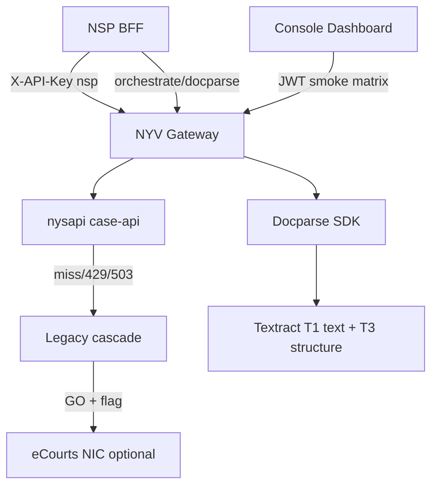

# NYV ↔ NSP ecosystem closure — architecture & phased GO (2026-10-16)

**Audience:** NYV + NSP engineering, ops, product  
**Scope:** Case search, docparse, AI task surface, Console dashboard truth  
**Rule:** Permanent closure = code + data + attestation + UI honesty (not feature flags alone).

---

## Phase 0 — Truth & probes (DONE in repo 2026-10-16T06:55Z)

| # | Deliverable | Evidence |
|---|-------------|----------|
| 0.1 | CNR **429 → legacy cascade** | `shouldFallbackToLegacyCnr` includes 429 + unit test |
| 0.2 | **`pageManifest`** in `docparseIntelligence` v1 | `@nyv/docparse-sdk@1.0.0-alpha.7` |
| 0.3 | Textract **structure parse** module (T3 foundation) | `nv-textract-structure-parse.ts` + unit test |
| 0.4 | Docparse **`GET …/docparse/health`** | `nv-docparse-sdk-routes.ts` (flags only) |
| 0.5 | Console **partner smoke SSoT** | `nv-partner-smoke-probes.ts`, Dashboard + SDK testing |
| 0.6 | SDK testing **POST CNR resolve** + docparse/JRX health | `sdk-testing-console.tsx` |
| 0.7 | Dashboard **platform count honesty** | No fake `6/6`; smoke on Dashboard for developers |
| 0.8 | Nav dedupe | Admin duplicate Operations Hub removed; `/sdlc` → dashboard |

**Run after deploy:** `npm run closure:matrix:local` (unit) · `npm run closure:matrix:ec2` (nysdev, no secrets).

---

## Phase 1 — Partner contract 100% (NYV + NSP, ~1–2 weeks)

### Case search

1. NSP BFF: **resolve-only intake**, `profile: caseCreate`, **56 keys**, BFF timeout 60–90s.
2. NYV: EC2 matrix — `nv-cnr-unified-cascade-probe-ec2.sh` + `nv-cnr-p1-max-resolve-probe-ec2.sh` on §4 CNRs from NYS API doc.
3. Ops/NYS: RDS watermark stable; HC order mirror pilot (`nv-hc-order-mirror-p1-ec2.sh`) — **data**, not gateway code.
4. Document **429** UX on NSP (backoff; NYV may return legacy enrich after cascade).

### Docparse

1. **Joint smoke** sign-off (4 scenarios) per `NYV-NSP-DOCPARSE-JOINT-SMOKE-2026-10-15.md`.
2. NSP: `runDocParseOrchestrator`, vision assist, attach bundle (NSP Pro).
3. NYV: Wire **Textract structure → candidates** behind `NYV_F_TEXTRACT_STRUCTURE` (T3 merge in `docparse-sdk` pipeline).

### AI surface

1. Keep **`nsp:ai:matrix:ec2`** + **`partner:smoke:ec2`** on every NYV deploy row in Project-Tracker.
2. Add docparse routes to NSP BFF playbook (`NSP-UNIFIED-DOCUMENT-INTELLIGENCE-2026-10.md`).

### Console

1. IronBee authenticated pass: sidebar → first API call per route (post-deploy).
2. Platform Registry limits tab + token metrics (backend already mounted).

---

## Phase 2 — Coverage & realtime fallback (GO-gated)

| Track | Requirement | Owner |
|-------|-------------|--------|
| Corpus depth | HC/DC ETL, Siddhanta merge, field availability | NYS ops |
| Tier 3 eCourts NIC | `NYV_F_ECOURTS_LIVE_FETCH` + key — **explicit GO** | Ops |
| Tier 4 portal | Legal review; not NSP default fallback | NYV + legal |
| Async Textract books | `StartDocumentAnalysis` + S3 for jobs > N pages | NYV |
| DPDP enforce | `NV_DPDPA_CONSENT_ENFORCE=1` when NSP ready | NYV ops |
| Placeholder enforce | `guardrail:no-placeholder --enforce` after stub triage | NYV |

**Honesty contract unchanged:** `claimEcourts: false` on corpus tiers until Tier 3 attested live.

---

## Architecture (single diagram)

---

## Definition of “100% closure”

| Pillar | NYV done when | NSP done when |
|--------|---------------|---------------|
| Case search | Matrix green on showcase CNRs; 429 cascade; docs §11–§22 | 56-field UI + caseCreate + PDF TTL |
| Docparse | pageManifest + health + legal gate + T3 flag path | Joint smoke signed + orchestrator wired |
| AI | Matrix 0 failures | Persist auditHash/qualityEnvelope on all calls |
| Dashboard | Smoke SSoT + no fake KPIs | N/A (NYV Console) |

**Deploy GO:** User must approve EC2 deploy separately (`NV-NO-KEY-ROTATION-DEV-001`).
