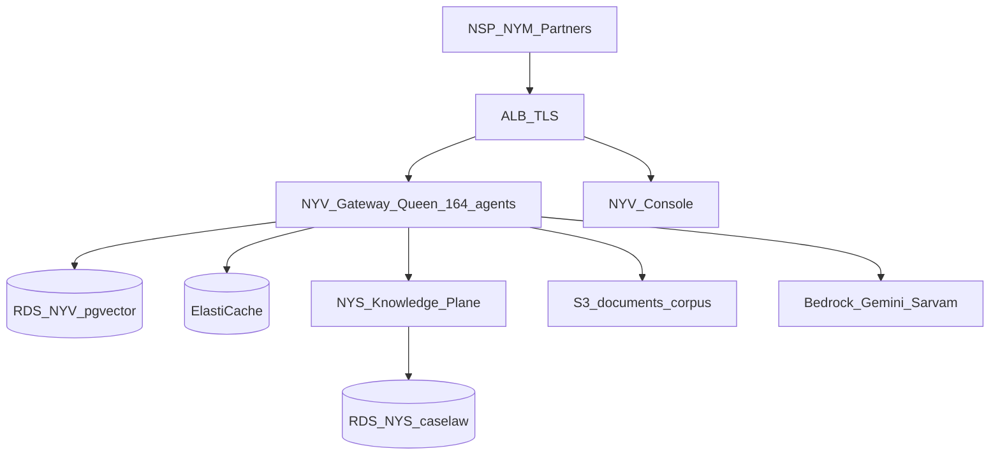

# Nyayavigya — AWS Production Deployment Guide

> **Updated:** 2026-09-03 UTC · Region **ap-south-1** (India primary)  
> **Legal ecosystem only.** Deploy needs explicit operator **GO**.  
> **Cost models:** [`13-Cloud-Cost-Reference.md`](./13-Cloud-Cost-Reference.md)  
> **Full prod cutover plan (nyayasiddhi.com):** [`../PRODUCTION-DEPLOYMENT-PLAN-NYAYASIDDHI-COM-2026-09.md`](../PRODUCTION-DEPLOYMENT-PLAN-NYAYASIDDHI-COM-2026-09.md)

---

## 1. Topology

| Tier | Component | Pilot posture | Production target |
|---|---|---|---|
| Compute NYV | Gateway + Console | Single/dual host | Dedicated instance(s) or ECS/EKS behind ALB |
| Compute NYS | Knowledge Plane API + embed workers | Separate host | Sized for corpus + embed throughput |
| OLTP | RDS PostgreSQL | Multi-AZ medium | Same or larger; PITR ON |
| Caselaw | RDS PostgreSQL (NYS) | Isolated instance | Scale storage/IOPS independently |
| NSP DB | Partner product DB | Separate instance | Never merge into NYV OLTP |
| Cache | ElastiCache Redis | Single or replica | Multi-AZ replication group |
| Edge | ALB + ACM + Route53 | HTTPS termination | WAF optional for public GA |
| Artifacts | S3 + ECR | SDK bucket + images | Immutable tags + rollback tags |

**Never deploy Nyayavigya Legal artifacts onto non-Legal product hosts.**



---

## 2. Deployment method

1. Build gateway + console locally or CI.  
2. Upload artifact to S3 (or push to ECR).  
3. Remote deploy command on target host (SSM, Ansible, or CI pipeline).  
4. Docker compose pull/up (or K8s rolling update).  
5. Verify health + partner smoke when GO includes it.  
6. Tag deploy in audit ledger; keep prior image `:rollback-YYYYMMDD` ~7 days.

Serialize deploys on the same host — overlapping deploys can fail.

---

## 3. Multi-cloud equivalents

| AWS | GCP | Azure |
|---|---|---|
| EC2 / ECS / EKS | Cloud Run / GKE | App Service / AKS |
| RDS PostgreSQL | Cloud SQL | Azure Database for PostgreSQL |
| ElastiCache | Memorystore | Azure Cache for Redis |
| ALB + ACM | Cloud LB + managed certs | App Gateway + Front Door |
| S3 | Cloud Storage | Blob Storage |
| Secrets Manager | Secret Manager | Key Vault |

Full CapEx/OpEx tables for all three clouds: **[13-Cloud-Cost-Reference.md](./13-Cloud-Cost-Reference.md)**

---

## 4. Production cutover checklist (paid GA)

| # | Gate | Posture |
|---|---|---|
| 1 | RDS Multi-AZ + automated backups | Required Medium+ |
| 2 | ElastiCache Multi-AZ + AUTH/TLS | Verify on cutover |
| 3 | RDS CA pin (`sslmode` verify) | Plan before paid GA |
| 4 | Full UAT / 10K readiness | UAT plan gate |
| 5 | SOC 2 evidence pack | Engagement — not Type II cert |
| 6 | Key rotation policy for **prod** only | Documented procedure |
| 7 | Partner freeze window | Orchestrate/SSE contracts |
| 8 | CNR honesty regression | `claimEcourts:false` |
| 9 | CloudWatch + SNS confirmed | Alarms provisioned |
| 10 | Capacity + cost plan signed | Docs **08** + **13-Cloud-Cost-Reference** |

---

## 5. Dual-product rule

| Tag | Tree | Deploy target |
|---|---|---|
| **NYV** | `nyayavigya-platform-312/` | Gateway + Console host(s) |
| **NYS** | nested `NYS-Agentic-AI/` | Knowledge Plane worker(s) |

Do not mix trees in one deploy.

---

## 6. Rollback

1. Retag previous gateway/console image.  
2. Compose up previous tag.  
3. Health + partner smoke.  
4. Tracker row `ROLLED-BACK` with evidence.

---

## 7. Post-deploy smoke (minimum)

```text
GET /api/nv/health          → 200, totalAgents=164, registry=5.1.0
GET / (console)             → 200
Partner orchestrate         → 200 (credentials in secret manager only)
```

---

## 8. Related

- **Production deployment plan (NYV + NYS, nyayasiddhi.com, 10K tier):** [`../PRODUCTION-DEPLOYMENT-PLAN-NYAYASIDDHI-COM-2026-09.md`](../PRODUCTION-DEPLOYMENT-PLAN-NYAYASIDDHI-COM-2026-09.md)  
- Capacity + SLOs: [`08-CAPACITY-PLANNING.md`](./08-CAPACITY-PLANNING.md)  
- Cost reference: [`13-Cloud-Cost-Reference.md`](./13-Cloud-Cost-Reference.md)  
- Config: [`05-CONFIGURATION-AND-SECRETS.md`](./05-CONFIGURATION-AND-SECRETS.md)
