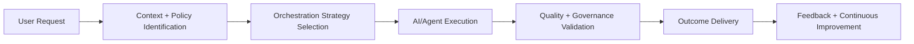
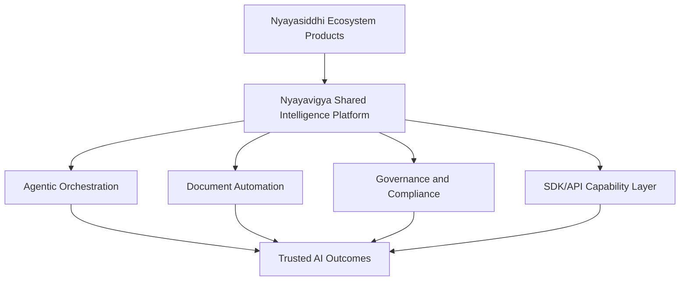

# Nyayavigya Platform 5.1.0 — Final Business and Product Reference

## 1. Product Vision

Nyayavigya is a governed agentic AI platform designed to deliver trusted, high-quality outcomes for complex workflows. It is the core intelligence backbone for Nyayasiddhi ecosystem products and is structured for multi-domain expansion beyond legal.

## 1.1 Update — 2026-07-31 (what sales / PM can claim)

| Claim | Posture |
|---|---|
| **Global-best agentic Legal AI OS (engineering)** | **Live** — W0–W4 + residuals on nysdev `2026-07-31T0424Z` |
| Multi-domain substrate (other verticals later) | **Ready** — registries/RAG/templates swap; Queen/SDK unchanged |
| India-first Legal AI OS (164 agents, BNS/BNSS discipline) | **Live** |
| Adaptive multi-agent Queen + specialist lean FAQ | **Live** |
| Streaming answers with safety-gated final text (provisional→gated) | **Live** — client-sdk 5.0.6 replace contract |
| Document automation (EDJ BullMQ) + India templates SDK | **Live** |
| Partner curated MCP (~125) | **Live** — do not sell full 556 catalog |
| Multimodal avatar / 3D / Chatdoll | **Flag-gated lab** — not GA |
| SOC2 Type II certified | **Not certified** — engagement pack only |
| Live DocuSign / iManage e-sign OAuth | **Not sold** — NYV-native HMAC e-sign live |
| 100% Indian caselaw semantic vectors | **Ops backfill** — search still works via FTS/hybrid |
| GRPO continuous weight training | **Preference export + online EMA live**; weight trainer pending |

## 2. Strategic Positioning

Nyayavigya is positioned as:

- an orchestration-first AI operating substrate
- a reusable ecosystem intelligence layer
- a compliance-forward platform for sensitive and regulated use cases
- a unified stack combining AI, automation, workflow, and governance

## 3. Why This Platform Exists

Organizations need more than a chatbot. They need:

- reliable multi-step execution
- policy and review controls
- context-rich outputs
- auditable decision paths
- reusable SDK integration across products

Nyayavigya addresses all of these in one platform.

## 4. Product Pillars

1. Agentic orchestration and coordination
2. Multi-model intelligence with controlled routing
3. Context depth through retrieval and memory
4. Document automation and workflow acceleration
5. Governance and compliance by default
6. Ecosystem-grade API and SDK enablement

## 5. Value Proposition by Stakeholder

### Product teams

- launch AI features faster on shared platform capabilities
- avoid rebuilding orchestration/governance components
- standardize user journeys across products

### Business teams

- faster time-to-market for new AI use cases
- lower marginal feature-delivery cost
- stronger enterprise trust posture

### Operations and compliance teams

- better control over high-stakes workflows
- improved auditability and policy adherence
- reusable governance controls across business units

### Leadership and investors

- platform leverage across multiple product lines
- reusable capability inventory (500+)
- stronger moat through architecture, workflow depth, and governance

## 6. Product Capability Landscape (500+ framing)

Nyayavigya capability inventory spans:

- orchestration and workflow capabilities
- topology and pattern combinations
- intelligence and response-quality capabilities
- document AI and automation capabilities
- governance/compliance controls
- ecosystem SDK/API capabilities
- tool catalog capabilities (500+ MCP entries)

## 7. User Journey Model

### 7.1 Generic journey

1. User request submission
2. Context and intent resolution
3. Capability and workflow selection
4. Guided AI execution
5. Policy and quality checks
6. Response delivery
7. Trace and audit continuity

### 7.2 Agentic journey (business view)

## 8. Core Workflow Families

### 8.1 Advisory and response workflows

- guided Q&A
- structured drafting
- reasoning-rich analysis
- multi-step recommendation synthesis

### 8.2 Document workflows

- ingestion and extraction
- OCR/parsing
- summarization and drafting
- intelligence and compliance analysis
- workflow-ready output generation

### 8.3 Governance workflows

- policy-aware execution checks
- review/escalation pathways
- decision trace and audit continuity
- regulated-flow controls

## 9. Ecosystem Product Leverage

Nyayavigya powers ecosystem platforms through shared capabilities. Each platform can consume common intelligence, automation, and governance services through stable API/SDK contracts.

Benefits:

- faster integration cycles
- capability reuse across products
- consistent quality and trust posture
- reduced fragmentation of AI behavior

## 10. Business Use Cases

Representative use-case families:

- legal and policy assistance
- contract and compliance operations
- risk review and governance workflows
- enterprise and institutional copilots
- multilingual assistance flows
- document-intensive process automation

## 11. Competitive Differentiators

Nyayavigya differentiates through:

- agentic orchestration over one-shot generation
- workflow-aware and role-aware outcomes
- governance and compliance built into execution
- ecosystem-first architecture with SDK reuse
- broad capability footprint with structured expansion model

## 12. Business Architecture (non-code view)

## 13. Investment and Scale Narrative

### 13.1 Investment thesis

Nyayavigya is a reusable platform asset, not a single-feature product. Its leverage increases as more products adopt the same orchestration, governance, and capability substrate.

### 13.2 Strategic advantages for investment

- Platform reuse economics across multiple products
- Durable moat through workflow depth and governance controls
- Expandable architecture for additional domains
- Capability compounding through shared tooling and integrations

### 13.3 Growth mechanics

- More products using shared SDK/API capabilities
- More workflows mapped to standardized orchestration patterns
- More document and automation pathways integrated
- More enterprise use-cases activated on the same base platform

## 14. Operating Priorities (Current)

- finalize full end-to-end UAT sign-off across role journeys
- close remaining staged feature pathways
- complete documentation harmonization to v5.1.0 truth
- continue ecosystem integration hardening and feature leverage

## 15. Expansion Model

Nyayavigya’s architecture supports expansion by:

- substituting domain registries
- introducing domain policy packs
- adapting corpus and workflow templates
- preserving the same orchestration-governance core

This enables multi-domain scale without rebuilding platform fundamentals.
